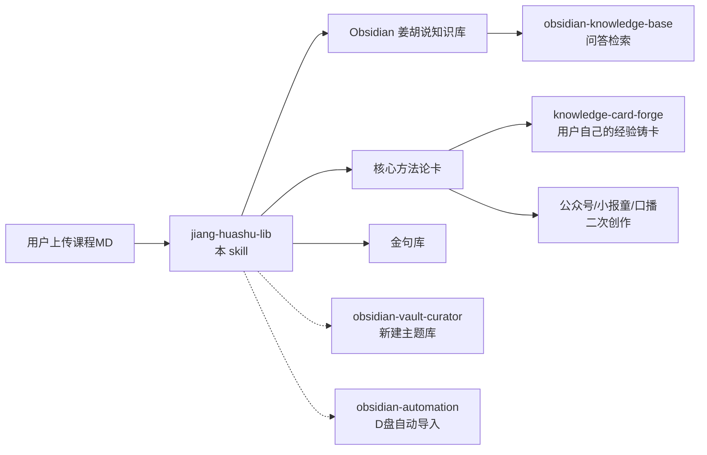

# 姜胡说课程库流水线 v1

> **一句话定位**：姜胡说（胡子哥）课程/答疑 MD → **归档 + 提炼方法论卡 + 金句入库 + 索引同步** → 一句话跑完全流程。

---

## 一句话定位

**输入（一份课程/答疑 MD）→ 5 步流水线（识别/归档/提炼/金句/同步）→ Obsidian `姜胡说知识库/` 完整入库。**

---

## 核心原则（4 条）

1. **原文一字不改** —— 原始转录是金矿，只加 frontmatter，不动正文
2. **提炼要有方法论密度** —— 不是复述章节，是提炼「可复用的判断规则」
3. **每张卡必须能回溯** —— `sources` 指回具体实录页
4. **索引同步不能漏** —— vault SCHEMA 强制：index.md + log.md

---

## 铁律（5 条，硬门禁）

| # | 铁律 | 违反的表现 |
|---|------|-----------|
| 1 | **不改正文** | 删了「智能总结」「章节概要」「金句精选」等索引段 |
| 2 | **不改原话** | 胡子哥原话被"润色"成书面语 |
| 3 | **不编数字** | 编造播放量/收入/人数 |
| 4 | **不越级提炼** | 章节概要里没有的方法论不要硬造 |
| 5 | **不入错库** | 胡子哥原始素材 ≠ 我的二次创作 |

---

## 一、5 步流水线

```
① 识别（线上课/线下答疑 + 日期 + 主题）
        ↓
② 归档到 姜胡说知识库/线下答疑|线上课程/YYYY-MM-DD-主题-姜胡说.md
        ↓
③ 提炼 3-8 张核心方法论卡 → 核心方法论/
        ↓
④ 金句入库（去重 + 按 6 主题分类）→ 金句库/
        ↓
⑤ 同步 index.md + log.md
```

---

## 二、Step ① 识别（3 分钟）

### 判别线上课 vs 线下答疑

| 特征 | 判定 | 归档目录 |
|---|---|---|
| 有「线下」「闭门会」「见面」「现场」 | 线下 | `线下答疑/` |
| 有「直播」「线上课」「第 N 讲」「训练营」 | 线上 | `线上课程/` |
| 有「得到大脑」转录 + 「录音时间/时长/参与人数」 | 线下答疑（默认）| `线下答疑/` |
| 有多天主题（Day1/Day2/Day3）| 线下闭门会 | `线下答疑/` |

**判不出来 → 默认 `线下答疑/`，并在 frontmatter 标 `source: 待确认`**

### 提取元数据（用脚本，别手动数）

```bash
python3 -c "
import re
s=open('<file>',encoding='utf-8').read()
print('章节:', len(re.findall(r'^\[[0-9]{2}:[0-9]{2}:[0-9]{2}\]', s, re.M)))
print('金句:', len(re.findall(r'^- “', s, re.M)))
print('天数:', len(re.findall(r'^# .*第[一二三]天', s, re.M)))
"
```

### 日期判定优先级

1. frontmatter 的 `date:` / `recorded:`
2. 正文标题里的日期（「2026-11-11」「2026年11月11日」）
3. 文档名里的日期
4. 都没有 → 用上传日期，但标 `recorded: 待确认`

---

## 三、Step ② 归档

### 目录规范

```
/mnt/d/Obsidian/llm-wiki/姜胡说知识库/
├── README.md              ← 已有，不要覆盖
├── 线下答疑/              ← 线下分享 / 闭门会 / 社群答疑
├── 线上课程/              ← 线上课
├── 核心方法论/            ← 提炼的概念卡
├── 金句库/                ← 金句索引
└── 图片和附件/            ← 实录引用的图片（按实录分目录）
```

### 文件命名

```
YYYY-MM-DD-主题关键词-姜胡说.md
```

- 日期 = **课程实际发生日期**（不是入库日期）
- 主题关键词 ≤ 20 字，中文
- 一律 `-姜胡说.md` 结尾

### frontmatter 模板

```yaml
---
title: "课程/答疑标题"
type: jiang-huashu-transcript
status: raw              # raw=原始转录 | distilled=已提炼过
created: YYYY-MM-DD      # 入库日期
updated: YYYY-MM-DD
recorded: YYYY-MM-DD     # 课程实际日期
recorded_end: YYYY-MM-DD # 多天时填
source: 得到大脑 | 线下现场 | 线上直播
author: 姜胡说（胡子哥）
duration: 约 XX 分钟
participants: 约 N 人
days: 3
parts_count: 27
knowledge_points: 113
quotes_count: 18
todos_count: 6
images_total: 2
images_resolved: 2
images_path: 图片和附件/
tags: [姜胡说, 胡子哥, 主题1, 主题2, ...]
audience: 一人公司新手 / 自媒体新手 / 社群老伙计
confidence: high
summary: "一句话简介（前 100 字）"
key_concepts:
  - "[[概念卡名1]]"
  - "[[概念卡名2]]"
source_file: "原始文件名.md"
related:
  - "[[huashu-flywheel]]"
  - "[[姜胡说知识库]]"
---
```

**关键**：正文**完全保留**，只替换原有 frontmatter。

---

## 四、Step ③ 提炼方法论卡

### 提炼标准（不是章节复述）

一张合格的卡必须回答：**「这条怎么变成可执行的判断规则？」**

| ❌ 不合格（章节复述）| ✅ 合格（方法论提炼）|
|---|---|
| 「本节讲了行为公式」| 「B = M × A × T，三样缺一行为为 0；要让用户做 X，先把三个变量各问一遍」|
| 「本节讲了简单原则」| 「地基不牢，装修华丽 = 塌得更快；学技法前先自测能不能对着一个人毫无表演讲 3 分钟」|

### 提炼来源优先级

1. **⭐ 胡子哥明确命名/公式化的**（如 B=M×A×T、1-2-4-8）→ 必提
2. **⭐ 有具体案例支撑的**（眉山果冻橙、村庄珠宝老伙计）→ 必提
3. **⭐ 被反复强调的**（在 ≥3 个章节出现）→ 必提
4. **有具体动作的**（可落地步骤）→ 优先
5. 纯理念/鼓励类 → **不建卡**（归金句库）

### 提炼数量

- **3-8 张**。少于 3 个说明课程内容薄；多于 8 个说明没提炼。
- 已有同名卡 → **更新**（合并新内容），不新建

### 卡片结构（标准）

```markdown
---
title: 概念名
type: concept
status: active
created: YYYY-MM-DD
updated: YYYY-MM-DD
tags: [姜胡说, 胡子哥, 主题, 关键词...]
audience: ai-agent + self
confidence: high
sources:
  - "[[实录文件名]]"
related:
  - "[[相关卡1]]"
  - "[[姜胡说知识库]]"
---

# 概念名

> **一句话**：……

---

## 原始定义（日期 + 章节）

胡子哥原话（blockquote 引用，逐字）

---

## 逻辑框架

（mermaid 流程图 或 代码块流程）

---

## 落地动作

（3-5 条可执行）

---

## 自检清单

- [ ] ……

---

## 相关

- 上游：[[……]]
- 库位置：[[姜胡说知识库]]

---

*提炼自：[[实录文件名]] 章节 XX · 创建于 YYYY-MM-DD*
```

**硬要求**：
- ✅ 必须有 `## 原始定义`（带原话引用）
- ✅ 必须有 `## 落地动作`（≥3 条）
- ✅ 必须有 mermaid 或代码块流程图（vault SCHEMA 强制图表用 mermaid）
- ✅ `sources` 指向具体实录页
- ❌ 不用「综上所述」「赋能」「闭环」等 AI 味词

### 命名规范

中文概念名，不用空格。文件名 = 标题。
已建立的：`知识产品化` `能力系统化` `免费起步保留退出权` `新人付费才算产品被确定` `土壤保护与筛选` `用时间衡量核心团队` `简单原则` `行为公式B等于MAT` `视频是状态的溢出` `真诚是地基技法是装修` `个人系统从用户问题到知识库` `故事化表达结构` `情绪表演与三幕剧`

---

## 五、Step ④ 金句入库

### 6 分类（固定）

| 分类 | 判据 |
|---|---|
| 🎯 战略洞见 | 关于方向/判断/取舍的 |
| 🛠 方法技巧 | 有具体做法/公式的 |
| ⚡ 执行策略 | 关于怎么推进/节奏的 |
| 💡 思考启发 | 引发反思/心态的 |
| 💛 情绪共鸣 | 情绪价值/鼓劲的 |

### 规则

1. **必须有出处**：`（2026-11-11 · 章节时间戳）`
2. **逐字引用** —— 不改一个字
3. **去重**：同一句在多课出现 → 合并成一条，标注多个出处
4. **泛用金句归最贴切分类**
5. 原文档已有「金句精选」段 → 直接搬运 + 补充章节概要里漏掉的

### 入库位置

`金句库/姜胡说金句库.md`（按分类表格追加，不重建文件）

---

## 六、Step ⑤ 索引同步（vault SCHEMA 强制）

### index.md

在「📚 姜胡说知识库」板块内：
1. 新增实录链接
2. 新增方法论卡链接
3. 更新 `**页面数：N | 最近更新：YYYY-MM-DD**`

### log.md

```markdown
### [YYYY-MM-DD] ingest | <动作简述>
- 实录归档: <路径>
  （源文件：<原名>）
  （<关键统计>）
- 提炼方法论卡 N 张: <卡片名列表>
- 方法论卡累计: N 张
- 金句库追加: N 句（累计 N 句）
- 索引同步: index.md <板块> 更新（页面数 X → Y）
```

---

## 七、图片处理

### 判断流程

```bash
# 1. 实录里引用了几张图
grep -c "^!\[" <实录.md>

# 2. 图片文件在不在
ls -la <附件目录>/

# 3. 引用路径能不能解析
python3 -c "
import re,os
md='<实录.md>'; base=os.path.dirname(md)
s=open(md,encoding='utf-8').read()
for m in re.finditer(r'^!\[([^\]]*)\]\(([^)]+)\)\$', s, re.M):
    p=os.path.join(base,m.group(2))
    print(('OK' if os.path.exists(p) else 'MISS'), m.group(2))
"
```

### 处理规则

| 情况 | 动作 |
|---|---|
| 图片已随 MD 一起上传 | 复制到 `图片和附件/`，更新 frontmatter `images_resolved` |
| 图片没传 | 建 `图片和附件/README.md` 写明「哪个文件、引用位置、怎么补」，frontmatter 标 `images_missing` |
| 图片是外链（会过期）| 保留 URL + 建议本地化（问用户是否下载）|

**图片目录位置**：`姜胡说知识库/线下答疑/图片和附件/`（与实录同级的 `图片和附件/` —— MD 里写的是相对路径 `图片和附件/xxx.jpg`）

---

## 八、触发词（用户说这些就跑流水线）

| 触发词 | 动作 |
|---|---|
| "放姜胡说知识库" | 完整 5 步 |
| "这是胡子哥的课" | 完整 5 步 |
| "归档姜胡说课程" | 完整 5 步 |
| "提取胡子哥的方法论" | 只跑 Step ③ |
| "胡子哥金句" | 只跑 Step ④（查 + 补）|
| "姜胡说知识库有什么" | 列全库 + 一句话摘要 |
| "姜胡说知识库入库" | 完整 5 步 |

---

## 九、检查点设计

| CP | 触发 | 确认 |
|---|---|---|
| **CP1** | 识别后 | 线上课还是线下答疑？日期对不对？ |
| **CP2** | 归档后 | 正文一字未改？frontmatter 完整？ |
| **CP3** | 提炼后 | 每张卡有原话 + 落地动作 + 回溯链接？数量在 3-8？ |
| **CP4** | 金句后 | 逐字？标出处？去重了？ |
| **CP5** | 同步后 | index.md + log.md 都更新了？ |

---

## 十、失败处理

| 失败场景 | Fallback |
|---|---|
| 判不出线上/线下 | 默认 `线下答疑/`，frontmatter 标 `source: 待确认` |
| 找不到日期 | 用上传日期 + `recorded: 待确认` |
| 提炼不出 3 个概念 | 少建卡也不硬造 —— **宁可 1-2 张真卡，不要 8 张废话卡** |
| 已有同名方法论卡 | 更新合并，不新建 |
| 图片引用指向不存在的目录 | 建目录 + README 说明补图方式 |
| vault 文件被 Obsidian 占用 | `sleep 1 && ls -la` 验证落盘 |
| `execute_code` 被沙箱拦截 | 改用 `terminal` + `python3 -c` |
| 用户上传的是自己的原创文章 | **不建卡**，建议走 `公众号文章/` 或 `小报童文稿/` |
| 课程内容与我已有认知冲突 | 两说并存，标 `contradictions`，不覆盖 |

---

## 十一、红灯边界

- 🚫 不改原文一个字（哪怕是错别字、重复口语）
- 🚫 不把胡子哥原话"翻译"成书面语 —— 引用要逐字
- 🚫 不编数字（播放量/收入/人数）
- 🚫 不把我的二次创作放进姜胡说库
- 🚫 不把课程摘要当方法论卡（要有可执行判断规则）
- 🚫 不为凑数硬造概念卡
- 🚫 不在没读原文的情况下凭记忆写卡

---

## 十二、实操流程图

```
用户上传 MD
   ↓
[CP1] 识别：线上/线下 + 日期 + 主题
   ├─ 不确定 → 默认线下答疑 + 标待确认
   ↓
[CP2] 归档：写 frontmatter + 原文照搬
   ├─ 图片 → 复制 / 建 README
   ↓
[CP3] 提炼 3-8 张方法论卡
   ├─ 已有同名 → 合并更新
   ↓
[CP4] 金句入库（去重 + 6 分类）
   ↓
[CP5] index.md + log.md 同步
   ↓
报告：归档了什么 / 建了几张卡 / 加了几句金句
```

---

## 十三、相关 Skill

| Skill | 关系 |
|---|---|
| `obsidian-vault-curator` | 互补：它管「新建主题库」，本 skill 管「姜胡说内容持续入库」 |
| `knowledge-card-forge` | 互补：它锻**用户自己的**经验，本 skill 提炼**外部课程内容** |
| `obsidian-automation` | 互补：它管 D 盘文件自动导入 cron，本 skill 管课程归档流水线 |
| `obsidian-knowledge-base` | 上游消费：本 skill 的产出被问答 skill 检索 |
| `huashu-flywheel` | 内容同源：胡子飞轮是胡子哥方法论的另一面 |

---

## 十四、实战记录

| 日期 | 实录 | 产出 |
|---|---|---|
| 2026-11-11 | `2026-11-11-知识产品化与能力系统化-姜胡说.md`（线下答疑 / 87min / 34 章 / 18 金句）| 7 张方法论卡 + 18 句金句 |
| 2026-11-11 | `2026-11-06-姜胡说3.0自媒体北京闭门会-姜胡说.md`（3 天 / 27 部分 / 113 知识点）| 6 张方法论卡 + 25 句金句 + 2 张图 |

---

## 十五、配套脚本用法

### 自动归档（机械部分）

```bash
python3 ~/.hermes/skills/knowledge/jiang-huashu-lib/scripts/archive_course.py <源MD> \\
  [--kind 线下答疑|线上课程] \\
  [--date YYYY-MM-DD] \\
  [--theme 主题关键词] \\
  [--vault /mnt/d/Obsidian/llm-wiki] \\
  [--no-sync]
```

**自动完成**：识别类型/日期 → 写 frontmatter → 原文逐字照搬 → 补图 → 统计报告 → 同步 index.md + log.md

**输出示例**：
```
✓ 已归档: .../2026-11-06-姜胡说3.0自媒体北京闭门会-姜胡说.md
  类型: 线下答疑 | 日期: 2026-11-06（来源 正文标题）
  统计: {'chapters': 0, 'quotes': 0, 'knowledge_points': 113, 'days': 3,
         'parts': 27, 'site_designs': 3, 'quick_refs': 3,
         'images_total': 2, 'images_resolved': 2}
```

**注意**：
- 目标文件已存在且正文一致 → **跳过覆盖**（保留人工精修的 key_concepts / related）
- 正文不同 → 备份为 `.bak` 后覆盖
- `--no-sync` 用于测试（不写 index/log）
- 脚本**不含**方法论卡提炼和金句分类 —— 那两步需 LLM 判断，按 Step ③/④ 手动/半自动执行

### 手动提炼模板

- 概念卡：`templates/concept-card-template.md`
- 金句分类判据：`templates/quote-categories.md`

---

## 十六、相关 Skill 关系图



---

*Skill 版本：1.0 | 最后更新：2026-11-11 | 建库：大盛 + Hermes Agent*
