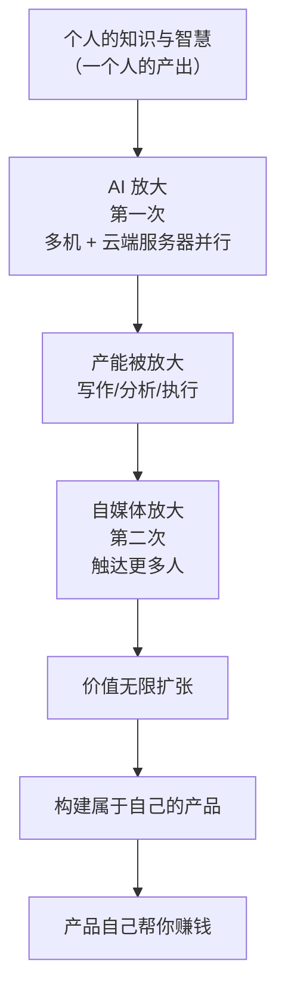

# AI 放大与自媒体二次放大

> **一句话**：个人知识智慧 **× AI**（第一次放大）**× 自媒体**（第二次放大）= 价值的无限扩张。

---

## 原始定义（2026-10-23 · 00:05:39 / 00:19:31）

胡子哥原话：

> "AI 可以帮个人无限放大能力，现在直播聊天的时候**多台本地电脑、云端服务器都在同时工作**，当天下午还启动了多台服务器，今天已经充值 500 美金用于服务器运行。"
>
> "**AI 放大之后，自媒体可以做二次放大**，个人知识智慧通过 AI 乘以自媒体实现价值的无限扩张。"
>
> "一人公司 99% 的业务都围绕 AI 和自媒体展开，核心是要构建属于自己的产品，**让产品自己帮你赚钱**。"

---

## 两次放大的分工



**关键：AI 放大的是「产能」，自媒体放大的是「触达」。两个都要有，缺一个就是空转。**

---

## AI 降价带来的行业机会（2026-10-23 · 00:19:31）

> "当前 AI 大模型 Token 价格越来越便宜，**很多人只看到竞争，实际意味着 AI 创作成本大幅降低**，
> 未来大模型会变成水电一样的基础设施，基于大模型的创作会集中爆发。"
>
> "因为创作成本降低，**纯整合类知识内容会变得不值钱**，比如 AI 整理的早报类内容没有护城河，迟早会被淘汰，
> **大量没有深度的知识博主会逐步退出市场**。"

### 反推：你该做什么

| ❌ 会贬值 | ✅ 会升值 |
|---|---|
| AI 整理的早报 | 有深度洞见的内容 |
| 纯工具整合 | 能沉淀数字资产的洞见 |
| 靠大流量接广告带货 | 拥有深度洞见、能沉淀资产的博主 |

**Sam Altman 的观点（胡子引用）：**

> "看不到趋势找不到机会，但**很多人死于看到机会就 all in**，因为执行过程充满变数，容易进退不得。"

### 未来主导力量

> "高盛研报：未来一年知识经济市场规模将达 5000 亿美金，市场仍在扩张，
> 但靠大流量接广告、带货的模式会逐步萎缩，**拥有深度洞见、能沉淀数字资产的博主会成为未来一人公司的主导力量**，
> 可以用知识和洞见入股项目 —— 类似纳瓦尔、邓科这类人都是这种路径。"

---

## 科技传导链（胡子哥的关注点）

```Plain Text
科技 → 技术 → 生产力 → 经济
   ↓
科技永远走在最前面
   ↓
每天读最前沿科技情报，搞清楚发展方向
```

**短视频爆发的例子**：核心原因是**拍摄门槛降低**，人人都可以拍 → 符合科技-技术-生产力传导逻辑。

---

## 落地动作

1. **AI 侧**：多机并行 + 云端服务器（胡子本人当天充了 500 美金跑服务器）
2. **每天读科技情报**：服务器每天全网抓最新信息，帮自己把握投资和方向选择
3. **自查护城河**：我的内容是「AI 也能秒出的」吗？是 → 会被淘汰
4. **检查变现路径**：我是在接广告带货，还是在沉淀能入股的数字资产？

---

## 自检清单

- [ ] 我的 AI 侧产能放大了吗？（还是全靠手工）
- [ ] 我的自媒体在放大什么？（还是只在记录）
- [ ] 我的内容有护城河吗？（AI 一天能出十份的 = 没护城河）
- [ ] 我在积累能沉淀成资产的洞见吗？
- [ ] 我看科技情报吗？

---

## 相关

- 传播层：[[自媒体传播三问]]
- 起点：[[做自己的小事]]
- 工具层：[[简单原则]]（交付要简单到能立刻用）
- 库位置：[[姜胡说知识库]]

---

*提炼自：[[2026-10-23-AI时代一人公司的构建方法-姜胡说]] 章节 00:05:39 / 00:11:43 / 00:16:02 / 00:19:31 / 00:23:01 · 创建于 2026-11-12*
