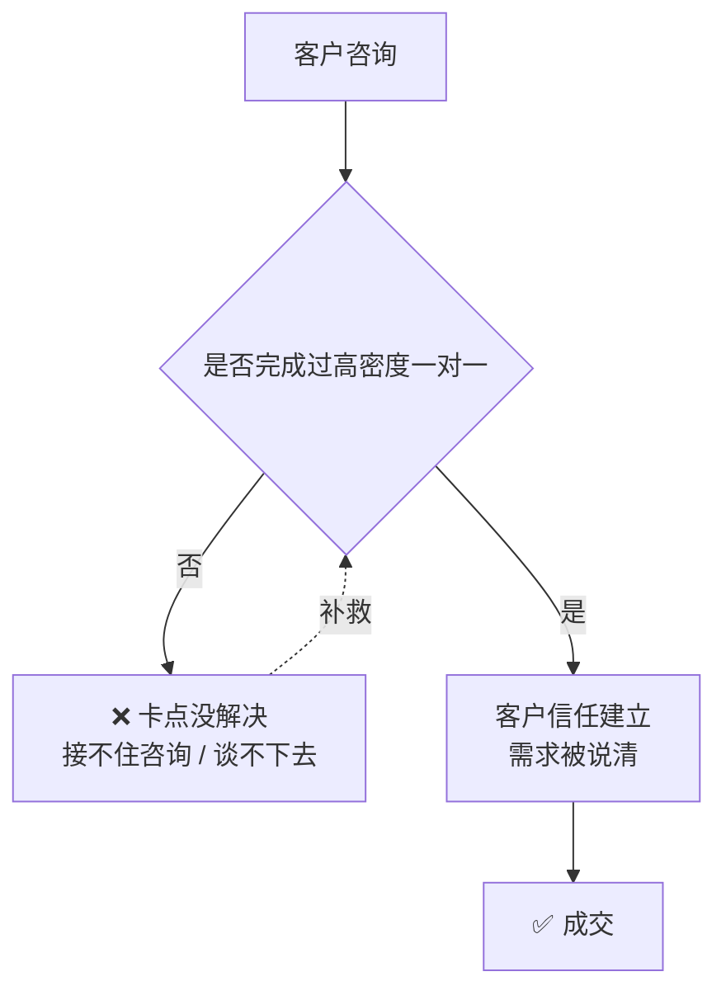

# 一对一成交原则

> **一句话**：**大部分付费客户都需要至少 1 小时左右的一对一电话沟通** —— 高信息密度沟通才能解决客户卡点。

---

## 原始定义（2026-10-06 · 00:20:00 + 00:17:20 + 00:23:30）

### 时长标准

> "**大部分付费客户都需要至少 1 小时左右的一对一电话沟通**，高信息密度沟通才能解决客户卡点，促成成交。"

**实证（北京女客户）**：
> "前后经过两次沟通，**第一次沟通 1 小时，第二次沟通三四十分钟**，最终才完成成交。"

### 客户敢不敢谈（能力差异）

原话：
> "你在跟别人谈的时候别人是能感觉得到呀。**你是不是畏手畏脚的去做，你真的是放开了很自信的去谈，他是不一样的感觉的呀。**"

### 两个人的能力差异（会议里的判断）

| | 王艳玲 | 梅子 |
|---|---|---|
| 做生意时间 | 久 | — |
| 接受新事物 | 强 | 弱 |
| 沟通 | 敢冲敢谈，放得开 | 畏手畏脚 |
| 临场应变 | 强 | 弱（不熟 AI、不会找痛点）|
| 结论 | **优先推进**（更容易快速出结果）| 需重新设计分工 |

---

## 逻辑框架

**关键：一对一的价值不是「说服」，是「解决卡点」** —— 客户的问题被解决了，付款是自然结果。

---

## 落地动作

### 1. 把沟通时长当硬指标

**第一个电话至少 1 小时。** 别用 15 分钟的「快速过一下」。

### 2. 准备好「问什么」而不是「讲什么」

高信息密度 = 高质量提问。
- 客户现在怎么做的？
- 哪一步最卡？
- 试过什么？为什么没成？

### 3. 检查自己的沟通状态

> 「你是不是畏手畏脚的去做？」—— 客户能感觉到。

**自查**：你敢不敢在客户面前承认「这个我不确定」？不敢 = 你的沟通状态有问题。

### 4. 认清能力差异，用分工解决

不是所有人都要学会谈。**会谈的人线上谈，不会谈的人跑现场。**（见 [[三方电话会议探店方案]]）

---

## 自检清单

- [ ] 我的第一个成交电话打了多久？
- [ ] 客户说「贵」的时候，我有没有解决他的具体卡点？
- [ ] 我跟客户沟通时，是放开的状态吗？
- [ ] 团队里谁会谈？谁该跑现场？我分清了吗？
- [ ] 我是不是把「说服」当成了成交的抓手？

---

## 相关

- 反面案例：[[大课转化为什么失败]]
- 分工设计：[[三方电话会议探店方案]]
- 行为层：[[行为公式B等于MAT]]（降低客户决策风险 = 降低摩擦）
- 库位置：[[姜胡说知识库]]

---

*提炼自：[[2026-10-06-AI知识库变现与养老院AI赋能-姜胡说]] 章节 00:17:20 / 00:20:00 / 00:23:30 · 创建于 2026-11-12*
