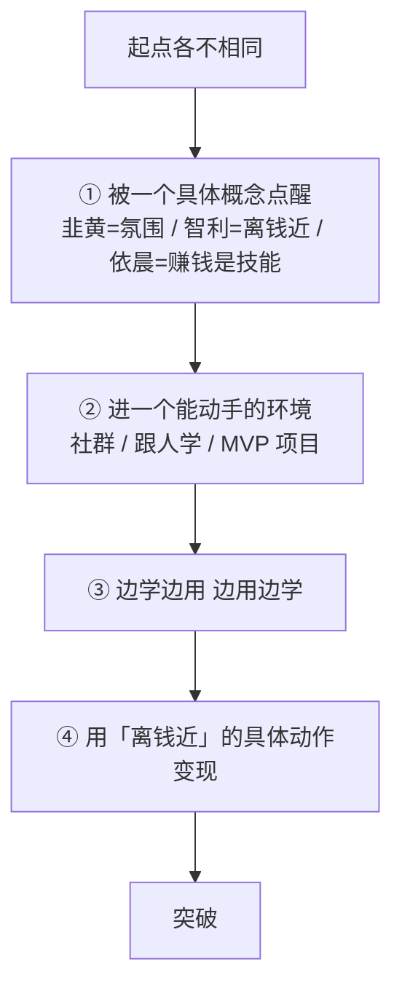

# 三位学员的突破路径

> **一句话**：三个起点完全不同的人（失败创业者 / 迷茫宝妈 / 失业青年），**用了同一套底层逻辑跑出来**。

---

## 三个案例对照（2026-10-30 线下活动现场）

| 学员 | 起点 | 卡点 | 转折动作 | 结果 |
|---|---|---|---|---|
| **韭黄** | 2022 年起特别迷茫，开武术馆、开面馆等**四五样生意全部赔钱**，没有退路才转互联网 | 自认社恐，线下活动身体还会抖 | **五六个月自我建设** + 跟有能量的人在一起 | 10/6 连续直播 **24 小时**，卖 **2700 单**，单日收入 **5 位数**（被平台自动断播下掉）|
| **智利** | 40 岁农村宝妈，每天围着孩子和老公转，自认"可有可无的存在" | 拿证那天（10 月下雨）仍找不到自己的价值 | 胡子哥「**离钱近**」的观点 → 拍跳绳挑战视频、分享自考经历 | 跟三姐学直播 2 个月多，**10/21 胡子哥来到市场当天爆单**（此前线下第一场播 6 小时只有 41 块）|
| **依晨** | 自称"没有文化、没有技能"的大龄失业青年，失业约 3 年 | 进社群按"每天写点什么"打卡，**坚持十多天后放弃**（因为没做事情写不出东西）| 在李公子星球学到「**赚钱是技能**」→ 6 字回复「坐等下一轮的 MVP」→ 跑黄豆项目 | 直播整整 2 个月每天 3-5 单 → 翻《价值心法》「**如何影响他人行为**」套用 → **第 3 个月破 100 单**；线下 3 小时成交 200 单，**每天稳定收入 4 位数，销冠** |

---

## 三人共用的 4 条底层逻辑

### ① 被一个具体概念点醒（不是被一堆道理说服）

| 学员 | 那一个概念 |
|---|---|
| 韭黄 | 「**多跟有能量、有上进的人在一起，那个氛围才能改变人**」|
| 智利 | 「**你要赚钱，就去做那个离钱近的事情**」|
| 依晨 | 「**赚钱它是一个技能，既然是一个技能，那就可以学习**」|

**共同点：一个概念 + 立刻行动**，不是「听了一堂课」。

### ② 进一个能动手的环境

- 韭黄 → 线下活动（身体还会抖，但去了）
- 智利 → 峨眉山直播 → 买《价值心法》→ 社群 → 跟三姐学
- 依晨 → 胡子哥社群 → 李公子社群 → MVP 跑黄豆项目

### ③ 边学边用、边用边学

依晨原话（主持人转述）：「通过做直播把以前丢下的『每天写点什么』重新用起来，**边学边用、边用边学**，按利他、公开构建的方式完成小闭环。」

### ④ 用「离钱近」的具体动作变现

三个人的具体动作都很小：跳绳挑战视频 / 直播 6 小时 / 跑黄豆 / 拍口播。

---

## 关键对比：同样方法，结果差异巨大

| 学员 | 学多久 | 结果 |
|---|---|---|
| 智利 | 直播 2 个月多 | 爆单（10/21）|
| 依晨 | 直播 2 个月零起色（每天 3-5 单）→ **第 3 个月**破 100 单 | 销冠，日入 4 位数 |
| 韭黄 | 直播 6 个月 + 口播 6 个月 | 24 小时 2700 单 |

**关键：依晨前 2 个月「一点起色都没有」，但他没换方向 —— 他换了概念。**

> 「每天 3 单、5 单出单，已有点坚持不下去、开始怀疑自己」→
> 「翻到胡子哥《价值心法》中『如何影响他人行为』那一章，把内容套用到直播上，**第 3 个月突破 100 单**」

**卡住时的动作不是「换方法」，是「回书里找概念套进场景」**（见 [[赚钱是技能]]）。

---

## 落地动作

给学员/自己的一份提问清单：

1. **我的起点是什么？**（韭黄：生意全赔 / 智利：宝妈迷茫 / 依晨：失业 3 年）
2. **哪个概念能点醒我？**（现在就去查社群/书里的概念）
3. **我进哪个能动手的环境？**（社群 / 跟人 / MVP 项目）
4. **我的第一个「离钱近」的小动作是什么？**
5. **我卡住时，是换方向还是换概念？**

---

## 相关

- 概念来源：[[离钱近的事情]] / [[赚钱是技能]]
- 系统层：[[目标与系统的区别]]（持续累积 vs 一次性爆发）
- 库位置：[[姜胡说知识库]]

---

*提炼自：[[2026-10-30-多位普通人直播创业突破经历-姜胡说]] 全 12 章节 · 创建于 2026-11-12*
