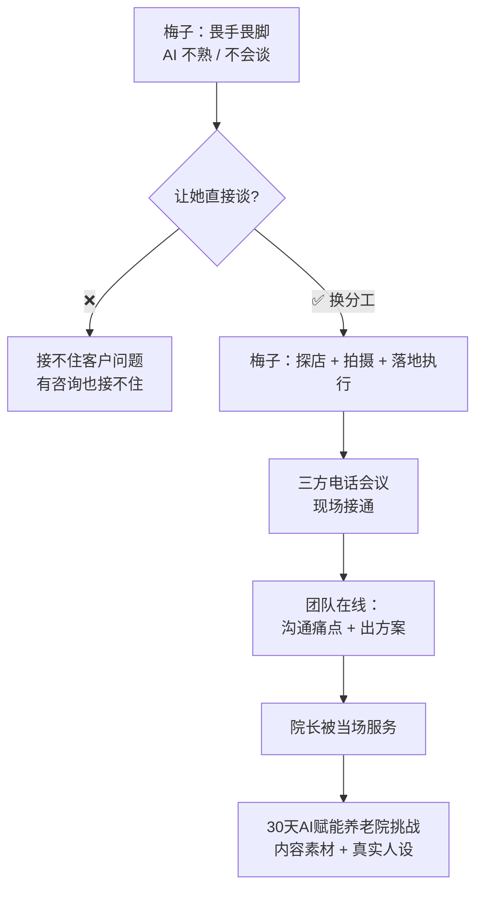

# 三方电话会议探店方案

> **一句话**：不会谈的人负责拍和跑，**会谈的人在线上谈** —— 一次拜访，三个角色同时到位。

---

## 原始定义（2026-10-06 · 00:37:00 梅子线下探店方案）

### 方案核心

> "让梅子在**自己店铺周边 5-10 公里范围内，逐个拜访养老院**，
> 提出**免费**为养老院用 AI 做赋能、打通业务闭环，**全程记录拍摄过程**。"

### 协作模式

> "拜访时**梅子在现场，通过三方电话会议**，由说话人团队在线和院长沟通痛点、出方案，
> **梅子负责拍摄记录和后续落地执行**。"

### 内容定位

> "发起「**30 天 AI 赋能养老院挑战**」，真实记录从探店、沟通、出方案到落地培训的全流程，
> **打造真实人设，同时积累内容素材**。"

### 为什么不能让梅子直接拍

> "如果直接让梅子拍养老院成交相关内容，**梅子不了解完整过程，遇到客户提问无法回答，很难促成成交**。
> 大部分付费都需要一对一电话沟通解决客户痛点，**梅子不熟悉业务，高信息密度沟通下无法应对**。
> 即使拍了视频，有客户咨询也接不住，因此这个方向行不通。"

---

## 逻辑框架



**关键：方案是「三方电话会议」，不是「让梅子学怎么谈」。**

---

## 角色分工表

| 角色 | 负责 | 不负责 |
|---|---|---|
| **梅子（本地）** | 线下探店、拍摄记录、后续落地执行 | ❌ 不需要谈（她谈不了）|
| **团队（线上）** | 沟通痛点、出方案、专业应答 | ❌ 不需要跑现场 |
| **院长（客户）** | 提需求、验证方案 | — |

---

## 这个方案的 3 层价值

| 价值层 | 说明 |
|---|---|
| **业务层** | 5-10 公里内的养老院，一个一个扫；免费赋能做入口 |
| **内容层** | 全程记录 → 「30 天 AI 赋能养老院挑战」= 真实人设 + 素材 |
| **组织层** | 不会谈的人也能参与业务（只做他能做的部分）|

---

## 落地动作

### 1. 找「探店人」的条件

- 在目标行业**有本地资源**（店铺、场地、人脉）
- 愿意跑腿、拍摄
- **不要求他会谈** —— 这是关键，别选错人

### 2. 设计三方通话流程

```
探店人（现场）→ 三方电话接通 → 团队在线谈痛点出方案 → 现场拍下全过程
```

### 3. 把过程变成内容

> 「30 天 AI 赋能养老院挑战」—— 挑战本身是内容，不是包装。

### 4. 分工讲清楚，别让探店人背锅

原话（关于梅子的处理）：
> "给梅子讲清楚思路，**愿意做就推进，不愿意做也不强求，尽到告知义务即可**。"

---

## 自检清单

- [ ] 我是不是让「不擅长的人」去干「他不擅长的事」？
- [ ] 探店人要做的 3 件事我讲清楚了吗？
- [ ] 线上支援的响应机制是什么？
- [ ] 这个过程能不能同时变成内容？
- [ ] 不愿意做的人，我是不是还在催？

---

## 相关

- 方向判断：[[从2C转2B]]
- 组织方法：[[能力系统化]]（真实项目带教 + 分工）
- 库位置：[[姜胡说知识库]]

---

*提炼自：[[2026-10-06-AI知识库变现与养老院AI赋能-姜胡说]] 章节 00:09:00 / 00:30:40 / 00:37:00 / 00:45:00 / 00:52:20 · 创建于 2026-11-12*
