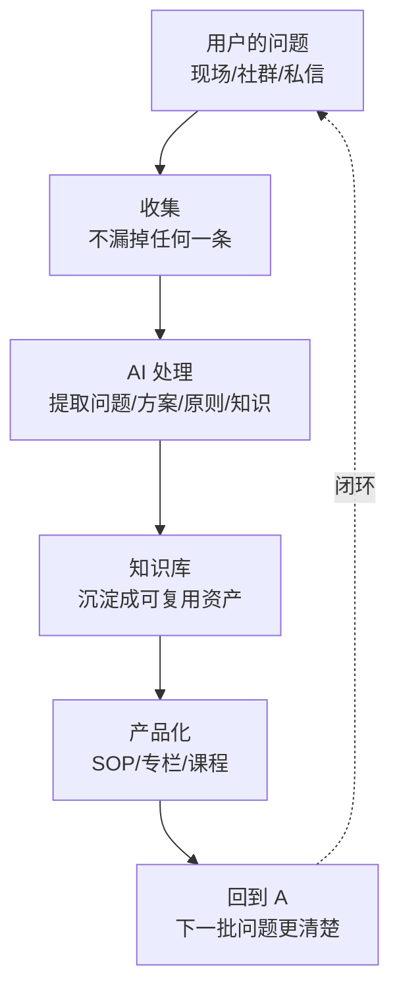

# 个人系统：从用户的问题到知识库

> **一句话**：系统不是「我想要什么功能」，是**「用户反复问的问题自动变成我的知识库」**。

---

## 原始定义（2026-11-06 Day2 · 第六部分）

### 尽早上系统

> "各位最好的投资是什么？**最好的投资是投资自己**，就是你你自己生长了以后，那你会发现其他全部都能理解。"
>
> "由这个东西延展的情况下，**尽早构建你的系统，然后升级你的系统**。"
>
> "你们会看到平时的时候是非常轻松的……一个很重要的原因，就是因为我的系统在运作。"

### 一套系统跑起来，手机就能办公

胡子哥现场演示：**在台上拿出手机 → 登录远端机器 → 命令行进系统 → AI 助手回复问题 → 后台有帖子没回复。**

> "整个过程它完全是可以自动化，但平时的话呢，我现在都会停掉，为什么停掉？**就是我希望大家问的每一个问题我都会理。**"

---

## 系统的三层



**关键：现场「没在讲」的时间，往往是价值最高的时候（在观察、在判断）。**

---

## 系统检验标准

> **你不在的时候，它还能转吗？**

| 检验 | 说明 |
|---|---|
| ✅ 转得动 | 问题进来 → 自动/半自动进知识库 |
| ❌ 转不动 | 你不做就停 —— 那不是系统，是习惯 |

**落地起点**：列出你每天重复做的三件事，先给其中一件建「模板 / 自动化」。

---

## 现场诊断 → 内容调整（现场设计原则）

```Plain Text
留 20 分钟只听问题 → 再决定讲什么
   ↓
允许流程改（流程服务于现场，不服务于排练）
   ↓
每一分钟都在做「现场诊断 + 内容调整」
```

---

## 与知识产品化的关系

| | [[知识产品化]] | 本卡 |
|---|---|---|
| 输入 | 免费咨询录音 | 用户现场问题 |
| 提取 | AI 提 4 要素 | 同上 |
| 产出 | 共性需求 = 产品 | 知识库 = 系统底座 |

**知识产品化是「往外变现」，个人系统是「往内提效」—— 同一条流水线，两个出口。**

---

## 自检

- [ ] 用户的问题我一条都没漏吗？
- [ ] 我的问题进知识库了吗？（还是只在聊天记录里）
- [ ] 我不在的时候，系统还能转吗？
- [ ] 我每天重复做的三件事，固化了哪一件？
- [ ] 我做分享时，留了只听问题的时间吗？

---

## 相关

- 变现出口：[[知识产品化]]
- 行为层：[[行为公式B等于MAT]]（能力变量 = 降低用户动作难度）
- 我的对应：[[knowledge-creation-framework]]
- 库位置：[[姜胡说知识库]]

---

*提炼自：[[2026-11-06-姜胡说3.0自媒体北京闭门会-姜胡说]] Day2 第五/六部分 · 创建于 2026-11-11*
