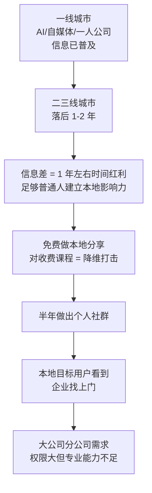

# 二三线信息差红利

> **一句话**：AI、一人公司在二三线城市有 **1-2 年信息时间差** —— 足够普通人快速建立本地影响力。

---

## 原始定义（2026-09-28 · 01:01:38 + 01:09:31）

胡子哥原话：

> "二三线城市的 AI、自媒体、一人公司相关信息**比一线城市落后 1-2 年**，
> 普通人可以利用这个**信息差建立本地影响力**，做个半年左右就能做出自己的个人社群。"

> "之前就有老伙计**用社群内部的知识，成功入职二三线城市的自媒体公司**，哪怕当时自己还没完全弄明白，
> 也能满足企业的需求。"

### 竞争优势

> "市面上 AI、自媒体、一人公司相关的**线下课程大多是割韭菜，而且收费**，
> 江湖说输出的内容对这些课程是**降维打击**，还是免费分享，更容易快速积累口碑。"

### 本地获客的核心要求

> "**不需要太高的线上播放量，只要让本地的目标用户看到，就一定会有企业找上门**，
> 哪怕初期费用不高，也能起步逐步进化。"

---

## 逻辑框架

---

## 企业端的机会（为什么本地能起步）

> "**大公司的地方分公司普遍存在权限大、专业能力不足的问题，需要外部支持**，
> 这就是本地创业者的机会。"

**国际巨头案例**：
> "某国际巨头中国总部，引入海外软件后，**从海外调专家的成本是本地专家的 6-10 倍**，
> 邀请主讲人做交付，**只需要支付两倍费用，交付效果还更好**，各地分公司都有类似需求。"

---

## 落地动作

### 1. 算你的时间差红利

| 领域 | 你的城市落后多久？|
|---|---|
| AI 工具 | ？ |
| 自媒体玩法 | ？ |
| 一人公司 | ？ |

**落后越多，红利越大。**

### 2. 不需要高播放量

> 「不需要太高的线上播放量，只要让本地的目标用户看到。」

**本地 100 个精准用户 > 全国 10 万泛粉。**

### 3. 免费对标收费

市面上同类课程都在收费割韭菜 —— **你免费 = 自动降维打击**。

### 4. 瞄准「权限大但能力不足」的人

大公司分公司负责人：
- **权限大**（能拍板采购）
- **专业能力不足**（需要外部支持）

**这两条同时成立的地方，就是你的客户。**

---

## 自检清单

- [ ] 我所在的城市，AI/自媒体信息落后一线多久？
- [ ] 我做的是全国流量还是本地精准用户？
- [ ] 我有没有找到「权限大但专业能力不足」的决策者？
- [ ] 我能不能免费做一次本地分享？

---

## 相关

- 前提：[[有价值和被看见]]
- 生态位：[[生态位与互相托举]]
- 库位置：[[姜胡说知识库]]

---

*提炼自：[[2026-09-28-从零到一打造个人影响力-姜胡说]] 章节 01:01:38 / 01:09:31 · 创建于 2026-11-12*
