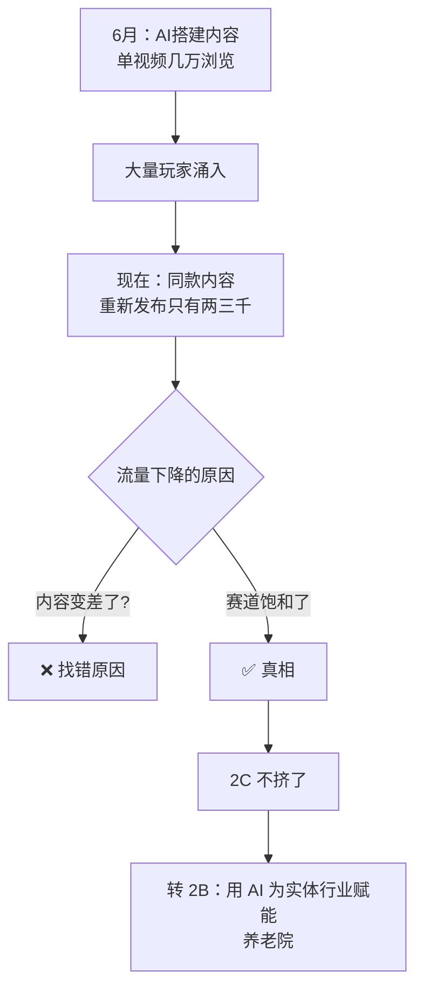

# 从 2C 转 2B

> **一句话**：AI 搭建内容从几万浏览跌到两三千 —— **不挤 2C 了，把 2B 打通。**

---

## 原始定义（2026-10-06 · 00:26:00）

> "6 月份 AI 搭建相关内容刚推出时**单视频能获得几万浏览量，现在重新发布同款内容只有两三千浏览量**，
> **赛道玩家过多已经非常拥挤**。"

### 决定

> "因此决定**不再挤 2C 内容的赛道，把精力转向拓展 2B 业务，通过 AI 为实体行业赋能**。"

胡子哥的原话（会议记录）：

> "**2C 的业务不要再跟他们再挤了，这个赛道太挤了。我们要走出去把这个 2B 业务给它打通。**"

---

## 逻辑框架



**关键：同一条内容，浏览量掉了 10 倍 —— 说明不是内容问题，是位置问题。**

---

## 为什么 2C 拥挤必然发生

```Plain Text
AI 搭建内容（6月）
   ↓ 门槛低，人人能做
   ↓ 大量玩家涌入
同质化内容泛滥
   ↓
平台推荐被稀释 → 单条浏览从几万 → 两三千
```

**低门槛内容的终点一定是红海** —— 这跟[[简单原则]]里「用户拿起来就能用」是同一件事的两面：**好做 = 会被做烂**。

---

## 2B 的不同逻辑

| 维度 | 2C 内容 | 2B 赋能 |
|---|---|---|
| 客户 | 泛用户 | 具体行业实体 |
| 竞争 | 同质化严重（几万→两三千）| 需行业理解，门槛高 |
| 客单价 | 低 | 高（2000 / 6000 档）|
| 交付 | 内容 | 方案 + 落地 |
| 复购 | 靠流量 | 靠信任和标杆案例 |

**标杆案例是关键** —— 刘院长的陪跑营最后就转成了养老院赋能项目（见 [[分阶段成交]]）。

---

## 落地动作

### 1. 给自己的内容算一次「流量衰减率」

**把 3 个月前数据最好的内容重新发一遍**，看现在多少浏览。
- 掉了 80%+ → 赛道饱和，该转了
- 没掉 → 是内容问题，改内容

### 2. 找到「低门槛内容不做、但需求真实」的位置

AI 搭建内容人人能做，但**「用 AI 帮养老院打通业务闭环」不是人人能做** —— 需要行业理解 + 落地能力。

### 3. 先做一个标杆，再复制

刘院长路径：自己付费 → 做成 → 团队提议做标杆 → 转成赋能项目。

---

## 自检清单

- [ ] 我 3 个月前的内容重发还有流量吗？
- [ ] 我现在的内容是不是「门槛低、人人能做」？
- [ ] 我能不能找到一个「门槛高但需求真实」的位置？
- [ ] 我有没有一个可复制的标杆案例？

---

## 相关

- 落地方式：[[三方电话会议探店方案]]
- 定价：[[差异化定价与服务边界]]
- 库位置：[[姜胡说知识库]]

---

*提炼自：[[2026-10-06-AI知识库变现与养老院AI赋能-姜胡说]] 章节 00:26:00 / 00:27:20 · 创建于 2026-11-12*
