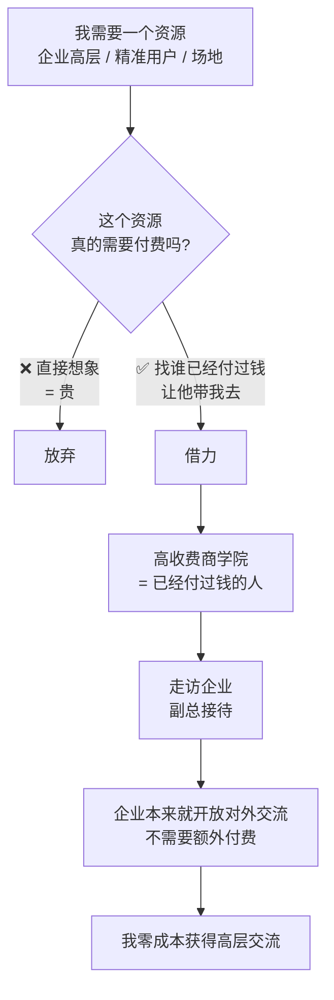

# 借力打法

> **一句话**：**别人付费买的东西，本来就是免费的** —— 商学院安排走访企业由副总接待，企业本来就开放对外交流。

---

## 原始定义（2026-09-28 · 00:52:45）

胡子哥原话（会议记录）：

> "分享借力打力的案例：**朋友高伟报名高收费商学院，商学院安排走访企业由企业副总接待**，
> 而**企业本身本来就开放对外交流，不需要付费**，这就是典型的借力。"

### 老伙计的正确用法（同一场分享）

> "**老伙计应该先自己做事，遇到卡点再来交流，不要一直迷茫诉苦，不实际行动。**"

---

## 逻辑框架

**关键：先查「这个资源真的需要付费吗」，再查「谁已经为它付过钱」。**

---

## 借力的 3 个来源

| 来源 | 例子 | 借什么 |
|---|---|---|
| **付费机构** | 高收费商学院 | 走访企业 + 副总接待 |
| **开放的企业** | 本来就开放对外交流 | 半天高层交流 |
| **社群/老伙计** | 江湖说品牌 | 活动组织 + 初始参与者 |

---

## 落地动作

### 1. 三个问题诊断资源

1. **这个东西真的收费吗？**（很多「需要付费」是想象出来的）
2. **谁已经为它付过钱？**（那个人能带我进去）
3. **有没有本来免费开放的场所？**（企业、大学、协会、园区）

### 2. 顶级交流的复利

> "为顶级公司做半天交流，**提前花了两个礼拜沟通准备，虽然压力很大，但交流完成后自身认知直接升级**，
> 后续去中小企业分享就是**降维打击**。"

**为顶级客户做的准备，会变成你之后所有 lesser 客户的底气。**

### 3. 老伙计的正确用法

**先自己做事 → 卡住了再来交流。**
不要一进群就诉苦、迷茫、要答案 —— 那不是交流，那是消耗关系。

---

## 自检清单

- [ ] 我现在缺的那个资源，真的需要花钱吗？
- [ ] 我身边谁已经为它付过钱？
- [ ] 有没有本来就开放的地方我去错了？
- [ ] 我最近一次找老伙计，是带着事去的还是带着情绪去的？

---

## 相关

- 曝光路径：[[线下分享定价阶梯]]
- 生态位：[[生态位与互相托举]]
- 库位置：[[姜胡说知识库]]

---

*提炼自：[[2026-09-28-从零到一打造个人影响力-姜胡说]] 章节 00:52:45 · 创建于 2026-11-12*
