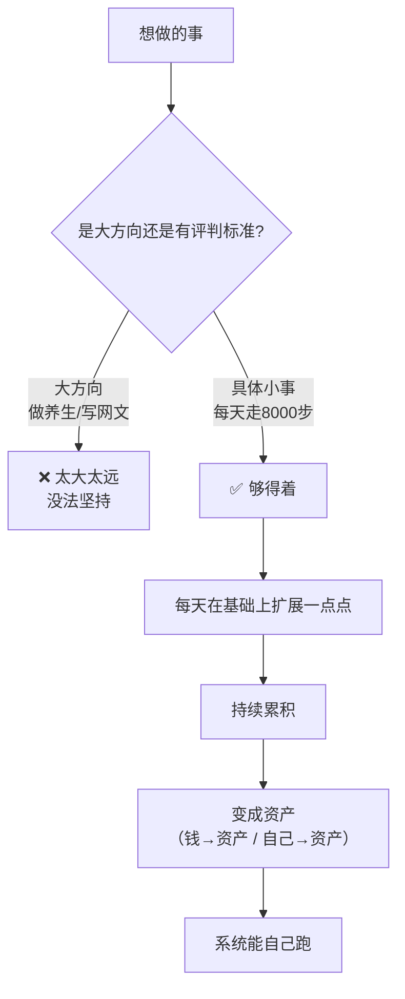

# 做自己的小事

> **一句话**：普通人第一件事是**做自己的事** —— 可以是小事，但一定要做自己的。**一直给别人干活无法积累资产。**

---

## 原始定义（2026-10-23 · 00:29:35 / 00:59:07）

胡子哥原话：

> "普通人要做的第一件事就是**必须做自己的事**，可以是小事，但一定要做自己的，一直给别人干活无法积累资产。"
>
> "钞票一定会贬值，**要把钱变成资产，也要把自己变成资产**。"

### 两个真实资产案例（胡子哥自己）

| 资产 | 状态 |
|---|---|
| 《价值心法》| 已完成第 18 次印刷，**不需日常维护**，放在那里每年带来几十万收益 |
| 小报童订阅 | 11000 人，**交税后每年 100 多万收益** |

**共同点：都是「做成小事变成资产」。**

---

## 关键：怎么定义「一件小事」

> 「让观众说出自己想做的事，指出大部分人说的都是大方向，不是具体的小事。
> 比如做养生、写网文都是方向，目标太大太远，**没有评判标准，很难坚持**。」

### 什么是方向（❌ 不是小事）

- 做养生
- 写网文
- 做自媒体

### 什么是小事（✅）

| 方向 | 拆成小事 |
|---|---|
| 做自媒体 | 今年写一本小册 |
| 健身 | 每天走 8000 步 |
| 写东西 | 每天写一小段文字（能力只够 300 字）|
| 学 AI | 一礼拜解决一个小问题 |

> **原来月入 2000 就不要定月赚 1 万的目标，目标够得着才不会焦虑。**

---

## 逻辑框架



---

## 落地动作

### 1. 把方向降维成小事

问自己三个问题：
1. **评判标准是什么？**（说不出来 → 还是方向）
2. **今天能做的一步是什么？**（越具体越好）
3. **原来的水平能不能够得着？**（够得着才不焦虑）

### 2. 能力是练出来的，不是想出来的

胡子哥的成长路径：

```Plain Text
刚开始每天只写一小段文字（能力只够 300 字）
   ↓ 第二天在基础上调整
两个月后 → 一天写 500 字，质量更高
   ↓
半年后 → 半小时写 500 字
   ↓ 能力起来后再练发现问题解决问题
一礼拜解决一个小问题 → 慢慢能解决更大的问题
   ↓
国企：从端茶跑腿 → 负责所有计算机相关的工作
   ↓
通过写作分享解决问题的方法 → 讲课费/咨询费提升
   ↓
不需要稿子就能做直播分享
```

**核心：多年系统累积的结果。**

### 3. 每天 1 小时底线

> 「如果一天抽不出 1 小时做自己的事，就只能一辈子给别人干活。」

胡子哥的做法：**手机从早 8 点到晚 5 点开免打扰，任何电话都打不通**，保证每天至少 2 小时专注做自己的事。

> 「大多数人每天 8-10 小时忙别人的事，剩下的时间去掉吃喝拉撒、带孩子，连 1 小时做自己事的时间都没有。」

---

## 自检清单

- [ ] 我正在做的事，有评判标准吗？
- [ ] 它的目标是我够得着的吗？
- [ ] 这件事明年能原样再做一遍吗？
- [ ] 我今天留出了 1 小时做自己的事吗？
- [ ] 我做的是自己的事，还是一直在给别人干活？

---

## 相关

- 下一步：[[目标与系统的区别]]（小事做成系统）
- 放大器：[[AI放大与自媒体二次放大]]
- 库位置：[[姜胡说知识库]]

---

*提炼自：[[2026-10-23-AI时代一人公司的构建方法-姜胡说]] 章节 00:29:35 / 00:59:07 / 02:06:37 / 02:12:18 · 创建于 2026-11-12*
