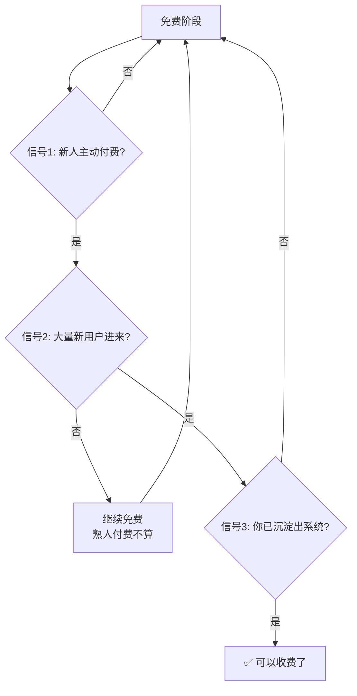

# 免费起步保留退出权

> **一句话**：免费的价值不是「不收钱」，是「保留随时退出的能力」—— 没有契约才有大量实验窗口。

---

## 原始定义

胡子哥 2026-11-11（06:27 + 09:39 章节）：

> 免费有几个好处，第一个就是你具有随时退出的能力。你要求对方可以不满足，
> 双方没有形成契约，这给了大量实验窗口。
> 一上来就收钱就麻烦了，比如年费包进来 12 个人、每人 9 块 9，你就得做一年。

---

## 核心逻辑

| 维度 | 免费 | 一上来收钱 |
|---|---|---|
| **退出权** | ✅ 随时能退 | ❌ 被契约锁住（9块9×12人=一年）|
| **实验窗口** | ✅ 大量试错 | ❌ 一次定生死 |
| **反馈真实** | ✅ 用户没心理负担 | ⚠️ 用户会「客气」|
| **成本** | 时间 | 时间 + 交付责任 + 退款风险 |

**「要求对方可以不满足」是关键** —— 免费没有承诺，对方可以拒绝你的方案，你能快速迭代。

---

## 什么时候开始收费（3 个信号）

### 三条判定标准（胡子哥原话）

1. **「有新人主动付费的时候，那个产品才被确定，熟人付费不算。」**
   - 熟人付费有时是被裹挟的，**要劝退他们**
2. **有大量新用户进来，才说明产品被认可，才是真正开始商业化。**
3. **做事不断沉淀出系统时** —— 到了这一步收费是自然结果，不是目的

### 补充信号

> 做到 200 人，觉得是自己喜欢、擅长且自律的事，这时候就可以收费了。

---

## 从 0 到 1 阶段

> 从 0 到 1 本身就是长知识、长经验，未来不一定变成产品，产品过早了退都退不出。

**「从 0 到 1」阶段不需要产品，需要的是知识积累和经验密度。**

---

## 常见误判

| 误判 | 为什么错 |
|---|---|
| 「免费没人认价值」 | 免费的价值在实验窗口和真实反馈，不在当期收入 |
| 「熟人付费说明产品成立」 | 熟人可能被裹挟，要劝退 |
| 「先收钱才有动力」 | 收钱会锁死迭代能力，且误判产品方向 |
| 「一上来做产品最专业」 | 产品过早 = 退都退不出 |

---

## 相关

- 采集端：[[知识产品化]]（免费咨询 = 免费实验窗口）
- 收费判定：[[新人付费才算产品被确定]]
- 我的对应方法论：[[mvp]]（最小可执行版本）
- 库位置：[[姜胡说知识库]]

---

*提炼自：[[2026-11-11-知识产品化与能力系统化-姜胡说]] 章节 06:27 / 09:39 · 创建于 2026-11-11*
