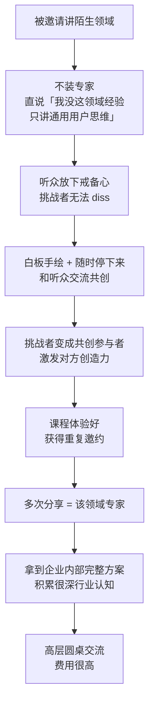

# 共创式分享

> **一句话**：不懂就直说「我没这个领域经验，只讲通用方法」—— **放下戒备 → 挑战者变共创者 → 重复邀约 → 变专家**。

---

## 原始定义（2026-09-28 · 00:39:31）

胡子哥原话（会议记录）：

> "主讲人**很少用 PPT，大多用白板手绘，分享过程中随时停下来和听众交流共创**。"

> "面对没接触过的领域，**主讲人会直接说明自己没有该领域经验，只分享自身擅长的通用用户思维**，
> 现场和听众共创交流。这种方式**能直接放下听众的戒备心**，**挑战者无法 diss**，
> 还能**把挑战者变成共创参与者**，最终课程体验很好，**会获得多次重复邀约**，
> 多次分享后就会成为该领域的专家，甚至能拿到企业内部的完整方案，积累很深的行业认知。"

### 后期形态

> "后期很多企业邀请主讲人，**已经不是讲课，而是高层圆桌交流，费用很高，体验也很好**。"

---

## 逻辑框架

**关键：承认不会，是拿到重复邀约最快的方式** —— 装专家反而会被 diss。

---

## 落地动作

### 1. 接需求时先分类

| 类型 | 怎么说 |
|---|---|
| 你的主场 | 直接讲专长 |
| 陌生领域但有通用方法 | **「我没这领域经验，只讲通用用户思维」** + 现场共创 |
| 完全不相关 | 拒掉（否则既帮不了自己也掉价）|

### 2. 用白板，别用 PPT

**PPT 是准备好的、是单向的；白板是活的。**

准备动作：
- 白板/大空白纸 + 粗笔
- 只准备**通用框架**，不准备这个行业的具体答案（现场一起找）

### 3. 随时停下来共创

不要讲满 60 分钟。**中途停，问听众「你们这儿是什么情况」** —— 那一刻听众就从听众变成了参与者。

### 4. 追求「重复邀约」而不是「一次讲完」

> 「会获得多次重复邀约，多次分享后就会成为该领域的专家。」

**一次讲完 = 一次性收入。重复被邀 = 专家地位 + 长期高价。**

---

## 自检清单

- [ ] 接到陌生领域的分享邀请，我会装专家还是承认不会？
- [ ] 我用 PPT 还是白板？
- [ ] 我有没有在台上停下来问听众？
- [ ] 我追求的是「讲完这一场」还是「下次还来找我」？

---

## 相关

- 定价：[[线下分享定价阶梯]]
- 底层原则：[[真诚是地基技法是装修]]（不装 = 地基）
- 库位置：[[姜胡说知识库]]

---

*提炼自：[[2026-09-28-从零到一打造个人影响力-姜胡说]] 章节 00:39:31 · 创建于 2026-11-12*
