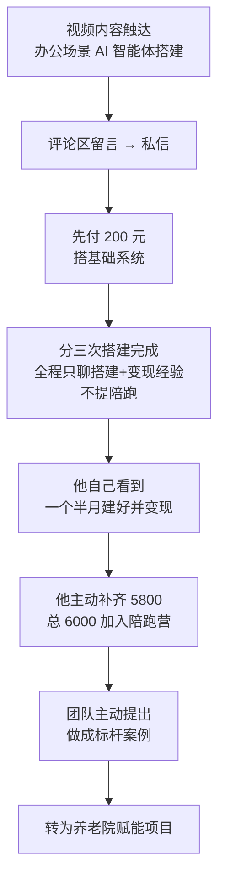

# 分阶段成交

> **一句话**：刘院长先付 200 元，三次搭建完成，**全程没提陪跑营** —— 最后是他自己补齐 5800 元。

---

## 原始定义（2026-10-06 · 00:01:20 刘院长成交复盘）

> "刘院长通过**办公场景的 AI 智能体搭建视频**找到说话人，**先付费 200 元搭建基础系统**，
> **分三次搭建完成，全程未提前提付费陪跑**，仅分享自身的搭建和变现经验。
> ……最终刘院长**补齐 5800 元，总共支付 6000 元**加入陪跑营。"

### 付费的真正原因

> "刘院长在**其他社群待了数月仍未搭建完成系统**，而说话人**用一个半月就完成搭建并实现变现**，
> 能力获得刘院长认可。"

### 项目性质的转变

> "初始付费目的是学习 AI 工具自己赋能养老院业务，**后续是团队主动提出将其做成标杆案例**，
> 才转为养老院赋能项目。"

---

## 逻辑框架

**关键：不是「推销陪跑营」成交的，是「交付了真实结果」成交的。**

---

## 核心机制

| 要素 | 具体做法 | 为什么有效 |
|---|---|---|
| **低门槛起步** | 200 元先搭基础 | 客户几乎无决策成本 |
| **只给结果，不给承诺** | 只分享搭建经验和变现路径 | 没有预期落差 |
| **分次交付** | 分三次搭建完成 | 每次都有真实进展 |
| **时间换信任** | 一个半月建好并变现 | 能力被验证 |
| **不主动提陪跑** | 全程不提 | 客户自己得出「我想学更多」的结论 |
| **升档由客户发起** | 他补 5800 | 需求已存在，不是被创造的 |

---

## 与「提前报价」的对比

| | 提前报高价 | 分阶段（刘院长路径）|
|---|---|---|
| 客户心理 | 「这么贵，我再想想」| 「先试试，反正 200」|
| 交付压力 | 一次交付全部 | 每次交付一点 |
| 升档触发 | 你推销 | 客户自己 |
| 违约风险 | 高 | 低 |

---

## 落地动作

### 1. 设计一个「200 元级」入口

不是免费（免费没有交付承诺），是**低到不需要犹豫**的价格。

### 2. 交付过程中只讲事实

> 「仅分享自身的搭建和变现经验。」—— 不说「这个还能带你做陪跑营」。

### 3. 让客户自己产生升档需求

**他看到你能做到 → 他自己想学更多 → 他自己付钱。**

### 4. 升档之后，你的角色变了

刘院长的陪跑营不是「推广出来的产品」，是**他做成事之后的自然延伸**。

---

## 自检清单

- [ ] 我的第一步服务有没有低门槛入口？
- [ ] 交付时我是不是急着推销下一步？
- [ ] 客户有没有亲眼看到我做成过？
- [ ] 他的升档是他自己提的，还是我提的？

---

## 相关

- 定价边界：[[差异化定价与服务边界]]
- 免费阶段：[[免费起步保留退出权]]
- 转化方式：[[一对一成交原则]]
- 库位置：[[姜胡说知识库]]

---

*提炼自：[[2026-10-06-AI知识库变现与养老院AI赋能-姜胡说]] 章节 00:01:20 · 创建于 2026-11-12*
