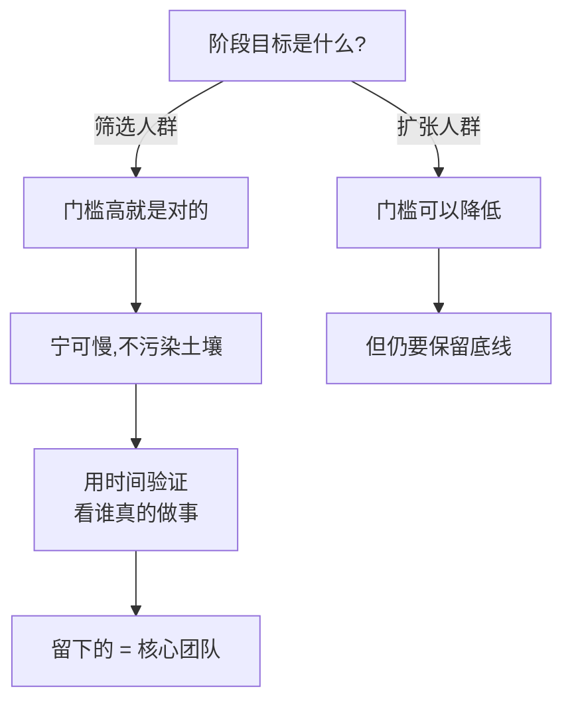

# 土壤保护与筛选

> **一句话**：社群是土壤，不是收费渠道。土壤污染了，再多的人也做不了事。

---

## 原始定义（2026-11-11 · 15:15 / 18:01 / 18:35 章节）

### 目标先行

> 胡子哥反问「你的目的是啥」——要先搞明白现阶段目标是**筛选人群**还是**扩张人群**，
> 「有了目标才有方法，而不是有方法带动目标」。
> 如果目标是筛选人群，门槛高就是对的，不要「既要还要」。
> 他自己被问社群在哪就说「不知道」、推荐也不加，这叫筛选人群。

### 筛选不能急

> 筛选的时候一定不能着急，你着了急就会有一帮不适合的人进来，土壤污染了，你就做不了事了。
> 他不停劝退加进来的老伙计，就是为了保证土壤，土壤是最重要的。
> 「长鸡毛臭胆子很容易，那个没有用」—— 人进来以后产品长不出来。

### 老伙计的定位

> 老伙计是股东、是合伙人、是天使投资人。
> 做社群不是为了挣老伙计的钱，社群是土壤，目标是帮老伙计变得更好。
> 人跟你建立连接无外乎两条：**你能帮我解决痛苦**，**你能让我变得更好**。
> 只帮该帮的人和值得帮的人，其他一律不内耗、不纠结。

### 不主动建群（线下活动后）

> 胡子哥自己从来不建绿泡泡群，但群里有几百上千个群。正确切片方式是**让别人自己建群**——
> 活动后老伙计主动建群，说明活动有价值、大家有需求；没人建群，说明活动失败、没价值，
> **不要尴尬地去建群**。

---

## 决策流程

---

## 3 条硬原则

| # | 原则 | 原话支撑 |
|---|---|---|
| 1 | **目标先行** | 「有了目标才有方法，而不是有方法带动目标」|
| 2 | **宁可劝退，不可污染** | 「土壤污染了，你就做不了事了」|
| 3 | **别人自己建群才是成功** | 「没人建群，说明活动失败」|

---

## 筛选的具体做法（胡子哥自己的社群）

1. **不直接让人加星球** —— 先让对方看直播回放、多看几期
2. **再来沟通**：看到什么好玩的、冲着哪个点来链接
3. **对上频道、觉得是好玩的人**才让加入
4. 有人问社群在哪 → 「不知道」、不加 → 这本身就是筛选

---

## 自检：你的社群在筛人还是在装人？

- [ ] 我知道现阶段目标是筛选还是扩张？
- [ ] 我的门槛是「有目标才有方法」，还是「有方法带动目标」？
- [ ] 我有没有为了增长放松筛选？
- [ ] 有人进来我能劝退吗？
- [ ] 线下活动后，是别人建群还是我在建群？

---

## 相关

- 人员验证：[[用时间衡量核心团队]]
- 交付门槛：[[简单原则]]
- 我的对应：[[huashu-flywheel]]（胡子飞轮系统 = 理解 → 运行化 → 资产沉淀）
- 库位置：[[姜胡说知识库]]

---

*提炼自：[[2026-11-11-知识产品化与能力系统化-姜胡说]] 章节 15:15 / 18:01 / 18:35 / 13:14 · 创建于 2026-11-11*
