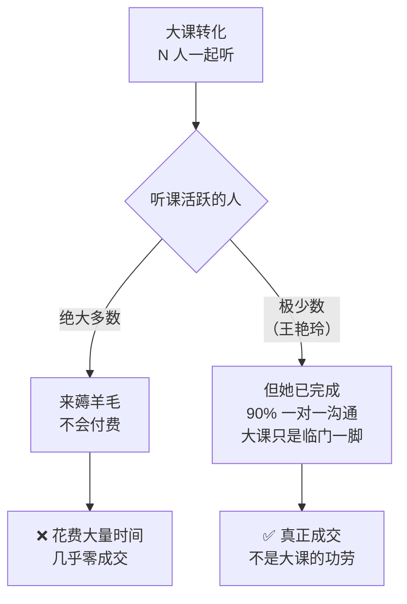

# 大课转化为什么失败

> **一句话**：共创营一期、二期都用大课转化，**几乎没有成交** —— 听课活跃的人大多是来薅羊毛的。

---

## 原始定义（2026-10-06 · 00:20:00）

胡子哥团队的原话（会议记录）：

> "共创营一期、二期都采用腾讯会议大课转化的方式，**花费大量时间，最终几乎没有成交**，
> **听课活跃的用户大多是来薅羊毛，不会付费**；
> 只有王艳玲是前期已经完成 90% 的一对一沟通，**大课只是临门一脚才成交**。"

### 决定

> "**停止腾讯会议大课转化，全部改为一对一电话沟通成交**，效率更高，成交率更高。"

---

## 关键洞察

**最关键的一句**：**大课看起来有效的那一单，不是因为大课有效 —— 是因为前面的一对一已经做完了。**

如果不看这一层，会误以为「大课能转化，只是需要更多耐心」。

---

## 判据：大课成交 ≠ 大课有效

| 情况 | 大课的角色 | 判断 |
|---|---|---|
| 客户已完成 90% 一对一，大课只是临门一脚 | 收尾工具 | ✅ 可以用 |
| 客户只听过大课 | 唯一的接触方式 | ❌ 成交率极低 |

---

## 落地动作

### 1. 停止把大课当成交渠道

大课当**内容交付/信任建立**可以，当**成交渠道**不行。

### 2. 转化动作换成一对一电话

> "大部分付费客户都需要**至少 1 小时左右的一对一电话沟通**，高信息密度沟通才能解决客户卡点，促成成交。"

### 3. 复盘时必须问的问题

> 「这单到底是大课成交的，还是一对一成交的？」
> —— 答不上来，就别把大课写进成交漏斗。

---

## 自检清单

- [ ] 我上一次成交，是因为大课还是因为一对一？
- [ ] 我的大课学员里，有多少是真客户，有多少是薅羊毛？
- [ ] 我是不是在用「学员很活跃」安慰自己？
- [ ] 成交前的一对一电话，我做够 1 小时了吗？

---

## 相关

- 替代方案：[[一对一成交原则]]
- 流程设计：[[分阶段成交]]
- 库位置：[[姜胡说知识库]]

---

*提炼自：[[2026-10-06-AI知识库变现与养老院AI赋能-姜胡说]] 章节 00:20:00 · 创建于 2026-11-12*
