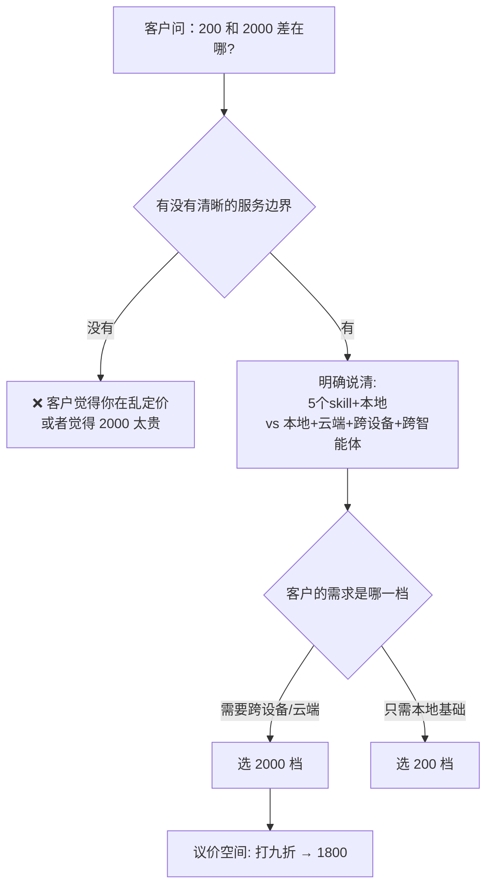

# 差异化定价与服务边界

> **一句话**：200 元只连本地知识库，2000 元支持本地+云端、可跨设备跨智能体切换 —— **差价来自能力边界，不是随口定的**。

---

## 原始定义（2026-10-06 · 00:17:20 北京女客户成交复盘）

> "该客户原本找鹏飞支付 200 元搭建知识库，**最终从鹏飞手中转来**，找说话人付费。
> 客户问 **200 元和 2000 元服务的区别**，说话人说明：
> **200 元仅提供 5 个 skill 连接本地知识库，2000 元服务支持本地+云端知识库，可跨设备、跨智能体自由切换**。"

### 议价与成交周期

> "最终**给客户打九折，收取 1800 元**成交，前后经过两次沟通，
> **第一次沟通 1 小时，第二次沟通三四十分钟**。"

---

## 逻辑框架

**关键：议价空间来自「服务边界清晰」** —— 客户知道自己买到了什么，才可能接受折扣。

---

## 定价设计的 3 个原则

| 原则 | 做法 | 依据 |
|---|---|---|
| **差价对应能力差** | 200 = 本地 + 5 个 skill；2000 = 本地+云端 + 跨设备 + 跨智能体 | 客户听得懂、能判断自己需要哪个 |
| **保留议价空间** | 标 2000，成交打九折 1800 | 有折扣余地，客户觉得赚了 |
| **明确说不提供什么** | 「5 个 skill」是上限 | 边界清晰 = 不失控 |

---

## 落地动作

### 1. 给每个价格档写一句「能力边界」

不是「服务更好」，而是**具体多了什么**：
- ❌ 「2000 元享受更全面服务」
- ✅ 「支持本地+云端，可跨设备、跨智能体自由切换」

### 2. 让客户自己选档

问「你需要哪种」，而不是「这个多少钱」。**让客户做判断，成交阻力最小**。

### 3. 报价留 10% 余量

标 2000 → 成交 1800。**客户拿到折扣的感觉，比省下 200 块更值钱**（尤其 ToB 决策链里要「过一下」）。

### 4. 沟通时长是成交的一部分

这个单子：第一次 1 小时 + 第二次三四十分钟。**两轮沟通才成交 —— 别指望一通电话搞定。**

---

## 自检清单

- [ ] 我的每个价格档，能不能用一句话说清「多给了什么能力」？
- [ ] 客户能自己判断该选哪一档吗？
- [ ] 我报价留了议价空间吗？
- [ ] 我是不是第一次沟通就想签单？

---

## 相关

- 成交流程：[[分阶段成交]]
- 赛道选择：[[从2C转2B]]
- 库位置：[[姜胡说知识库]]

---

*提炼自：[[2026-10-06-AI知识库变现与养老院AI赋能-姜胡说]] 章节 00:17:20 · 创建于 2026-11-12*
