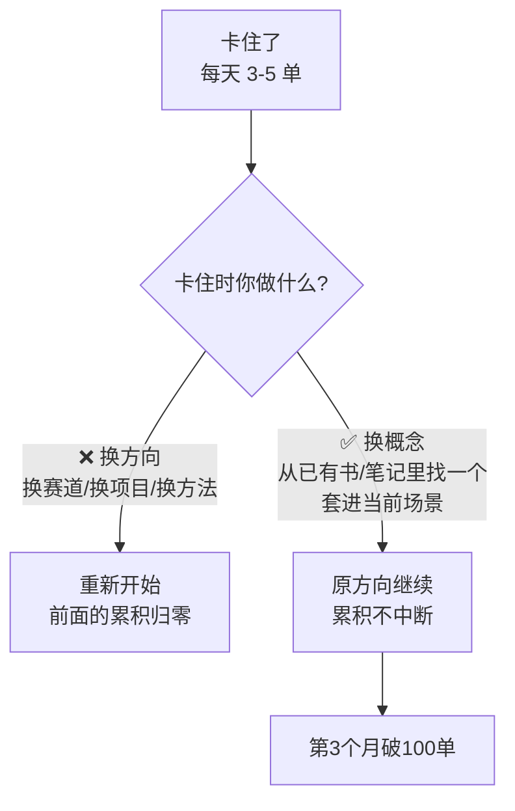

# 换概念不换方向

> **一句话**：卡住的时候，**不是换方法，是换一个概念套进你现在的场景**。

---

## 原始定义（2026-10-30 · 00:14:06 依晨分享）

依晨的原话路径：

> 做直播整整 **2 个月一点起色都没有**，每天 **3 单、5 单**出单，**已有点坚持不下去、开始怀疑自己**。
>
> 「他翻到胡子哥《价值心法》中『**如何影响他人行为**』那一章，**把内容套用到直播上**，**第 3 个月突破 100 单**，直言『**真的好用**』。」

线下再突破：

> 「从来在家 4 小时成交 100 单，到线下 **3 小时成交 200 单**。」（主持人补充：每天稳定收入 4 位数，是销冠）

---

## 核心区分



**关键：换概念 = 复用已有的方向和累积；换方向 = 全部重来。**

---

## 落地动作

### 1. 卡住时的 3 步动作（不找新方法）

```Plain Text
① 回到你已有的书/笔记/社群记录
   ↓
② 找一个能解释当前卡点的概念
   ↓
③ 把它套到你现在正在做的事上
```

依晨的具体做法：翻《价值心法》→ 找到「如何影响他人行为」→ 套到直播 → 第 3 个月破 100 单。

### 2. 区分「方向错了」和「方法没对」

| 信号 | 判断 | 动作 |
|---|---|---|
| 做了很久，**反馈有但小**（3-5 单）| 方向对，方法/概念没对 | **换概念** |
| 做了很久，**完全没反馈**（0 单 0 互动）| 方向可能错 | 换方向 |
| 数字在涨但停住了 | 触达不够 | 换手段（见 [[自媒体传播三问]]）|

**依晨是典型的「方向对、方法没对」** —— 每天能出 3-5 单说明链路是通的，只是效率低。

### 3. 边学边用、边用边学

> 「通过做直播把以前丢下的『每天写点什么』重新用起来，**边学边用、边用边学**，按利他、公开构建的方式完成小闭环。」

**不要等学完再做**（依晨之前打卡「每天写点什么」坚持十多天就放弃了，因为没做事情写不出东西 —— **先做，再学，学习才有素材**）。

### 4. 用概念时问一句「它解释了什么」

依晨把「如何影响他人行为」套到直播上 —— 这正好对应 [[行为公式B等于MAT]] 里 T（触发）和 A（能力）两个变量。

**动作**：套概念时，把概念拆成变量，逐个问「我这边的这个变量是什么」。

---

## 自检清单

- [ ] 我卡住的时候，是在找新方法还是回已有资料？
- [ ] 我的卡点是「方向错」还是「概念没对」？
- [ ] 我是边做边学，还是学完再做？
- [ ] 我上一个概念套进场景后，有效果吗？

---

## 相关

- 认知前提：[[赚钱是技能]]（概念可以学）
- 行为公式：[[行为公式B等于MAT]]（依晨用透的那个）
- 系统层：[[目标与系统的区别]]（换概念不打断累积）
- 库位置：[[姜胡说知识库]]

---

*提炼自：[[2026-10-30-多位普通人直播创业突破经历-姜胡说]] 章节 00:14:06 / 00:15:20 · 创建于 2026-11-12*
