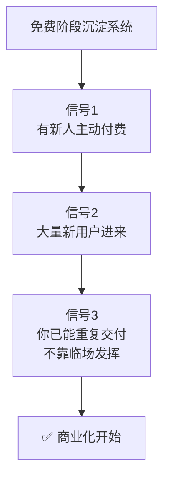

# 新人付费才算产品被确定

> **一句话**：熟人付费可能是被裹挟的。**只有新人主动付费，产品才被市场确定。**

---

## 原始定义（2026-11-11 · 09:39 章节）

> 胡子哥给建议：
> 不断沉淀出系统时，判断标准是「**有新人主动付费**」时产品才被确定；
> **熟人付费不算**，熟人付费有时是被裹挟的，**要劝退他们**；
> 有大量新用户进来，才说明产品被认可，才是真正开始商业化。

补充：
> 老伙计是股东、是合伙人、是天使投资人。
> 做社群不是为了挣老伙计的钱，社群是土壤，目标是帮老伙计变得更好。

---

## 判定矩阵

| | 新人付费 | 熟人付费 |
|---|---|---|
| **说明什么** | ✅ 产品被市场验证 | ⚠️ 可能被裹挟 / 人情 |
| **能不能收费** | ✅ 可以 | ❌ 继续免费 |
| **要做什么** | 规模化交付 | **劝退** |

---

## 收费的 4 个前置信号

**第 4 个信号（我的补充，基于 21:xx「做产品要能积累」的逻辑）：**
产品必须**可积累、可复利**，否则一单接一单，天花板是「一年 365 天」。

---

## 胡子哥自己的对照

| | 旧模式（咨询） | 新模式（产品） |
|---|---|---|
| 客单价 | 5 位数～6 位数，排满 | 不靠单价 |
| 积累性 | ❌ 做一个丢一个 | ✅ 可复利 |
| 成本 | 时间 | 几乎为零 |
| 天花板 | 一年 365 天（还要去掉节假日、婚丧嫁娶、头疼脑热）| 用户数极大 |
| 复购 | ❌ | ✅ |

**「先问凭什么是我」** —— 胡子哥的护城河：给世界 500 强做咨询的背景。

---

## 常见误判

| 误判 | 为什么错 |
|---|---|
| 「有 10 个人付了，其中 8 个是熟人」 | 熟人付费不算数 |
| 「先收钱做一年再看」 | 被契约锁死，退都退不出（见 [[免费起步保留退出权]]）|
| 「客户说便宜点就便宜点」 | 100 倍价差要先讲清楚，否则两个都不成交 |
| 「涨价是唯一的商业化」 | 涨价不解决「产品是否被认可」|

---

## 自检

- [ ] 最近付费的人里，新人占比多少？
- [ ] 我有没有在劝退「被裹挟的熟人」？
- [ ] 我这个产品可积累吗？还是做一个丢一个？
- [ ] 我能说清楚「凭什么是我」吗？（更好/更快/更便宜/更不可复制）
- [ ] 我交付的是「结果」还是「知识」？

---

## 相关

- 前置：[[免费起步保留退出权]]
- 土壤：[[土壤保护与筛选]]
- 我的对应：[[mvp]]
- 库位置：[[姜胡说知识库]]

---

*提炼自：[[2026-11-11-知识产品化与能力系统化-姜胡说]] 章节 09:39 / 21:xx · 创建于 2026-11-11*
