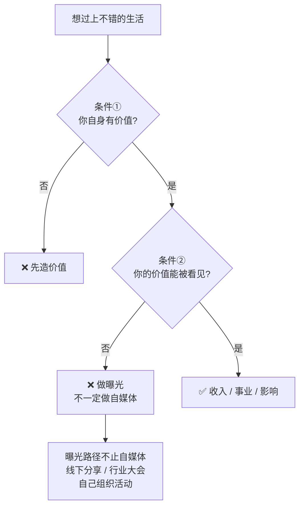

# 有价值和被看见

> **一句话**：普通人想过上不错的生活，只需两件事 —— **① 你有价值 ② 你的价值能被看见**。

---

## 原始定义（2026-09-28 · 00:10:14）

胡子哥原话：

> "**普通人想生活得很好，只需要两件事：第一个，你有价值；第二个，你的价值能被看见。**"

### 自媒体的角色

> "自媒体是让更多人看到自身价值的**低成本方法，没有成本门槛**，所以人人都应该做自媒体。"

### AI 的要求

> "人人都要使用 AI，**不需要一定做成什么，但要把 AI 变成自身能力的一部分**。"

### 风险提示（这一条最容易被忽略）

> "做自媒体能获得更多机会，但同时**风险也更大，绝对不能赚来路有问题的快钱**。
> 当前环境下，**任何来路不正的钱最终都留不住，这不是道德要求，是现实规则**。"

---

## 逻辑框架

**关键：条件②有多个路径，自媒体只是其中一个。**

---

## 认知 bug 的限制（前置提醒）

胡子哥在同一场分享的开头：

> "**当你 bug 太多的时候，你是没有办法穿透原有认知，会天然排斥新的认知。**"
>
> "很多人无法取得成绩的核心原因，就是**旧有认知的负面影响过大**，无法接受新方向。"

**他在前一天回看自己拍的视频时也发现了新的认知问题** —— 说明这个 bug 自己也一直在处理。

---

## 落地动作

### 1. 分别诊断两个条件

| 条件 | 诊断问题 | 缺了怎么办 |
|---|---|---|
| ① 有价值 | 我能解决什么具体问题？| 先造价值（做小事、跑闭环）|
| ② 被看见 | 本地的目标用户知道我是谁吗？| 选一条曝光路径 |

### 2. 别默认「被看见 = 做自媒体」

见 [[线下分享定价阶梯]] —— 线下路线的单价高得多。

### 3. 把 AI 变成能力的一部分

不是「学个工具」，是**它进了你的交付流程**。

### 4. 守住来路

**来路不正的钱最终都留不住** —— 快速钱的账，后面要还。

---

## 自检清单

- [ ] 我现在缺的是「有价值」还是「被看见」？
- [ ] 我的曝光路径是不是只有自媒体一种？
- [ ] AI 是我能力的一部分，还是只是学过？
- [ ] 我赚的钱来路干净吗？

---

## 相关

- 曝光路径：[[线下分享定价阶梯]]
- 红利窗口：[[二三线信息差红利]]
- 库位置：[[姜胡说知识库]]

---

*提炼自：[[2026-09-28-从零到一打造个人影响力-姜胡说]] 章节 00:01:07 / 00:10:14 / 00:12:38 · 创建于 2026-11-12*
