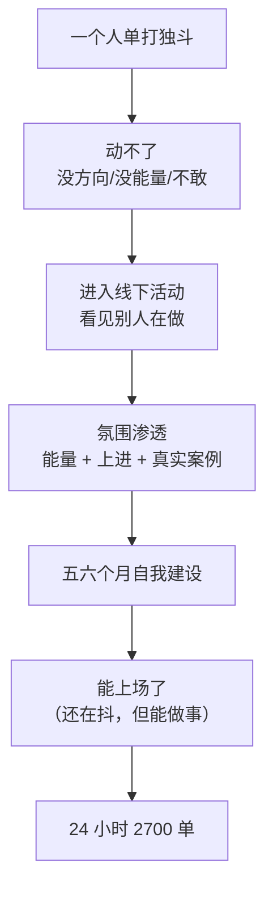

# 氛围改变人

> **一句话**：**一个人真的动不了，还是得要多跟有这种能量、有上进的人在一起，那个氛围才能改变人。**

---

## 原始定义（2026-10-30 · 00:00:14 韭黄分享）

韭黄原话：

> "一个人真的动不了，还是得要多跟有这种能量有上进的人在一起，**那个氛围才能改变人**。"

### 他的完整背景

> "2022 年开始特别迷茫，先后开武术馆、开面馆等**四五样生意，全部赔钱**，实在没有退路才转投互联网。"
>
> "自认是社恐，**参加线下活动时身体仍会抖**，但通过五六个月自我建设建立了自信。"

**关键：他到今天身体还是会抖** —— 不是「练到不抖了」，是「在抖的同时能做事」。

### 现场的画面感（原文）

> "但是通过这呃五六个月的这个自己不断的给自己建立了自信嘛，就是呃你看我呃很多人说你这个一点一点也不像社恐的呀，就说其实我还是我现在身体还是还是会抖，就是但是我是我是在有突破的，嗯，我觉得。"

### 胡子哥现场回应

> "**我直播挣到钱了，所以来线下了**。"
>
> （调侃）"怎么 30 万完了到我这都秃了毛了。"

---

## 逻辑框架

**关键：氛围不是「听道理」，是「看见身边有人在做」。**

---

## 落地动作

### 1. 去有能量的场（线下活动的真正价值）

| ❌ 以为是 | ✅ 实际是 |
|---|---|
| 听方法课 | 看见身边有人在做 |
| 学知识 | 吸收能量 + 上进氛围 |
| 认识人脉 | 被氛围改变 |

### 2. 允许自己「还在抖」

韭黄的身体还是会抖。**突破不是「不抖了」，是「抖着也能上场」**。

**动作**：社恐的人先从「只听不发言」开始 → 下一场「发一句」→ 再下一场「讲一段」。

### 3. 认自己的位置（韭黄的「韭菜 → 韭黄 → 变绿」）

> "就是那个**大韭菜**，现在是一个**韭黄**，慢慢变绿了。"

**这是自我定位的转换叙事** —— 从「我被骗了/我不行」变成「我在变成什么」。

### 4. 跟人比更有效

> "跟着胡子哥、李公子以后会少走很多弯路，**这比花掉的『韭菜钱』值得得多**。"

---

## 自检清单

- [ ] 我最近一次去「有能量的场」是什么时候？
- [ ] 我身边有没有在做事的人？（还是都在抱怨）
- [ ] 我允许自己「还在抖」吗？
- [ ] 我把自己定位成什么？（韭菜 / 韭黄 / 变绿）
- [ ] 我跟谁学？能不能少走弯路？

---

## 相关

- 环境层：[[生态位与互相托举]]（找到对的环境 = 合作博弈）
- 情绪层：[[跳出内耗]]（换环境是跳出内耗的两个方法之一）
- 社群层：[[土壤保护与筛选]]（氛围靠土壤保护）
- 库位置：[[姜胡说知识库]]

---

*提炼自：[[2026-10-30-多位普通人直播创业突破经历-姜胡说]] 章节 00:00:14 / 00:02:33 · 创建于 2026-11-12*
