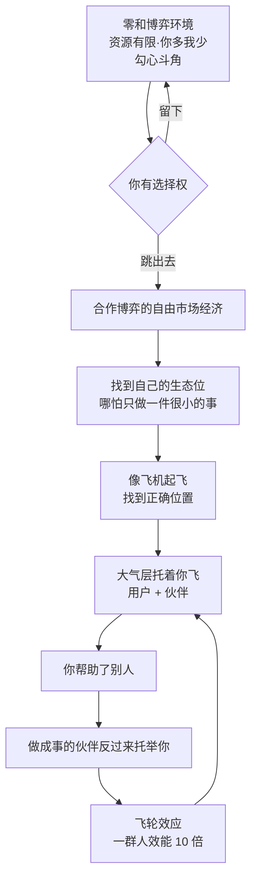

# 生态位与互相托举

> **一句话**：跳出零和博弈，找到自己的生态位 —— **会有大气层（用户和伙伴）托着你飞**。

---

## 原始定义（2026-10-23 · 01:29:42 / 01:36:08）

胡子哥原话：

> "大多数人处在封闭的零和博弈环境里，资源有限，你多拿我就少拿，因此到处都是勾心斗角。**你有选择权，可以跳出来**到合作博弈的自由市场经济环境，找到自己的生态位。"
>
> "找到生态位后，会像飞机起飞一样，**找到正确位置后，会有大气层（用户和伙伴）托着你飞**，你帮助了别人，做成事的伙伴会反过来托举你。"

### 互相托举的真实案例

> "过去 6 年一直分享知识帮助老伙计，很多老伙计做成事后会主动帮我宣传，比如公子、冰超、严木都会主动分享我的帮助，带来了很多新用户，这就是互相托举。"
>
> "江湖说的老伙计都是互相托举，很少互相攻击，内耗少摩擦少，**一群人一起前进的效能比一个人高 10 倍**，会形成飞轮效应。"

---

## 逻辑框架

---

## 落地动作

### 1. 诊断你在哪个环境

| 零和特征 | 合作特征 |
|---|---|
| 资源有限，你多我少 | 有增量蛋糕 |
| 到处勾心斗角 | 互相成就 |
| 你不干我就干 | 你干好我也好 |

### 2. 找生态位（不是找风口）

> 「所有人都告诉你要找风口，其实你找到正确的位置，会有很多人托举着你飞。」

**生态位 = 别人不做、你能做、且能持续做的那一小块。**
哪怕只做一件很小的事 —— **位置对了，大气层会自己来**。

### 3. 主动托举别人（这是生态位的入场券）

**托举不是交易，是先给。**
> 「你帮助了别人，做成事的伙伴会反过来托举你。」

具体动作：
- 公开分享你的方法（胡子哥 6 年）
- 做别人的产品设计者 / 教练（[[能力系统化]]）
- 给粉丝真实价值（[[自媒体传播三问]]）

### 4. 警惕伪托举

**托举的前提是「你先帮到人」**。如果只是资源互换、互相抬轿，那还是零和博弈。

---

## 自检清单

- [ ] 我现在处的是零和还是合作环境？
- [ ] 我的生态位具体是什么？（能一句话说清吗）
- [ ] 我最近主动托举过谁？
- [ ] 我是在等别人托举我，还是先在托举别人？
- [ ] 我做的事，有增量吗？

---

## 相关

- 内耗解法：[[跳出内耗]]
- 社群土壤：[[土壤保护与筛选]]
- 我的飞轮：[[huashu-flywheel]]
- 库位置：[[姜胡说知识库]]

---

*提炼自：[[2026-10-23-AI时代一人公司的构建方法-姜胡说]] 章节 01:29:42 / 01:36:08 · 创建于 2026-11-12*
