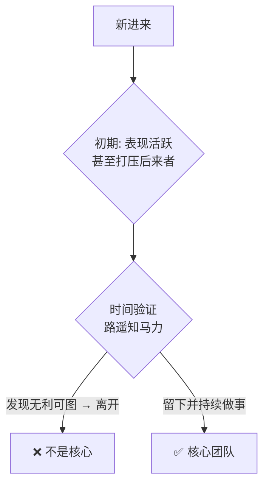

# 用时间衡量核心团队

> **一句话**：不要用「你以为」判断人 —— 人会看错。要用时间衡量，路遥知马力，日久见人心。

---

## 原始定义（2026-11-11 · 18:35 志坤章节后）

> 胡子的原话：
> **「路遥知马力，日久见人心，核心团队一定要学会用时间来衡量。」**

展开逻辑：

- 不要用「你以为」判断人 —— **人会看错**
- 表现活跃的人可能带着目的来、可能擅长做这个（未必真的做事）
- **早期进来的人可能打压后来者**（怕资源被分走）
- 等时间长了，发现无利可图就离开了 —— **留下的才是真正做事的人**
- **「着急长出来的『视频』就是歪的」**

---

## 时间检验的三个阶段

**关键**：初期的不活跃 ≠ 不是核心。初期的高活跃 ≠ 是核心。**只有时间能区分。**

---

## 与「筛选」的分工

| 环节 | 解决什么 | 手段 |
|---|---|---|
| **筛选**（[[土壤保护与筛选]]）| 挡住明显不合适的人 | 门槛 + 目标先行 + 劝退 |
| **时间衡量**（本页）| 从留下的里识别谁在真做事 | 耐心等待 + 观察 |

**筛选是减法，时间是验证。两者缺一不可。**

---

## 落地动作

1. **降低早期判断权重** —— 刚进来表现好不好，先不下结论
2. **设观察期** —— 至少一个完整周期（一个月 / 一期活动 / 一轮共创）
3. **看持续性，不看爆发力** —— 持续做事 > 一时活跃
4. **别让早期的人形成垄断** —— 资源分配要留出后来者的空间
5. **接受「着急长出来的视频是歪的」** —— 慢不是问题，歪才是

---

## 自检

- [ ] 我是不是在用「你觉得他靠谱」代替「他持续在做事」？
- [ ] 我有没有因为一个人现在不活跃就判他出局？
- [ ] 我有没有因为一个人很活跃就给他核心位置？
- [ ] 核心团队的位置，是否被早期的人占满了？

---

## 相关

- 前置：[[土壤保护与筛选]]
- 协同：[[能力系统化]]（核心团队怎么一起把事做成）
- 库位置：[[姜胡说知识库]]

---

*提炼自：[[2026-11-11-知识产品化与能力系统化-姜胡说]] 章节 18:35 志坤 · 创建于 2026-11-11*
