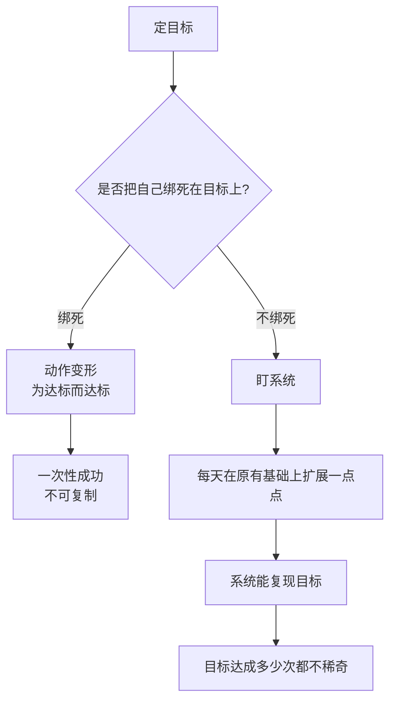

# 目标与系统的区别

> **一句话**：目标只能让你成功一次，系统才能让你的目标不断复现。**定好目标之后不要把自己绑定在目标上，否则动作会变形。**

---

## 原始定义（2026-10-23 · 01:03:46）

胡子哥原话：

> "目标只能让你成功一次，构建系统才能让成功不断复现。"
>
> "定好目标之后不要把自己绑定在目标上，否则动作会变形。"
>
> "我们要的是系统，不是单次的结果。"

---

## 两个反例（胡子哥给的）

| 反例 | 为什么不可复制 |
|---|---|
| **为了成交隐瞒产品瑕疵** | 哪怕成交了也不可复制 |
| **靠刷热点做出一条爆款** | 没法持续做出爆款 |

**共同点：都是「一次性动作」，不是「可重复机制」。**

---

## 逻辑框架

---

## 落地动作

### 1. 目标照定，但每天问的是「系统」不是「目标」

> 「不要盯着目标，要盯着系统，慢慢就会形成自运转系统。」

| 问法 | ❌ 目标导向 | ✅ 系统导向 |
|---|---|---|
| 今天要看什么 | 还差多少到 100 | 系统今天跑起来了吗 |
| 遇到诱惑 | 怎么最快达成 | 这件事对系统有什么增益 |
| 什么时候停 | 达标就停 | 系统能跑就继续 |

### 2. 判断一件事是不是「系统动作」

问自己：**「这件事明年还能再做一遍吗？」**
- 能 → 系统动作
- 不能 → 一次性动作（可以做，但别把它当方法）

### 3. 每天只扩展一点点

> 「每个人每天能做的事非常少，很多人认识不到这一点，总想着拍几条视频就爆火，拍了几个月没流量就放弃。」

**每天只在之前的基础上扩展一点点** —— 不求爆火，求不断累积。

### 4. 达标了也别松

冰超和聂风的社群案例：年初定「帮 100 位老伙计每年多赚 1 万」，已完成七八十个。

> **不要为了凑数硬帮剩下的达标**，要把已经做成事的方法梳理成可复制的方法论，形成系统 —— 哪怕今年没达标，明年这套方法还能用。

---

## 自检清单

- [ ] 我今天做的事，明年能原样再做一遍吗？
- [ ] 我是在盯「还差多少」，还是在盯「系统跑起来没」？
- [ ] 我有没有为了达标而变形动作？
- [ ] 达成目标后，我留下的是方法还是只有数字？

---

## 相关

- 终点：[[自运转系统]]
- 起点：[[做自己的小事]]
- 库位置：[[姜胡说知识库]]

---

*提炼自：[[2026-10-23-AI时代一人公司的构建方法-姜胡说]] 章节 01:03:46 / 01:10:08 / 01:57:31 · 创建于 2026-11-12*
