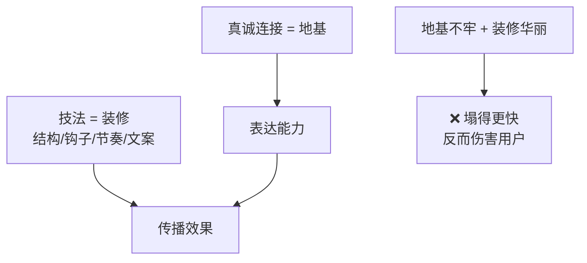

# 真诚是地基，技法才是装修

> **一句话**：地基不牢，装修华丽 = 塌得更快。**基础不牢，所有技法都是伤害。**

---

## 原始定义（2026-11-06 Day3 · 第六部分）

> 胡子哥：
> "这个时候不要技法，注意你和你和（用户）的这种真心的连接是所有的基础，
> **这个如果不牢，所有的技法对你全是伤害**，各位能懂我的意思吗？"

---

## 地基 vs 装修



---

## 技法层的正确顺序

```Plain Text
① 真诚连接（地基）
      ↓  稳了才往下走
② 逐次去杂质（不表演）
      ↓
③ 结构 / 钩子 / 节奏（装修）
```

**自测题**：我有没有能力对着一个人，毫无表演地讲三分钟？
- 做不到 → **先练这个，别学钩子**
- 做到 → 再学技法

---

## 去杂质的操作法

```Plain Text
杂质（紧张、表演欲、在意流量、想耍帅）
   ↓
不是一次清空，是一次去掉一点
   ↓
这次没去掉也不自责 → 下次再试
   ↓
底线：真诚连接不能破，否则技法全是伤害
```

### 三个落地动作

1. **拍完问自己**：「这条里我还在乎什么？」—— 那个就是杂质。
2. **每次只针对一个杂质**（比如「总想说得漂亮」），下一条只练去掉它。
3. **反复拍不是重复劳动**，是**逐次去杂质**。

### 场景再现法

> "拿起一部手机打开镜头，盯着屏幕……**这个摄像头是你女朋友，她不是摄像头，她不是流量，她就是你女朋友。**回到那种场景，场景再现开始。"

给自己定一个「镜头对面的人」：爱人、老友、某个学员。**每次拍之前默念一遍他的名字。**

---

## 自检清单

- [ ] 我能不能对着一个人，毫无表演地讲三分钟？
- [ ] 我这条视频里还在乎什么？
- [ ] 我有没有在用技法掩盖「我其实没想清楚」？
- [ ] 我的钩子背后有没有「药」？（没药就是耍流氓）

---

## 相关

- 状态层：[[视频是状态的溢出]]
- 行为层：[[行为公式B等于MAT]]
- 库位置：[[姜胡说知识库]]

---

*提炼自：[[2026-11-06-姜胡说3.0自媒体北京闭门会-姜胡说]] Day3 第六部分 · 创建于 2026-11-11*
