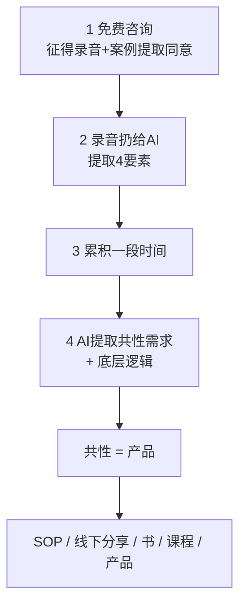

# 知识产品化

> **一句话**：把「一个个免费咨询」变成「可批量分发的产品」，靠的是录音 → AI 提取 → 找共性 → 共性即产品。

---

## 原始定义

胡子哥在 2026-11-11 线下答疑中提出（03:28 章节）：

> 做免费咨询时先征得对方同意「从你的故事里提取案例」，同意才做、不同意就不做；
> 咨询时把手机放旁边录音，录完把内容扔给 AI，让 AI 提取「问题是什么、解决方案是什么、原则是什么、知识是什么」；
> 提取多了以后每隔一段时间让 AI 提取共性需求、底层逻辑，共性需求就变成产品。

---

## 4 步流水线

### AI 提取的 4 个字段（每条咨询都要提）

| 字段 | 问什么 |
|---|---|
| **问题是什么** | 对方来的时候，卡在哪 |
| **解决方案是什么** | 实际怎么解的 |
| **原则是什么** | 背后可复用的规律 |
| **知识是什么** | 能沉淀下来的认知 |

---

## 关键前提

- **必须先征得同意** —— 「同意才做、不同意就不做」。不是默认能录音。
- **必须是免费** —— 免费让你有随时退出的能力，才有大量实验窗口（见 [[免费起步保留退出权]]）
- **老伙计是股东** —— 免费共创的过程本身就是资产提取，「帮助老伙计变得更好」的过程 = 对外分发的东西

---

## 可迁移到「一人公司」的场景

| 场景 | 免费动作 | 提取什么 | 变成什么产品 |
|---|---|---|---|
| 短视频 | 免费帮粉丝改钩子 | 高频问题类型 | 钩子模板库 / 提示词 Skill |
| 社群答疑 | 免费改作业 | 反复出现的错 | 常见错误手册 |
| 实体店 | 免费给顾客做搭配 | 审美偏好分类 | 付费搭配服务 |
| 企业咨询 | 免费诊断 | 行业共性痛点 | 行业解决方案 SOP |

---

## 反模式（胡子哥明确反对）

- ❌ 直接收钱做咨询 —— 没有实验窗口，也不知道共性需求在哪
- ❌ 把「能帮一个人」当成产品 —— 那只是服务
- ❌ 追求「做得全面」 —— 应该追求「有一个人极需要」

---

## 相关

- 上游：[[免费起步保留退出权]] → 采集端
- 并行：[[能力系统化]]（同一场答疑的另一支柱）
- 下游：[[knowledge-runnable-check]]（提取后跑三问门禁再铸卡）
- 库位置：[[姜胡说知识库]]

---

*提炼自：[[2026-11-11-知识产品化与能力系统化-姜胡说]] 章节 03:28 · 创建于 2026-11-11*
