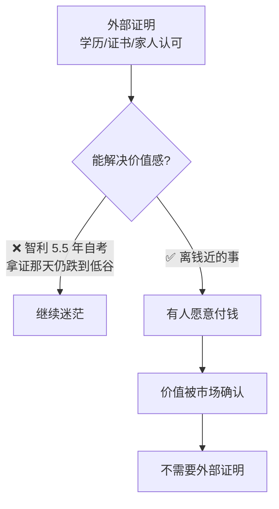

# 离钱近的事情

> **一句话**：**你要赚钱，就去做那个离钱近的事情** —— 不需要靠外面的东西来证明你自己。

---

## 原始定义（2026-10-30 · 00:06:40 智利分享）

胡子哥的原话（智利转述 + 引用）：

> "你要赚钱，你就去做那个离钱近的事情，你不需要靠外面的东西来证明你自己。"
>
> "不需要靠外面的东西证明自己，**通过做一件小事发现自己的价值**。"

---

## 为什么「离钱近」重要（智利的完整路径）

```Plain Text
40 岁农村宝妈
   ↓ 每天围着孩子和老公转
「可有可无的存在」· 能量特别低
   ↓ 大孩子上初中，聊天时看到孩子眼神里的嫌弃
「怎么就活成了这样，失去了自己」
   ↓ 学亲子教育修复关系（无效）
   ↓ 花 5 年半自考拿本科毕业证（仍无效）
拿证那天 · 10 月 · 下着小雨 · 心情跌到低谷
「仍得不到家人肯定，找不到自己的价值」
   ↓ 刷到胡子哥视频 —— 离钱近
拍跳绳挑战视频 · 分享自考经历和踩过的坑
   ↓ 每条视频都看、反复看直播回放
去年 10 月峨眉山直播 → 买《价值心法》→ 加入社群
   ↓ 跟三姐学直播 2 个月多
10 月 21 日（胡子哥来到市场当天）爆单
```

**关键转折点**：拿证那天（5 年半的 effort）没有解决价值感问题，**「做一件离钱近的小事」解决了**。

---

## 逻辑框架



**关键**：外部证明（学历、证书、他人认可）≠ 价值。**离钱近的事，是把价值交给市场检验。**

---

## 落地动作

### 1. 列出你的事，按「离钱近」排序

对每件事问一句：**「离别人付钱还有几步？」**

| 离钱远 | 离钱近 |
|---|---|
| 学新技能（不知道谁会买）| 把你已有的能力做成一个能卖的小东西 |
| 做「我想做」但没人买的东西 | 做「已经有人在买」的事，只是换个人来做 |
| 长期项目（3 个月后才见结果）| 一件小事（今天就能开始卖）|

### 2. 用「做一件小事」替代「证明自己」

智利的具体动作（都是小事）：
- 拍跳绳挑战视频
- 分享自考经历
- 分享踩过的坑

**不是先想清楚「我该做什么」，而是先动起来做一件小事。**

### 3. 反复看回放

> 「每条视频都看、反复看直播回放。」

**回放 = 最便宜的复盘**（见 [[个人系统从用户问题到知识库]] 的现场诊断原则）。

---

## 自检清单

- [ ] 我现在做的事，离别人付钱有几步？
- [ ] 我是在等外部认可，还是在做一件能卖的小事？
- [ ] 我今天能做的那件小事是什么？
- [ ] 我有看回放复盘吗？

---

## 相关

- 互补：[[做自己的小事]]（离钱近 + 足够小）
- 落地：[[自媒体传播三问]]（怎么把价值传出去）
- 库位置：[[姜胡说知识库]]

---

*提炼自：[[2026-10-30-多位普通人直播创业突破经历-姜胡说]] 章节 00:05:10 / 00:06:40 · 创建于 2026-11-12*
