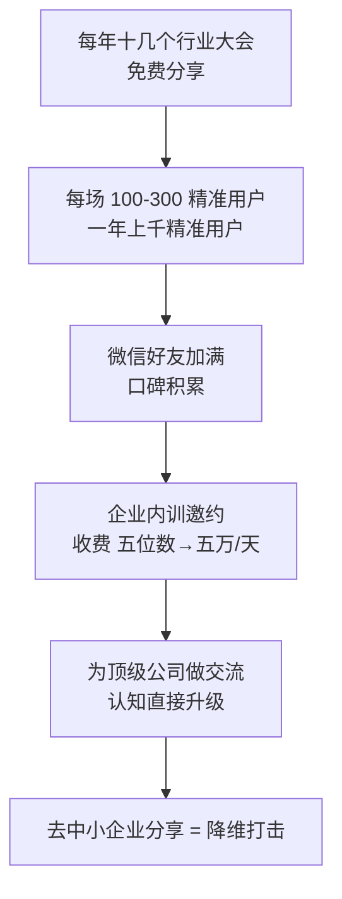

# 线下分享定价阶梯

> **一句话**：大会分享免费（换精准用户）→ 企业内训收费（五位数 → 五万/天）—— **先免费积累信任，再收费必满额**。

---

## 原始定义（2026-09-28 · 00:18:52）

胡子哥原话：

> "2010 年开始，主讲人**每年参加十几个产品经理、开发者行业大会做分享**，
> **规模越大的公开大会分享越免费，每场分享覆盖 100-300 名精准用户**，每年就能积累上千精准用户，
> **2010 年就把 5000 人好友的微信加满了**。
> 而**企业请内训全部收费，2010 年单日价格就已经是五位数，后续逐步涨到五万一天**。"

### 定价规则（关键）

| 场景 | 价格 | 目的 |
|---|---|---|
| 大型公开行业大会 | **免费** | 换精准用户 + 曝光 |
| 企业内训讲课 | **收费** | 五位数起 → 五万/天 |
| 自己组织的线下活动 | **免费为主** | 积累精准信任 |

---

## 逻辑框架



---

## 为什么免费反而更赚

```Plain Text
免费分享（100-300 精准用户/场）
   ↓ 常年积累
精准信任 + 大量人知道你能讲什么
   ↓ 偶尔收费
上线即满额（2018 年两天 2018 元限 30 人）
```

> "**常年做免费的高价值分享，只要你偶尔收费，用户就知道你的价值绝对物超所值，会很快报满。**"

**关键洞察：收费的溢价来自「免费阶段积累的价值感」，不是来自价格本身。**

---

## 落地动作

### 1. 找到你所在的行业大会

不是要你去讲（那是第二步），是**先去看**：
- 这个会有哪些精准用户？
- 有没有免费分享的环节？
- 有没有能搭上话的人？

### 2. 免费分享的标准

- **规模越大的越免费**（大会有流量需求，你有内容）
- **每场 100-300 精准用户就够** —— 关键是精准，不是数量
- **分享完加微信**（2010 年就加满 5000 人）

### 3. 收费时不要解释价格

**不要解释，要让对比自动发生** —— 用户自己心里有「你免费讲过那么多次」的账。

### 4. 高端交流的长期价值

> "为顶级公司做半天交流，**提前花了两个礼拜沟通准备，虽然压力很大，但交流完成后自身认知直接升级**，
> 后续去中小企业分享就是**降维打击**。"

---

## 自检清单

- [ ] 我今年参加过几个行业大会？
- [ ] 我在大会上讲过吗？（免费）
- [ ] 我积累了「精准用户」还是「围观群众」？
- [ ] 我敢收费吗？还是觉得自己还不够格？

---

## 相关

- 前提：[[有价值和被看见]]
- 补充路径：[[自己组织线下活动]]
- 讲法：[[共创式分享]]
- 库位置：[[姜胡说知识库]]

---

*提炼自：[[2026-09-28-从零到一打造个人影响力-姜胡说]] 章节 00:18:52 / 00:52:45 · 创建于 2026-11-12*
