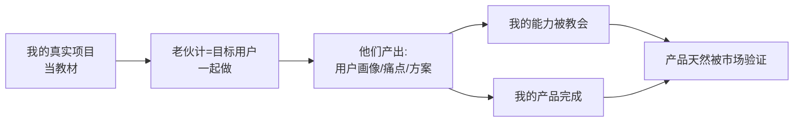

# 能力系统化

> **一句话**：用「自己真实要做的项目」当教材，把老伙计（= 目标用户）拉来一起干 —— 既教会了别人，也把自己的项目做完了。

---

## 原始定义

胡子哥 2026-11-11（04:40 章节）：

> 他有产品设计能力，想设计一款产品时就把所有老伙计叫到一块分享产品设计能力，
> 用自己真实要做的项目当案例，让在场的人（本身就是目标用户）画用户画像、写用户场景痛点、提出解决方案；
> 大家做完，他既教会了别人产品设计能力，自己的产品设计也完成了，
> 所以他的产品「都是用户帮我设计的」，出来就能卖掉。

---

## 关键机制

**为什么有效：**
1. 教材是真的 —— 不是假案例，学员有投入感
2. 学员就是用户 —— 他们产出的东西天然贴近真实需求
3. 一份时间两个收益 —— 教学 + 交付同时完成
4. 产品「出来就能卖掉」—— 因为需求是用户自己说的

---

## 与知识产品化的区别

| | 知识产品化 | 能力系统化 |
|---|---|---|
| **提取什么** | 共性需求（认知层） | 用户方案（能力层）|
| **谁参与** | 咨询对象（外部） | 老伙计（= 用户 + 股东）|
| **产出** | SOP / 书 / 课程 | 产品本身 |
| **核心句** | 共性需求 = 产品 | 产品都是用户帮我设计的 |

---

## 落地动作

1. **找出你接下来真要做的项目**（不是练习项目）
2. **列出「做这个项目需要哪几项能力」**
3. **每项能力 → 拉一批人当样本用户，一起实操**
4. **让他们产出**：用户画像 / 场景痛点 / 解决方案
5. **你收能力，他们收成品**

---

## 关键提醒

> 胡子哥：「先构建一个能让自己生存无忧、让所有人在里面受益的闭环，构建完了，你想干什么就干什么。」

能力系统化不是目的，是让闭环能自我运转的手段。

---

## 相关

- 配套：[[知识产品化]]（采集共性需求）
- 前提：[[简单原则]]（别搞太复杂，否则老伙计做不起来）
- 对应我的库：[[huashu-flywheel]]（胡子飞轮 = 理解 → 运行化 → 资产沉淀）
- 库位置：[[姜胡说知识库]]

---

*提炼自：[[2026-11-11-知识产品化与能力系统化-姜胡说]] 章节 04:40 · 创建于 2026-11-11*
