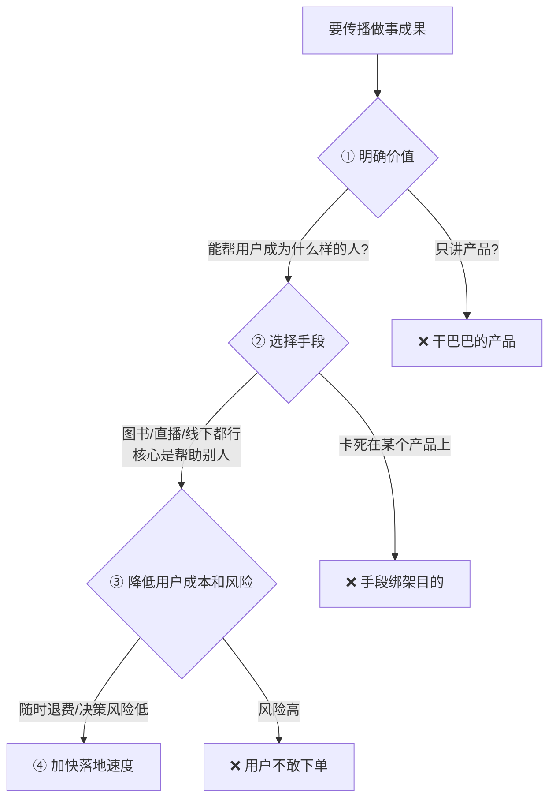

# 自媒体传播三问

> **一句话**：自媒体是用来传播你的做事成果的。传播时要算清三件事：**明确价值 / 选择手段 / 降低用户的成本和风险。**

---

## 原始定义（2026-10-23 · 00:45:06 / 00:51:29）

胡子哥原话：

> "自媒体用来传播你的做事成果，传播时要想清楚三个问题：
> 第一是**明确价值**，要想清楚你能帮用户成为什么样的人，让用户真实感受到价值，不是干巴巴的产品；
> 第二是**选择手段**，图书、直播、线下都是手段，**核心是帮助别人，不要卡在具体产品上**；
> 第三是**降低用户的成本和风险**，比如自己的社群支持随时退费，降低用户的决策风险。"

### 第四点：速度

> "提出第四个要考虑的点是速度，要想办法加快落地速度。"

---

## 三问详解

### ① 明确价值 —— 不是产品，是「成为什么样的人」

> 「要想清楚你能帮用户成为什么样的人，让用户真实感受到价值。」

**判据**：用户买的是「变成某个人的路径」，不是「一个东西」。

### ② 选择手段 —— 手段可替换

| 手段 | 适用 |
|---|---|
| 图书 | 需要沉淀、需要留存 |
| 直播 | 需要互动、需要即时反馈 |
| 线下 | 需要信任、需要体验 |

> 「核心是帮助别人，不要卡在具体产品上。」

### ③ 降低用户成本和风险 —— 退费机制

胡子的实际规则：

> 「当年财年没有交税的订单随时可以退，过了财年已经交税就无法退了。
> **每年只有不到五六个用户申请退费**，主动降低用户风险，反而不会有大量退费，**也能获得用户信任**。」

**反直觉点：主动降低风险 = 提高信任 = 降低退费率。**

### ④ 加快落地速度

> 「要想办法加快落地速度。」

---

## 落地动作

每次要做内容/产品前，问四遍：
1. **用户能成为什么样的人？**（不是：我要卖什么）
2. **这次用什么手段？**（还有别的选择吗）
3. **用户的决策风险怎么降？**（退费 / 试用 / 承诺）
4. **落地能不能更快？**

---

## 自检清单

- [ ] 我的价值主张是「成为什么样的人」还是「一个产品」？
- [ ] 我是不是卡死在某一个形式上了？
- [ ] 我给用户的退出成本是多少？
- [ ] 我敢不敢主动推「随时退」？
- [ ] 落地速度还能快吗？

---

## 相关

- 放大逻辑：[[AI放大与自媒体二次放大]]
- 行为层：[[行为公式B等于MAT]]（降低用户动作难度 = 提高能力变量）
- 产品化：[[知识产品化]]
- 库位置：[[姜胡说知识库]]

---

*提炼自：[[2026-10-23-AI时代一人公司的构建方法-姜胡说]] 章节 00:45:06 / 00:51:29 · 创建于 2026-11-12*
