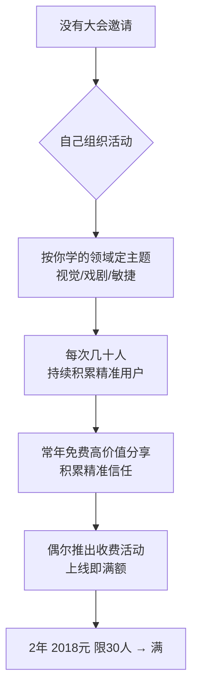

# 自己组织线下活动

> **一句话**：没有大会邀请就自己组织 —— 学什么领域就组织什么主题活动，每次覆盖几十人，**持续积累精准用户**。

---

## 原始定义（2026-09-28 · 00:26:21 + 00:58:41）

胡子哥原话：

> "**没有大会邀请就自己组织线下活动**，学什么领域就组织什么主题的活动：
> **学视觉就组织视觉主题活动，学戏剧就组织戏剧活动，学敏捷就组织敏捷主题活动**，
> **每次活动覆盖几十人，持续积累精准用户**。"

### 收费活动为什么必满

> "常年做免费高价值线下分享，积累了足够的信任，**偶尔推出收费线下活动就会快速报满**：
> **2018 年推出两天收费 2018 元、限 30 人的活动，上线就满额**，
> 核心是**用户都知道收费活动的价值远超价格**。"

### 新手可以借用社群品牌（江湖说）

> "**新手起步可以借用江湖说的品牌做活动**：
> 一来**新手不会组织，社群提供试错氛围，不需要一开始就完美**；
> 二来**新手没人来，借助社群能吸引初始参与者**。"
>
> "江湖说社群**鼓励成员自己组织线下活动，支持成员做成自己的个人事业，不限制成员发展**。"

---

## 逻辑框架

---

## 两种起步方式

| 方式 | 适用 | 起步成本 |
|---|---|---|
| **自己组织** | 已有一定能力，想建自己的盘子 | 高（要会组织）|
| **借社群品牌** | 新手，试错成本要低 | 低（社群提供氛围 + 初始参与者）|

**新手优先选第二种** —— 先跑通一次，再独立。

---

## 落地动作

### 1. 主题 = 你正在学的那个领域

不是「我想办什么活动」，是「**我最近在学什么，就办什么**」。
- 学视觉 → 视觉主题
- 学戏剧 → 戏剧
- 学敏捷 → 敏捷

**理由**：你是同款学习者，能讲的是真东西（见 [[共创式分享]]）。

### 2. 每次覆盖几十人就行

**不要一次办几百人。** 几十人足够验证主题、验证你的表达能力。

### 3. 收费活动怎么定价

参照胡子哥的 2018 年打法：
- **定价带年份**（2018 元 / 2019 元）—— 好记，本身是承诺
- **限时限量**（限 30 人）
- **天数明确**（两天）
- **上线即满**的前提是前面有免费积累

### 4. 新手就借社群品牌

> 「不需要一开始就完美」—— 试错成本低才敢开始。

---

## 自检清单

- [ ] 我最近在学什么？能办什么主题的活动？
- [ ] 我上次办活动覆盖了多少精准用户？
- [ ] 我有没有免费积累的信任底子？
- [ ] 我是新手，要不要先借社群品牌试一次？

---

## 相关

- 定价路径：[[线下分享定价阶梯]]
- 资源获取：[[借力打法]]
- 社群土壤：[[土壤保护与筛选]]
- 库位置：[[姜胡说知识库]]

---

*提炼自：[[2026-09-28-从零到一打造个人影响力-姜胡说]] 章节 00:26:21 / 00:58:41 · 创建于 2026-11-12*
