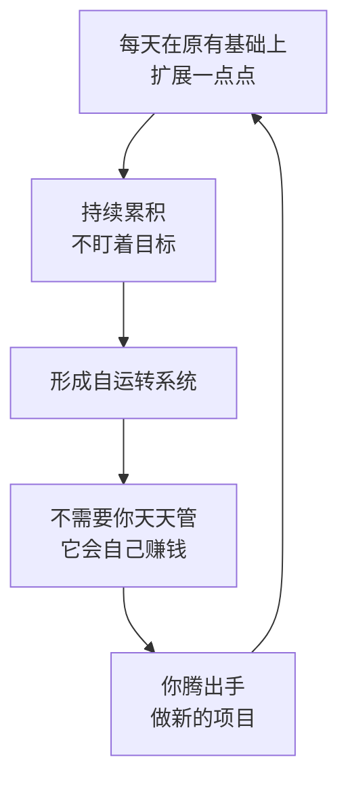

# 自运转系统

> **一句话**：系统形成后**不需要你天天管，它会自己赚钱**，你就可以去做新的项目。

---

## 原始定义（2026-10-23 · 01:57:31 / 02:01:15）

胡子哥原话：

> "正确的做法是：每天只在之前的基础上扩展一点点，持续累积，**不要盯着目标，要盯着系统**，慢慢就会形成自运转系统，形成后不需要你管，它会自己赚钱，你就可以去做新的项目。"

### 三个自运转案例（胡子哥自己）

| 系统 | 怎么自运转 | 需要你管吗 |
|---|---|---|
| **江小湖 AI 问答** | 自动分析用户问题、匹配用户画像给出回答 | **只需要偶尔纠偏**，不需要逐个处理 |
| **江湖说社群** | 每个周末全国各城老伙计**自发组织**线下活动 | 不需要发起人参与安排 |
| **个人投资系统** | 投完之后几年不用管 | 符合巴菲特「投完 5-10 年不用看」|

---

## 逻辑框架

**关键：自运转不是「躺赚」，是「解放出来后做新项目」** —— 系统在跑，人在往上走。

---

## 落地动作

### 1. 判断你的系统是否自运转

| 自运转 | 未自运转 |
|---|---|
| 不需要我参与也照跑 | 我一停就停 |
| 只需要偶尔纠偏 | 需要逐个处理 |
| 几年不用管 | 每天都要盯着 |

### 2. 从「每天在基础上扩展一点点」开始

> 「每个人每天能做的事非常少，很多人认识不到这一点，总想着拍几条视频就爆火，拍了几个月没流量就放弃。」

**这是自运转的燃料** —— 不是爆发，是累积。

### 3. 排除「伪自运转」

胡子的两个反例（详见 [[目标与系统的区别]]）：
- 隐瞒产品瑕疵促成交 —— 不可复制
- 刷热点做爆款 —— 不可持续

**判据：这件事明年能原样再做一遍吗？**

### 4. 守护自运转的关键动作

- **不需要你管** ≠ **不需要纠偏**（江小湖要偶尔纠偏）
- **自发组织** 是社群自运转的标志（江湖说：不需要发起人参与）
- **系统建好后，要腾出手做新项目** —— 否则会被拖回重复劳动

---

## 自检清单

- [ ] 我的系统，我一停它会停吗？
- [ ] 我今天做的事，是「系统动作」还是「一次性动作」？
- [ ] 我有没有被重复劳动拖住，没做新项目？
- [ ] 我给系统留了纠偏机制吗？
- [ ] 我每天在原有基础上扩展了吗？

---

## 相关

- 原理：[[目标与系统的区别]]
- 我自己的系统：[[个人系统从用户问题到知识库]]（你不在它还能转吗）
- 起点：[[做自己的小事]]
- 库位置：[[姜胡说知识库]]

---

*提炼自：[[2026-10-23-AI时代一人公司的构建方法-姜胡说]] 章节 01:57:31 / 02:01:15 · 创建于 2026-11-12*
