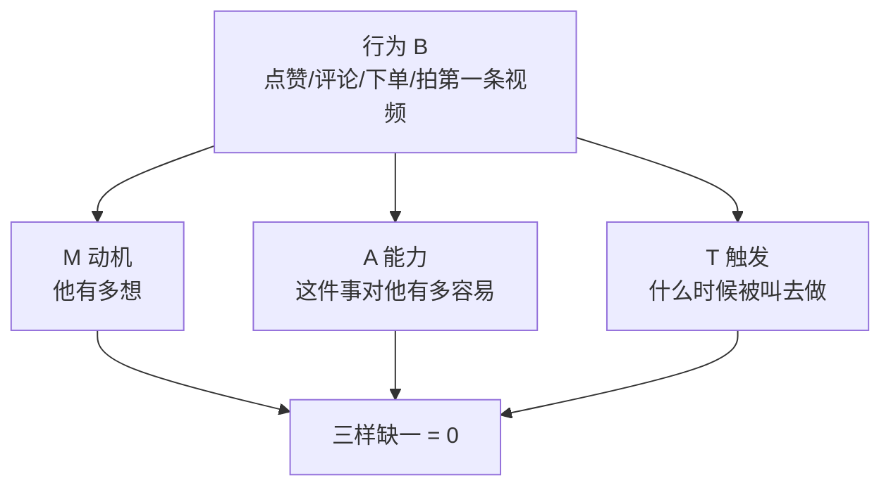

# 行为公式 B = M × A × T

> **一句话**：行为（点赞/评论/下单/拍第一条视频）= 动机 × 能力 × 触发。**三样缺一，行为为 0。**

---

## 原始定义

胡子哥 2026-11-06（北京闭门会 Day2 · 第三部分）：

> "B 就是行为的意思，行为就是你希望用户做什么，你希望别人给你点赞、给你评论、你希望别人买你的东西……"
>
> "行为等于 M 这个动机。**所以当一个人的动机足够强烈的时候，他就一定会去做。**所以我们要找到怎么去激发一个人的动机。"
>
> "但是光有动机不行，阻碍太大了。所以我们要给他提供一些方法，**这个方法越简单越好**。"

---

## 三变量拆解

| 变量 | 问什么 | 提升手段 |
|---|---|---|
| **M 动机** | 他有多想？| 找到他想做的事 / 让他看到结果 |
| **A 能力** | 对他有多容易？| **方法越简单越好**（关键）|
| **T 触发** | 什么时候被叫去做？| 设计明确的时机 / 环境 |

---

## 落地动作：每次问三遍

想要谁做什么，**先把三个变量各问一遍**：

1. 他为什么想做？（动机够强吗）
2. 他做得到的吗？（有没有降低难度）
3. 什么时候提醒他？（触发点在哪）

**最常被忽略的是 A。** 胡子哥：「光有动机不行，阻碍太大了。所以我们要给他提供一些方法，这个方法越简单越好。」

---

## 配套：傻瓜版动作设计

胡子哥在眉山爱媛果冻橙现场的做法：

> "所有的老伙计你先不要给我讲理论，去现场直接穿上衣服，然后穿上鞋，这个时候就开拍摄。……完全可以更复杂，但是我们就用那个最简单的方式让大家运营起来。"

**设计原则：运作起来 > 运作得好。**

| 目标 | 傻瓜版 |
|---|---|
| 拍视频 | 穿好衣服 → 站到现场 → 说一句话 |
| 写卡片 | 打开文档 → 写今天最有感觉的一句 |
| 做直播 | 固定时间 → 打开镜头 → 先坐着读书 |

---

## 相关

- 简化原则：[[简单原则]]
- 免费阶段的实验窗口：[[免费起步保留退出权]]
- 库位置：[[姜胡说知识库]]

---

*提炼自：[[2026-11-06-姜胡说3.0自媒体北京闭门会-姜胡说]] Day2 第三部分 · 创建于 2026-11-11*
