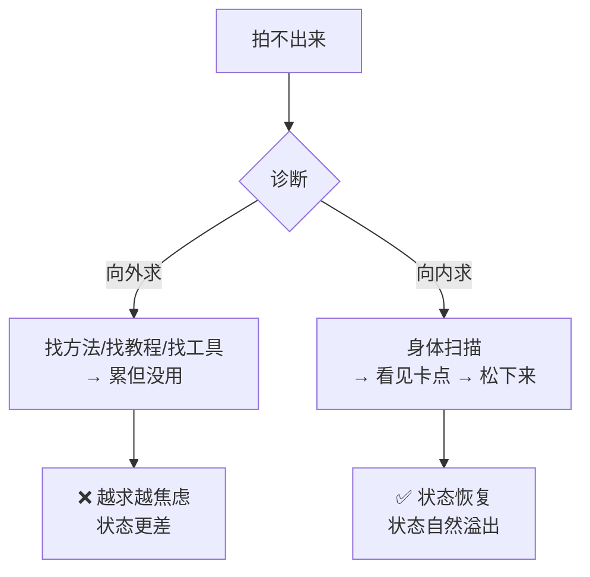

# 视频是状态的溢出

> **一句话**：拍不出来不是方法问题，是状态问题。**先让自己活舒坦，你的自媒体就是你状态的溢出。**

---

## 原始定义（2026-11-06 Day2 · 第二部分 / Day1 第四部分）

> 胡子哥：「先让自己活舒坦、活自在，然后你的所有的自媒体是你状态的溢出。」
>
> 「这是一个非常非常棒的赛道。你可以让自己活得很明白，同时让周围人活得明白……」
>
> Day1 骨架定调：**卡点不在方法，在向外求；视频是状态的溢出；三天换身份。**

---

## 核心诊断：卡点不在方法

胡子哥开场的第一刀：**「文化不是门槛，卡点才是。」**



**关键判断：只盯分发，漏了承接。**
（向外求 = 只盯「怎么让别人听见」；向内求 = 先解决「我自己的状态」）**

---

## Day1 上午的身体路径（胡子哥现场设计）

| 环节 | 做什么 | 解决什么 |
|---|---|---|
| **静走** | 两个能量球：一个向外感受环境，一个向内觉察自己 | 先让人安全 |
| **时空胶囊** | 放下不配得感，敢写「我想要」 | 打开自我 |
| **鸟妈妈** | 把「想做不敢做」的人推上台 | 行动优先于大脑 |
| **人体雕塑 → Yes and → 八人短剧 → 现场表演** | 身体先动 | 行动优先于大脑 |
| **身体扫描** | 看见卡点 → 松下来 | 向内求 |
| **拍完 AI 批判** | 拍完才刚开始 | 降低启动阻力 |

---

## 落地动作

### 1. 身体扫描（向内求的具体工具）

拍摄/直播前做一次：
- 我现在身体哪个部位是紧的？
- 我在装什么？（表演欲 / 在意流量 / 想耍帅 / 怕被骂）
- 那个紧的地方，是谁在撑着我？

### 2. 逐次去杂质

```Plain Text
杂质（紧张、表演欲、在意流量、想耍帅）
   ↓
不是一次清空，是一次去掉一点
   ↓
这次没去掉也不自责 → 下次再试
```

**拍完问自己：「这条里我还在乎什么？」** 那个就是杂质。

### 3. 逐次练（不是重复劳动）

每次只针对**一个**杂质（比如「总想说得漂亮」），下一条只练去掉它。

### 4. 场景再现法

> "拿起一部手机打开镜头，盯着屏幕……**这个摄像头是你女朋友，她不是摄像头，她不是流量，她就是你女朋友。**回到那种场景，场景再现开始。"

给自己定一个「镜头对面的人」：爱人、老友、某个学员。**每次拍之前默念一遍他的名字。**

---

## 自检

- [ ] 我拍不出来的时候，是在向外求方法还是向内找卡点？
- [ ] 我这条视频里还在乎什么？（那个就是杂质）
- [ ] 我有没有对着「一个人」说话，而不是对着「流量」？
- [ ] 我今天的状态，活舒坦了吗？

---

## 相关

- 技法层：[[真诚是地基技法是装修]]（地基不牢，装修是伤害）
- 行为层：[[行为公式B等于MAT]]（能力/触发变量降低启动阻力）
- 认知层：[[cognitive-ghost-wall]]（向外求 = 加固旧认知）
- 库位置：[[姜胡说知识库]]

---

*提炼自：[[2026-11-06-姜胡说3.0自媒体北京闭门会-姜胡说]] Day1 第四/五部分 + Day2 第二部分 · 创建于 2026-11-11*
