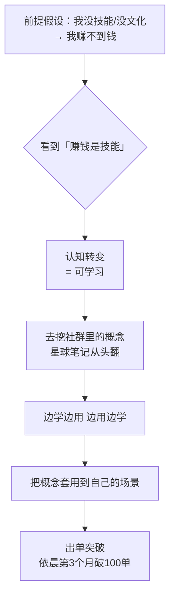

# 赚钱是技能

> **一句话**：**赚钱它是一个技能，既然是一个技能，那就可以学习。**

---

## 原始定义（2026-10-30 · 00:13:07 依晨分享）

依晨在李公子的星球上学到的一句话：

> "赚钱它是一个技能，既然是一个技能，那就可以学习。"

**这句话打碎了依晨的前提假设**：

> 依晨原话：自称"没有文化、没有技能"的大龄失业青年，失业约 3 年没做事情，
> 网上搜"怎么赚钱"搜到胡子哥视频后进社群。
>
> 他给李哥留了一大堆提问留言，问**没文化没技能能不能赚到钱**。

**认知转变**：从「我天生不行」→「这可学」。

---

## 主持人点评（概念要「用透」）

> "把关键概念用好就好了，大家多去查查这东西是啥，**能够理解清楚他们都能赚到钱**。"
>
> "我自己把胡子哥的营销学『6 要素』用出来，**依晨把『b 等于 map』用出来**，做直播把这些关键概念用好就好。"

---

## 逻辑框架

---

## 落地动作

### 1. 把「我不会」翻译成「这是什么概念」

依晨的做法：直播 2 个月没起色（每天 3-5 单）→ **不找新方法，去翻《价值心法》里「如何影响他人行为」那一章** → 套到直播上 → 第 3 个月破 100 单。

> 「真的好用。」

**关键：不是学更多，是把一个概念用到自己的场景里。**

### 2. 社群是宝藏，要挖

依晨原话：「李公子的社群是一个宝藏，**使劲挖**」→ 他**从头翻星球笔记做笔记**。

**动作**：
1. 社群/课程里的笔记，**从头翻**，不是挑着看
2. 遇到不懂的概念，**查清楚是什么**（主持人的建议）
3. 找到一个能套用的，**立刻套到自己的场景试**

### 3. 边学边用、边用边学

> 「依晨通过做直播把以前丢下的『每天写点什么』重新用起来，**边学边用、边用边学**，按利他、公开构建的方式完成小闭环。」

### 4. 6 字回复也是一种策略

依晨问「没文化没技能能不能赚到钱」，李哥回 6 个字：**「坐等下一轮的 MVP」**。

**动作**：不知道答案时，别追着要答案 —— **进一个能动手的项目（见 [[mvp]]）比听更多道理有用**。

---

## 自检清单

- [ ] 我说的「我不会」，真的是我没能力，还是我没学？
- [ ] 我有没有把一个概念「用透」，而不是只读过？
- [ ] 社群/课程里的笔记我从头翻过吗？
- [ ] 我是边学边用，还是学完再做？
- [ ] 我卡住时，是在找新方法，还是在把已有概念套进场景？

---

## 相关

- 行为层：[[行为公式B等于MAT]]（依晨用透的那个公式）
- 认知层：[[离钱近的事情]]（技能要在离钱近的事上练）
- 方法论：[[mvp]]（李哥回复里的 MVP）
- 库位置：[[姜胡说知识库]]

---

*提炼自：[[2026-10-30-多位普通人直播创业突破经历-姜胡说]] 章节 00:11:48 / 00:13:07 / 00:14:06 / 00:15:20 · 创建于 2026-11-12*
