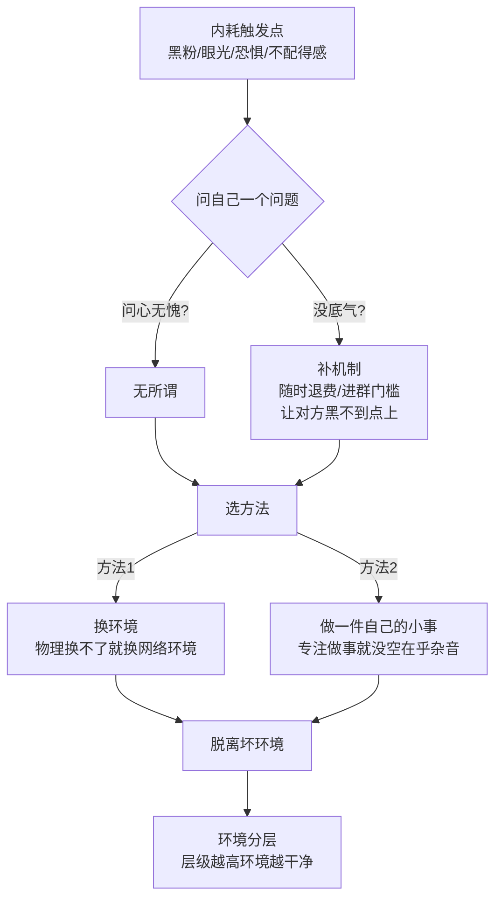

# 跳出内耗

> **一句话**：**真正做成事的人没有时间内耗。** 处在内耗就去做一件自己的小事，专注做事就会把精力集中过来。

---

## 原始定义（2026-10-23 · 01:14:03 / 01:18:12）

胡子哥原话：

> "遇到黑粉不要被影响，**要学会玩黑粉，不要被黑粉玩**。"
>
> "大多数人做事的核心卡点是**恐惧、不敢、不配得感**，学会不在乎别人的眼光，否则一辈子活在别人嘴里不会幸福。"
>
> "自己问心无愧就无所谓，自己支持随时退费，还有进群门槛，**黑粉黑也黑不到点上**。"
>
> "在底层环境你会看到到处都是垃圾，升到更高层级后环境会干净很多。**真正做成事的人没有时间内耗**。"

### 环境分层 + 两个方法

> "如果你不敢行动，建议两个方法：
> 一是**走出去找正能量的同频环境，物理换不了就换网络环境**；
> 二是**认真做一件小事，专注做事就不会在乎杂音**，这是脱离原生坏环境的重要方法。"

---

## 逻辑框架

---

## 三个具体动作

### 1. 玩黑粉，不要被黑粉玩

胡子的现场示范：遇到黑粉攻击**不拉黑，反而留着互动**，调侃可以给自己带流量。

> 「黑粉攻击是镰刀，没有拉黑反而留着互动，调侃可以给自己带流量。」

### 2. 给自己建「黑不到点上」的机制

| 机制 | 作用 |
|---|---|
| 支持随时退费 | 你不靠套路赚钱 |
| 进群门槛 | 不是谁都能进 |
| 问心无愧的产品 | 你的价值不需要靠嘴 defend |

### 3. 用「做小事」替代「处理杂音」

> 「当你真的认真做一件小事的时候，你是**没有心力或者情绪处理其他事儿的**。」

**专注是最强的内耗解药** —— 不是说服自己别想，是没空想。

---

## 落地动作

### 时间管理（胡子本人的做法）

> 「大多数 人每天 8-10 小时忙别人的事，剩下的时间去掉吃喝拉撒、带孩子，连 1 小时做自己事的时间都没有。
> 个人的做法是**手机从早 8 点到晚 5 点开免打扰，任何电话都打不通**，保证每天至少 2 小时专注做自己的事。」

### 中学被霸凌那件事（胡子自己说的）

> 「当时被霸凌孤立，觉得是天大的坎，**现在那些人早就淡出生活，根本没有联系**，不用把当时的伤害放在心上。」

**判断标准：这个人还在你生活里吗？如果没有，他的攻击成本是零。**

---

## 自检清单

- [ ] 我现在在处理杂音，还是在做事？
- [ ] 我今天有 1 小时完全不被打扰吗？
- [ ] 黑粉能黑到我什么点上？我有机制挡住吗？
- [ ] 我身边/网络上是同频的人吗？
- [ ] 我是不是在该换环境了？

---

## 相关

- 环境层：[[生态位与互相托举]]（找到对的环境 = 合作博弈）
- 行动层：[[做自己的小事]]（做小事 = 内耗解药）
- 库位置：[[姜胡说知识库]]

---

*提炼自：[[2026-10-23-AI时代一人公司的构建方法-姜胡说]] 章节 01:14:03 / 01:18:12 / 01:41:03 · 创建于 2026-11-12*
