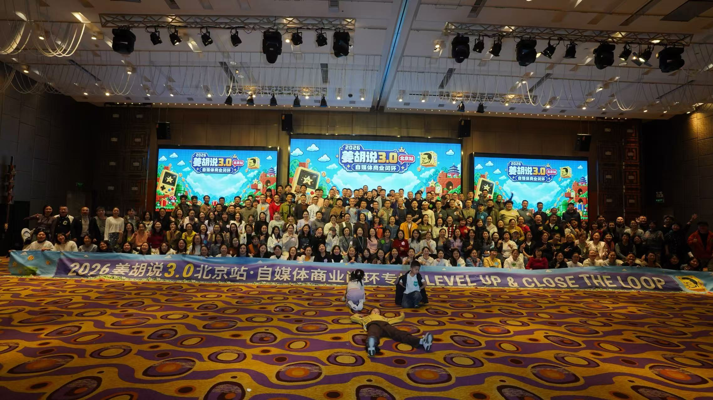
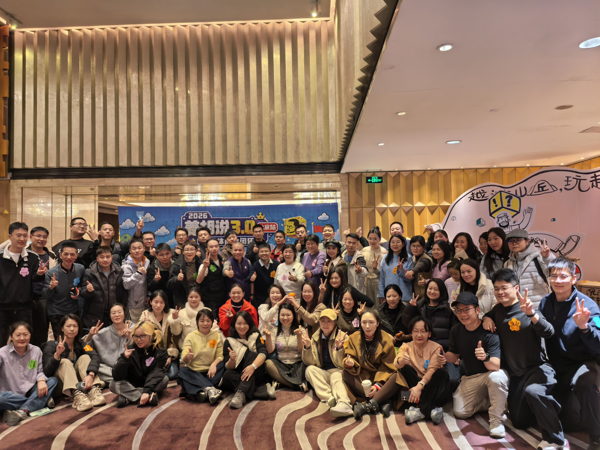

# 姜胡说3\.0自媒体北京闭门会

三天完整知识点整理 · 2026\-11\-06 — 11\-08 · 保留原话与现场设计



第一天 · 11\-06 周五

## 不确定性与即兴

# 姜胡说北京线下3\.0自媒体·第一天：不确定性与即兴

> **整场主题：** 用一天把“来听方法”的人推到“先动起来、先成为创作者”；方法不是重点，状态、行动、反馈才是。
> 
> 

## 整场骨架（先看这条线）

```Plain Text
开场：让人安全（静走 / 时空胶囊 / 鸟妈妈）
   ↓
胡子哥定调：卡点不在方法，在向外求；视频是状态的溢出；三天换身份
   ↓
上午：身体先动（人体雕塑 → Yes and → 八人短剧 → 现场表演）
   ↓
中场：行动优先于大脑（脑子先行 → 下意识 → 多演一轮 → 拍完AI批判）
   ↓
下午：向内（身体扫描：看见卡点 → 松下来）
   ↓
答疑：完美是动词 / 读书博主 / 红利 / 变现五差 / 取舍 / 写书 / 市场验证
   ↓
学员真实故事即兴剧：同理心 → 情绪就是方法
   ↓
收尾：没上过台的人，优先上台
```

**一句话记住：** 先动起来，再谈方法；先成为创作者，再谈流量。




## 今天讲了什么（点一下就能到）

## 按问题找

- 拍视频总在准备、发不出去 → 第四部分

- 直播/口播找不到状态 → 状态溢出、身体扫描

- 读书口播卡壳 → Q2 读书博主

- 不知道怎么变现 → Q4 变现五差

- 时间不够、什么都想做 → Q5 时间、Q6 取舍

- 产品/卖货文案没转化 → Q8 市场验证、Q9 卖货文案

- 活动/社群破冰 → 第一部分、第三部分、现场设计拆解

- 想提升表达/上台 → 第四部分、第七部分

**怎么读：** 每个知识点先看“原话”，再看“逻辑框架”，最后看“我能借鉴什么（落地动作）”。“我能借鉴什么”不是新知识点，是这条怎么用。

## 第一部分 · 开场：先让人安全，再让人打开

### 知识点①：把“不确定性”变成开场规则——即兴是一种专注的能力

#### 主持人怎么说的

主持人竹子讲自己当主持，约了化妆师大雪早上化妆；结果大雪打不到车，想了个办法，叫了闪送把自己送到现场。

> “其实我们会莫名其妙地被Q到，会遇到很多问题。”
> 
> “你要享受即兴的人生。即兴是一种关于专注的能力。当你开始即兴，你就开始专注。当你开始专注，你就开始好。当你开始回归自己，你就开始绽放。”
> （转写把这几句分给了不同说话人，待确认）
> 
> 

#### 逻辑框架

```Plain Text
活动流程会变、主持人也不专业
   ↓ 先把“出错”正常化
讲一个自己当天的真实意外（化妆师叫闪送）
   ↓
大家不再怕“现场不完美”
   ↓
即兴 → 专注 → 好 → 回归自己 → 绽放
```

#### 我能借鉴什么（落地动作）

- 直播/活动开场先讲一个自己当天的真实意外，降低“必须完美”的压力。

- 不要一上来就“今天我要教大家三个方法”；先让人放松，后面才进得去。

- 拍视频前也可以用：先接受“这条可能不完美”，再开机。

---

### 知识点②：静走——两个能量球，一个向外感受环境，一个向内觉察自己

#### 主持人怎么说的

> “不要跟别人打招呼，保持禁言，就静静地走一走，静静地走一走。”
> 
> “你可能会注意到别人，注意就好，不用打招呼，不用微笑。”
> 
> “你感受自己身体有两个球：一个向外的能量球。你边走边感受，向外的能量球在感受环境。”
> 
> “这个时候你突然发现有了另外一个能量球，是一个向内的能量球。那个能量球开始关注自己。”
> 
> “两个能量球都在出现：一个向外关注环境，一个向内觉察自己。不用在意别人，不用在意有没有人看到你。”
> 
> “不用在意一些响起机械的声音。可能你听到手机铃声你会紧张，会想‘是不是我的手机铃响起来了’，放下那种紧张，看见就好。”
> 
> “我们在这种流动中，慢慢地走向自己的位置，慢慢地回归到自己的座位。”
> 
> 

#### 逻辑框架

```Plain Text
静走（不说话、不打招呼、不对视）
   ↓
向外：感受环境、人、声音、灯光 → 不评判
   ↓
向内：感受身体、呼吸、脚底触感 → 觉察自己
   ↓
两个能量球同时存在 → 回到座位、闭眼 → 进入当下
```

#### 我能借鉴什么（落地动作）

- 线下活动/直播前 3—5 分钟静走，不刷手机，先收心。

- 一个人拍视频前也可以走两分钟，感受“我现在是什么状态”。

- 紧张时用“看见就好”：听见手机响、听见杂音，不跟着紧张，只看见。

---

### 知识点③：时空胶囊——放下不配得感，敢写“我想要”

#### 主持人怎么说的

> “我们给大家5分钟的时间，写一个时空胶囊，给3天后的自己。”
> 
> “你可以告诉他，你今天为什么要来到这里？你有什么样的期待？你有怎样的意图？你有什么困惑？或者是你想连接谁都可以。”
> 
> “这是一个很安全的场域，你可以只写给自己看，要对自己诚实，你想怎么写就怎么写。”
> 
> “放下自己心里那种深深的不配得感，我想要什么，我就是可以大胆地去要，我就是敢写敢要，把它放在那里。”
> 
> “不用考虑能不能得到，不用考虑做不做到，不用考虑自己配不配得上。”
> 
> “找到你儿时的那种感觉，我就是想要一定要。”
> 
> 

#### 逻辑框架

```Plain Text
给3天后的自己写一封信
   ↓ 不写“应该”，写“想要”
为什么来 / 期待 / 意图 / 困惑 / 想连接谁
   ↓ 只给自己看，不评判
放下不配得感 → 敢写敢要 → 3天后复盘对照
```

#### 我能借鉴什么（落地动作）

- 训练营/线下活动开营先写“给 3 天后的自己”，3 天后复盘对照。

- 个人月初写一份“给月底的自己”：我想要什么、我为什么来、我想连接谁。

- 写内容前也可以用：先写“我真正想说什么”，再想“怎么说”。

---

### 知识点④：鸟妈妈——把“想做不敢做”的人推上台

#### 学员怎么说的

一位学员讲“鸟妈妈”的来源：安徽社群“徽通集结号”里，有很多像她一样“想了很多但不敢做”的人，是在鸟妈妈的“唯品会赛场”里被带出来、掏出来的。

> “我们的鸟妈妈，有人不知道是谁吗？”
> 
> “是安徽社群‘徽通集结号’群里出来的。”
> 
> “有很多像我一样的人，想了很多但不敢做，是在鸟妈妈的唯品会赛场里，把我们带出来、掏出来。”
> 
> “我今天站在这个讲台上，也是因为鸟妈妈带上来。”
> 
> “我非常感谢鸟妈妈，也希望我们每个老伙计身边都有一位鸟妈妈。”
> 
> “在接下来的三天活动中，我希望我们以后很多小妈妈把身边想做但不敢做的人，全部推上来，好吧？”
> 
> 

#### 逻辑框架

```Plain Text
想做但不敢做（想很多、动不了）
   ↓ 场域里有一个“鸟妈妈”
鸟妈妈不是替你做，是把你带出来、推上台
   ↓
第一次站上去 → 后面才敢继续
   ↓
每个老伙计身边都需要一个鸟妈妈；每个鸟妈妈再推下一个人
```

#### 我能借鉴什么（落地动作）

- 社群设“鸟妈妈”角色，专门推人上台；活动设“第一次上台”名额。

- 推人不是替人做，是让人先站上去；站上去之后，后面他自己会走。

- 做内容也可以当“鸟妈妈”：把身边想做不敢做的人的故事讲出来，推他们一把。

---

## 第二部分 · 胡子哥开场：卡点不在方法

### 知识点①：文化不是门槛，卡点才是

#### 胡子哥怎么说的

> “做自媒体其实没有那么多方法。方法并不神秘。”
> 
> “我相信很多老伙计来到现场，是想代表他，对吧？你跟我聊聊，子公司到底该怎么做？有什么秘籍？有什么神诀？用户思维怎么做？商业模式怎么梳理？我看很多老伙计留言说，最好能把我的视频拆了也拆了。这种根本不重要。”
> 
> “这次去眉山，我发现很多老伙计文化并不是很高，但他们走出来了。走出来的一个重要原因是什么？就是身上的卡点问题。”
> 
> “文化不高问题也不是很大，但前提是你要靠提供价值。”（此句在直播笔记中；本次现场原话以“卡点”为主，待核对）
> 
> 

#### 逻辑框架

```Plain Text
很多人以为：做自媒体要先有文化/学历/方法/秘籍
   ↓ 眉山观察
文化不高的人也能走出来
   ↓
不是方法多，是卡点被解决
   ↓
先找自己的卡点，不要先找秘籍
```

#### 我能借鉴什么（落地动作）

- 不要用“我学历低/没文化”当不做的理由。

- 先找一个具体卡点：不会选题、不敢出镜、拍了没人看、不会承接……一次解决一个。

- 遇到“秘籍/神诀”先警惕：方法不神秘，卡点才是个人的。

---

### 知识点②：油田案例——用“做过更难的事”建立底气

#### 胡子哥怎么说的

> “自媒体是我从业这么多年遇到的最简单、最没有挑战的事，不是因为我做得好，而是因为我做过最简单、最没挑战的事。”
> 
> “我之前不止无数次说过，我做每个行业都会去挑战。”
> 
> “举个例子，第一次开公司时，我跟大家说过，当时我做油田项目。”
> 
> “油田项目当时我要做一个什么项目呢？就是我要判断在什么位置有油。然后我要打多深，这口井打多深，在什么位置爆破？”
> 
> “因为我们国内的油和国外不太一样，伊拉克的油往往往上冒。我们国内的这个油是什么呢？它在那个位置，你需要在非常准确的位置爆破。”
> 
> “这边打个管子，这边一个井，那边一个井，然后这边爆破，非常准确地爆破，那边也是非常准确地爆破。然后用水沿着这个灌水，把这个油浮出来。”
> 
> “我们采用这种方法，因为我们的油没有人家那么丰富，所以你要非常精确地算到油在哪个岩层，在什么位置爆破，一口井的成本是上百万。”
> 
> “我们要做这个东西，我自己从来没有学过地质，我是中专毕业，我要自学地质，自学高等数学。”
> 
> “各位，你们可以想象一下，一个中专毕业生，自学土木，但土木没好好学，开始创业做项目的过程中，需要自学地质。”
> 
> “你要快速把人家地理大学花几年学的东西学到，而且马上要用出来。而且过去我上的是初中中专，没上高中，你要把高中的高等数学全补上，还要在一年之内把这个产品做好。”
> 
> “你们可以想象这个难度。”
> 
> “说实话，做自媒体是我遇到的最简单的事情。”
> 
> “我说这个不是凡尔赛，是想跟大家讲我们的关注点错了。”
> 
> 

#### 逻辑框架

```Plain Text
中专毕业、没学过地质
   ↓
自学地质 + 高等数学（一年内）
   ↓
判断油在哪个岩层、井打多深、在哪里精确爆破
   ↓
一口井成本上百万 → 必须算准
   ↓
对比：自媒体不需要这么高的门槛
   ↓
结论：不是自媒体简单，是你把注意力放错了地方
```

#### 案例

油田项目：国内油田和伊拉克不同，油不会自己往上冒；要在非常准确的位置爆破，再灌水把油浮出来；一口井成本上百万。他中专毕业，自学地质、高等数学，一年内把产品做好。

#### 我能借鉴什么（落地动作）

- 用“我做过更难的事”给自己建立底气，不要神化自媒体。

- 遇到不会的，先自学到能用，再谈系统；不要一上来就找“完整方法论”。

- 做内容时，把“我解决过什么难问题”讲出来，这是你的可信度来源。

---

### 知识点③：向外求 vs 向内求——只盯分发，漏了承接

#### 胡子哥怎么说的

> “我们的关注点一直在向外求，有没有一个好的方法，有没有一个好的系统？”
> 
> “哎呀，你最好帮我把那个我的 AI 系统搭起来，搭了这东西以后，我就自动有选题了，然后我就自动有文案了，然后我那个文案一表达，它就爆了。”
> 
> “而且我发现一个特别有趣的现象，就是几乎我们所有的流量管理的问题，全部关注的点全部是在分发的问题。”
> 
> “有一个端是完全被遗漏的。就是一旦你有了流量，你怎么承接它？”
> 
> “不承接的话，我们基本上做不好。”
> 
> “所以那个小报童我昨天其实写好了，但是我来的时候临时重新写那个小报童，那个位置就是你的价值量去算，我们到底在什么位置。”
> 
> “首先我们解决我们的卡点，就是停掉向外求的地方，而是向内学。”
> 
> “我给大家举个很简单的例子，我们内部是有监管的。这个大家都知道，可是我几乎发现我们领导的特点是什么？遇到了一个问题，马上就会叫老师。”
> 
> “甚至在我看来，这个问题要梳理，没梳理清楚。”
> 
> “这说明什么？说明我们的下意识是没有自己独立解决问题的思路的。”
> 
> “遇到问题马上就去找答案，找到答案赶快走。不行，我来不及了，我不知道该干什么。”
> 
> “向内求这件事情非常重要。”
> 
> 

#### 逻辑框架

```Plain Text
向外求：方法 / 系统 / 爆款 / 分发
   ↓ 漏掉的一端
有了流量，怎么承接？（私域、产品、服务、交付）
   ↓ 内部伙伴遇到问题马上叫老师
问题没梳理，先找答案 → 下意识没有独立解决问题的思路
   ↓ 向内求
先自己梳理，再问人；先解决卡点，再谈系统
```

#### 我能借鉴什么（落地动作）

- 遇到问题先写三行：我到底卡在哪、我试过什么、我还缺什么；写完再问人。

- 不要只研究怎么涨粉，也要设计“流量来了怎么接”：私域、产品、交付、复购。

- 做内容前先问：这条内容是在“向外求爆款”，还是在“向内解决一个真问题”？

---

### 知识点④：状态溢出——视频是你状态的溢出

#### 胡子哥怎么说的

> “当你自己活明白了，你会发现你发的那个短视频，它是有能量。”
> 
> “先让自己活舒坦、活自在，然后你的所有的自媒体是你状态的溢出。”
> 
> “不要去憋着，不要去憋视频，不要想着这个东西该怎么做。因为你的视频，人们是可以通过屏幕感受到你的焦虑。”
> 
> “你的内在不和谐，你的生活不舒坦。”
> 
> “我这次从你们单位起来，我莫名其妙，我也没干什么，结果我的粉丝涨了50万，就是10天吧，一天就10天，就是一天5万。”
> 
> “好像叫大麦哥是吧？好像是一周涨了400万。”
> 
> “为什么？好像是有一条有一个点赞好像是几百万点赞还是上千万点赞。那条视频对很多人来说，很多人喜欢的原因是因为折射出另外一个陷阱之中，大多数人活得太焦虑了。忽然发现，原来我可以活得不这么焦虑。他的那个情绪切口就出来了。”
> 
> “我告诉大家，这是一个非常非常棒的赛道。你可以让自己活得很明白，同时让周围人活得明白，这是什么？就是先让自己活舒坦、活自在，然后你的所有的自媒体是你状态的溢出。”
> 
> 

#### 逻辑框架

```Plain Text
先活明白 / 活舒坦 / 活自在
   ↓
状态有能量 → 视频是状态的溢出
   ↓
观众先感受到你的状态，再听你的内容
   ↓
焦虑会被屏幕放大；松弛也会被屏幕传递
   ↓
情绪切口：替观众说出“原来我可以不这么焦虑”
```

#### 案例

大麦哥（转写又称“张迈”，待确认）一周涨 400 万；那条视频很多人喜欢，不是因为技巧，是因为它折射出“大多数人活得太焦虑了”，观众忽然发现“原来我可以活得不这么焦虑”。

#### 我能借鉴什么（落地动作）

- 拍之前先问“我现在是什么状态”；状态不对先调整，不硬拍。

- 直播前先做一件让自己松下来的事：走一走、喝口水、静坐三分钟。

- 找那条视频“替观众说出了什么情绪”，而不是只学它的结构。

---

### 知识点⑤：给予 vs 索取——创作者不是索取者

#### 胡子哥怎么说的

> “创作者是给予别人价值的，而不是向外索取的。”
> 
> “我们很多拍短视频的焦虑，都是向外索取。”
> 
> “我看到很多老板的那个问题，那个字里行间，那个焦虑感就是索取。胡子哥，我怎么有流量？怎么那么多人关注我？我为什么拍了这么长时间没有流量？连个评论都没有，都是这种。”
> 
> “我告诉各位，那个就叫索取。”
> 
> “但是各位，如果你们看一看我的视频，包括你们可以看一看张迈的视频，你们会发现这种状态是往外溢出，是给予。就是我得到了一个好东西，我给他分享；我感受了什么东西，给他分享一下。”
> 
> “我还是跟大家说那个概念，就如果一个人靠近他可以做得更好，你靠近他可以变得更放松，你靠近他，你就觉得你充满了能量。那么你放心，你只要在那个位置，你在哪儿，你都是中心。”
> 
> “我现在拍照，就是我们有时候真的会有大合照，线下活动都是大合照。我已经有2年时间，大合照都不在中间了，因为大家都习惯了谁组织谁坐中间。我每次都是靠到边上。然后很多老师说胡子哥你来中间，我说没事，我在哪都中间。”
> 
> “我希望我们每个人都有这种状态，不是在形式上的，而是一种内心的素质。”
> 
> 

#### 逻辑框架

```Plain Text
索取：给我流量 / 给我关注 / 为什么没人看我
   ↓ 字里行间的焦虑
给予：我得到了好东西，分享给你；我感受到什么，分享给你
   ↓
靠近你，别人能变好 / 变放松 / 充满能量
   ↓
你在哪儿，你都是中心（不是站位，是内心状态）
```

#### 案例

线下活动拍大合照，他两年都不站中间，习惯站边上；别人让他去中间，他说“没事，我在哪都中间”。

#### 我能借鉴什么（落地动作）

- 每条内容先问“这是给谁的、能帮他什么”，不是“这条能不能爆”。

- 把“我能给什么”写在选题前面；给不出来，就先别拍。

- 位置不在中间没关系；能量在中间，别人会靠近。

---

### 知识点⑥：三天设计——放下 → 创造力 → 身份转换

#### 胡子哥怎么说的

> “这三天，希望大家放下，不管外边有什么样的事情，不管有多焦虑，不管有什么样的期望。活成自己。”
> 
> “我希望这3天大家都放松。首先第一个就是放假，就是要放下。”
> 
> “然后活出我们自己。我不知道有没有变化，因为我们的流程是不断变的。”
> 
> “所以今天晚上我们的状态很有可能是我们碰到一帮成年人满地打滚，这是很正常的。我已经证明过无数次了，但是我们把它放在这个场子里，就是让大家放松。”
> 
> “你看，不是讲关于怎么去做自媒体，然后我们的第二天的大概逻辑是什么？就是让你充满创造力。”
> 
> “我昨天参与的时间不多，我大概说了一些我的建议和想法，我们有一个使命或者一个目标。就是大家第三天离开的时候，你的身份转换了，你真的成为了一号。”
> 
> “就是你是你骨子里就是一个创作者，他不是一个拍视频的人。”
> 
> “我本身就是一个创作者，我无时无刻不在创作，我在解决我的问题，我在解决周围其他人的问题，我让我自己生活变得更美好，同时让周围的环境生活变得更美好。”
> 
> “我们希望第3天大家离开的时候，每个人都成为创作者。”
> 
> “因为创作者是给予别人价值的，而不是向外索取的。”
> 
> “我们不准备讲怎么去做自媒体，让你去感知它，而不是去讲它。”
> 
> “我们做了很多事，其实你认真思考一下，是完全可以带到你的领域、社群、行业、城市。然后你会发现有一个种子，这个种子会爆发出来。”
> 
> 

#### 逻辑框架

```Plain Text
第一天：放下 / 放松 / 放假
   ↓
第二天：让你充满创造力
   ↓
第三天：复盘 + 身份转换
   ↓
从“拍视频的人” → “创作者”
   ↓
创作者 = 给予价值，不是向外索取
   ↓
三天的方法可以带回自己的领域/社群/行业/城市
```

#### 我能借鉴什么（落地动作）

- 训练营/线下活动按“放松→创造→复盘/身份”三段设计；不要第一天就塞满干货。

- 给自己定一个身份目标：不是“我要拍视频”，是“我是一个创作者”。

- 把活动里的方法带回自己的领域：先改一个环节，不要整套照搬。

---

### 知识点⑦：活动是筛选，不是脱胎换骨

#### 胡子哥怎么说的

> “我们经常遇到这种情况，比如从去年文山到年会的厦门，然后包括这次眉山，每次做活动一定会走出来一张老文，所以就让很多人误以为参加一个线下活动就脱胎换骨了。”
> 
> “其实真正的情况是我把能做成事的人筛选出来，我不知道大家能不能体会这一点。”
> 
> “你会发现有很多小学、中学，成才率特别高，这种中学的教学质量肯定不差。我认为肯定不差。但是他们的生源都是去各个学校挑的尖子生。”
> 
> “都是去各个学校挑的尖子生，各位能体会吗？就是把一些天才分到那个学校，同时教学质量又跟不上，所以升学率就高。”
> 
> “所以大家来应该是很多老伙计，精力已经很大了。很多老伙计未来可能会构建自己的社群，形成自己的商业模式。”
> 
> “所以实际上我们对……我们可以3天的流程活动方法都可以作为你那个需求的体验。”
> 
> 

#### 逻辑框架

```Plain Text
参加活动 ≠ 脱胎换骨
   ↓
活动里总会有人走出来 → 让人误以为是活动改变了人
   ↓
真相：活动把“本来就能成事的人”筛出来
   ↓
好学校升学率高，不只是教学质量，还因为生源是尖子生
   ↓
活动提供场域和方法；成事的人本来就有行动力
```

#### 我能借鉴什么（落地动作）

- 活动后看谁真的动手；把资源给已经在做的人。

- 自己参加活动后，当天就做一个最小动作，不要等“回去再说”。

- 做社群/训练营，不要承诺“人人改变”；筛选出已经在行动的人，给他们方法和场域。

---

## 第三部分 · 上午即兴游戏：身体先动

### 知识点①：人体雕塑——不用语言，先用身体做

#### 现场怎么做的

两人一组，一个当雕塑家，一个当雕塑；雕塑不动、不说话、没有自我意识；雕塑家可以随意摆姿势，但不能用语言；完成后可以让雕塑保持一会儿，去参观别人的作品，回来鞠躬；然后互换角色。

#### 主持人怎么说的

> “一个人作为雕塑家，有一个人当雕塑，你们可以商量一下谁当雕塑家，谁当雕塑。”
> 
> “雕塑不动，雕塑是没有自我意识，把你的大脑扔出去啊。雕塑家这时候可以随意雕刻这个雕塑，但是你不要说话，不要用语言传达。”
> 
> “它是你的作品，你想让它是什么样子，它就是什么样子，你可以随意发挥。”
> 
> “如果雕塑家雕完了你的雕塑，可以让他保持一会儿，就让他定在那里，让他成为你的作品。”
> 
> “然后你可以走一走，去看一看别人的作品。”
> 
> “各位雕塑要敬业啊，你现在是作品。”
> 
> “现在雕塑家和雕塑可以换一个位置，互换角色。”
> 
> “想一想他刚才是怎么对比的，你现在可以开始教过他了。对，刚才他是有多么过分地为难你，他就有多么过分地为难他。”
> 
> 

#### 逻辑框架

```Plain Text
两人一组：雕塑家 / 雕塑
   ↓
雕塑不动、不说话、没有自我意识
   ↓
雕塑家只用动作摆姿势（不能用语言）
   ↓
完成 → 保持 → 参观别人的作品 → 鞠躬
   ↓
互换角色 → 体会“被摆布”和“摆布别人”的感觉
```

#### 我能借鉴什么（落地动作）

- 拍视频前用身体热身，别一坐下就写稿；先动，再想。

- 破冰/团队共创可以用“一人摆、一人动”的方式，先把气氛打开。

- 卡住时先做一个动作，不要只在脑子里想。

---

### 知识点②：流动录像 Yes and——先接住，再加自己的

#### 现场怎么做的

4 人一组，第一个人摆一个动作；第二个人根据他的动作加入，组成新画面；第三、第四个依次加入；然后每人讲自己演的是什么；最后一个人把四个不相关的东西串成一个故事。

#### 主持人怎么说的

> “先站出来一位朋友，先站出来一个人。好，你可以摆一个动作，给大家一起看，你要摆一个什么样的动作。”
> 
> “OK，你要保持这个动作不动。来，第二个人，你要根据他的动作，摆出一个新的动作，跟他组成一个新的画面。”
> 
> “然后第三个人，根据他们的画面，融入这个画面，你摆一个什么样的动作呢？”
> 
> “第四个人上场，你想坐哪里就坐哪里，想干什么就干什么，但是你们要组成一个新的画面。”
> 
> “它就是4个很不相关的东西搭在了一起。”
> 
> “那下面请这位朋友，这个奥特曼，你来讲一个故事，讲好这个故事，你就可以解封了。”
> 
> “这是一种即兴的艺术，Yes and。前面一个人做动作，不要否定他，Yes我承认你，但是我可以给你组成一个新的画面。”
> 
> “当你有了这个新的故事的时候，你们就有了四个不相关的词。其实你也不知道别人演的是什么。但是当大家说了这个词的时候，它就组成了一个新的故事。”
> 
> 

#### 案例（学员即兴）

木头 \+ 奥特曼 \+ 木头 \+ 游客。故事被讲成“38000年前，我被两只木头怪兽定住了，然后某一天，来了一位不知名的游客坐在这里跟我合影”。

#### 逻辑框架

```Plain Text
4人一组，一人一个动作
   ↓
第二个人不否定前一个人（Yes）
   ↓
在他的画面上加自己的动作（and）
   ↓
第三、第四个人继续接
   ↓
四个不相关的东西 → 串成一个新故事
```

#### 我能借鉴什么（落地动作）

- 接住热点/评论，再加一个自己的观点，不要一上来就否定。

- 内容共创时，先接住别人的点，再补自己的部分。

- 直播连麦可以用“Yes and”的方式，让对话不断线。

---

### 知识点③：八人短剧——先定格画面，再四幕，再串剧情

#### 现场怎么做的

8 人一组，2 分钟找到自己的组；先表演一个画面（如《西游记》），每个人都要在画面里，并保持动作到最后；再定 4 个最经典的画面；再把剧情串起来，演 3—5 分钟；最后随机挑一组上台。

#### 主持人怎么说的

> “8个人组成一个同盟，用2分钟快速找到自己的组织。”
> 
> “你们可以去排演一个剧。可以先从一个画面开始，比如8个人先上台。”
> 
> “请表演一下《西游记》的一个画面，让大家看到你们演的是《西游记》。”
> 
> “请表演《西游记》，每个人都要在画面中，并保持这个动作到最后。”
> 
> “你们刚才的主题是《西游记》，此时可以把《西游记》想到的4个最经典画面定格出来，演一部短剧。”
> 
> “第一幕、第二幕、第三幕、第四幕。你们可以把这四幕定格成画面。”
> 
> “然后第二步，把你们这个剧定格成3个或4个画面演出来。”
> 
> “再演完之后，第三步是什么？是把剧情串起来，演出这一段的剧情。”
> 
> “这个剧不长，可能3分钟或5分钟。一会儿结束的时候，我们可能会随机挑一组上台演你们刚才排的短剧。”
> 
> 

#### 案例（学员即兴）

西游记组里有人演孙悟空、猪八戒、玉兔、沙僧、绳子、唐僧、妖怪；主持人调侃“你这个妖怪堂堂正正站在了他们中间”。

#### 逻辑框架

```Plain Text
8人一组 → 2分钟找组
   ↓
先演一个画面（西游记），每个人都在画面里、保持动作
   ↓
定4个经典画面（定格）
   ↓
把4幕串成剧情，演3—5分钟
   ↓
随机挑组上台
```

#### 我能借鉴什么（落地动作）

- 短视频分镜可以用“四幕定格”：先定 4 个画面，再写台词。

- 先演一遍，再改脚本；不要一开始就写逐字稿。

- 团队共创先定焦点，不要同时两三个主角。

---

### 知识点④：两组现场表演——把产品放进场景

#### 现场怎么做的

两组学员把上午排的短剧演出来：一组演“内蒙古羊肉串火锅店直播”，一组演“北京一日游”。都是即兴表演，不是胡子哥的方法论，但能看出“场景\+冲突\+话术”怎么组织。

#### 羊肉串火锅店（学员即兴原话）

> “今天怀着沉重的心情跟大家讲，这是我们宇宙第一内蒙古羊肉串开业3年来第一次开全体员工会议，也是最后一次会议了。”
> 
> “我不3个月交不起房租了。”
> 
> “你们想一下，你们进来3年，你们都办了一些什么事？”
> 
> “我现在觉得我们这个店，你看3个月都没进来一个顾客，早上好不容易进来一个，还是问错路过来问路的。”
> 
> “你看到我们这边桌子，你看，这么厚一层尘埃，没有3个月积不了这么厚的尘埃。”
> 
> “现在我们的‘得到大脑’就怎么样来拯救我们家羊肉伙计，必须开直播。”
> 
> “你第一个要开视频……你要跟他们讲，说是你是非遗的传承人，你是第四代的传承人，我们的羊肉是全部人有最好的，你要跟他们讲一下怎么样做一个最好吃的羊肉火锅。”
> 
> “你在这里，你就在这里挂一个相机，把你每天买菜买多少钱，你把它拍出来，在哪里买的菜，你把它拍出来。”
> 
> “厨师长在我们在你身后挂了100多斤货，就是说你天天100块钱的货，你买的成本不到10块钱，我要给你产品好水啊。”
> 
> “你把你每天开车买菜的过程你都把它直播出来，好不好？”
> 
> 

#### 北京一日游（学员即兴原话）

> “大家排好队，先下后上，注意脚下缝隙，人多拥挤。”
> 
> “我们先上一个北京的地铁。”
> 
> “请走午门，请走午门，其他先安检，先安检，安检完之后走午门。”
> 
> “来一次故宫，先要去冰窖尝一下这个醋，酸梅汤。”
> 
> “故宫是3小时游玩，只能从神武门出去。”
> 
> “烤肠烤肠，5块钱一根，5块钱一根。”
> 
> “不到长城非好汉，要拍一张婚纱照吗？20块钱一张。”
> 
> 

#### 逻辑框架

```Plain Text
场景（火锅店没顾客 / 北京旅游）
   ↓
冲突（3个月交不起房租 / 景区太大走不完）
   ↓
对策（必须开直播 / 买烤肠、拍照）
   ↓
直播话术（身份：非遗第四代；产品：内蒙古羊肉；价格：199→99；包邮）
   ↓
产品
```

#### 我能借鉴什么（落地动作）

- 直播脚本先写“谁在什么场景下遇到什么麻烦”，再写产品。

- 把产品放进日常场景演一遍，比背卖点更有用。

- 学员表演是练手，不是标准答案；重点是“场景\+冲突\+话术”的结构。

## 第四部分 · 中场复盘：行动优先于大脑

### 知识点①：脑子先行——行动之前，脑子是最大的障碍

#### 胡子哥怎么说的

> “上午的过程是让大家行动起来，我观察了一下，好几个组都发生了一个问题，什么问题？好多人围成一圈，讨论剧情是什么。”
> 
> “各位，今天在这个现场，我相信你们最后一定能拍出一个视频来。但是你信不信？等你回到家，3周以后热度一降，你还是不敢拍。”
> 
> “为什么？因为你一直是用脑袋先行。脑子先行是什么？你脑子里想的东西，应该这么拍，会有这种计划。”
> 
> “结果当你们拍的时候，你会发现各种拿不到。比如你预想的一个动作做出来，你原本认为对方会这么配合，结果对方不配合，最后出来的结果和你预想的不一致。”
> 
> “你会怪对方不配合，想法没能实施。但我跟大家讲，你们平时拍短视频就是这样。”
> 
> “你拍个完整的怎么做呢？今晚拍视频，我准备去刷选题，看看市面上有什么选题、别的东西，准备一大堆，然后开始做设计。一看时间快到了，赶快拍一条吧，是不是？”
> 
> “行动之前，脑子是最大的障碍。”
> 
> 

#### 逻辑框架

```Plain Text
围圈讨论剧情（想清楚再动）
   ↓
回家三周，热度一降，还是不敢拍
   ↓
脑子先行：先设计、先计划、先想“应该怎么拍”
   ↓
现实不配合 → 结果和预想不一致 → 怪对方/怪环境
   ↓
行动之前，脑子是最大的障碍
```

#### 我能借鉴什么（落地动作）

- 拍视频前只定“主题 \+ 给谁看”，不定逐字稿；先拍第一条。

- 不要用“我还没想清楚”当不拍的理由；想清楚是拍出来的，不是想出来的。

- 计划越细，越容易在现实不配合时崩溃；先做一个最小版本。

---

### 知识点②：下意识——下意识就是你当下的真实水平

#### 胡子哥怎么说的

> “什么叫下意识？下意识就是你当下的真实水平。”
> 
> “比如你学了很多投资理念，大家学过投资理念吧，等你投资的时候，你会发现你的动作和你理解的投资理念完全匹配不上，是这个逻辑吧？”
> 
> “因为有些时候你在买东西或者投资的时候，用的是下意识，根本不是你所学的知识，所以各位你今天的生活状态来自于你的下意识。”
> 
> “而不是你的逻辑意识。”
> 
> “所以当你下意识去演、没有太多准备的时候，那个就是你当时的状态。”
> 
> “演完一圈，你马上就知道自己有哪些问题了。你马上就知道自己哪些卡点，然后这个时候再复盘，复盘以后重新设计，重新设计以后，你会发现结果就不一样了。”
> 
> 

#### 逻辑框架

```Plain Text
学了很多理念/方法（逻辑意识）
   ↓
真正做的时候，动作来自下意识
   ↓
下意识 = 当下的真实水平
   ↓
演一遍/拍一条 → 暴露真实水平 → 复盘 → 重新设计
```

#### 我能借鉴什么（落地动作）

- 拍完不要只删，先看“我下意识做了什么”；记录 3 个卡点，下一条只改一个。

- 不要用“我懂了”判断自己会了；做一遍，才知道自己会不会。

- 复盘时看动作，不看自我评价。

---

### 知识点③：多演一轮 ＞ 多准备一小时

#### 胡子哥怎么说的

> “我给大家举个例子，比如刚才我们上了两组。我问大家一个问题：我要是再给大家多一个小时去排练，结果会不会更好？”
> 
> “不会吧？不会。”
> 
> “但是你会发现，我下午每个组再给他10分钟才能上来，效果会不会更好？一定会更好，因为他演的过程中就会发现这有问题、那有问题要去调整，对不对？”
> 
> 

#### 逻辑框架

```Plain Text
多准备一小时（排练）→ 结果不会更好
   ↓
多演一轮（上台）→ 演的过程中发现问题 → 下一轮调整 → 更好
   ↓
反馈来自行动，不来自准备
```

#### 我能借鉴什么（落地动作）

- 内容迭代用“发布→看反馈→改→再发”；不要一次憋大招。

- 准备只能解决“已知问题”，行动才能暴露“未知问题”。

- 把“再准备一下”换成“先演一版”。

---

### 知识点④：拍视频的方法——3—5 分钟即拍，拍完用 AI 批判再拍

#### 胡子哥怎么说的

> “我跟大家讲我是这样做的。比如我今天想拍一个选题，或者想拍什么东西，因为我昨晚12:30、12:40左右才到酒店。”
> 
> “我12:40到酒店，因为我要哄姑娘睡觉，把作业做完，然后睡觉。我回来晚上拍个视频，昨晚想起来又写了一个小毛虫，到酒店已经12:30了，跟大家讲这个时间特别紧张。”
> 
> “我在哄姑娘睡觉之后，拍视频中间有3\~5分钟，就是我进门到拍视频那个时间，脑子想今天拍什么。”
> 
> “123，对，我要拍什么？我要通过什么讲？123，没有细节，完全没有细节。”
> 
> “我只有说我要讲什么，123，好，可以了。主题123，拿起手机拍。”
> 
> “那很多人说能拍好吗？拍好。”
> 
> “如果你给我半个小时，我一拍肯定不好。”
> 
> “但是拍短视频是一个长期游戏。我不是要把今年能拍好。我是把我未来的粉丝全拍好。”
> 
> “所以我要养成一个好习惯，什么好习惯？拿出来就拍，拍不好不要紧，我知道哪错了，调整一下，第二天再拍这个镜头，一定比这个好。”
> 
> “所以各位，你们知道你们最大的问题在哪吗？你们用了5个小时去设计一条视频，准备了一条视频就爆，没爆了以后你们会陷入内耗，陷入各种纠结。”
> 
> “对我来说，我连给自己思考的时间都没有，我拿起来就拍，一边拍一边思考，然后发起来努力，再出去扭扭。我今天只要没拍，不要紧，明天再拍。”
> 
> “但是我总结反思了，而且这个时候给我自己一个很有意思的意念……我花3分钟思考的，然后我就直接拍吧，数据不好没事，我根本没思考，我就没把它当回事，看见没？我就不会受这个东西的纠结。”
> 
> 

**拍完之后的闭环：**

> “那个视频是有链接的对不对？我把那个链接转化成文本。然后我把这个文本扔给我的大模型。”
> 
> “然后我说，请你批判我的观点。我哪个地方做得不好？有哪些是合理的，哪些是不合理的？我的思维的裂缝在哪？”
> 
> “请你对我刚才的观点纠偏、补全、完善，重新给我一套更简洁且完整的知识框架和核心矛盾。”
> 
> “啪，给了我一套东西，然后我认真一看，哦。这个地方是这样。好，各位，我是不是完成了一次闭环？”
> 
> “但是你没有注意到，有时候我拍视频的内容其实是差不多的，对不对？但是你会发现，选题永远是那个选题，但每次都不一样，对不对？”
> 
> “因为你会发现，等我第二次拍的时候，还是以前的那个东西。过两天我又升级了，第三天我又升级了。”
> 
> “然后你就会发现在这个过程中，我自己得到了非常大的提升。我对一些东西的理解越来越深。”
> 
> 

#### 逻辑框架

```Plain Text
有感觉 → 3—5分钟想主题（123，不写细节）
   ↓
拿起手机拍（不追求一次拍好）
   ↓
拍完 → 视频链接转文本
   ↓
给大模型：批判观点 / 找思维裂缝 / 纠偏补全 / 给更简洁完整的框架
   ↓
认真看 → 第二天/下一版再拍同一选题
   ↓
同一选题反复拍 → 每次升级 → 能力长出来
```

#### 我能借鉴什么（落地动作）

- 建一个“选题—版本”表；每条视频拍完跑一次 AI 批判。

- 隔天再拍一版；不要用 5 小时设计一条“必须爆”的视频。

- 数据不好不内耗：本来就没把它当“一次定生死”。

---

### 知识点⑤：用动作代替思考——行动优先于大脑

#### 胡子哥怎么说的

> “用动作代替你的思考。”
> 
> “当你没有思考的时候，你就做各种各样的动作。”
> 
> “然后当你有动作的时候，你的思考会越来越丰富。”
> 
> “而不是坐在那个地方，站在那个地方。”
> 
> “各位，你们去感受一下，今天你们可能没有观察，快到11点的时候。在房间里的人在10:55左右表演完后，没事就坐在旁边开始等那5分钟的到来。但是在门外的人是完全不一样的。”
> 
> “门外的人你会发现他们还在讨论、还在交流，发现这个同学走另外一个方向，看没看，这就是流动的状态。”
> 
> “如果你不流动起来，你会发现永远卡在那个位置。可是一旦流动起来，你会发现你会接受各种各样的信息。”
> 
> “我们今天对大家的要求是，你的行动要优先于你的大脑。”
> 
> 

#### 逻辑框架

```Plain Text
坐着想 → 卡住 → 信息不流动
   ↓
先做动作（走、演、拍、写）
   ↓
动作带来新信息 → 思考变丰富 → 继续动
   ↓
行动优先于大脑
```

#### 案例

快到 11 点时，房间里的人表演完坐着等；门外的人还在讨论、交流、走动。胡子哥说，这就是“流动的状态”；不流动，就永远卡在那个位置。

#### 我能借鉴什么（落地动作）

- 卡住时先做一个最小动作（写 3 行、拍 15 秒、发一条），不要等想清楚。

- 内容卡住时，先换场景/走一走/找人聊，不要坐在原地硬想。

- 把“我想想”换成“我先做一个版本”。

---

### 知识点⑥：单向门 vs 双向门——大部分自媒体试错是双向门

#### 胡子哥怎么说的

> “我们有两种角色，那种叫单向门。这种单向门就是一旦做了这个决策以后，再想反悔，反悔的机会很少。”
> 
> “就好像你在传统企业里做了一个决策一样。”
> 
> “但是有一种叫双向门，你做了，随时还可以回来。”
> 
> “各位，我们今天生活的这个时代。移动互联网、自媒体、AI全是双向。”
> 
> “我拍这个视频不好，不好删了吗？你就觉得不想看，删了不就完事了吗？”
> 
> “所以一个最快的方法就是试错回来，AI也是一样的。”
> 
> 

#### 逻辑框架

```Plain Text
单向门：做了很难回头（传统企业决策）
   ↓
双向门：做了随时可以回来（发视频、删视频、试AI）
   ↓
自媒体/AI 大多是双向门 → 试错成本低
   ↓
先做，再看，再调
```

#### 我能借鉴什么（落地动作）

- 列出手头的事，标注单向/双向；双向的先做，单向的再想。

- 拍视频、发内容、试AI，都是双向门；不要用“万一失败”吓自己。

- 把“不可逆”的恐惧，换成“先做一个可撤回的版本”。

---

### 知识点⑦：稳定环境可能是最大的风险

#### 胡子哥怎么说的

> “你以前可能在单位的时间比较长，很多老伙计可能还是企事业单位的。因为你是企事业单位，所以你做什么事都害怕犯错。”
> 
> “所以你的动作经常是：我不干，只要不干就不犯错；只要不犯错，我就是安全的。”
> 
> “而且你们做什么事，脑子一定要去想。然后我们想明白了，一定不做，所以这就是安全的。”
> 
> “可是各位你知道吗？这个世界是这样的，它在快速变化。我自己以前是学土木的。2000年我开始学软件，然后进军互联网、移动互联网、自媒体，再到AI。”
> 
> “当这个世界发生改变的时候，会以最快的速度进化。”
> 
> “可是各位，你很多人认为自己是安全的，身处一个非常稳定的环境。但这个稳定的环境只是你所在的环境是稳定的，当大环境对那个环境造成冲击的时候，你突然就发现连生存的能力都没有。”
> 
> “比如你可能在一个行业里，过去几十年都很稳定。比如在建筑行业，你觉得这就是生活状态，挺好的，这就是你追求的稳定。”
> 
> “可是这几年当大环境发生改变的时候，你突然发现过去所有的稳定都变成了最大的风险。”
> 
> “甚至你的能力全没了。”
> 
> “所以确实让我跟大家说得直白一点，你的脑子现在是严重落伍的。然后你还依靠你的脑子，就这个世界已经变化了，你的脑子还是486，然后你觉得还在想得更清楚一点，可是你的脑子是486啊。”
> 
> 

#### 逻辑框架

```Plain Text
稳定环境 → 害怕犯错 → 不干 = 安全
   ↓
大环境变化 → 原来的稳定失效
   ↓
过去所有的稳定 → 变成最大的风险
   ↓
能力要跟着环境迁移（土木→软件→互联网→移动互联网→自媒体→AI）
```

#### 案例

他自己的路径：土木 → 软件 → 互联网 → 移动互联网 → 自媒体 → AI。每次环境变化都跟着迁移。

#### 我能借鉴什么（落地动作）

- 每年学一个“新工具/新平台”；不要只守一个渠道。

- 把“稳定”换成“可迁移”：能力、判断、关系、内容资产。

- 在稳定的时候练新能力，不要等环境变了才动。

---

### 知识点⑧：第一次上台——最坏结果是出丑，最好结果是突破

#### 胡子哥怎么说的

> “还有一个场景可以尝试，尝试什么呢？就是从来没有上过台的人。”
> 
> “从来没有上过台。你觉得自己非常内向，表达能力不行，我的建议是你找各种机会上台。”
> 
> “你哪怕吓尿裤子，等你再下台的时候，你的人生就不一样了。”
> 
> “真的，你尝试一下，完全不一样啊。”
> 
> “我没有太多干货要讲，只有一个建议，就是各位来到这个场合，放下自己，打开自己，玩起来，让我们成为一个创作者。”
> 
> “而不是一个依靠 AI 去做设计的。”
> 
> 

#### 逻辑框架

```Plain Text
没上过台 → 觉得自己内向/表达不行
   ↓
找各种机会上台（最坏：出丑；最好：突破）
   ↓
下台之后，人生不一样
   ↓
从“依靠AI做设计” → “自己成为创作者”
```

#### 我能借鉴什么（落地动作）

- 给自己设“第一次上台”：第一次直播、第一次连麦、第一次线下分享。

- 把“出丑”写进规则里；最坏结果可接受，就敢上。

- 每周做一次“第一次”，扩大舒适区。

---

## 第五部分 · 身体扫描：从外流向内

### 知识点①：30 分钟探险漂流——看见卡点，松下来

#### 引导者怎么说的

> “上午是一场能量的流动，从外界人与人之间，从行走过程中，再到我们对2人、4人、8人的感受，以及整个世界能量的流动。”
> 
> “所以此刻，我们开始从外往内，来到内在的流动。”
> 
> “这场午间主题是什么呢？就是30分钟的探险漂流，让我们感受内在世界的流动是什么样的。”
> 
> “现在允许所有小伙伴选择一个特别舒服的状态。你可以站着，可以躺着。”
> 
> “如果可以，小伙伴们可以躺下来。这是你在哪都体验不到的一种体验。”
> 
> “躺下来之后，双脚自然打开，双手自然打开，让掌心朝天花板。”
> 
> “让你的能量在体内，然后自然流动起来。”
> 
> “想象你心里有一艘小船，它想飘去哪儿就让它飘到哪儿。所以这一趟旅程没有目的地。”
> 
> “如果你睡着了，行不行？可以。如果你睡着了，突然听到我的声音，你可以跟着这一趟旅程，自己继续漂流下去。”
> 
> “在这里，一切允许被发生。”
> 
> 

**扫描过程：**

> “你现在是一个探险家。探险家是什么样的状态？在这个世界，在与外在世界和内在世界的交互过程中，你会碰到很多人和事。”
> 
> “你会碰到地板，会有一些不舒服的点，这些都是我们在漂流过程、生命流动过程中遇到的一些卡点。”
> 
> “接下来，当你看见它们时，请接受它们，我们只是看见。”
> 
> “如果你发现自己有卡点，比如躺在那儿有硌着的地方，它是硬的。你需要用你的念头，轻轻挪动一下身体，甚至没有任何动作，只是一个念头。”
> 
> “漂流可能就越过了那个卡点，你会感受到不一样的东西。”
> 
> “好，我们带着你的小船和念头，从头到脚扫描一下，感受一下你此刻的呼吸。”
> 
> “此刻你与这个世界碰撞时，哪些点是卡住你的？在与地板接触时，哪一个点让你不舒服？它是硬的吗？是腰硌着疼？还是头好硬？还是肩膀？”
> 
> “好，带上你内在的眼睛，流动地看一看自己的状态，再看看哪个地方。”
> 
> “如果你不舒服，是可以挪动的。记住，你此刻是一个探险家。你可以轻微调动身体的角度。”
> 
> “怎么样在漂流和感受能量流动的过程中，让自己越来越舒服，而不是呆在那里一成不变，对吗？”
> 
> “轻轻动动脚趾头、手指头都是可以的。”
> 
> “你一定要去尝试一下，什么才是舒服的，你才知道。原来我可以是这样的。原来我的身体会有不一样的感觉。”
> 
> 

**从头到脚的扫描：**

> “首先来到的是我们的头。那此刻，你的头它是正的吗？当你来到头的位置时，你能感受到头在与地板接触时，是左边重一点？还是右边重一点，还是说两边都是一样的？”
> 
> “小船继续往下飘，慢慢来到了你的两只耳朵。你能感受到耳朵现在是什么样的存在吗？你能在小船上看到耳朵的形状吗？两只耳朵现在在地板上，它的距离是什么样的呢？两边的耳朵，左边和右边是一样的吗？”
> 
> “小船现在慢慢飘向你的眼睛。审视眼睛时，你能感受到眼睛此刻的状态是什么样的吗？它是有一点酸酸胀胀的，还是说它是舒服的、没有任何压力的？它是悬浮在眼眶里呢？还是慢慢再落回更远的、更深的地板的方向呢？你的眼睛，它是有重量的吗？”
> 
> “来到了你的鼻子。你能感受到你此刻鼻子自然的呼吸吗？他的呼吸是急促的呢，还是说它是缓慢而深沉的呢？”
> 
> “水流慢慢地流到了你的嘴巴。此刻你的嘴巴是闭拢的呢，还是张开的？那你的牙齿是紧紧咬合着的吗？还是说它是轻轻地闭合？那你能感受到你的舌头吗？你此刻舌头，它是轻轻地贴住了你的上颚，还是在哪里呢？”
> 
> “再慢慢地，我们随着你的呼吸，随着水流慢慢地向更远的地方飘去，来到了你的脖子，来到了你的肩膀。此刻，你的肩膀，他是紧张的吗？你的左边的肩膀和右边的肩膀会有不一样吗？它与地面的距离是一样的吗？”
> 
> “我们随着肩膀往下流去的时候，感受一下整个背部。你的能量是很顺滑的，沿着你的脊柱在慢慢地流淌下去，还是说你能感觉到你的背部有哪个地方它是卡住的？”
> 
> “来到了你的腰。此刻来感受一下你的腰和你的背。他们是一样的吗？是一样的，贴合在地面呢，还是说你的背部后面，它是有空间的？”
> 
> “我们继续把这个能量向下流，流到了你的骨盆。来感受一下你整个骨盆区域，哪个地方它是最重的？然后，他与地板接触的感觉是什么样的呢？”
> 
> “感受到你的骨盆之后，你能感受到找到你的尾骨吗？尾骨就是骶骨的下方。那现在最重的区域，你能感受到对吗？现在我们来感受一下，此刻它的温度是什么样的。它是暖暖的，还是凉凉的呢？还是说我什么感觉都感觉不到？”
> 
> “我们再来感受一下你的两条腿。此刻，你能感受到是大腿重一点呢？还是小腿重一点呢？还是说两个是一样的？”
> 
> “大腿与小腿之间，也就是膝盖的后方，是有空间的吗？此刻，它的空间和你腰后侧的空间，它们是一样的吗？”
> 
> “随着水流慢慢滑向了你的小腿，来到了你的脚。你能感受到你的脚后跟，它们现在是什么样的存在呢？两边与地面接触的角度是一样的吗？感受一下你脚的温度。”
> 
> 

**结束：**

> “好啦，那我们今天慢慢地，大家醒一下。现在醒一醒，不着急，保持你的呼吸。”
> 
> “慢慢地侧身，来到你的右侧。然后再慢慢地手撑地，坐立起来，不着急。”
> 
> “把双手在胸前合十，然后开始摩擦。手心有温度了，对吗？赶紧敷在眼上，把满满的能量带到我们的眼睛。”
> 
> “大家眼睛不要去压它，轻轻放着，感受这个热度带给你不一样的能量。”
> 
> 

#### 逻辑框架

```Plain Text
从外部能量 → 转向内部能量
   ↓
躺下/坐舒服 → 关灯 → 想象小船
   ↓
从头到脚扫描：头/耳/眼/鼻/口/舌/肩/背/腰/骨盆/腿/脚
   ↓
遇到卡点：只是看见 → 用念头轻轻挪动
   ↓
前后侧对比 → 发现身体真实存在 → 松下来
   ↓
疗愈开始 → 新的名字：创作者
```

#### 我能借鉴什么（落地动作）

- 开拍前做 3 分钟身体扫描；紧张时找身体最紧的地方，只看见。

- 写内容前先问“我身体现在什么感觉”；不要在紧绷时硬写。

- 把“松”的状态拍进视频，观众能感受到。

---

### 知识点②：后背更实，前面混沌——松下来，疗愈才开始

#### 引导者怎么说的

> “好，那么躺着的小伙伴，我们来感受一下此刻，体会后侧与前侧的区别。”
> 
> “此刻感受一下你的后侧，它会更实吗？你能感受到你后侧是有形状的吗？”
> 
> “好，我们重新来感受一下你的前侧，也依然是闭着眼睛的。你能感受到你前侧和后侧的变化吗？它们有区别吗？”
> 
> “前，这是混沌的呢，还是你的脑子里它是有感觉的？它与这个世界、与这个空气、与这个空间有边界吗？”
> 
> “有感觉、发现你的前面和后面不一样的小伙伴，举个手我看看。”
> 
> “你会发现此刻你的后背才是真实的存在，前面是混沌，没有感觉。”
> 
> “那所以其实很多时候我们都不知道自己真实的存在是什么样的，当你真正的慢下来、觉察下来、松下来的那一刻，你会发现是由身体接管了，就是我们原本的身体接管了你整个身体。”
> 
> “然后，当你松下来，你会发现疗愈的那一刻就开始了。当你松下来、慢下来那一刻，它（疗愈）就开始了。”
> 
> “所以此刻你们有一个新的名字，叫做创作者。”
> 
> 

#### 逻辑框架

```Plain Text
后背：更实、有形状、真实存在
   ↓
前面：混沌、没有感觉、与空间没有边界
   ↓
平时活在前面的“表演/应该”里
   ↓
慢下来、觉察、松下来 → 身体接管 → 疗愈开始
   ↓
新的名字：创作者
```

#### 我能借鉴什么（落地动作）

- 写内容前先问“我身体现在什么感觉”；不要在紧绷时硬写。

- 紧张时把注意力放到后背/呼吸，先让自己“实”下来。

- 创作不是硬憋，是松下来之后自然流出来的。

---

## 第六部分 · 答疑：自媒体、变现与成长

### Q1：拍不好、找不到状态，怎么办？

#### 胡子哥怎么说的

> “你拍摄的时候是没有稿子的，你上次拍拍完再用AI，那是因为你达到那个状态，对吧？然后我们现在没有这个状态，对吧？你的能力我没有啊，没那个能力是吧？”
> 
> “那我问的问题就是你们拍得还拍不好吗？我拍完了以后不发的，然后走一遍AI，我再走一遍。不可以吗？”
> 
> “为什么要一次拍好呢？承认自己一开始不行，那得多练两遍，菜就要多练，可不可以？”
> 
> “不要指望一次成型了。各位能理解我的意思吗？偷偷练是不是？谁知道你在下面练了多少次呢？”
> 
> “但是一定不要自己准备两三个小时之后再拍，而是有感觉就拍，拍完以后发现不是很好，看看哪个地方不好，然后再拍。拍完以后发现还不好，然后再拍就可以了，允许自己不那么完美。”
> 
> “完美是个动词。”
> 
> “你一直找不到那个状态，问题在于一上来就太想拍好，这折射出你们的生活状态太在乎别人对你的看法。”
> 
> “你们对自己的评判来自于别人的嘴里，所以每次拍摄时都会想别人怎么看自己。”
> 
> “这个时候带来很大的问题：你会很心虚，老想扮演专家，但又怕同事揭穿你。”
> 
> “你在努力扮演专家，但从未学过表演，拍的时候会发现自己是分裂的。”
> 
> “我承认我是一个菜鸟。我承认我不是专家。但是我有一个更牛的身份。进化者。”
> 
> “我早期学画画，每次画完发到朋友圈，以前常居界的同事……发现以前朋友圈的朋友在下面评论：‘还不如我儿子画得好。’”
> 
> “他会打击到你吗？不会，因为我确实没他儿子画得好，对吧？所以其实他是如实的、真实的，无所谓。”
> 
> “我的感受是我确实没他画得好，可是两年以后他们就没有问题了。因为他突然发现一个人变得很强，变得很酷，这个时候他开始变得羡慕起来了。”
> 
> “所以我从来不是扮演专家，我也没说自己就是专家或很厉害的人。我只是一直在进化。”
> 
> “所以我不准备在别人的眼里说我是一个多牛的人，如实表达我的状态，自己舒服就好。”
> 
> “我不活在别人的眼睛里，也不活在别人的嘴里，我活在自己的感受里。”
> 
> 

**关于显性知识和隐性知识：**

> “知识分两种。一种叫显性知识。就是他可以用语言表达。一种叫隐性知识，他不是用语言表达的。”
> 
> “这个时候你该怎么才能进入状态？我告诉你，我知道你讲的方法，你也不用。但是今天下午我一会儿安排几个小活动，我会安排你，然后你会发现我们在场一定有一部分人能做到这个状态。”
> 
> “但是另外一部分人要允许自己没进入这个状态，慢一点，每个人的花期不一样，别着急，慢慢来。”
> 
> 

#### 逻辑框架

```Plain Text
一次拍好 → 太在乎别人看法 → 扮演专家 → 分裂 → 更不敢拍
   ↓ 换身份
承认菜鸟（我现在不行）+ 进化者（我一直在变强）
   ↓
有感觉就拍 → 拍完再改 → 允许不完美 → 偷偷练
   ↓
完美是个动词：一条一条拍出来的
```

#### 案例

他早期学画画，画完发朋友圈；以前同事评论“还不如我儿子画得好”。他承认确实没人家儿子画得好，觉得无所谓；两年以后，对方开始羡慕他。

#### 我能借鉴什么（落地动作）

- 拍前说一句“我是来练的，不是来表演完美的”。

- 每条只改进一个点；允许自己不那么完美。

- 不要扮演专家；用“进化者”的身份持续输出。

- 显性知识靠学，隐性知识靠做；允许自己慢，花期不同。

---

### Q2：读书博主回去又自我怀疑，怎么破？红利怎么看？

#### 胡子哥怎么说的

> “你的那个读书博主很多时候在表演，因为你根本就没有理解那个书里面的那一段内容的意思。”
> 
> “如果你真的理解了那段内容的意思，你在分享的时候你不会卡。”
> 
> “就像大家在问我问题的时候，我不认为我在卡，我就是在跟你说，我甚至认为这个我就想分享给你。他不会卡，他不会在乎形式。”
> 
> “我们很多老伙计的卡点在哪？全卡在形式上。”
> 
> “就是读读书博主到底应该是什么样子的，或者是口播知识博主到底是什么样子的。”
> 
> “其实你会发现，你拿我的读书的话，我特别简单，就是今天我读的一段内容，这段内容我很有感受，然后结合我的人生经历，我确实有些感受，我有个发展的感受。”
> 
> “那我拿起手机，我就给大家说，我给大家分享我的经历，我的规划，我的观点。就好了。”
> 
> “但是你们很多人问题在哪？我要做读书博主，这条视频要爆，我要卖出很多书，所以钩子该怎么设计？这个地方的槽点该怎么说？”
> 
> “你本来是一个很好的食材，你非要在里面加上油精。他一定会卡呀。”
> 
> “可不可以加一个？可以，但你一定是什么？你对这个东西有一个很深的理解。”
> 
> “所以我们很容易做口播、做知识博主，是因为你对内容的理解不深刻，又不愿意花时间深入理解，却急于通过某种表达方式让事情爆火，所以你会发现这里卡住了。”
> 
> “我跟大家分享一个点：拍视频时，我从来不去思考怎么用钩子、怎么安排结构，我不考虑这些问题。”
> 
> “我脑子里永远想的是，这条视频是拍给谁的……这个人之前遇到了问题，我的方法能帮他，所以我能平静地把视频做出来。”
> 
> “只要做到这一点，剩下的事情你会发现，我把更多时间放在哪里呢？放在如何心平气和地、真诚地把我的状态放出来，和他分享。”
> 
> “我几乎不在所谓的套路。我可以跟大家讲，那个时代过了，你们那些技法都是别人玩剩下的。”
> 
> “各位，今天这个时代真的，我们的自媒体进入了一个下半场。这个下半场就是精耕细作，认认真真把一个东西做好、打磨好。”
> 
> 

**红利逻辑：**

> “这个时代有一些红利，这个红利是什么呢？这个红利一定是当科技改变了技术，而技术推动了生产力之后，这个时候就一定会有红利。”
> 
> “这个红利的出现会对原有的生产关系进行重构。”
> 
> “一个画家以前画画。费用很高，很昂贵的。但是因为有了AI，我速度快，或者有了照相机，我可以很快把它拍出来。”
> 
> “科技改变生产力，生产力改变生产关系。”
> 
> “比如说我们以前拍电影是有影视公司的，影视公司很赚钱，第一个是制作钱……第二个是制作，制作很昂贵……第三个叫分发，分发也很昂贵。”
> 
> “可是移动互联网来了以后，你会发现很多老百姓拿起手机，啪，就可以一拍。直接拍摄过程中，拍摄成本降低了，随便拿个剪映一改就OK了，制作成本降低了，往平台上一发，流量分发的成本也降低了。”
> 
> “所以影视公司的日子不好过，反而是有些演员艺人抢占了红利，且抢占了红利的往往不是著名演员……反而是一些有点演技但在那时代无法生存的人，正好科技来了，能用极低成本快速抢到很多。”
> 
> “但是这个红利是有时间线的。然后你会发现越来越多的粗制滥造的东西出来了。”
> 
> “任何时候只要科技推动生产力，生产力推动生产关系，就一定会出现你们口中的这种乱象，而那个乱象就是红利。”
> 
> “可是一旦这种现象越来越多时，人们开始传播，人们需要精心制作、用心制作的东西。这个时候你会发现，属于红的是谁？是认真做事的人。”
> 
> 

#### 逻辑框架

```Plain Text
读书博主的卡点：不理解内容 → 表演 → 卡在形式 → 设计钩子/槽点
   ↓ 换方法
读懂一段 + 我的人生经历 + 我的观点 → 平静地分享
   ↓ 形式
钩子/结构可以有，但前提是理解深；好食材不需要加油精
   ↓ 红利
科技降门槛 → 乱象 → 红利 → 用户要求变高 → 认真做事的人留下
```

#### 案例

画家/照相机；影视公司的拍摄、制作、分发成本被移动互联网降低；早期粗制滥造的内容是红利，后期用户需要精心制作的东西。

#### 我能借鉴什么（落地动作）

- 读书口播先写三行：“这段讲了什么 \+ 我的哪段经历被击中 \+ 我的观点”；不先套钩子模板。

- 拍视频前只想“这条拍给谁、能帮他什么”，把时间放在真诚分享上。

- 判断平台/工具红利：看门槛是否刚降低、乱象是否出现；红利期先跑量，后期拼打磨。

- 不要只研究技法；技法时代过了，内容理解才是根本。

---

### Q3：学员复制不了我的闭环，选品怎么选？

#### 胡子哥怎么说的

> “找最简单的方式，做任何事找最简单的方式。”
> 
> “这次来的有多少老伙计是眉山来的？好，有好几件事。眉山来了，我来给大家分享现场眉山是怎么做的，大家感受下，这是第一节。”
> 
> “是怎么拍摄的？别废话，穿上衣服去地里，拿一盆橙子。叔叔阿姨别划走。”
> 
> “各位，你们能理解吧？当我这么拍的时候，你会发现一定会有很多人评判。一定会有很多人觉得，这么简单，一点都不高级。”
> 
> “但是你会发现这个设计特别棒，棒到什么程度？就是你什么话都不要费，上来就用最简单的动作完成。”
> 
> “你得先展开，再立好，然后我们再讨论情况。”
> 
> “所以做事情时，最简单的方法是什么？最简单的方法要用什么？能够跑起来，跑起来以后再去基础上迭代。”
> 
> “所以你会发现我们很多人的最大问题在哪呢？就是你在拍摄的时候，总想一步到位。你总想拍得高级，结果完蛋了。”
> 
> “你会发现因为不敢追求高级，所以你不会拍，不敢轻易尝试。所以你别说这个被子能不能高级，你拍都没拍。”
> 
> “所以最简单的方法永远是什么？用最简单的方式和方法先做出来。一定是寻找最简单、最有效的方法。”
> 
> 

**关于用户需求：**

> “我每天都能收到减少这个问题，每天几十条，我可以跟大家讲。99%的人提问这个，都不知道自己的需求。”
> 
> “那提的需求哇，好多好像反思了，好多人连反思都没反思啊！但是这个问题提出来，我给你拿那个。”
> 
> “就因为人他处在问题当中。所以他提出的问题是他认为的问题，然后你只有他的问题，回答是解决不了他的问题的，你必须看他最终的问题。”
> 
> “所以我举个例子，就是我们很多老总的想法是我要变现，是我要用AI，有没有这样一种可能？他是因为他只看到了AI，或者是我们身边老伙计全用了AI，所以我觉得我要用AI，有没有这样一个可能？”
> 
> “有。所以其实有的时候，老伙计的问题可能真不一定是用AI去解决，他可能是别的链接，所以我们再回到底层上来。”
> 
> 

#### 逻辑框架

```Plain Text
学员复制不了 → 想教完整系统 → 太难
   ↓ 换方法
找最简单的方式：穿衣服去地里，拿一盆橙子，说“叔叔阿姨别划走”
   ↓
先跑起来 → 再迭代 → 不要一步到位追求高级
   ↓ 用户需求
用户说的不一定是真需求 → 看最终问题 → AI可能不是答案
```

#### 案例

眉山现场：拍视频别废话，穿上衣服去地里，拿一盆橙子，说“叔叔阿姨别划走”。不高级，但特别棒：什么话都不费，上来就用最简单的动作完成。

#### 我能借鉴什么（落地动作）

- 学员交付先给“今天能拍的一条”，不给完整系统。

- 选品先跑最小测试；不要先做产品/系统。

- 问用户“你最终想解决什么”，不要只回答他表面的问题。

- 先做能跑的最小版本，再迭代；不要用“高级”吓住自己。

---

### Q4：怎么变现？五种“差”

#### 胡子哥怎么说的

> “要变现很容易的，第一个其实就是运营商（信息差）。”
> 
> “这个信息差是什么？我不知道这个能不能播啊，我稍微收敛一点。这个世界一定有跑得快的，跑得慢的。这个世界一定有的地方是比较发展比较快的，有的地方发展比较慢的。这个水一定是这个地方流了以后才流到下一个地方的。”
> 
> “所以如果你能够在水流的上一个地方，你就看到可能会发生什么。那么在这个水流到下一方的时候，你就知道该干什么了。这个事就这么简单。”
> 
> “我举个最简单的例子。我不知道你们有多少人知道像亚马逊这样，注意我只能说是亚马逊，可能还有别的，那些网站，你看看他们最新的东西是什么。然后马上以最快的速度去1688，去义乌商城去搜，搜到了之后你就可以看到之间的这个问题，然后你稍微做一些调整，快速发到小红书上，你会发现这个钱就赚了，而且你会发现这个钱赚得让你发指，你会发现这么简单吗？”
> 
> “各位，你会发现真正赚钱一开始根本不是做个什么小报童，做个什么东西，它其实就是信息差。”
> 
> “但是可怜的是我们两个问题，第一个问题很多人没有看过，他找不到这个信息差，他就在信息差的高端的东西，所以他挣不到这个钱。”
> 
> “我为什么一直鼓励大家要多出去看一看？我这么跟你讲，你只要见过世面，这个钱你是稳赚的，稳赚的，几乎没有成本。”
> 
> “第二个叫时间差。比如我们这种方式，如果是直接按过来的，就兑现。如果能够找到，如果兑现的话。”
> 
> “去年我就在喊AI，今年我在社区里明确跟大家说，所有人必须学AI。我就在社区里跟大家分享怎么做AI，搞线下活动，很多老伙计就开始学AI、做知识库。等AI流行起来时，你的知识库已经搭建好了。”
> 
> “然后你就给大家演示怎么搭建知识库，很多人有需求就会找到你，问你怎么样，你直接靠这个就能挣钱。”
> 
> “这叫时间差。我过去20年，几乎就在用时间差赚钱。为什么？因为我的学习速度永远比较快。在顶尖领域，差不多一两年，甚至半年的时间都OK。”
> 
> “第三个问题就是定义它（地域差/场景差）。还是我说的概念，很多老板不愿意查，第一个查，就别人选的这个数据。”
> 
> “飞机都没有坐，国都没有出，你就不知道你家里有什么，也不知道外面有什么。”
> 
> “我们社区里好几个老伙计，其实就是做家里生意的。我跟你讲，因为那个品一出来，大家就知道了。”
> 
> “很多细分的小品类，我们都是做投入的。为什么？就是因为家里周边有这个，他发现别的地方没有。他就把这个分享出来了，哇，就OK了，就这么简单。”
> 
> “我有你没有，你的地方有没有，我这有。”
> 
> “我顺着这个话题再跟大家分享一个概念的问题。什么叫赚钱能力呢？我给大家举个小例子吧。之后我们会组织一些活动，带大家去一些科技馆转转，看看他们怎么搞的，大家会觉得很酷。”
> 
> “非常简单。我在这边这个圈子，然后我在这边这个圈子，然后我发现这边这个圈子有这个需求，然后我就跟那边先打电话，哎，哪天我带两个朋友去你那参观一下啊。”
> 
> “你看我带这么多人去你那参观，你说再给我颁个什么奖吧。”
> 
> “你正好站在这个圈层和这个圈层的中间。你知道这个圈层需要什么，然后你也知道这个圈层需要什么。你只需要把这个宣传东西放到这个宣传，就这样，就这么简单。”
> 
> “你们有兴趣真的花点时间去接触花姐，去接触老师群，去接触那个叫律师群，然后你就会发现：‘我的天哪，我的知识这么值钱吗？’”
> 
> “第四个就是能力差。这就是我们很多所追求的，属于上一个追求的能力。”
> 
> “什么是能力？我跟大家一直说。Building in public（转写为Building company，待确认），什么叫Building company？我就是给你看，你看我是不是有这个能力，拍出10万\+的这个公众号，拍出20万的播放量，我是不是能在很短的时间做到10万粉丝，是不是？”
> 
> “来，我有这个能力，我告诉你，你想不想学？就能开，就这么简单。”
> 
> “但它实际上到第4层，这个时候真的需要你再去做这个什么，就4核了。”
> 
> “再往后是认知差，认知差是什么？就你真的看到这个时代的发展，你就站在那个位置，那个卡位上。”
> 
> “我做自媒体，凭的不是技术。不是那个拍的短视频，我凭的是对于自媒体走向的洞察。就是我大概知道自媒体流量怎么走？这时候应该怎么走？所以我怎么去排位？我卡在这个位置，我站在这个位置，我做这样的事情。”
> 
> “如果你没赚过钱，先去选一些特别简单的。说得再简单一点，你们都可以这么弄：去小某书上搜什么品牌，然后马上到1688上一股脑去搜，搜完你就能找到那个厂。然后你后面做的事情，就是怎么把文案和图片做好，就这么简单。”
> 
> 

#### 逻辑框架

```Plain Text
变现五差（从易到难）：
  ① 信息差：快的地方先看到，慢的地方还没看到 → 亚马逊/1688/义乌/小红书
  ② 时间差：早学一步，等流行起来你已经准备好了 → AI/知识库
  ③ 地域差/场景差：你身边有、别人没有；站在两个圈层中间 → 特产/科技馆
  ④ 能力差：拿出结果再谈教学 → 10万+公众号/20万播放/10万粉
  ⑤ 认知差：对趋势的判断和卡位 → 自媒体走向/排位
      ↓
没赚过钱：先从简单的差开始，不要一上来做产品/系统
```

#### 案例

亚马逊最新产品 → 1688/义乌 → 小红书；早学 AI/知识库；科技馆参观撮合两个圈层；10 万\+公众号/20 万播放/10 万粉。

#### 我能借鉴什么（落地动作）

- 盘点自己有的差：信息、时间、地域、能力、认知；选成本最低的那个先跑。

- 没赚过钱：小红书搜品牌 → 1688 找厂 → 做好文案图片。

- 不要一上来做产品/系统；先赚到第一笔小钱。

- 站在两个圈层中间，做连接，也是变现。

---

### Q5：每天只剩一个多小时，怎么快速进入状态？

#### 胡子哥怎么说的

> “我首先给大家分享一下。大家做第一件事情：欲望不要那么多。你同时做很多事，我告诉你，你完蛋了。就是你又想做这个，又想做那个，你完蛋了。这个人的经历是完全不一样的。”
> 
> “我现在每天真正花在工作上的时间其实很少，大概就是两三个小时吧。大概就两三个小时，你就问，你怎么这么少吗？我比你多多了。因为我的那两三个小时是非常专注、非常高效的。”
> 
> “我们很多人空出很多时间，是用来刷视频的，是用来焦虑的，是什么呢？”
> 
> “我给你们的建议是，先说两个最简单的。第一个问题，就是把那套衣服给换掉。第二个问题，你学要有那么多，就干一件事，什么事最重要？短期内什么事最重要？我就这件事。”
> 
> “好了，这个时候你发现没有那么多天，那就很简单了。那我今天就会有一个非常重要的事，这个重要的事是什么呢？最重要的就是我要看，比如还是你举个例子，我最近的目标就是把短视频这件小事做好。”
> 
> “我今天的目标，比如我一个月或者三个月的目标，就是把拍摄短视频这件事做好。好了，可以了，那么其他事就不是那么重要了。”
> 
> “比如财务打电话来，胡总，我这边有一个演讲分享，这个费用还挺高，对吧？2小时10万块钱。去不去？不去。因为因为因为打断了，真的，因为他很，对我来说最重要的是做这个事。”
> 
> “你们可能会纠结，我靠，这个机会，钱呐。其实你会发现，我组织大家鼓励你，你每天就会受到这种诱惑。然后你就会发现，在当天看来，那个事就是你现在最重要的，但是你做的事永远没机会。”
> 
> “你做的那个事永远没准，所以你这个永远是今天一个好事，明天一个好事，后天一个好事，大后天一个好事，没有一个事是你能构建为资产的。”
> 
> “但是既然我决定了，那我最近一个月的目标就是干这事，对不起，这事我来做。”
> 
> “事实上我今天早上起来的时候，我就开始想今天哪个事情是什么。因为我目标是什么？我不会拿着出来，我买新的，我上班今天有什么东西，我有哪些选择，我知道我今天就是要把拍好视频作为目标。”
> 
> “然后你会发现我走神了，走远了，我就会拿回来。”
> 
> “我8点多把孩子送到学校，送到学校中间是有一段时间是我自己的，这个时候其实你会发现我的目标就是拍一段好短视频。那我今天就是要拍短视频，我就要为这个短视频做准备。”
> 
> “这个视频可能没拍，但不要紧，这个素材已经准备了。”
> 
> “然后我去接我们的孩子的时候，这个时候注意，我其实没在工作，对不对？但是我在接的路上，其实我在思考。走的过程中，今天怎么样的？”
> 
> “在路上，你们可能没见过我的状态，我有时候拍视频没有这个状态，因为我之前演讲，告诉大家我去演讲的时候，就比如说我们下礼拜要去演讲，我经常在街上走的时候，你们经常能看到照片。”
> 
> “你不知道你在做什么工作，然后你在那个学校门口的时候，你好像在等孩子前。然后就跟我断了。因为这个孩子出来了吗？拉着孩子，然后开始让孩子做作业，对吧？开始吃饭，吃饭的时候你接着想下一个。”
> 
> “然后你这个孩子，然后又又开始陪你做作业了，你就认真陪他做作业。”
> 
> “我曾经有一段时间当过老师，我当老师的时候，用了很短的时间，我就成为一个很受欢迎的老师。”
> 
> “我的服务助理说，我想先睡会儿，我问为什么。我昨晚听了一晚上课，真的不撒谎，追了很长时间。我的助理天天听我晚上在睡觉，不是我要讲课。因为我每天都在想这个，晚上真的在讲课，你能不能做到？”
> 
> “我真的在专注这件事。你看着好像我没干嘛，但晚上我就知道，真的在想。这不是我有意思，是因为脑袋在想，运转的时候，睡觉时状态很好，醒来时……”
> 
> “我去讲课前，上台前，我是第一次上台，但对不起。这个财务就上不去送。只是你们不知道，能理解吧？”
> 
> “然后你会发现，好，孩子题做完了，我回家了。其实他回家路上不过是把这个过程再重新在脑子里演一遍。这个时候你再开始，我都上了10次台了，有啥印象吗？”
> 
> “哎呀，今天来拍摄了，我得刷选题呀。这个选题不合适，哎呀，这个选题不合适，哎呀，这个选题不合适，哎呀，这个包子怎么设计，哎呀，我要怎么独自搞，我找个AI看一看吧。哎呀，我我我靠，时间到了，拍了，是不是？”
> 
> “我工作两三个小时，我跟大家讲是非常高效的。”
> 
> “其实你们要真正要做的事情不是看书，不是搞个什么AI给你的稿子，我告诉你一个最有效的方法，其实就是白日梦。”
> 
> “白日梦，我给大家举个例子啊，比如说今天做演讲，对，其实这个时候你看我没上台，但是这个时候你们感受一下啊。”
> 
> “这个时候我的红客后的精神来了啊，我红客注意啊，这不是我啊，我在这站着啊，这个时候你来我啪上台了，然后开始全场掌声掌声掌声掌声，哎哎好，热烈一点。”
> 
> “然后就是刚才，然后呢。今天我想和大家分享的是。行动产生。”
> 
> “讲完以后，嘣就回来了。我靠，那个地方拍的不好，我不应该从这上拍，我应该从这上拍。”
> 
> “其实你在做白日梦，而且你会发现，如果做白日梦，我就站在那个位置，我今天如果在现场，我站在那个位置，我告诉你，我做两场白日梦，上直播去。”
> 
> “你那个白日梦越基于现场的那个环境，你的那个白日梦做得越好，你真正做得越好。因为你会发现其实你已经在做了啊。”
> 
> “人们是以你攀登过的最高峰来定义你的。你不要用那个最小的来定义。”
> 
> “比如说你们现在跟别人说这个是500万，我也不知道500多万了，因为今天涨得特别快。500万马上就1000万了。现在他们标签543万了，对吧？”
> 
> “所以你会发现人的介绍指数是550万，他不会跟你这样说，我靠这是那个曾经拍一条视频只有20个播放量的，不会的。”
> 
> “所以你要用长期的目标去定义，而不是短期的。”
> 
> 

#### 逻辑框架

```Plain Text
欲望太多 → 同时做很多事 → 分散 → 完蛋
   ↓
一个阶段只定一个最重要目标（把短视频做好）
   ↓
拒绝其他“好事”（2小时10万也拒绝）
   ↓
把目标放进日常：送孩子/接孩子/陪作业/睡前都在想
   ↓
白日梦：在脑子里预演现场/上台/直播
   ↓
用长期最高峰定义自己，不用眼前最小的事定义
```

#### 案例

他拒绝 2 小时 10 万的演讲，因为打断当前目标；目标是把拍摄短视频这件小事做好。早上送孩子后、接孩子路上、陪孩子写作业时，都在脑子里预演要拍的内容；上台前也在做白日梦。

#### 我能借鉴什么（落地动作）

- 写下这个月唯一目标；删掉其他“好事”。

- 每天用 5 分钟做现场白日梦（上台/开播/拍摄）。

- 走神了就把自己拉回来，不要自责。

- 用长期目标定义自己，不要用一条视频的播放量定义。

---

### Q6：既要又要，把身体干崩了怎么办？

#### 胡子哥怎么说的

> “提效最有效的方法不是既要又要，是取舍和拒绝。”
> 
> “我举个小例子：每次做线下活动，一定有人找我单聊。这事并不重要，对方只是想单聊，说‘胡子哥，只耽误你4分钟’，全是客套，然后就把你缠住了。”
> 
> “上次在眉山，我去看老伙计，他说‘胡子哥，跟你聊聊’，我说‘我挺忙的，现在没时间’。他们没走，问我‘你在想什么’，我说‘你也知道我在想什么，能理解吗’。”
> 
> “我的经历非常重要，我对经历的专注程度很高，给大家一个小观点，希望大家记住。真正取得成绩的人，知道把自己的注意力用在什么地方。”
> 
> “如果注意力过于分散，你一定取得不了成功。”
> 
> “你要明白身体的周期，特别了解它。了解到什么程度？知道什么时候是创作高峰期。知道什么时候电量不够，电量不够时不要创作。”
> 
> “此时创作，除了耗电外，没有任何能量产出。”
> 
> “所以一定要知道专注点在哪。比如有很多影响经营的事，我绝对不做，并且会明确告诉你我不做。”
> 
> “但这个边界要守住，守住是什么意思？守住概念是什么？拒绝这个人时，同样的事也要拒绝他，不能拒绝了人却打破了原则，对不对？”
> 
> “原则既然定了，你就一定要坚持住，让所有人都知道的原则。”
> 
> “把握你的生物钟，我给大家举个例子，我每天上午真正高效的时间实际上是9点半到12点半，这个时间我是让我的大脑快速进行运转，大量思考。”
> 
> “有这个时间，我绝对不干别的事情，一定让大脑高效运转。”
> 
> “下午我的注意力没那么集中，没那么集中干嘛？我就会去搞搞AI，搭个系统，装个软件，处理一些琐碎的事情。”
> 
> “因为这个时候注意力不是那么集中，我就允许自己去做一些琐碎的事情，但是我绝对不会把需要大脑高速处理的时间放到下个月的时候。”
> 
> “比如我给大家举个例子，你们看我拍摄短视频基本上都是10:30、11点左右，是因为我家姑娘作业做完了，该睡觉了，这是我回家的时候，我可以拍摄。”
> 
> “你去接孩子那时间难道不能开视频吗？能，但那个时候我的状态不是最好的。我就不在那个地方，所以我就知道我的时间段就是9:30到12:30。”
> 
> “然后10点半到11点，是我最高效的时候，所以我把一些重要的事放在那。”
> 
> “所以其他的时间其实我是可以打算的。我知道自己的生物钟，同时我会拒绝一切影响我生物钟的事。”
> 
> “所以你们会发现，我9点半到12点半的时候，电话永远打不通，就这个时间永远是全屏投入。”
> 
> “我有一个叫分派，叫全屏投入，各位看到吗？就是全屏投入，就这个时间是全屏投入，什么事都不干，就是全屏投入。电话什么的全进来。”
> 
> “所以你会发现，如果谁约我早晨9点半到12点半，你放心，百分之百拒绝。”
> 
> 

#### 逻辑框架

```Plain Text
既要又要 → 注意力分散 → 失败
   ↓ 换方法
取舍 + 拒绝：不属于目标的事，不做
   ↓
守住原则：拒绝这个人，同样的事也要拒绝
   ↓
了解生物钟：高效时段做创作，低效时段做琐碎
   ↓
全屏投入：9:30—12:30 电话打不通；10:30—11 点拍视频
```

#### 案例

眉山有人找他单聊“只耽误 4 分钟”，他直接说“我挺忙的，现在没时间”。他的生物钟：9:30—12:30 大脑高速运转；下午搞 AI/系统/软件；晚上 10:30—11 点拍视频。

#### 我能借鉴什么（落地动作）

- 标出自己的高效时段；把重要创作放进去；其他时间做琐碎。

- 设“不可约”时段，电话/消息统一晚回。

- 拒绝同类事，不要只拒绝一次。

- 电量不够时不要创作；先休息，再拍。

---

### Q7：《价值心法》是怎么写出来的？

#### 出版编辑怎么说的

> “这本书出版后，在出版过程中，我天天被总监骂，包括印出来之后，领导也天天骂我。”
> 
> “别人出本书，这么薄一本……我的这本书是别人家厚度的两倍。以前我跟胡子哥说，我觉得现在不是两倍，是十几倍的厚度。”
> 
> “我们原来设计时，跟胡子哥说不用写太多，10万字就很多了，因为现在很多作者5万字就能出书。结果他写了40万字，但这只是最终结果。在40万字之前，我看他在飞书表格里删了一本又一本。”
> 
> “我总结了一下，他起码写了100万字。”
> 
> “这100万字还只是我看到的，不包括老伙计们帮他删的，也不包括他自己删的。”
> 
> “最后呈现在我面前的是100万字的东西，最终删减至40万字。”
> 
> “我觉得这个时代没有人这么写书，但他还在这么干。”
> 
> “他起码重写了4遍，我知道的是4遍，写过了很多遍。”
> 
> “第一次写的时候，我跟当时的搭档、现在的领导小面姐，看到初稿，我们俩其实挺不好意思的，没读懂。”
> 
> “我说怎么办？我很纠结，明姐这书在你手里，我说看不懂显得自己水平不够。如果我不如实反馈，万一未来读者也看不懂，这书怎么卖？”
> 
> “好在我特别感谢老伙计们，他们自己帮我把这个问题解决了。”
> 
> “胡子哥写书的过程，不是‘写’，我觉得‘写’这个词不对，这真的是一种流动与共创的过程。”
> 
> “一定不是闭门造车，我们这个时代早就不是闭门造车的时代了。”
> 
> “我在飞书协作记录里看到了大量老伙计们的互动。哪句写得好，哪句写得不好，哪句看不懂，哪个方法觉得实践起来有困难，全部都在反馈。”
> 
> “大家以后火了之后，要注意两点：一个是不要飘，一飘就会塌房。第二个就是保重身体。”
> 
> “不要做割韭菜的事。”
> 
> 

#### 胡子哥怎么说的

> “写书对我来说是系统。我的每一篇长文，都是我对一件事的论述。”
> 
> “比如怎么开头，我一定会写一篇长文。然后这篇长文会慢慢转化成若干节，大家能理解吧？”
> 
> “我不准备一上来就把场景做好，我会先写应用。我会把里面认为最好的部分拍成视频，做直播。”
> 
> “我拍其中一个内容，比如今天做一场直播给大家分享，分享时我就能看到大家遇到什么问题。”
> 
> “然后你会发现，直播结束后我会扫一下反馈，说：‘哇，就是那个点，速度啊，我们就卡在这儿。’”
> 
> “马上你就知道了，老伙计们的问题就在这，我的内容对老伙计的触动在这。”
> 
> “好好思考一下，这是初衷，然后看怎么解决他们的问题，卡在哪，卡在哪里。”
> 
> “一条视频发出去，之后是不是有反馈？反馈回来，重新优化，回到我的产品上。”
> 
> “然后我们一节一节拍，这一章就写完了。”
> 
> “我告诉你，当你这一章写完，你会发现一个很神奇的现象：你原来列的方法和后面那个方法完全不一样。”
> 
> “然后你要重新整理，决定通过，升级完后，嗯，我觉得这个方法不错。”
> 
> “再来一场直播，一场直播出去，马上又有反馈，把这个点画出来，这是老问题。”
> 
> “然后每一个关键的时间点再拍一段干货。”
> 
> “我不在乎播放量，不在乎数据。”
> 
> “然后这个大概只能通过迭代完成。”
> 
> “就是我的每一张，我跟大家讲都是一版一版改出来的。”
> 
> “如果你有兴趣，我建议你们可以看一下2021年年底到2023年这一段时间我的直播和表情，其实全部都是和数据同步的。”
> 
> “你就会发现，我们每一道题目其实都在这里。”
> 
> “没多少人在用，然后不停反馈调整，反馈调整，反馈调整。”
> 
> “所以你会发现有一张，我可能要改很多遍。”
> 
> “所以你会发现，如果书写完后过了很久，人家认为它是垃圾，我的建议是你再好好改一改。”
> 
> “书是一个人的性格。”
> 
> 

#### 逻辑框架

```Plain Text
写书不是“写”，是“系统 + 共创”
   ↓
100万字 → 40万字 → 重写4遍
   ↓
飞书共创：老伙计逐句反馈（哪句好/不好/看不懂/难实践）
   ↓
每一篇长文 = 对一个问题的论述 → 拆成若干节
   ↓
拍视频/直播测试 → 看反馈 → 重新优化 → 回到产品
   ↓
一章写完 → 原来的方法和后来的方法不一样 → 重写
   ↓
一版一版改出来
```

#### 案例

《价值心法》从 100 万字删到 40 万字，重写 4 遍；飞书表格里老伙计逐句反馈。

#### 我能借鉴什么（落地动作）

- 先写一篇长文，拆成 3—5 条视频，直播测试，收集反馈，再改写。

- 不要闭门写完整本书；让用户参与。

- 每章一版一版改，不追求一次成型。

- 火了之后：不飘、保重身体、不割韭菜。

---

### Q8：我认知很高，产品方向对不对？

#### 胡子哥怎么说的

> “你的方向对不对，应该由市场来告诉你。因为我真的看不了那么多，你的是不是对的，应该由市场来告诉你。”
> 
> “不是说我觉得怎么样，是市场来告诉你这个是对的。”
> 
> “价值取决于用户的嘴，不取决于你的嘴。”
> 
> “不是你认为有价值，而是用户市场告诉你它有没有价值。”
> 
> “这个东西再有价值，如果市场没人买单，对不起，没价值。”
> 
> “这就是你要面对的，你不用回复。”
> 
> “为什么我说你不用回复？因为你现在的回复实际上你是在给自己自洽的逻辑。这个很危险。”
> 
> “就算今天我认同了你，只是对你来说是一种安慰，其实把你坑了。”
> 
> “记住一个事情，就是不要去着急构建你所谓的系统，去帮助你身边的一个、两个、三个、四个人，然后反馈回来，觉得你这个事情怎么做。”
> 
> “然后看看有没有人需要你真的帮助，这就是产品的设计，而不是我在设计说我这个产品怎么样，我宣传出去，我之所以还没有什么，是因为别人不知道。”
> 
> “好的产品来自于现实的生活场景，不来自于我的头脑。”
> 
> 

#### 逻辑框架

```Plain Text
高认知 → 设计系统/产品 → 自洽逻辑 → 市场没反馈
   ↓
方向对不对：市场告诉你，不是自己判断
   ↓
价值：用户的嘴，不是你的嘴
   ↓
先帮身边 1—4 个人 → 真实反馈 → 再设计产品
   ↓
好产品来自现实生活场景，不来自头脑
```

#### 案例

一位学员讲自己的高认知产品方向；胡子哥说“我无法判断对不对，应该由市场告诉你”，并提醒她不要急着构建系统。

#### 我能借鉴什么（落地动作）

- 找 1—4 个真实用户，免费帮他们解决一次；记录他们的原话。

- 不要先设计产品再找用户；先看用户真实场景。

- 不要用“别人不懂我”解释没有反馈。

- 不要用逻辑自洽安慰自己；市场不买单就是没价值。

---

### Q9：学历低、悟性低，怎么输出有深度的内容？

#### 胡子哥怎么说的

> “推荐书不重要，跟大家分享一下，为什么别难为自己？当我们认为水平没那么高时，别着急去输出特别深度的东西，那是难为自己。”
> 
> “我不是在 diss 你，只是跟大家分享。”
> 
> “我生活不成问题。我又快退休了，你这个是一个非常美好的。”
> 
> “所以这个时候你真正要做的事情，不是说再做下一个项目是什么，而是一直跟大家分享，当生存不成问题的时候，你就去做自己想做的、喜欢做的有趣的事。”
> 
> “如果你着急赚钱，这个时候就不要绕远。你就直接去走最近的路，什么意思？比如说卖货就是最直接的路。”
> 
> “我们很多人，比如我去读书。我们很容易不会读。你的那个读书博主很多时候在表演，因为你根本就没有理解那个书里面的那一段内容的意思。”
> 
> “我昨天也在讲，今天也在讲，叫热度蒸发效应。你们也一样，这其实就是前车之鉴。”
> 
> “就是你看到一个流量，有时你去研究算法，结果研究来研究去，突然算法变了，或者它已经没有了热度蒸发效应。”
> 
> “所以我第一个跟大家分享的是，你要去沉淀。你要稍微沉淀，而不是去研究所谓的算法。”
> 
> “那第二个事情，我跟你说的两条路。第一条路，如果我想赚钱，这个时候最好的方法是找到一个合适的品，而不是我原来在做什么。”
> 
> “比如我以前是搞建筑的，以前搞建筑感觉特别好，现在建筑不行了，请问我怎么在互联网上把建筑接回来，把它对齐？这条路我建议：如果一条船在下沉，而且是一定下沉，你已经肉眼可见地在下沉的时候，这个时候最好的方法不是在这条船上，而是换一个角度。”
> 
> “如果你要去卖产品，好，我就卖这个产品了，你要花时间研究这个产品的卖点。这个产品到底有什么点？它的特征和特点，它的用户到底是谁？”
> 
> “要不停反复去做，找到那个角，就是这个品到底给这类人群提供了什么价值？”
> 
> “如果实在找不到，就是活动问题；如果找到了，就 OK。”
> 
> “用户在哪里，我就在哪里卖。”
> 
> 

**线香文案现场：**

> 学员：“现在大家可能都比较焦虑，或者很难集中注意力，因为快餐社会嘛，所以大家都希望能够快速拿到结果，然后非常浮躁。所以很多时候，如果你点一支线香的话，可能会让你比较容易平静下来，然后你就可以集中注意力。”
> 
> 胡子哥：“不对，害怕了，恐惧。直接找一个在非常困难情境下的人。”
> 
> 学员：“如果说你晚上没有办法睡眠很好的话，那你就点一根线香，然后再睡觉。”
> 
> 胡子哥：“特别好，这个就 OK 了。这个都进一步了，这更进一步的时候，你再找一个更典型的人。比如说这个人晚上一直在失眠，造成第二天（的）后果，这个痛点一定要说出来。”
> 
> “比如说非常具体的人啊，非常具体的人，找到个真的受这个事情影响的人，就是谁谁谁。”
> 
> “你身边能找到一个具体的人，你能找到那么一个人之后，好了，你就定了他：他是什么人的代表。”
> 
> “然后他因为睡不着觉造成了什么样、什么样、什么的困难。”
> 
> “然后我的这个写法，你的文案应该对了。”
> 
> “你刚才那个文案，你第一个文案不行，因为你第一个文案没有动，没有回应，没有购买的欲望。”
> 
> “所以一定要确定说我这个就是讲你这个问题，我一说马上就进入到场景里，然后勾起你的欲望，完成消费。”
> 
> “他的逻辑还是产品，我的产品可以干这个，我的产品可以干这个。”
> 
> “还有切入角度，你如果要今天不要紧，你就对现在体系的概念，你要换思维，你的思维是卖货思维。这个思维不乱，然后这个香，然后睡眠。”
> 
> 

#### 逻辑框架

```Plain Text
水平没那么高 → 别急着输出“深度” → 难为自己
   ↓ 先看生存
生存不成问题 → 做自己想做的、有趣的事
生存有问题 → 着急赚钱 → 走最近的路：卖货
   ↓ 卖货
不要研究算法（热度蒸发）→ 沉淀
船在下沉 → 换角度，不要在原船对齐
   ↓ 产品
研究卖点 / 用户是谁 / 给这类人什么价值
   ↓ 文案
具体人 + 具体场景 + 具体痛点 + 后果 → 购买欲望
```

#### 案例

线香文案：学员先说“焦虑/浮躁→点线香→平静”；胡子哥说太泛。要找一个具体的人：晚上失眠的人，第二天有什么后果；身边找一个真实受这件事影响的人，把痛点说出来。

#### 我能借鉴什么（落地动作）

- 找 3 个真实用户原话；按“具体人 \+ 场景 \+ 痛点 \+ 后果 \+ 产品”写。

- 不要只讲产品功能；先讲用户场景。

- 账号不行时，先判断是船下沉还是自己没做好；船下沉就换角度。

- 不要研究算法；先沉淀内容和用户。

---

## 第七部分 · 学员故事即兴剧：把真实故事演出来

### 知识点①：三幕即兴剧的规则——不商量、定格、单一焦点

#### 主持人怎么说的

> “下午玩的东西全是即兴的，中间不允许商量。”
> 
> “当我说开始的时候，你们中间不允许商量，但一定要配合特别默契。”
> 
> “其中一个人在动作中，感觉到其中一个人静止了，这个动作静止了，他按了人再上。然后再上过程中和另外一个人合作，连续，然后其他人不能用，第三个人再上来，第四个人再上来。”
> 
> “然后我们说一个物品的时候，不准有商量，你们要很默契地把这个物品表达出来。”
> 
> “不商量，你们自己讨论，我不讨论，就你们自己讨论。”
> 
> “一个人上的时候，另外一个人不要动，就这个时候同时只有一个人在讨论。”
> 
> “不说话，完全用动作表达。”
> 
> “就是当我们说一个词的时候，然后让他们脑子里有一个概念，但中间不允许有任何一个人听声音，也不允许协商。你们很严肃地去表达，而且任何人上，其他人全部表示禁止，不管谁表达得如何，都是 yes，我接受。”
> 
> “你们是塑造那个产品，而不是表达自己。”
> 
> “有些时候我们要充当绿叶。”
> 
> “屏幕上不要同时有两三个主角，必须只有一个焦点。”
> 
> “当你发现这个世界和你不一样的时候，你马上适应这个世界，而不是说为什么明明是我该演的你上去了，能理解吗？”
> 
> “就一定要学会适应这个，而不是去做。”
> 
> 

#### 逻辑框架

```Plain Text
规则：不商量、不交流、不说话
   ↓
一人一动：一个人做动作，其他人静止
   ↓
定格：每个人停在画面里
   ↓
Let's watch / Action：按口令推进
   ↓
单一焦点：不抢戏，有人做绿叶
   ↓
世界不按你的意识转 → 马上适应
```

#### 我能借鉴什么（落地动作）

- 短视频分镜可以用“四幕定格”；先定焦点，再写台词。

- 团队共创先配合，不要抢主角。

- 直播/连麦遇到意外，先适应，不要停。

- 不会表达时，先做动作，不要用语言解释。

---

### 知识点②：物件、成语、寓言四幕——用画面讲故事

#### 现场怎么做的

主持人出题，学员一组一组上台，用四幕定格把题目演出来；不商量、不交流，一个人动，其他人静止；最后观众猜演的是什么。

**题目包括：** 直升机、摩托车、电饭锅、话筒、电脑；龟兔赛跑、守株待兔、叶公好龙、掩耳盗铃、三个和尚没水喝、井底之蛙、盲人摸象、卖火柴的小女孩。

**现场案例（学员即兴）：**

- **三个和尚：** 第一幕一个人拎水喝；第二幕两个人一起挑水；第三幕第三个人上来，三个人吵架，谁也不打水，最后没水喝。

- **卖火柴的小女孩：** 第一幕寒风里划火柴取暖；第二幕看到食物、温暖、奶奶；第三幕火柴熄灭；第四幕回到现实，饿死冻死。

- **掩耳盗铃：** 大门、铃铛、盗铃的人、观众；偷铃→铃响→堵耳朵→被发现。

- **叶公好龙：** 雕刻龙/画龙→龙活了→叶公跑。

- **龟兔赛跑：** 第一幕起跑；第二幕兔子睡觉；第三幕乌龟继续走；第四幕乌龟到终点。

- **守株待兔：** 农夫、树桩、兔子；兔子撞树→农夫捡到→天天等→再也没有兔子。

- **井底之蛙：** 井、青蛙、天空；青蛙只看井口大的天。

- **盲人摸象：** 盲人摸象的不同部位，各说各的。

#### 主持人/胡子哥怎么说的

> “你们需要表达这个场景，把这个故事诠释出来，不允许交流沟通。”
> 
> “这是第一幕，然后我说第二幕，这个时候你会发现是一个一个表的表演。”
> 
> “比如原来这样的，不是移动另外一个人，一个人动了，另外一个人也在动，这是第二幕。”
> 
> “我说第三幕，同样是一个一个动，然后全部静止，这是第三幕的一个片段。我说第四幕，仍然是一个一个动，这个看明白了吗？”
> 
> “你们不是每个人都可以演人，有人可以演狗，有人可以演树。也可以说演天气，也可以演心情。”
> 
> “哇，这个你们要自己配合，不要打仗，而且配合要特别好。”
> 
> “三木，要很明确怎么表达，所以不一定非要是人物，可以是物品，可以是心情。可以是一种意念。”
> 
> 

#### 逻辑框架

```Plain Text
题目（物件/成语/寓言）
   ↓
第一幕：一个人动，其他人静止 → 定格
   ↓
第二幕：再一个人动 → 定格
   ↓
第三幕、第四幕：继续推进 → 定格
   ↓
四幕连起来 = 起承转合
   ↓
可以演人、演物、演天气、演心情、演意念
```

#### 我能借鉴什么（落地动作）

- 短视频分镜用“四幕定格”：第一幕钩子、第二幕冲突、第三幕转折、第四幕结果。

- 不会写台词时，先定四个画面；画面定了，文案就有了。

- 团队共创可以演“产品/用户/场景”，比开会讨论更直观。

---

### 知识点③：四个学员真实故事——真实转折就是内容

#### 现场怎么做的

学员在台下讲自己的真实人生转折，3—5 分钟；台上几个人不商量、不交流，用三幕即兴剧把这个故事演出来；配乐的人根据情绪配乐。

#### 军嫂的故事（学员原话，整理概述）

> “我曾经在北京有一份还不错的工作。后来结婚，我老公是军人，当了16年兵，我就做了16年军嫂。”
> 
> “结婚后我去了唐山，那一年换了好几份工作，发现没有理想的工作。”
> 
> “2016年，我开始在网上学Photoshop，花了500块钱，下个月赚了4000块钱。我老公是军人，部队的工资那时候是3000块钱。”
> 
> “我说，我的工资超过了你。虽然离职了，但工资超过你，我就有一种优越感。”
> 
> “后来我开始自己探索做淘宝店，一个人拍图、找厂家，很顺利就找到了。”
> 
> “找到之后，我怀孕了。他说要给我买台车，因为我要去福建轮战，万一有问题可以自己开车去医院。”
> 
> “我说好，但我没考驾照。孕期我考了驾照，同时电商淘宝店也做起来了，没有耽误。”
> 
> “再后来我就有了老二。老二出生后，我想休息几年，就休了两年。”
> 
> “后来我想，不能这样，只要立志就得干。”
> 
> “2024年我做自媒体，跑通了图文。过程中有很多困难，但我遇到困难时有点小惊喜。”
> 
> “我这个人有个毛病，不爱付费，就爱研究。这让我走了好多弯路。”
> 
> “2025年孩子上幼儿园，3月17号上的，我3月18号就开始做直播。我给自己设置了截止日期，防止拖延，当天就开始做。2025年一年来，休息没超过3天，基本每场直播都在4个小时以上，所以练出了这个能力。”
> 
> “2026年4月份，稍微遇到点瓶颈，我就想应该再学习学习，所以来到了这里。”
> 
> 

#### 程序员的故事（学员原话，整理概述）

> “我以前是程序员，在公司职位挺好，包括出国工作很长一段时间。”
> 
> “2020年疫情，我就待在家里，不去上班。那个时候我在想以后要怎么走，走什么样的路线。”
> 
> “当时有种感觉，一直在公司里到达了瓶颈，走不通了。”
> 
> “再想跟朋友出来做些尝试，最开始我们也尝试了。好像挺成功的，当时看胡歌直播，感觉自媒体是个方向，就开始拍视频。”
> 
> “我当时有个特别大的冲击，不知道，他15年就开始讲，说我们去写公众号吧。”
> 
> “印象是在奥林匹克公园，不远的一个草地上，5、6个人，同学跟我们每个人讲未来，我们互推，大家都会很好，我当时回去就写啊写。这个地方我就写不下去了，就看看别的。”
> 
> “2020年都说拍自媒体，我就拍拍拍，最近也拍了很久，不知道每天在拍什么，感觉我很努力很努力，但是当时有一段时间播放量特别低，根本出不去。”
> 
> “都不知道每天在忙什么。有很长一段时间很迷茫，不知道为什么要来，其实那时有一个想法。”
> 
> “后来不是写嘉宾嘛，当时也在想投资，去研究投资，刚开始感觉亏得一塌糊涂。后来就开始一点点研究，到去年比较侥幸投资超过了100%的收入。”
> 
> “很多时候不知道未来是什么，中间是很煎熬的，相信我们很多人都有一点感觉，感觉很努力。”
> 
> “有的时候，你很难说，你有一个开关，那个开关往下一掰，你就回到你自己。”
> 
> “我希望我们所有人，都能把这个开关打开。”
> 
> 

#### 宝妈的故事（学员原话，整理概述）

> “我是被逼的自媒体做不下去，跟胡子哥学AI的。其实那一段是我人生当中最低谷的时刻，自媒体做不下去了，然后我是带着家人的反对和朋友异样的眼光做自媒体。”
> 
> “那个时候我已经构建出了自己的第一个产品小光头，也完成了我一个社群的闭环。但是在那个时候放弃的时候，我跟着胡子哥学呀。”
> 
> “我很感谢啊，通过那么一个小小的屏幕，我认识了江卓老师。也通过那个小小的屏幕，我找到了我自己喜欢的事业。”
> 
> “可是我做不下去，也是通过那个小小的屏幕认识了我的老师，然后我把自媒体变成了我喜欢的事情，学了AI，但是学的很痛苦。那个时候我要照顾两个孩子，一个高中一个小学，还有4个老人，那个时候是我最黑暗的时候啊。”
> 
> “我家4个老人全部生病了，然后我家先生两个半月没回家，我一个人带两个娃，做自媒体，学AI，照顾4个老人。”
> 
> “在我最低谷最低谷低谷的时候，我不知道怎么去使用AI，我不知道跟谁说，因为我很好面子，朋友觉得嘲就是会有的时候调侃啊，这是未来的主播，这是未来的博主，所以我没地方说，我更不会告诉我家的亲人。在父母面前，我永远是那个报喜不报忧的人，所以我跟谁说，我跟AI说。”
> 
> “只有和AI反复的去沟通，我才知道原来AI是这么用，也只有和AI去沟通，才把我从那个最低谷最低谷，我那时候我的我的世界是灰色的，没有彩色，我如果说去精神科测的话，我一定是重度抑郁。但是就是因为我学AI那一段，用AI疗愈了我，我也知道怎么去用AI。”
> 
> “我也用AI把自媒体变成了我喜欢且擅长的事，通过不断分享，就像胡子哥说的，做Building in public，一个月内用了23天，我拉起了第二个社区，72个小伙伴组成了我的新人村。”
> 
> “我和新人村的小伙伴们一起到达天台，所有人都拖着你，没人抓我。”
> 
> “我觉得这个场子很好，于是把自媒体变成了我喜欢、擅长且互利的事。”
> 
> “我想表达的是，有时过程特别艰难。可能在几次想放弃时，你没有放弃，而是选择做一件事，就是动手去做。做事过程中，你会知道下一步该往哪迈。”
> 
> “我觉得今天胡子哥上午说的‘先动手，动手说话’，特别爽快，这是我的故事。”
> 
> 

#### 佩佩的故事（学员原话，整理概述）

> “我是佩佩，我每天都直播，展示我最真实的自己。我差点就要放弃自媒体，觉得撑不下去了，差点要把视频号关掉，不想直播了，不做了。”
> 
> “别播了，你以为你会成网红吗？”（旁人的声音）
> 
> “哼，我不信。老娘从头开始，天天播，哪怕播到最后秒也要播，账号也要做起来，哪怕最后一个客户都没有，也要播起来。我不怕。”
> 
> “我饿了，没事，不用等我。这是国王，等一下再给他。没事，这都饿，不是儿子，可是儿子。”
> 
> “一个月都没把你照顾好，都是我的错。我到底该心疼你，还是照顾你？你真的让我好难受。”
> 
> “伙计们必须去学AI，退出我们的群。”
> 
> “我真的真的好难。但没有人可以依靠，特别是没有人能当我的靠山。那时我觉得只有胡子哥，一有问题我就找他，把心事讲给他听。”
> 
> “所以胡子哥给我的力量很强，一有问题我都会去找他报喜，遇到难题都去找他。我觉得我能行。”
> 
> “我最大的恩师是吴军哥，所以我和你说，从账号或社群做起来，我第一个就是跑去跟吴军哥报喜。”
> 
> “我很感谢吴军哥。从接触吴军哥开始，事业越做越大，从70多人到几百号人，都有我在后面支撑。”
> 
> “练习时，我的人生看到了另一束光，我也要把这种能量引出来，让我的事业变成更多人的榜样。佩佩，你是最棒的。”
> 
> 

#### 观众反馈与胡子哥的点评

> 观众：“看了其实挺感动的，我都差点想哭了，让我看到了一个非常努力，但是家里人不支持，通过自己努力最后成功的人。”
> 
> 观众：“我看到的是，不管这个结果最后怎么样，但是他在努力往外爬，爬出那个困境。”
> 
> 观众：“我也是经历了一段这样的事情，一直不愿意放弃……在那个最低谷的时候，那时候只有元宝和DC，当时过年，就是春节两会之后下载豆包。……我当时也经历了一段时间，可以说重度抑郁，然后给AI聊了之后，把我从那走出来。”
> 
> 胡子哥：“这个过程中有话术吗？”——“没有。”
> 
> “有钩子吗？”——“没有。”
> 
> “有套路吗？”——“没有。”
> 
> “这就是做自媒体的方法。”
> 
> 

#### 逻辑框架

```Plain Text
真实背景（军嫂/程序员/宝妈/佩佩）
   ↓
低谷/转折（换工作/瓶颈/4老人2娃/差点放弃）
   ↓
具体动作（500元学PS/拍视频/学AI/天天播）
   ↓
结果/变化（月入4000/投资超100%/72人社群/几百人）
   ↓
真实故事自带情绪 → 观众共情
```

#### 我能借鉴什么（落地动作）

- 内容素材优先从“真实转折”里找；不要编。

- 先问“我当时最痛的点是什么”，再写故事。

- 讲别人的故事要保护隐私；讲自己的故事要真实。

- 故事结构：背景 → 低谷 → 动作 → 变化。

- 演/讲时用同理心，不要演“我很惨”或“我很牛”。

---

### 知识点④：情绪就是方法——表演不重要，共情重要

#### 胡子哥怎么说的

> “这个过程中有话术吗？”——“没有。”
> 
> “有钩子吗？”——“没有。”
> 
> “有套路吗？”——“没有。”
> 
> “这就是做自媒体的方法。”
> 
> “我再重申一遍，要用同理心，把自己放在讲故事的人身上，一定是同理心，那才是表演的重要之处。”
> 
> “表演不那么重要，你的同理心重要。”
> 
> “你不要冷场，在这个过程中你要学会把同理心注入进去，你要把这个人讲的这个故事那个精神、那个状态、那个情绪表达出来，你的表演不是那么重要的事情。”
> 
> “当你发现这个世界和你不一样的时候，你马上适应这个世界，而不是说为什么明明是我该演的你上去了。”
> 
> 

#### 逻辑框架

```Plain Text
真实故事（没有话术/没有钩子/没有套路）
   ↓
观众感动/共情
   ↓
方法不是技巧，是“真实的人+真实的痛+真实的转折”
   ↓
演/讲的人用同理心，不演自己
   ↓
技巧只能放大，不能替代真实情绪
```

#### 案例

现场观众说“感动”“差点想哭”“看到一个非常努力、家里人不支持、通过自己努力最后成功的人”；胡子哥借此说“这就是做自媒体的方法”。

#### 我能借鉴什么（落地动作）

- 先找真实故事，再考虑结构；没有真实情绪，不要硬套钩子。

- 演/讲之前先问“我怎么才能理解他”，而不是“我怎么演得像”。

- 把“情绪”当成内容的发动机，不是装饰。

- 不会演时，先把自己放进对方的处境；同理心比演技重要。

---

## 第八部分 · 收尾：晚上摆摊与自由演讲

### 知识点①：没上过台的人，优先上台

#### 主持人怎么说的

> “今天下午已经到了5:40了，所以今天晚上的话，我们还有两个环节：一个是外面会有个摆摊的环节，一个是内部可以做自由演讲的环节。”
> 
> “很多小伙伴，如果说平常没有上过台的，今天晚上可以有一个机会上台做一次简单的分享。但是名额是有限的，到时候具体的规则我们会在群里公布。”
> 
> “三哥会在微信群给大家接龙。”
> 
> “外面会有10个摊儿，我是10个摊主之一。但是现在我感觉竞争非常激烈。”
> 
> “晚上是10个摊儿在外面，所以说老伙计们根据自己的情况，可以来听老伙计们的分享，也可以在外面看看老伙计们的摊儿都是什么样子的，去感受一下。”
> 
> “我觉得今天晚上大家一定要上台，没有上过台的更要上台。因为在刚才让分享故事的时候，我特别想分享我在厦门的时候的事。”
> 
> “厦门年会那次真的改变了我。我觉得我之前好像是没有被看到的。”
> 
> “我第一次在金姐那个训练营去卖书的时候，当时直播间0个人。第一次学直播，然后开始拍短视频，就是从厦门年会的时候开始的。”
> 
> “我被老伙计们上台的时候打动了，然后我在台下的时候非常激动。我内心在挣扎，我挣扎了10分钟之后，我说我最坏的结果上台是什么样的？无非就是丢人一下，出丑一下，对吧？没有什么大不了的。”
> 
> “所以我觉得大家在这个场域下是安全的，就放开了去玩就好。”
> 
> “自媒体就是内容的溢出，谢谢大家。”
> 
> 

#### 逻辑框架

```Plain Text
晚上：摆摊 + 自由演讲
   ↓
没上过台的人优先
   ↓
群里接龙报名
   ↓
最坏结果：出丑一下；最好结果：被看到/突破
   ↓
自媒体是内容的溢出
```

#### 我能借鉴什么（落地动作）

- 给自己设“第一次上台”；活动后当天做一个最小动作。

- 把“没上过台”写进活动规则，优先给机会。

- 内容来自生活和状态的溢出，不是硬凑。

- 上台前问“最坏结果是什么”；能接受，就上。

---

## 现场设计拆解（活动形式本身）

这一节把“活动怎么办”单独拆出来，方便以后复用为线下活动 SOP；不是胡子哥的观点，是现场流程的整理归纳。

**怎么用：** 这套流程可以直接复用为线下活动 SOP；每个环节的“目的/规则/话术”可以单独拆成执行卡，按活动时长增减。

## 附录：上午排练间隙的现场私聊（非正式分享）

> 说明：以下是学员之间在排练间隙的零散交流，不是胡子哥的正式分享，也不是经过验证的方法论；只保留与主线相关、可复用的判断，删去个人隐私、医疗建议和闲聊。引用为转写大意，非逐字原话。
> 
> 

### A\. 时间换钱 → 产品化/一对多

一位做过教练的老伙计说：一开始就是“时间换钱”，一对一上课；当客户多到接不过来时，才被迫换模式——做产品、把流程结构化交给团队，或从一对一转一对多。也可以先提客单价（“一个小时1万块钱”）或讲课。

> “你由时间换钱，然后这个东西做特别好了，那用户特别多了，然后被迫的……产生一个新的模式，你脱离了时间关系，比方说做产品，或者你能够把这个结构化包给别人，让有团队或者有架构……”
> 
> 

**可用点：** 服务型个体先别急着“做系统”；先看客户是不是已经多到接不过来。没到那个量，产品化/团队化可能是提前复杂化。

### B\. 流量内容 vs 转化内容

一位有直播流量的老伙计说：有流量但不知道怎么转化。现场的建议是：不能只做流量内容，流量内容没有转化；要有一部分“专业内容”承接，让流量去看你的专业，再引流到私域，用低价标品做第一次转化。

> “你不能只做流量内容，只做流量内容没有转化，你要去做一部分转化……你做流量去曝光，让他们去看你那个专业……进入私域做转化，一般都会去卖一些低价的标品。”
> 
> 

**可用点：** 内容分两层：一层负责被看见（流量），一层负责被信任（专业/案例）；两层都要有，不能只追播放。

### C\. 情绪价值 vs 专业价值

一位教练说：很多人来健身，不是真的需要你的专业知识，是需要“开心”；“他想要一个情绪，这个东西赚钱，你是专业的，不一定能赚钱。”

**可用点：** 专业是底座，情绪/体验是入口。做 IP 时，先想“用户来你这儿想获得什么感觉”，再想“我能给什么专业价值”。

### D\. 培训/社群：筛选 \+ 场地 \+ 行动力

现场聊到培训：有人买课只是“我做了一个事”；很多人真正做短视频时，先去买补光灯、相机支架、相机，“先准备好”，但永远不会开始。有人总结：培训不是保证结果，是“把那帮能成事的人筛出来”，他们缺方法，你提供方法；另外很多人需要的其实是一个“有执行力的场地”。

> “很多人他真正做短视频他是不拍短视频……他会去买补光灯，他会去买相机支架……他永远不会开始。”
> 
> “他是把那帮能成事的老伙计给筛出来了，他们可能缺方法，正好我提供方法。”
> 
> “其实很多人需要的是一个场地，有执行力或者行动力。”
> 
> 

**可用点：** 做训练营/社群，别承诺“人人出结果”；把交付做扎实，把“已经在行动的人”筛出来，给他们场地、反馈和下一步。“卖装备给准备者”是一个市场现象，不等于值得鼓励；可以作为用户洞察，不要当成割韭菜的理由。

## 附录E · 开场致辞逐段深读（我的笔记）

> 以下是粉粉对开场致辞的逐段深读。正文第二部分已整理同一场致辞的知识点与原话；这里保留逐段原文摘录与 📌 个人笔记，供对照。标记说明：【原文】= 胡子哥原话；📌 我的笔记 = 粉粉的注释、拆解、深化。
> 
> 

---

### 一、眉山回来的启发

【原文】在眉山的时候，其实让我感触比较深，因为我们去

年参加了峨眉山，这次再到眉山，其实我是有预期的，但是我

又能看到一些很有用的东西。我相信很多朋友也看过我们周二

的直播，也看过周日的内部会，我们有很多的逻辑。我不想把

这个词专门拿出来，给它一个特定的标签、故事，我只想让大

家看到——我们很多人都会有这种期待。

📌 我的笔记：胡子哥一开场，就在「去标签化」。他说「不想给它特定的标签、故事」——他讲的是「道」，不是「术」。他怕一旦贴了标签、命了名，大家就把它当成一个「知识点」去收藏，然后不用。

这恰恰是我要「反过来」的地方。我做进化岛研习社个人IP训练，就是把胡子哥的「道」，翻译成「术」——给学员「标签」「框架」「步骤」。不是因为我比他俗，是因为我的学员够不到他的「道」。他讲「状态」，学员听不懂；我得讲「一条视频迭代十版」，学员才能上手。这是「分工」。

### 二、做自媒体，卡点不在文化

【原文】比如要去做一件事情，我必须文化水平很高，我要拼了命的学，考个大学，上了大学之后发现挣不到钱，就考个研究生，研究生不行，再考博士，博士不行，再等博士后。这次去眉山我发现，文化并不是很好，但他们走了下来。走下来一个很重要的原因是什么？就是身上的卡点。做自媒体其实没有那么多方法。我相信有很多老伙计来到现场，都是带着一个（期待）：你给我讲讲，我们这个到底该怎么做，有什么秘籍、什么神学，用户思维怎么做，商业模式怎么梳理。我看有三分之一的老伙计，给我留言：最好能把我的视频拆解一下。

📌 我的笔记：这是胡子哥最反常识的一句——打破「学历崇拜」。他用「眉山人文化不高却走下来了」，直接拆掉「我要先考学历才能做」的借口。

这背后的东西，是「知识结构」——不是学历，是结构。眉山的人能走下来，是因为他们的「卡点」（真实问题）被解决了，不是因为学历高。这正好接我的「知识结构与市场匹配」：你要拿结果，靠的是「你的结构匹不匹配市场」，不是「你的学历有多高」。

我自己的经历也一样：中专、自学软件、创业打井。我没学历，但我「做成过事」，所以我敢。胡子哥讲的「卡点」，就是我说的「真问题」——卡点=真问题。

### 三、我做自媒体，是我遇到过最简单的事

【原文】我可以跟大家讲，自媒体不是因为我（有天赋），是因为我真的做过最简单、也最艰难的事情。我第一次开公司的时候，跟大家说过，当时做的项目：我要判断在什么位置有油，然后要打多深，在什么位置爆破。因为我们国内的油和国外不太一样，需要在非常准确的位置，这边一个井，那边一个井，然后把油浮出来。爆破一口气，它的成本是上百万。各位可以想象一下：就是一个中专毕业生自学，学土木没好好学，然后自学软件，创业做项目的过程中，你要快速地把大学花几年学的东西学到，而且马上要用。我初中上的中专，没有上高中，你要把高等数学学到，还要在一年之内把这个产品做出来。你们可以想想这个难度。你说实话做自媒体，我觉得实在是不值一提，真的是我遇到过最简单的事情。

📌 我的笔记：胡子哥这一句，是「降维打击」。他讲自己「打井、爆破、上百万成本」的经历，不是凡尔赛，是在论证「自媒体简单」。

这背后的逻辑，是「借假修真」。胡子哥借「打井」这件更难的事，修出了「做事的能力」——所以自媒体对他简单。而老伙计觉得自媒体难，是因为他们没做成过「更难的事」，没有「能力的底盘」。

这就是为什么我的进化岛研习社个人IP训练「①想清楚」先讲「借假修真」：你得先借一件小事，修出「做成过事」的能力，自媒体才「变得简单」。能力是「做」出来的，不是「学」出来的。

### 四、你们的关注点错了

【原文】我说这个不是凡尔赛，我是想跟大家讲——我们的关注点错了。我们的关注点一直在向外倾斜，一直想「买」：有没有一个好的方法、好的系统，你最好帮我把我的 AI 系统搭起来，搭起来我就自动选题了、自动文案了，文案一表达就爆了。而且我发现一个特别有趣的现象：几乎我们所有老伙计的问题，全部关注的点，全部是在分发的问题。有一端是完全被遗漏的——一旦你有了流量，承接那端基本上是做不好的。

📌 我的笔记：这是全场最核心的一句。胡子哥点破了老伙计的「向外求」——要方法、要系统、要 AI 自动爆。

这接我的「从『我有什么』到『别人需要什么』」：向外求是「我有什么」（我要方法），向内求是「别人需要什么」（我给价值）。

而胡子哥说的「遗漏了承接那端」，就是我的进化岛研习社个人IP训练「④赚到钱」的核心——有流量了，怎么承接、怎么转化、怎么变现。老伙计全盯着「分发」（怎么有流量），却漏了「承接」（怎么把人留下、怎么变现）。流量是「被看见」，承接是「被需要」——大部分人只会「被看见」，不会「被需要」。

### 五、向内求

【原文】怎么才能向内求？就是我们自己能够活得丰盛，自己能活得自在。真的有的时候看我们这个（老伙计）太苦了：每天上班然后还要照顾孩子，然后还要憋短时间里，终于憋出来了以后，还没有流量，还要承受来自外界的打击。偶尔热情高涨的时候，两个黑粉来了，直接给浇灭了。我们的幸福感完全（没了）。我希望我们能够放下，就是让我们自己活得舒服、舒坦。各位这一点是非常重要的。我可以跟大家讲，目前我不想挂大词，我不想玩大师，因为挂大师很容易被人家截了以后，产生一些不必要的误会。所以我们大部分人生活的都不幸福。这种不幸福感永远是向外求的，而且我们很多人认为这种不幸福是通过有很多钱就可以解决的。好多老板可能没见过有钱人，我见过他们，他们很痛苦——不是（没钱），他们有自己的课题，每个人都有自己的课题。

📌 我的笔记：这是胡子哥「道」的最高点——向内求，活丰盛、自在。他讲「有钱人也痛苦」，拆掉了「赚到钱就幸福」的幻觉。

但我要往下接一个「术」——「向内求」落地是什么？是「借假修真」的「真」。真三维度：时长、频次、归属。「活丰盛」= 找到你的「真」（你的基本盘、你的能力），而不是追「假」（平台、流量、别人的认可）。

胡子哥讲「向内求」，我讲「向内求 = 修自己的真」。他给方向，我给坐标。

### 六、状态的溢出

【原文】我这次从文昌回来，我莫名其妙，也没干什么，结果我的粉丝涨到 50 万了。大家看这个状态（指大麦者，一周涨了 400 万）。为什么很多人喜欢？折射出另外（一点）：我们现在这种大公司的人活得太焦虑了，然后突然发现原来我可以活得不这么焦虑，他的那个情绪泄露就出来了。所以你可以从这个地方，我可以告诉大家，这是一个非常棒的赛道：你可以让自己活得很明白，同时你可以让周围人活明白。就是让自己活舒坦、活自在。自媒体甚至（就是）状态的溢出。不要憋视频，不要想着「我这个东西该怎么做」。因为你的视频，我原本是可以通过这个屏幕感受到你们的焦虑的，你的内在的不和谐的，你生活的不舒坦的。

📌 我的笔记：这就是我「展示不说教」和「溢出状态」的源头。胡子哥讲「状态溢出」，我讲「怎么练出状态」。

我的一条视频迭代十版，最终验收标准就是这句「憋不住了、溢出了」——不是「技巧对了」，是「你有货了、憋不住了」。胡子哥给「状态」，我给「练出状态的路径」：问题立项 → 调研 → 对标 → 融合……迭代到第十版，你自然「溢出」。

他给「果」（溢出），我给「因」（怎么溢出）。

### 七、创作者：给予，不是索取

【原文】首先第一个就是放下，要放下，都是我们自己。我们有一个使命或者目标：大家第三天离开的时候，你的身份转换了，真的成为一名创作者。你骨子里就是一个创作者，无时无刻不在创造：我解决我的问题，解决周围其他人的问题，让我自己生活变得更美好，同时让周围的环境变得更美好。注意，因为创作者是给予别人价值的人，而不是向外索取。但是有些时候我们还一直想着，我们很多拍短视频的焦虑，都是向外索取——「我怎么有流量，怎么让人关注我，为什么拍这么长时间没有流量，连个评论都没有」，都是这种。那个就叫（佛系/索取）。

📌 我的笔记：这接我的「给 vs 索取」（③传出去）。但我要深化一层——怎么从「索取」转到「给予」？答案是「先做出东西」。

你手里有货，才能「给」；没货，只能「索取」。所以「给予」的前提，是「②做出来」。很多人卡在「索取」，是因为他「没做出来」——他没货，只能要。我的进化岛研习社个人IP训练，就是先让你「做出来」（一条视频迭代十版），你自然就「给」了。

### 八、靠近你，会更好

【原文】但是各位如果看一看我的视频，你们会发现这种状态是往外溢出——等于「我得到了一个好的东西给大家分享一下」「我感受到什么东西给大家分享一下」。就是之前给大家说的那个概念：如果一个人，你靠近他可以更好，你靠近他可以变得更放松，你靠近他，你就觉得你充满了能量，那么你放心，你只要在那个位置，你在哪儿都不行（都能成）。我希望我们每个人都有这种状态——不是在形式上，而是一种内心的付出，不是向外索取。当你对外能够创造价值、能够释放光芒的时候，会有非常多的人考虑你。比如说三生万物、露露、还有找几十个人——你会发现，他们不是想支持你什么，是那种状态。所以我们希望每一个老板都活成这种状态。

📌 我的笔记：这是「状态溢出」的「结果验证」——你的状态对了，人自然被吸引。

这接我的「场域」「心流」。你造一个场，让人进来就「被滋养」——他靠近你，就更有能量。这就是为什么我的线下活动，要设计「站着讨论、贴墙、互换角色」：我不是在教，是在造一个「让人动起来、被滋养」的场。

### 九、筛选：把能成的人挑出来

【原文】所以到第三天的时候，我们可以稍微做一些复盘。其实我们经常会遇到这种情况：从去年的峨眉山到年会的厦门，然后包括每次眉山，每次做活动一定会走出来一帮老板，他没参加这个线下活动，我就脱胎换骨了。其实真正的情况是，把能否（成）从这个人（群里）筛选出来，我不知道大家能不能体会这一点。你会发现有很多中学，他成才率特别高，但是你可能不知道，他们的生源都是去各个学校挑的尖子生。就是把一个天才送到那个学校，同时这个教学质量又跟得上，所以他的收益就越高。

📌 我的笔记：这是我和胡子哥最大的差异点。胡子哥只「筛选」，我还要「引导」。

他的「筛选」，接我的「爱死不死」——不是「带不动」，是「该筛选」。把精力给「能成的人」，不是「说服错的人」。

但我要加一层「引导」：胡子哥「挑尖子生」，我「挑出来之后再带」。因为我的用户，不是「尖子生」，是「想成但还没成」的老伙计。他们需要被「筛」，更需要被「带」——这正是我的进化岛研习社个人IP训练「引导技术」（让答案是他自己的）存在的意义。

### 十、种子：带回你的领域

【原文】所以实际上我们这三天的流程活动，都可以作为你（的样本）的体验。其实你如果认真想一想，你思考一下，是完全是可以带到你的那个领域、你的那个社区、你的那个行业、你的那个城市，然后你就会发现你就会有一个种子，然后这个种子你会发现，它会爆发出来。然后你在这个过程中，我们体会所谓的产品思维，所谓的运营思维。但是那些都不正常（不用讲大词）。我们这三天我就希望大家能够放开。

📌 我的笔记：这接我的「意识最重要」——种一个种子，让它自己长。

但我要深化一层：种子怎么种？是一个「具体的动作」，不是一个「概念」。「一条视频迭代十版」，就是一个「种子」——它种下了「问题意识」「用户意识」「产品意识」。学员做完十条，这些意识就长出来了，不用我讲「大词」。

胡子哥种「道」的种子，我种「术」的种子。道种在心上，术种在手上。

### 十一、放开

【原文】我不管外边有什么样的事情，我不管你有什么样的期望，放下来，归零。好，谢谢大家。

📌 我的笔记：这是「放下」的收尾。但我要接一个「闭环」——放下之后，是「闭环」，是「融合」。

胡子哥给「放下」，我给「放下之后怎么走」：放下（归零）→ 闭环（做成一件小事）→ 融合（把自己和事融在一起）。眉山三点「放下、闭环、融合」，放下是起点，闭环是过程，融合是终点。

---

### 总笔记：我读完胡子哥，看清了三件事

1. **我和胡子哥是「分工」，不是「竞争」**：他给「道」（向内求、状态、筛选），我补「术」（一条视频迭代十版、七条暗线）和「商」（商业是最大的真相）。他是「心法」，我是「手法\+账法」。

2. **胡子哥的「道」，我得用「术」来接**：他讲「向内求」，我接「借假修真」；他讲「状态溢出」，我接「迭代十版怎么溢出」；他讲「筛选」，我接「筛选之后怎么引导」。「道」是终点，「术」是路——我的进化岛研习社个人IP训练，就是修这条路。

3. **老伙计的问题，胡子哥看得最透**：关注点错了（向外求）、卡点不在文化（在能力）、焦虑全是索取。这些，就是我的进化岛研习社个人IP训练「①想清楚」要解决的东西——先让老伙计从「向外求」转到「向内求」，他才走得下去。

这份笔记，是我读胡子哥北京致辞的深度记录。后续胡子哥……

## 问题 → 方法 速查

**怎么用这张表：** 先找“问题”，再看“方法”，最后点“点这里”跳到原话和完整知识点。

第二天 · 11\-07 周六

## 推动行动与个人系统

# 姜胡说北京线下3\.0自媒体·第二天：推动行动与个人系统

> **整场主题：** 第二天不再讲"怎么想"，讲"怎么让人动起来"——用 B=MAT 推动别人，用用户建模接住别人，用一套自己的系统把自己从重复劳动里赎出来。
> 
> 

## 整场骨架（先看这条线）

```Plain Text
组织者提问：33 场活动办完了，人回去还是迷茫
   ↓
胡子哥定调：B = M × A × T（行为 = 动机 × 能力 × 触发）
   ↓
动机怎么来：发心（给予不是索取）＋ 欲望
能力怎么给：门槛砍到最低（穿上衣服就去拍）
触发怎么设：制造事件、降低摩擦
   ↓
村长案例：最低成本 + 借力 + 制造事件 + 先看主体权限
   ↓
珠宝老伙计：0→1 和 1→10 之间有断层，要先问问题再设计
   ↓
构建个人系统：用户画像 → 需求库 → 方案库 → 知识库
   ↓
拍视频：不找选题，回答真问题；用一次问题重构一次知识
   ↓
答疑：只讲一个点 / 商业闭环 / 允许断档 / 选事业三变量
   ↓
老伙计抢麦：打开自己、承认恐惧、走出信任
```

**一句话记住：** 方法越简单，人越会动；系统越跑，你越自由。

## 今天讲了什么（点一下就能到）

## 按问题找（点一下就能到）

- 办活动/做社群，人来了一趟没带走东西 → 第二部分、现场设计拆解

- 想推动别人（用户/学员/团队）动起来 → 第三部分

- 有一堆经验，不知道怎么产品化 → 第五部分

- 想知道怎么把用户"吃透" → 第六部分

- 拍视频太用力、状态不对、总在索取 → 第七部分

- 想找选题、找钩子、写逐字稿 → 第六部分

- 内容太多不知道讲哪个 → 第八部分

- 有了流量不知道怎么变现 → 第八部分

- 做事总断档、反复内耗 → 第八部分

- 不知道该不该换赛道/选什么事业 → 第八部分

- 回去就被打回原形、找不到状态 → 第七部分

**怎么读：** 每个知识点先看"谁讲的 \+ 原话"，再看"逻辑框架"，最后看"我能借鉴什么"。最后一栏不是新知识，是这条怎么用。

---

## 第一部分 · 开场：免费分享怎么长成资产

### 知识点①：不收费的自由分享 → 共性问题的专栏 → 知识变资产

#### 胡子哥怎么说的

他说自己最早的做法，是先在线下做不收费的分享：

> "我是做了一个线下的分享活动，这个线下分享的活动我是不收费的，然后不收费的过程中我会把我自己的一些观点，我把我自己的一些经验然后分享出来。然后就很多人会问我问题，然后有些问题的话呢，我觉得特别有价值，然后我就会愿意分享给他。然后有些问题的话呢，我觉得没有价值，然后我就不分享了，因为是免费的，所以我是自由的，我们之间没有契约关系。"
> 
> 

接着他发现重复率：

> "但是呢，我在这个过程中发现很多人都问同类的问题，而且这些问题我是完全可以把它解决的，所以呢，我就完全可以写一个专栏，我写一个专栏。然后明确告诉大家，我只是在分享我在成长过程中所遇到的问题，然后我就会把一些共类共性的问题放到我的专栏里，然后如果大家愿意收费的，愿意进入的话呢？就可能有个少额的费用，如果他们觉得不合适的话，他们就可以退出。"
> 
> 

这套做法对他的价值：

> "这样的一种做法对我来说有什么好处呢？就是你会发现他们会激励我成长。同时在这个过程中，我会把很多知识然后转化成资产。这样我既可以做自己的事情，然后同时的话呢，我又可以顺便长出自己的资产。"
> 
> 

#### 逻辑框架

```Plain Text
免费分享（无契约 → 你是自由的，可以只回答值得回答的）
   ↓
问题大量涌来，发现"同类问题反复出现"
   ↓
把共性问题写进专栏，收小额费用，不满意可退出
   ↓
① 用户反过来激励你成长
② 每次回答都在沉淀资产
```

#### 案例

现场有听众在 01:15 插了一句"拍视频"，他顺势追问"短视频是怎么拍的"，直接把话题切进当天的正题——**现场本身就是一次"用问题找内容"的演示**。

#### 我能借鉴什么

1. 先做**不收费**的小范围分享，不为结果负责，只负责真诚回答。

2. 把重复出现的问题记下来——重复出现就是需求信号。

3. 问题攒够一批，再收小额费用做专栏，**明确边界**（只分享成长中遇到的问题），降低承诺压力。

4. 每一次回答都顺手存进知识库，别让它只停在对话框里。

---

## 第二部分 · 组织者提问：3 场活动之后，人为什么散了

### 知识点②：线下活动办得好 ≠ 能带走东西；"用户就是眼前这个人"

#### 现场怎么发生的

成都线下活动的组织者（自称"星言"）提问：他们一共组了 3 场活动，第一场是自发，后面由东华和福袋组织，很多城市的老伙计都在组，大家也组得很好。但他发现：

> "组了这三场以后，因为第二场有 40多人，第三场有 30多也是接近 40人，但是我发现很多老伙计他其实还是有点迷茫，不知道自己要做什么。"
> 
> "然后我其实很想引导他们去做短视频……但是我会发现他们可能回去也就就参了个会，也就参了个会……我是希望他们能带点什么走，第二就是希望他们能够持续去做这件事情。"
> 
> 

#### 胡子哥怎么回应的

他没有先回答，而是指着这位组织者说：

> "你不用下去了，你你他就是用户，看明白了吗？他就是用户。然后我是一个自媒体人，然后我打开我的摄像头，然后我平常我要和用户线连接，我平时就是这样的。开始就行了。"
> 
> 

#### 逻辑框架

```Plain Text
组织者问"怎么引领大家"
   ↓
胡子哥不回答——直接把提问者当用户样本
   ↓
"他就是用户"：一个真实的人此刻的困惑，比任何理论都具体
   ↓
现场直播式回应：这就是我平时怎么跟用户连接
```

#### 我能借鉴什么

1. 有人问你问题，先别急着给答案——**这个人本身就是一次用户调研**。

2. 活动/社群最大的问题不是"办得不好"，是**没有给人留下可执行的第一步**。

3. 判断一场活动成不成，看参与者回去之后有没有"动作"，不是看当场气氛。

---

## 第三部分 · 推动行为的公式：B = M × A × T

### 知识点③：行为 = 动机 × 能力 × 触发

#### 胡子哥怎么说的

> "我个人的话呢，有几个方式，这个有一条公式，我希望大家能记一下，叫做 b等于 mat，这个 b是什么呢？B就是行为的意思，行为就是你希望用户做什么，你希望别人给你点赞。你希望别人给你评论，你希望别人买你的东西，你希望别人做什么，这个就是他的行为。"
> 
> "行为等于 m这个动机。所以当一个人的动机足够强烈的时候，他就一定会去做。所以我们要找到怎么去激发一个人的动机，他想做什么激发他。"
> 
> "但是光有动机不行，阻碍太大了。所以我们要给他提供一些方法，这个方法越简单越好。"
> 
> 

#### 逻辑框架

```Plain Text
B（行为：点赞 / 评论 / 下单 / 拍第一条视频）
 = M（动机：他有多想）
 × A（能力：这件事对他有多容易）
 × T（触发：什么时候被叫去做）

三样缺一，行为为 0
```

#### 我能借鉴什么

要让谁做什么，先把三个变量各问一遍：

---

### 知识点④：最简单的入口——穿上衣服就去拍

#### 胡子哥怎么说的

> "你比如说我们这次去眉山的时候，我们第一天做的事情是什么？就是所有的老伙计，你先不要给我讲理论，去现场直接穿上衣服，然后去现场穿上鞋，这个时候就开拍摄。叔叔阿姨别划走，看看我们的爱媛果冻橙，你看完全可以更复杂，但是我们就用那个最简单的方式让大家运营起来，所以它足够的简单。"
> 
> 

#### 逻辑框架

```Plain Text
别讲理论 → 穿上衣服 → 到现场 → 直接拍
   ↓
台词就一句："叔叔阿姨别划走，看看我们的爱媛果冻橙"
   ↓
复杂版本当然存在，但先让最简单的动作发生
   ↓
"运作起来"优先于"运作得好"
```

#### 案例

眉山爱媛果冻橙现场：所有人不讨论方法论，先上手拍。第一句话是固定的、谁都会说的、不需要表演的。

#### 我能借鉴什么

给自己的每个"培养动作"设计一个**傻瓜版**：

- 拍视频的傻瓜版：穿好衣服 → 站到现场 → 说一句话

- 写卡片的傻瓜版：打开文档 → 写今天最有感觉的一句

- 做直播的傻瓜版：固定时间 → 打开镜头 → 先坐着读书

**先把"完成"的门槛降到几乎为零，再谈质量。**

---

### 知识点⑤：电商为什么快——把"付钱"和"收货"变成零摩擦

#### 胡子哥怎么说的

> "为什么过去网红经济这么发达，或者今天我们在网上卖东西那么发达，其实原因很简单，就是因为我们的那个支付系统，还有我们那个快递系统变得越来越简单了。"
> 
> 

他用海飞丝做对比：

> "你看我们以前的时候，比如说卖这个海飞丝，那我要我要想让别人买我的海飞丝需要做两件事儿，第一件事情是什么呢？就是要影响他的认知，那我们怎么做呢？去铺街用海飞丝，我通过电视，然后来影响你，但是你会发现他到线下的时候买不到的时候怎么办？完了，对不起，这个广告白做了，所以我们还要铺过去。"
> 
> "但是因为我们今天有什么呢？今天我们有这个支付，网上快捷的支付，对吧？同时的话呢，物流又非常方便，所以他们看到了之后马上就会购买，原因是什么？原因不获的（待确认），所以让一个人产生这种行为最好的方式是什么？就是激发他的欲望，然后同时降低门槛，用最小的方式来降低门槛，给他一个触发就可以了。"
> 
> 

#### 逻辑框架

```Plain Text
旧路径：电视广告（造认知）→ 线下铺货（保可得）→ 才能成交
   ↓ 每一步都会流失
新路径：看到 → 一键支付 → 次日到货
   ↓ 摩擦被电商基础设施抹平
结论：行为 = 欲望被点燃 + 路径被压到最短
```

#### 我能借鉴什么

1. 检查你的成交路径有几步：看到 → 私信 → 加微信 → 问价 → 转账 → 发货，**每多一步掉一批人**。

2. 把路径砍到最短：能一步付就不两步；能直接下单就不先私信。

3. 除了砍路径，还要"点火"——先说清他为什么现在需要。

---

### 知识点⑥：拍短视频要"眼里有用户"，不是找钩子

#### 胡子哥怎么说的

> "大家知道怎么拍短视频吗？是这样的，就是你脑子里一定要有用户，盯着眼睛解决这个问题，而不是我靠没流量搞个钩子吧，下个下个钩子吧。来个找个槽点吧，不是的这个。"
> 
> 

#### 逻辑框架

```Plain Text
错误起点：没流量 → 找钩子 → 找槽点 → 拼爆款结构
正确起点：眼前这个人有什么问题 → 我怎么解决 → 说出来
```

#### 我能借鉴什么

拍之前问一句：**"我现在是看着谁的什么问题在说话？"**
答不上来就先别拍——那条视频大概率又是在索取。

---

## 第四部分 · 村长案例：最低成本、借力与制造事件

### 知识点⑦：做之前先问"什么不能做"；一切用最低成本

#### 现场怎么发生的

一位来自云南的村长（自称可能是"江湖说线下第一个村长"）提出一整套设想：把村里的闲置土坯房改造成"诗和远方"体验点，三种参与方式——出闲钱参与运营并拍摄、纯投资收房、村集体占 51% 掌握大方向但前 90% 收益让给投资人，直到回本。同时把云南的夏威夷果、咖啡（"占全中国的 98%"）、普洱茶资源串起来，让咖啡豆不再被二道手公司压价。

他最后的问题是：

> "我想问胡子和老伙计的问题是我要做成这么样的一件事情，什么样的事情我不能做，做了以后我就达不到这种效果。还有一个问题，就就是我这样子的这种思路和规划，对不对？就是说我要做什么事情不能走错路。"
> 
> 

胡子哥的回答：

> "因为我不是我们的村长，所以我这个只能是凭自己的感受。如果我去做一件事情，就是什么事儿不能做这个，你比我了解，我只是说一下我能做什么事儿。如果是我做这件事情的话呢，我一定是要用最低的成本去做这个事情，而不是更高的成本。因为所有更高的成本其实会带来更多的回收的工作，一定是最低的成本。"
> 
> 

#### 逻辑框架

```Plain Text
先划边界（"什么不能做"）——你比我懂，这部分你来定
   ↓
我能给的唯一硬约束：用最低成本试
   ↓
成本越高 → 回收/维护/纠错的工作越多 → 越容易被拖死
```

#### 我能借鉴什么

1. 任何新项目，第一问不是"能赚多少"，是**"最省的验证方式是什么"**。

2. 把"最低成本"写成硬规则：先做一场、先做一间房、先拍一条，别一次压上全部。

3. 自己不懂的领域，先问当事人"什么不能碰"，别替别人下判断。

---

### 知识点⑧：普通人三个抓手——自媒体、AI、投资

#### 胡子哥怎么说的

> "因为我们讲就是我们普通老百姓能够去改变的，就是应该把握的三个东西是什么？一个是自媒体，一个是 ai然后一个是，一个是投资，投资，对我们很多老伙计还稍微有点远。其实已经可以投资，但稍微有点远，我们这个稍微往外放一放，然后另外一个的话就是 ai，另外一个就是自媒体。"
> 
> "那作为一个村（待确认）的资源，它要去打开的话，那我们认为就一定是自媒体。"
> 
> 

#### 逻辑框架

```Plain Text
普通人可改变的三个杠杆：
① 自媒体 —— 最普适、门槛最低、可立刻开始
② AI —— 放大产能，但需要判断力兜底
③ 投资 —— 需要本金和认知，稍远，往后放
```

#### 我能借鉴什么

- 现阶段把力气压在**自媒体**上：它是唯一一个不需要本金、不需要许可、今天就能开始的杠杆。

- AI 是"放大器"，不是"起点"——先有要放大的东西。

---

### 知识点⑨：自媒体靠借力，最快的是"制造事件"

#### 胡子哥怎么说的

> "那么这个时候如果说自媒体的话呢，我们的方法是什么？就是你要学会去借力。那什么是借力打力？就是比如说你说你要有诗和远方，这个时候最好的方法是诗和远方，它能够被呈现，但这个呈现又不是很简单的呈现。一个最简单的方法是什么呢？实际上是一个是制造事件，制造事件是最简单的，然后同时又能够产生传播的方法。"
> 
> "什么叫制造事件？就是人们开始关注这个事儿，然后这个事儿代表了一种很好的方向。那么诗和远方治愈焦虑，活在当下，与自然圆融，享受当下这些东西都是非常好的。"
> 
> "所以如果是我的话，那我可能会选择搞一个事件出来。这个事件就是邀请一些人，然后来我这儿，我们一起享受生活，怎么享受生活？其实我是把拍摄作为我来说，因为我要是能撬动资源的事儿，我要把拍摄把脚本把设计全部做好。"
> 
> 

#### 逻辑框架

```Plain Text
借力 ≠ 蹭热点
借力 = 借一个"人们本来就认同的方向"（治愈、自然、活好当下）
   ↓
把它变成一件"正在发生的事"（一场邀请、一次聚会、一个季节）
   ↓
把拍摄/脚本/设计提前做好 → 事件自带传播
```

#### 案例

眉山现场就是一次"事件"：一群人到了果园，统一着装、统一开口，短视频与直播同时发酵。

#### 我能借鉴什么

1. 别做"内容"，做"事"——一件事能被拍成 30 条内容。

2. 事件的三个必备件：**场地/时间、参与的人、提前设计好的拍摄脚本**。

3. 选事件方向时，选人类天然认同的：治愈、陪伴、松弛、认真生活。

---

### 知识点⑩：主体权限与延续性——先看你能掌控什么

#### 胡子哥怎么说的

他提醒村长：作为村长有些话不好直说，但拍出去可能带来风险，因为很多具体事务有任期和证据链：

> "因为有很多领导在一个地方可能就待几年，很多时候他做事儿是有证据的，这个证据到了他就结束了。"
> 
> 

他用大同的例子说明"延续性"的价值：

> "比如说今年大同我们都记住了一个市长。但是没有人记后边的两个市长……为什么？因为如果只是前面一个市长的话，第二任市长他实际上他完全可以把以前的推翻，为什么？因为那是你的政绩，不是我的政绩，现在其实已经证明了他做成了以后，但是你会发现是什么结果呢？就是你会发现好多人只记住了第一位市长，不记得第二位市长，第三位市长。但是第二位市长和第三位市长，你会发现他们能够延续，然后把大同给做（成），哇，这个就很了不起。"
> 
> "然后你就会发现这里边会有很多的资源呢，很多的这种承诺，这些东西都要做到位。做到位的过程中你还要考虑是不是在你的掌控，所以你要考虑主体的权限到底有多大，你能掌控什么样的东西。"
> 
> 

#### 逻辑框架

```Plain Text
一个项目能不能成，不只取决于想法
   ↓
取决于"承诺能不能兑现"（资源、政策、合作方）
   ↓
取决于"是不是在你的权限内"
   ↓
先算清楚：我能决定的有多大？我不能决定的靠谁延续？
```

#### 我能借鉴什么

1. 启动前做一张"权限表"：**我完全能定 / 需要别人点头 / 完全不由我定**。

2. 越依赖"别人任期内"的事，越要准备"接棒方案"。

3. 别把不可控的东西写进对外承诺里。

---

### 知识点⑪：事件 = 把人聚到有治愈性的场里，把呈现做到位

#### 胡子哥怎么说的

> "我跟大家讲就是我们最近火的很多视频，各位其实是可以治愈的，对吗？治愈性的东西是非常好的，而且这个环境本身有治愈性，所以很好，其实我们只需要把环境配到位。然后让很多人在那个地方，我们搞一个事件出来，搞一个事件出来，就是去那里的生活，它的结果就很好。"
> 
> 

关于"天数/涨粉"这段转写有残缺，原话：

> "今天是我应该是第 11天了，我涨了 60分钟没有 10万粉这个 60万粉的概念是什么？（待确认）首先我要跟大家讲，你做的是实事儿，如果你做的不是实事儿，你做的不是立的正的事儿。我跟大家讲，你是要反噬的。"
> 
> 

关于被别人拆解：

> "今天我收到一个朋友的消息……有人开始拆解……他们把你们的短视频和把你们的这个直播间的图面图像全发到他们那个团队里面。然后说你看，然后呢拍一条做一个活动，让所有人都直播，就会产生这种热点效应。你们要怎么学，他们根本就没明白这个事儿是怎么做的，他们学的都是表面。"
> 
> 

#### 逻辑框架

```Plain Text
治愈性的环境（本身有价值）
   ↓
把人聚进去，让他们真实地生活
   ↓
拍摄与直播同步发生
   ↓
事件 → 热点 → 传播

前提：做的是真实的、对别人有益的事；否则会反噬
```

#### 我能借鉴什么

1. 做事件时先问："这件事本身对人有益吗？"有益才敢放大。

2. 别人拆解你的形式，学不到你的内核——**别照着形式抄，先找自己的"真事"**。

3. 如果你要办一场活动，提前定好：谁来、在哪、拍什么、发什么。

---

## 第五部分 · 珠宝老伙计：经验怎么产品化

### 知识点⑫：0→1 和 1→10 之间有断层

#### 学员的自述

一位 7 月加入的老伙计，做过 15 年珠宝自媒体，经历过电商起伏：

> "我是在 21年的时候从上海去的广东，就等于也是追梦的一个过程，然后看到了这个真的一个月。我们可能这个签收过亿，就是直播端，还有私域端……然后我当时也是就是收入也有过过 6位数。然后在这个过程中就是一直都是白天晚上颠倒，然后也胖了很多，身体也差了很多。"
> 
> "我之前是在做幕前，就是自己做 ip，那我也有之前的就是账号的话也有 10多万的粉丝，然后我现在掉的是 8万多，然后从幕前转到幕后。我就发现了一个就是我一直在给别人做嫁衣，这个就是让我觉得我好像没有把我过往的经验沉淀下来。"
> 
> "我在自己创业，然后我也仅仅在两个月亏了五六十万，就是一直在折腾。"
> 
> 

她回上海第三天崴脚（转写"lets spring损伤"，应为韧带损伤，待确认），需要手术：

> "我觉得就是老天想让我暂停一下，就是你不能再像以前一样，这个轮轴的转，就是你要停下来思考一下你到底要为什么活。"
> 
> "我就听到了这个胡子哥的直播，然后我就果断入了这个……听到这种可复制可复利零成本就一下子吸引到我了，我觉得这个事儿太香了。"
> 
> 

她的核心问题：

> "我怎么能够把我过去的这个经验沉淀下来，就是做成这样自己产品化的这样的一个过程……我觉得我的护城河是我的经验。我的阅历我看到过，就是登过高山，我看到过整个商业闭环是什么样子的。"
> 
> 

她已经试过一次训练营：

> "我也做了一次的训练营……然后有 10个小伙伴……"
> 
> "小伙伴会讲你交付的很重，就他们能感受到我每天直播两两个小时，三个小时，然后但他们会觉得就是比较深。就是讲的会比较深，可能跟他们的现状会稍微有那么一点点脱离。"
> 
> 

#### 胡子哥怎么说的

> "因为你自己已经做到了从 1\~10，从 0\~100。但是很多老伙计还是从 0\~1，然后你在分享的时候的话呢，你会发现这个中间会有一个断层。"
> 
> "这个内容是从 1\~10转化到 0\~1的，就一定和用户和你的学员有更多的互动，然后你才知道大家处在什么样的位置，然后你才能去设计。"
> 
> 

#### 逻辑框架

```Plain Text
你的能力层级：1→10（做过、见过完整闭环）
学员的层级：0→1（还没开始）
   ↓
直接讲 1→10 的内容 → 学员听不懂 → "交付很重" → 脱离
   ↓
解法：先互动，先知道对方在哪 → 再把 1→10 翻译成 0→1 的第一步
```

#### 我能借鉴什么

1. 交付前先做一次"位置检测"：让对方说三句话，你就知道他卡在门口、路上还是山顶。

2. **把"我知道"翻译成"他下一步做什么"**——每讲一个方法，跟一句"所以你现在只要做 X"。

3. 训练营的交付重不重，不看讲了多少，看学员当天有没有做出东西。

---

### 知识点⑬：线下活动不上 PPT，先问"你有什么问题"

#### 胡子哥怎么说的

> "大家有没有注意到我们几乎所有的线下活动上来就讲我在 ppt 上（待确认），注意到了吗？……我们的流程的问题，我们的流程都是现代（待确认）的。就是我们前一天改昨天的流程，然后昨天下午的流程又突然就发生改变了哈，然后昨天晚上改今天的流程，然后下午的流程又随时改变了吧。"
> 
> "还有一个问题就是我没有 ppt。不是讲什么样的内容……你们注意到我在讲什么吗？一直是你有什么问题，你有什么问题，因为你的问题我就知道你现在处在什么样的位置了。然后我再跟你分享。"
> 
> "所以你会发现我在分享的时候他不是我讲我的东西给你，我是想让你把你的问题告诉我。然后我根据你的情况，然后我来再给你。这个时候你就会发现大家处在什么样的位置，然后我们才设计后面该做什么。"
> 
> "等大家做完活动以后我再回头……你们没有看你们在做的过程中，我在外边绕转圈，经常有老伙计过来，胡子哥能给我签个名吗？胡子哥，我有个小的问题……我说对不起，这个时候会告诉我问题，因为这个时候我脑袋高度运转。你以为我在那儿坐着，其实不是，其实我脑袋高度运转就是现在我们老伙计的情况是什么样子的，我下一步要做什么。"
> 
> 

#### 逻辑框架

```Plain Text
不是"我有一份课，讲给你们"
   ↓
是"你们把问题给我，我据此现场设计"
   ↓
所以：不上 PPT、流程随时改、拒绝签名闲聊
   ↓
因为每一分钟都在做"现场诊断 + 内容调整"
```

#### 我能借鉴什么

1. 做分享/训练营，先留 20 分钟只听问题，再决定讲什么。

2. 允许流程改——**流程服务于现场，不服务于排练**。

3. 现场"没在讲"的时间，可能是价值最高的时候（在观察、在判断）。

---

### 知识点⑭：最好的投资是投资自己，尽早建系统

#### 胡子哥怎么说的

> "各位最好的投资是什么？最好的投资是投资自己，就是你自己生长了以后，那你会发现其他全部都都能理解。"
> 
> "我再跟大家分享一个方法，就是由这个东西延展的情况下，尽早构建你的系统，然后升级你的系统。"
> 
> "所以大家会发现我现在做的事情的话呢，你们会看到平时的时候是非常轻松的，是非常轻松的，为什么我会非常轻松一个很重要的原因，就是因为我的系统在运作。"
> 
> 

#### 逻辑框架

```Plain Text
投资自己（能力）→ 你能解决更难的问题
   ↓
建系统（把重复动作固化）
   ↓
系统跑起来 → 人从重复劳动里出来 → 看起来"很轻松"
```

#### 我能借鉴什么

1. 列出你每天重复做的三件事，先给其中一件建"模板/自动化"。

2. 系统的检验标准：**你不在的时候，它还能转吗？**

---

## 第六部分 · 构建个人系统：从用户的问题到知识库

### 知识点⑮：一套系统跑起来，手机就能办公

#### 现场怎么演示的

胡子哥在台上拿出手机：

> "我现在是手里拿着手机。比如说我出门的时候可能会今天可能会稍微有点赶……然后你会发现我这时候就可以登录我远端的机器。这个时候我稍微往下调整一下，我这个时候还是命令行，对不对，然后我换行了开始进入系统。然后江小福（待确认，应为 AI 助手名）回复问题，注意这个，如果没回复好，回头我要删除的。"
> 
> "然后你们可以看一下，现在有一些有一个帖子应该是没有回复的……我现在不看了，按理说我这个时候要过一遍的。其实整个这个过程其实整个过程它完全是可以自动化，但平时的话呢，我现在都会停掉，为什么停掉？就是我希望大家问的每一个问题我都会理。"
> 
> 

#### 逻辑框架

```Plain Text
手机 → 远端机器 → 命令行 → 自己的知识系统
   ↓
问题进来 → AI 先跑一遍 → 人再过一遍
   ↓
能自动化，但故意不完全自动化：每个问题都要被真人处理
```

#### 我能借鉴什么

1. 系统不一定要多复杂：**一个入口 \+ 一套处理流程 \+ 一个知识库**就够了。

2. 能自动化的地方自动化，但保留"人过一遍"的环节——那是质量，也是养料。

3. 检验：你出门在外，能不能只靠手机处理一件正事？

---

### 知识点⑯：用户主动给信息 → 用户画像 → 需求库 → 方案库 → 知识库

这是全天最核心的一条。

#### 胡子哥怎么说的

> "你问了我的一个问题，注意整个流程……我的用户主动把他的信息分（待确认，应为"分享"）给我。"
> 
> "我们拍视频也好，我们做什么事儿也好，是不是三个关键因素是什么？你的用户是谁？他有什么样的痛点？他遇到了什么样的问题，然后我们拍视频最好的方法是什么？我能解决他的问题，或者是我能让他变得更好，是这个逻辑吗？"
> 
> "所以你会发现，如果我越了解他的问题，越了解他的痛点，那么是不是我拍的视频越符合他，只要你的解决方案好，你说话磕不磕巴，整个视频长不长重要吗？不重要。"
> 
> "注意，这个时候我其实不是对一个人建模。我是对一类这样的老伙计建模，然后这个时候过来以后，然后我就快速的生成用户画像……谁大概什么样的情况，然后的话呢，大概的在什么场景下遇到了什么样的问题。"
> 
> "然后用户画像有，然后有问题库；用户画像，然后问题库，这时候脑子就干什么。你看我是不是越来越了解用户，我是不是越来越知道大家需要什么，那我跟大家讲，如果你能精通你的用户，你怎么可能穷呢？天理不容，各位懂吗？"
> 
> "然后我把这个答案放到我的知识库里，是不是问题答案，然后就变成知识库了。于是各位你看到没一个用户问遇到的问题，然后我就有了用户画像，精通我的用户，然后我就有了需求库，然后我又有了解决方案库。第二个用户又问了我类似的问题，然后你会发现我又有了用户画像，然后我又有了需求库，然后我又有了解决方案。"
> 
> "然后你会发现海量的用户画像，然后海量的需求库，海量的解决方案，所以这个时候你会发现会出现一种什么样的情况呢？就是你一上来问问题，你一张嘴你还没说呢，我基本上知道你要问什么。"
> 
> "你问我这个问题，为什么我马上就能回答上来，是不是？是因为你在问问题的时候，我已经知道你要问什么，这个时候脑子已经在处理了，各位能体会了吗？然后直接变成那个知识库。"
> 
> "然后这个知识库你会发现你是对用户的理解，千万不要认为那个知识才是最重要的，最重要的是用户需求。"
> 
> 

#### 逻辑框架

```Plain Text
一个用户提问
   ↓
拆出：他是谁 / 什么场景 / 什么痛点 / 处在什么阶段
   ↓
① 用户画像（对"一类人"建模，不是一个人）
② 需求库（真问题）
③ 解决方案库（可执行的第一步、第二步、第三步）
   ↓
全部归档进知识库
   ↓
第二个人问类似问题 → 重复叠加
   ↓
海量画像 + 海量需求 + 海量方案
   ↓
结果：对方一开口，你已经知道他要问什么
```

#### 我能借鉴什么

收到的每一个用户问题，按这个模板存一条：

```Markdown
- 谁：年龄/身份/处境
- 场景：在什么情况下遇到的
- 表面问题：
- 真问题：
- 我的方案（第一步/第二步/第三步）：
- 可复用的话术/内容点：
```

**存满 50 条，你的选题库就不用再找了。**

---

### 知识点⑰：用户说的不是真问题，要往前推三步

#### 胡子哥怎么说的

> "其实你会发现这个过程是我过去的很多年的问题。很多年的积累，用户好，我之前说过了，用户不知道他真正的问题是什么，我就要去思考他真正的问题是什么。"
> 
> "然后 ok 他现在处在一个什么样的阶段，他为什么会问出这个问题？是因为他迷茫了，是因为他看不到，所以他真正的问题应该是这个，他的长远路径是这样的。他整个的人生规划大概是这样的，他现在处在这个位置，所以他迷茫了，因此他真正的问题是这个。"
> 
> "我跟大家讲，你给我回答问题从来不是你的问题是什么，然后一定是找到你真正的问题。然后我去思考他真正的问题是是他，那么我们的解决方案是什么？我怎么用第一性原理去解决这个问题。"
> 
> "而且第一步，第二步，第三步，你们有没有注意到我给你们的回复，其实最后全都是行动。"
> 
> 

#### 逻辑框架

```Plain Text
表面问题："我怎么起号？"
   ↓ 他现在在哪？他为什么问这个？
真问题："他不知道自己能给别人什么，所以不敢开始"
   ↓ 用第一性原理拆
方案："先做一件小事，做完拍下来，发出去"
   ↓
答案必须落到：第一步 / 第二步 / 第三步
```

#### 案例

育婴师说"不知道从哪个点输出"（见知识点㉕），真问题不是"选题排序"，是**她没有把 200 万字压缩成一个点**。

#### 我能借鉴什么

1. 每次回答前多问一句："他为什么会问出这个问题？"

2. 回答的最后一定要有动作——**没有"第一步"的答案不算答案**。

3. 先判断对方在哪个阶段（门外/刚进门/上坡/平台期），再给内容。

---

### 知识点⑱：拍视频的错误循环 vs 用一次问题重构一次知识

#### 胡子哥怎么说的

先讲大家普遍的错误路径：

> "你们拍视频是什么？今天我要拍条视频，我要拍爆款的，哪有爆款的到处刷选题知道吧？哇，这个是个热点，我看看我怎么用，你整个 1个小时两个小时在干这个事儿。然后再去交给 ai 再进行处理。然后处理完以后逐字稿，然后逐字稿，然后你来认真看，然后你开始拍摄，然后拍摄完了以后哇聪明聪明死我了。好累。然后发出去以后，然后看数据好还是不好，哇，好的时候太开心了，你做的不好，我好又焦虑了，然后怎么办？你们一定要拍一条更好的视频。然后你妈又走了一遍开始刷，然后热点呐，然后爆款呐，然后选题，然后逐字稿，然后拍完了以后哇又焦虑了。你们每天就像牛马一样不停的旋转。"
> 
> 

再讲自己的路径：

> "我是做什么的，我是这样的，我是看大家有什么样的问题，好，有了这个问题以后，这个问题该怎么解决？对不起，我连逐字稿都不记得，我觉得很浪费时间，我只需要解决你的问题就好了，语言组织钩子根本不重要。"
> 
> "我经常就是这样拿着手机录音，然后我那个打开就是开始录像……说完了以后是不是有录音，我把我的录音扔给我的 AI，这个时候用的。"
> 
> "AI 完了以后，然后它会自动的帮我找到我的……因为我的提示词写的非常清楚。你要找到我整个思维的东西，然后以及我的盲点，我的盲点，然后我的缺点，我的问题。然后纠偏就是你可能偏了，补全完善，重新形成新的知识框架和可持续方法论。"
> 
> "看完了以后，然后我认真看两个月（待确认，疑为"两遍"）完以后生成原子，生成知识库进来。"
> 
> "你看一条视频完了以后，我对我自己的知识完成了重构，这也就是今天为什么你们老伙计问我问题的时候，我马上进行处理。因为你会发现，我把我的知识拿出来的时候，其实已经是 2\.0、3\.0、4\.0、5\.0。"
> 
> 

#### 逻辑框架

```Plain Text
【错误循环】
找热点/刷选题 → 写逐字稿 → 拍 → 看数据 → 焦虑 → 再找热点
   ↓ 每次归零，没有任何沉淀

【正确循环】
遇到一个真问题 → 开口回答（录音/录像）
   ↓
扔给 AI：找思维结构 + 盲点 + 缺点 + 纠偏补全
   ↓
重组为新的知识框架
   ↓
生成原子 → 进知识库
   ↓
下一次回答，起点已经是 2.0
```

#### 我能借鉴什么

1. 拍视频前不问"这条会不会爆"，问**"我在回答谁的真实问题"**。

2. 拍完不要只剪发布——把口播稿扔给 AI 做一次"审视"（结构/盲点/漏洞/偏差）。

3. 每条视频至少要留下**一颗原子**进知识库，否则这条视频只有流量价值。

---

## 第七部分 · 短视频的发心与状态

### 知识点⑲：索取会被屏幕放大，给予也会

#### 讲课老师怎么说的

> "有的时候我们在拍短视频的时候，我们太想表达，太想索取了。其实很多时候我们拍短视频是在索取，你看你拍每条短视频的时候，你的目的是什么？播放量，流量，点赞关注，好吧，我该挣钱了。"
> 
> "你在这个过程中，其实你的那个状态是通过屏幕表达出来的。所以各位你换一下就是你刷短视频的感受也是这样。当你看到这个人的时候，你觉得这个人不自信，你就不想和这个人交往，你会停下来看他的视频吗？就算你停下了，你会发现你上当了，你的反馈是什么？划走，拉黑，是这样的吗？"
> 
> "所以我们太多的时候去追求那种表面的东西……如果你在拍短视频的时候，你的状态是给予，你会发现什么样的（不同）。"
> 
> "我每拍一条视频，我的想法都是说这条视频要多少多少流量没有，我有的时候拍一条视频的目的就是为了让更多的老朋友看到，拍一条视频的时候，就是我希望有一东西能分享给大家。至于别人说什么看什么都不重要，这就是我们发心，然后等你出去的时候，那个感觉大家能感觉到。"
> 
> 

#### 逻辑框架

```Plain Text
发心（索取 / 给予）
   ↓
决定你镜头前的状态（紧绷索求 / 松弛分享）
   ↓
状态被屏幕完整传递
   ↓
观众的身体先做出反应：舒服 → 停留；不舒服 → 划走
```

#### 我能借鉴什么

1. 拍之前问自己："这条我是想拿点什么，还是想给点什么？"

2. 如果答"想拿"，先别拍——换成"我想让谁少走一步弯路"再拍。

3. 数据不好时先看状态，不要先换钩子。

---

### 知识点⑳：先进入状态，再打开镜头

#### 讲课老师怎么说的

> "我早期的时候拍视频可能还是有一些技巧，比如说每次拍视频之前，我为了缓解自己的紧张，然后我会把脚翘到我们那个桌子上，椅子上。然后呢，故意放松，然后有些时候会故意说脏话，然后让自己放松下来。"
> 
> "我现在拍一条视频，我可以以很快的速度进入这个状态，但是进入这个状态的目的是什么？其实不是为了拍视频，不是为了表演。其实进入那个状态，其实就是和大家今天上午那个状态是一样的，就是我打开了一个镜头。然后我看着老伙计，我能不能够很平静的、很平淡的把一个我认为好的东西分享出去，如果能做到，好的，把镜头打开。如果做不到，对不起，我要去找那种状态。"
> 
> "只要有那个状态，其实你会发现啰嗦一点都没有关系，所以我希望大家在拍短视频的时候，你一定要找到那种眼睛相对视的关系。"
> 
> 

#### 逻辑框架

```Plain Text
不是"准备好台词 → 开拍"
   ↓
是"先进入面对面的状态 → 再开拍"
   ↓
状态对了：啰嗦也没关系
状态不对：多精致的稿子也白搭
```

#### 我能借鉴什么

1. 开机前做一个固定动作：喝口水、站起来、看着一个真人照片、说一句"我跟你说个事"。

2. 允许自己啰嗦——**先有真人感，再谈精简**。

3. 拍不进去就停，别硬拍。硬拍的那条，观众能看出来。

---

### 知识点㉑：打开对方靠情绪，不靠方法

#### 讲课老师怎么说的

> "当你想把一个观点或者把一个礼物传递给对方的时候，如果对方是拒收的，如果一开始就是拒收的，你再多的方法都不用。而打开对方最好的方式是情绪，是心，因为心是柔软的。"
> 
> "今天上午的时候，我当时的设计是这样的，就是大家眼神有了，你那个时候正好在情绪里……我就是想要求你直接你的胸口，你想起你跟想跟谁说话，你就直接说，其实那个时候是你最好的状态。"
> 
> "后来有老伙计上来的时候，其实我是可以阻止的，但我想了想，我说 ok，就是让一切自然的发生，各位还记得吗？yes and，Yes and 会让一切自然的发生。"
> 
> "然后你会发现光有真诚还不行，就真诚是你打通的那个方法。那么另外一个方式什么？就是你要有一种表达方式，就这种表达方式是被别人接受的，所以这个时候就需要一些表达的技巧。"
> 
> 

#### 逻辑框架

```Plain Text
对方拒收 → 再加方法也没用
   ↓
先打开"心"（情绪、真实、眼神、被看见）
   ↓
再用技巧（结构、取舍、一句话）
   ↓
真诚负责"打通"，技巧负责"送达"
```

#### 我能借鉴什么

1. 先判断对方是"关着的"还是"开着的"——关着就先不谈方法。

2. 打开的方式是**真实的情绪**，不是更好的话术。

3. 真诚 \+ 技巧，缺一不可：光真诚是自我感动，光技巧是空壳。

---

### 知识点㉒：两条线——解决问题型 / 状态吸引型

#### 讲课老师怎么说的

> "所以各位现在我们脑子里应该有两条线……一种方式是你有什么样的问题我可以帮你，这是第一种方式，人们愿意来看我的视频；另外一种方式是我不用考虑你有什么样的问题，我只需要让我自己活的状态特别好，然后我把我的这个状态散发出去，然后就会吸引相关的人进来。"
> 
> "如果你们观察我的话，你会发现我过去的几年都是这种状态……我去做一件事，我去找什么东西是好东西，我自己去尝试，然后我尝试的过程中我发现有些东西是好东西，我分享给大家，然后大家看到了就会被吸引过来。"
> 
> "有很多人看我的直播，包括他都听不懂，就很多很多人听不懂我在说什么。但是你会发现他会听……他为什么还会听，他都看不懂，他为什么还会看？因为他觉得你身上的那种状态是我想要的。"
> 
> "只要你自己活得舒服，而且这种舒服最好是正向的，是内在和谐的，这种状态是很多人都需要的。在今天的整个大环境里边，能生活出这种状态的人很少，它和钱没什么关系。但是一旦你有了这种状态，你想不成为那个闪耀的星都不可能。"
> 
> "让自己不要向外求，向内求，我本具足（原文"我本居住"，待确认）。"
> 
> "你没这种状态的时候，你再参加一场线下活动，没人参加怎么办？自己搞一场线下活动，你会发现你永远可以一直持续这种状态。"
> 
> 

#### 逻辑框架

```Plain Text
线 A：我有答案 → 你有问题 → 我帮你（工具型内容）
线 B：我在认真生活 → 状态散发 → 同频的人被吸引（人格型内容）

两条不矛盾：
A 解决"他现在卡住了"
B 解决"他想成为你那样"
```

#### 我能借鉴什么

1. 内容配比：**A 线做承接，B 线做口碑**。只有 A 会累死，只有 B 会饿死。

2. B 线不是"装松弛"，是真去做一件让自己舒服的事，然后记录下来。

3. 没状态的时候别硬输出，去参加一场活动，或者自己办一场。

---

### 知识点㉓：不找选题，回答问题；精通用户

#### 讲课老师怎么说的

> "我不找选题，我会问问题，甚至连问题都不需要了。因为很多老伙计会问我问题，然后问问题的时候我就会认真看。"
> 
> "通常我都会停掉，我都是自己让江小福（待确认）跑一遍。然后我就再过一遍，过一遍的过程中不是他回答的对还是不对，是为什么呢？因为我们很多老伙计他讲不清楚问题是什么，所以我要让 ai 帮我过一遍，他的问题是什么。然后我大概再扫一遍，是不是这个问题，我核一遍，然后再看。所以这个时候你就会发现我就知道我们的老伙计他遇到的问题是什么。"
> 
> "所以你会发现，当我知道我的老伙计遇到问题是什么的时候，你会越来越清楚你的用户的时候，注意有一句话特别有意思叫精通你的用户，一旦你精通你的用户的时候，你做什么事情都是自然而然的。"
> 
> 

#### 逻辑框架

```Plain Text
不刷选题 → 看问题 → AI 先辨"他到底在问什么" → 人再核一遍
   ↓
持续积累 → 你比用户更懂他的问题
   ↓
内容自然生长出来（不需要"找"）
```

#### 我能借鉴什么

1. 把"今天拍什么"改成"今天谁问了我什么"。

2. 用 AI 做一步"问题翻译"：他说的是 A，他真正想问的是 B 吗？

3. 每周回看一次问题清单，重复出现的就是你的内容主线。

---

### 知识点㉔：认真做成一件小事；这个时代值钱的是确定性

#### 讲课老师怎么说的

> "有没有没用的方法是什么（待确认）？其实你都不需要套路的（原文"倒数的"，待确认），你只需要去做，认真去做成一件事儿。我为什么说让大家认真去做成一件小事，因为你会发现我们大多数人其实从来没有真真正正的认真做我自己的事儿，他们每天其实都在做别人的事儿，而且每天都在重复，而且每天几乎没有积累。"
> 
> "现在这个时代其实知识本身是不值钱的，值钱的是什么？值钱的是确定性，谁能给别人确定性，谁就掌握了最好的资源。"
> 
> "所以大家你会发现有了 ai 之后，然后我们知道阿里的 ai 会怎么样，但是你会发现你会怀疑他说的对吗？是这个逻辑吗？所以那个判断能力是非常强的。然后如果你能够做成一件事情，你会发现你身上是不是就有确定性了。"
> 
> 

#### 逻辑框架

```Plain Text
做过一件完整的事（不是听过、不是做过一半）
   ↓
你身上产生了"确定性"
   ↓
AI 时代信息过载 → 人们不缺知识，缺"这事到底成不成"
   ↓
能给确定性的人，掌握资源
```

#### 我能借鉴什么

1. 选一件小事，**做到有结果、能复盘、能讲清全过程**。

2. 判断标准：别人问你"这个能不能行"，你敢不敢说"能，因为我做成了"。

3. AI 给你的答案永远需要一个"判断力底座"——那个底座只能来自实践。

---

## 第八部分 · 答疑：一个点、商业闭环、断档与选事业

### 知识点㉕：表达只讲一个点，10 秒钟能说清才算想清

#### 育婴师怎么说的

> "我是做月嫂育婴师的，然后我的知识库存了将近 200万字，就是存的是宝宝的，从出生到现在是 2岁的日子……我是有一套自己的育儿理念，我是从宝宝出生给他植入安全感……更多的是品格塑造跟早教开发类的。"
> 
> "我一共有 32条线，就是早教类的（后文说 36条，待确认），但是我输出的话，我又不知道从哪每个点输出。我是从拉一条线出来，从开始，然后一点点的拆解给他拆分输出，或者是说……按日记内容……或者是我去搜索……宝宝 2月闹红屁屁之类的，我去吸收一些群体，然后再加入自己的一些早教类的东西。"
> 
> 

她讲了很长一段育儿细节（事实对照、延迟满足、自主选择权、给 20 个月宝宝做心理建设），最后的问题是：

> "我要怎么打造自己的短视频内容跟课程，因为我现在也是准备去读书。"
> 
> 

#### 讲课老师怎么回应

他不接内容，直接问：

> "你的问题是什么？"
> 
> "把你的问题用一句话来说。"
> 
> "我其实刚才已经回答你了，因为你刚才表达了很多。最后你当时问的问题……你的问题我说的是不知道怎么输出。"
> 
> "你在给别人表达的时候，你一定要非常清楚，不是要介绍什么的，也不是要介绍整个过程，就是一个点。我今天要分享什么，如果所有的时间都没有，只有 10秒钟，这 10秒钟，我要表达的内容问题是什么？这就是你要表达、你要输出、你要做的第一件事情。"
> 
> "我今天如果想跟对方表达的时候、要沟通的时候，连接完了以后，好，所有的东西全部扔掉，我最重要的一个点，我要沟通什么，我要表达什么，就那一个。"
> 
> 

#### 案例

老师的诊断是：她从头到尾一直在铺垫、铺垫、铺垫，"啪到最后的时候来了这么一句话"——所以她的问题本身就是她要学的内容：**先学会一句话说完。**

#### 我能借鉴什么

练习法：**10 秒练习**
1\. 说一个你想讲的内容。
2\. 掐表 10 秒，逼自己只能保留一个点。
3\. 说不出来 = 还没想清，回去想，别拍。

---

### 知识点㉖：有需求时，在"用户想要"和"我喜欢且不消耗"之间取交集

#### 学员的情况

一位中年男学员和妻子做自媒体：妻子每天早上 5:20 直播跳广场舞，他在旁边陪伴，后来自己也开号"什么也不说，就在那儿"，流量反而很好。

> "我老婆……我觉得就每一个女性都是非常喜欢为别人考虑，为别人着想……然后是一个好女儿，好妈妈，好员工，但是她从来没有成为一个真正的自己……然后我老婆就是造成了就是焦虑，失眠，脱发等等原因。"
> 
> "如果是直播的话，一场 1个小时（原文"11个小时"，待确认）的话，可能是十几二十万这样的一个场观。"
> 
> 

带来的需求很多：

> "用户他想成为我们这样的一种状态……还有人就是问那个就是你这个衣服是怎么样的，你的鞋子哪里有没有链接什么的，这些都有人问，然后还有就是我可不可以跟你一起学舞蹈……因为我老家是甘肃天水的，它那里是盛产那个花椒，苹果，那我在直播时候就是在吃苹果，还都是想要。"
> 
> "我的问题就是基于我的情况，如何建立我的自媒体商业闭环。"
> 
> 

#### 讲课老师怎么说的

> "无外乎就是选择而已。而一个比较好的选择是什么？……你说我想要什么呢？我可能想要你的苹果。我想要你的那个鞋子，我想要你穿的衣服，我想和你学跳舞，是不是我们就把用户想要的全部列出来，那么我们能不能给予？应该可以给予，对吧？那我吃了我分享给你好了，我穿了鞋子我分享给你好了。"
> 
> "但是有一个问题，是不是你喜欢的，是不是你擅长的，是不是你在消耗自己？那好，回到这边来就是我想要什么？我想卖苹果吗？不想。我想卖鞋子吗？不想。我想送（待确认）吗？行。那好，中间的这个交集就是……"
> 
> 

#### 逻辑框架

```Plain Text
左边：用户想要的（苹果、鞋、衣服、学跳舞、那种状态）
右边：我喜欢的 / 擅长的 / 不消耗我的
   ↓
取交集 → 就是你的商业闭环
   ↓
有需求 ≠ 都要做；做了会消耗自己的，果断放弃
```

#### 我能借鉴什么

画两列清单：

**交集区就是你接下来三个月只做的那一件事。**

---

### 知识点㉗：先学会赚小钱，再谈更大的自由

#### 学员的问题

一位开工厂的学员，做获客视频 6 年，感到实体工厂在进入夕阳产业：

> "我想我还是利用我这工厂赚钱，还是想走我人生第二条路，就是通过短视频来变现。"
> 
> 

他坦言："我个人到（一年）是几位数收入"（转写不清，待确认），但还想往上走。

#### 讲课老师怎么说的

> "想赚更多钱吗？……你有别的想法和欲望吗？"
> 
> "我记得纳瓦尔也好，还是查理芒格也好……查理芒格说我需要钱。我喜欢钱，伟大的自由需要经济基础。"
> 
> "当你没有成为领头人的时候，或者当你没有活出自己的时候，你要活出你自己；当你活出自己的时候，你去帮助别人。"
> 
> "你会发现我们现在很多人是困在了，我没有办法赚钱，然后我的这个整个的钱路是没有流通起来的，它是卡在那儿的。卡在那儿的时候呢……你让他去说"你奉献吧"，我觉得你在耍流氓。"
> 
> "所以这个时候你会发现我我一直跟大家讲，这个时候你可能要学会赚钱。你先从赚一点小钱开始，要学会赚点小钱。可是赚点小钱之后呢，我们去赚这么多的钱，然后赚了更多钱怎么办呢？"
> 
> "我们来到这个世界的目的是什么？赚钱，然后躺到最后躺到土里的时候发现钱没花完……是不是？"
> 
> "当你不再为钱发愁的时候……我希望各位能多一种选择，多一种选择是什么？我可能是继续赚钱，我成为钱的奴隶……但是还有一种方式就是我来到这个世界，我想成为什么？"
> 
> "到一个天花板，而这个时候又是又有钱的时候，又到了天花板的时候，我觉得这个时候你应该放松一下……去看看世界……或许有不一样的选择。"
> 
> 

#### 逻辑框架

```Plain Text
钱卡住 → 先解决"赚钱"（不回避、不羞耻）
   ↓
先赚到小钱 → 有底气
   ↓
到了天花板 + 不再为钱发愁 → 才谈"我为什么活"
   ↓
顺序不能反：没解决生存，谈使命是耍流氓
```

#### 我能借鉴什么

1. 别跳过"赚小钱"直接谈大事业——先把第一个 1000 块跑通。

2. 赚到之后，给自己留出"多一种选择"：可以是继续赚，也可以是换方向。

3. 达到天花板别硬顶，先停下来看世界。

---

### 知识点㉘：允许断档——袜子破了换一双

#### 学员的问题

一位程序员学员问两件事，其中第一件是：

> "我们大多数人他来到这里，他打开了自己……但是到你回去之后，你的状态就会被你的世俗的那些东西拉过去。"
> 
> "我尝试了很多事情，然后我会发现我的状态一直是充满往前冲。到那个时候又被拉回来，然后又内耗又焦虑，然后又选择一个方向又去干，干了之后又又被拉回来，就这个状态一直在反复。"
> 
> 

#### 讲课老师怎么说的

> "我突然有一个想法想给大家看看我的袜子，因为我这次来的时候忘了穿一双袜子。结果我今天早上穿的时候，我突然发现我的袜子漏了，对吧？这个按理说应该很尴尬，但是有什么呢？对吧，再买双袜子，穿上就完了吗？多大点事儿呢？"
> 
> "所以我跟大家讲，就是有些时候你去做一件事情，然后你的袜子漏了，那怎么样呢？那就扔掉，重新再开始。所以如果我做一件事情，断档了，断掉了不要紧，结果也不好，就允许它断档。"
> 
> "哇，我今天的情绪低落了，我又失落了，我又怎么样了，不要紧，失落就失落了。我接受我失落，接受这种状态，我不去内耗了。好，今天我做了，ok，我做了，好了，明天我接着起来。"
> 
> "我不一定是比如说我每天跑 5km，但是我再接起来的时候，我不一定是 5km，我跑 50m 都可以，我跑 50m 再回来，ok，跑了吗？跑了就可以了。"
> 
> "所以我希望各位有这样的一个状态，就是不要给自己太完美的假设。我做什么样的事情，我一定怎么怎么样，然后中间不能断，断了怎么样呢？断了能接上就好了。"
> 
> 

#### 逻辑框架

```Plain Text
断档（正常现象）
   ↓
两种反应：
  A. 自责 → 内耗 → 更不敢开始 → 彻底断
  B. 接受 → 袜子换了 → 接上（哪怕只跑 50 米）
   ↓
选 B：连续性不靠"不断"，靠"断了能接"
```

#### 我能借鉴什么

1. 给自己定一个"最低恢复量"：断了就做最小版本（50 米/写一句/拍 10 秒）。

2. 断档后禁止复盘自责，只做一件事：**今天先接上**。

3. 别设"必须怎样"的完美假设——那是最容易断的绳子。

---

### 知识点㉙：选事业的三变量：用户 × 价值 × 复利

#### 讲课老师怎么说的

> "我在做选择的时候，我基本上会有以下几个变量。第一个就是我的用户是谁，他们通常会遇到什么样的问题？这是第一个。第二个，这个用户群体到底有多大？效率（待确认）有多大？我能给他提供什么样的价值？是更快吗？更好吗？更便宜吗？是有护城河的吗？"
> 
> "然后第三个部分是这件事情，它是不是长期的，是不是可以复利的，是不是可以积累的？你看前面两个是不断的递进的，我把一个商业模式给大家简化了：用户付费，然后我的价值是什么？是更快更好更方便还是怎么样？然后是不是市场的量足够大，是不是长期的，是不是可存在的，是不是复利的？"
> 
> 

用自己做例子：

> "我以前做短视频之前呢，我是做咨询的……我的一场的出场费是 5位数，然后满了我一年全是满的，除非我不想接……我去哪儿都是商务座 vip，然后有车接车送，然后最好的酒店，然后有人鲜花。"
> 
> "但是为什么不去做？因为你会发现这个事情它不持续、不可复利，没有复利，你能理解吗？所以就相当于做一个项目，再做一个项目……然后你会发现哇，它是不可持续不可复制的。然后今年的咨询行业断崖式下滑……从商业的角度来说，这个就不可取了。"
> 
> 

#### 逻辑框架

```Plain Text
变量① 用户是谁 + 他遇到什么问题
变量② 群体多大 + 我能给什么价值（更快/更好/更便宜/有壁垒）
变量③ 是否长期 + 是否可复利 + 是否可积累

三个都过 → 才值得押上时间
只过①② → 可能是个好生意，但不是个好事业
③ 不过 → 做得越好，越累，且随时归零（咨询就是例子）
```

#### 我能借鉴什么

用三行做决策：

**第三行不通过，前两行再好也别全押。**

---

### 知识点㉚：烧水要到沸点；评价课程看"人有没有变好"

#### 讲课老师怎么说的

关于坚持到一个点：

> "你做任何事儿它都需要一个连接点（待确认），所有的事儿都需要连接点。然后你会发现在早期的时候就像那个水壶烧水一样，你会发现 70度 60度 75度 80度 85度 95度 99度，你看你看你看不出什么差别，到 100度，砰，开始沸点，然后这个水开了。"
> 
> "我们很多人的问题在哪？就是去做一件事情，做到 30度没结果，我换；30度没结果，我换；40度没结果，我换；50度没结果，我换。你但凡在一个领域行业里面，你真的用心去做，哪怕这个行业是个很烂的行业，你也一定会有结果。"
> 
> 

关于程序员"看不上教宝妈的 AI 课"：

> "评价一个课程，不是看价格，不是看它的粗浅程度，是看这个课程能不能给这个人群带来价值。哪怕这件事情再 low，你再看不上，水平再低，但是当能给宝妈这个群体带来巨大的价值的时候，ok，你这个钱赚的理所当然。"
> 
> "用户不关心你用的是哪款数据库，用户不关心你用的是哪款大模型，用户只关心一件事情：就是我用了你的产品，我上你的课之后，我经过你的陪伴之后，我是不是变得越来越好？"
> 
> "我们评价的标准从来不是技术（原文"进入"，待确认），而是这个技术给人带来的改变。"
> 
> 

#### 逻辑框架

```Plain Text
60 度换一壶 → 永远不开
   ↓
在同一个壶里烧到 100 度 → 开了

技术的价值 = 技术本身吗？
   ↓ 不是
   ↓
= 它让谁变得更好
```

#### 我能借鉴什么

1. 判断要不要换方向，别看"有没有结果"，看**"我烧到几度了"**——低于 80 度就别换。

2. 定价和评价内容时，用"用户是否变好"当标尺，不用"技术难度"当标尺。

3. 你觉得"low"的东西，先去看它服务的人在不在意。

---

## 第九部分 · 老伙计抢麦：打开自己与信任

### 知识点㉛：先写下"打开自己"

#### 分享者怎么说的

> "写开了，写下那四个字——打开自己，其实我当时就可开心了。我就在想，我确实打开自己了，我就很开心，我为什么一定要捂得严严实实的呢？这是我当时的感受。"
> 
> 

她还把一个问题抛回给全场：

> "当时我记得有一个问题是佩佩姐说的。她说那我们在这里信任对方，是因为我们都是江湖说的老伙计，如果是陌生人呢？那我们怎么跟我们的用户之间建立信任？这我会继续思考这个问题。"
> 
> 

#### 我能借鉴什么

"打开自己"不是想明白的，是先写下来、先做出来的。

---

### 知识点㉜：抢不到麦，是因为"想要"不够强烈

#### 梦竹怎么说的

> "终于抢到手了，我真是抢了第四次了……我是梦竹，我来自四川绵阳。然后呢，我是厦门年会的主持人，最失败的主持人。为什么我会这么讲呢？因为我在厦门年会的时候，三天有两天有我的机会，但是我连个自我介绍都没有做，所以我觉得我很失败。"
> 
> "但是我觉得我也很成功，为什么呢？因为我居然从来没有主持过，我居然敢在 200多人的面前做主持人，然后我觉得我很棒。"
> 
> "其实我刚刚在抢话筒的时候，我在想一个问题，我为什么抢了好几次都没有抢到？其实是因为我内心没有那么强烈，没有那么强烈的想要上来抢这个话筒。我不知道你们有没有这种感受，就是有时候有那种想去，但是又有点害怕，我害怕丢人。"
> 
> 

#### 逻辑框架

```Plain Text
想做（弱动机） + 害怕丢人（强阻力）
   ↓
行为不产生：四次都抢不到
   ↓
"抢不到"不是运气问题，是动机强度问题
```

#### 我能借鉴什么

对照 B=MAT：**你一直"差一点就能做"的事，多半是动机不够强，不是能力不够。**

判断法：如果明天就要交，你今天做不做？做 → 只是动机不够；不做 → 才是真的不想。

---

### 知识点㉝：蒙眼游戏——恐惧是自己想的，信任是走出来的

#### 梦竹怎么说的

> "就像刚才我们在玩那个游戏的时候，琴姐把我拉着，我第一次玩这个游戏……我感觉眼前就是黑黑的，很害怕，很恐惧，然后他把我拉出去，在那个出门的时候，他把我的手往那个门上面去摸了一下。那个时候我就感觉这个动作很温暖，让我感觉很有安全感。"
> 
> "在前几分钟的时候，我其实整个人都是很恐惧的，我就觉得好像前面有东西要撞着我，然后我要踩空，然后又撞着人……就是各种恐惧。这种恐惧就像什么呢？就像我们平时拍视频在拍之前，然后就会预想很多的东西，就觉得会不会有熟人刷到我，会不会有人觉得我长得丑，会不会有人觉得我表达的不好，然后会不会有人觉得我今天头发很油，然后又觉得我这衣服也不好看，就是各种设想，各种恐惧。"
> 
> "其实这些东西全是我们自己去想的。然后当琴姐把我拉到前面，然后她说跟着她的节奏走，然后我就在预想：其实这个时候他拉着我，我是安全的，因为他不可能把我带到一个不安全的地方，然后我就开始慢慢的信任他，我就不那么害怕了。"
> 
> "我们平时没有去感受当下的，就是包括我们身边的、我们眼下的一些东西，没有真切的去感受，就是太忙了。我们的世界里太多东西了，我们的眼前太多东西了，就不会去注意一些细节……其实身边有很多的美好，但是当你静不下心来的时候，你是感受不到的。"
> 
> 

她还介绍了另一位没到场的老伙计：

> "我想跟大家介绍一下那个幸福哥，他是一个老伙计，但是他没有来。他有两套系统，一个是人生操作系统，一个是 b端获客系统。然后我现在做的就是 b端获客系统。"
> 
> 

#### 逻辑框架

```Plain Text
蒙眼 → 大脑自动生成恐惧（撞到、踩空、被看见不好）
   ↓
恐惧 100% 来自想象，不来自现场
   ↓
有人牵着、说"跟着我" → 迈出第一步
   ↓
真的走了 → 发现"我是安全的" → 恐惧消退 → 信任建立
```

#### 我能借鉴什么

1. 拍视频前脑子里那些"会不会有人觉得我……"，等同于蒙眼前的想象。

2. 恐惧不能靠想消除，只能靠**走一步**验证。

3. 给用户/学员"有人牵着"的体验：一个明确的下一步 \+ 一句"跟着我"。

---

## 现场设计拆解（活动形式本身）

第二天的现场设计，本身就是 B=MAT 的演示：

**可复用的活动结构（三段）：**

```Plain Text
1. 真实问题收集（先问，不讲）
2. 现场演示 / 现场做事（让人看见"能成"）
3. 一句话收口（每人说出自己的下一步）
```

---

## 问题 → 方法 速查

**怎么用这张表：** 先找"问题"，再看"方法"，最后点"点这里"跳到原话和完整知识点。

第三天 · 11\-08 周日

## IPO 打通与故事化表达

# 姜胡说北京线下3\.0自媒体·第三天：IPO 打通与故事化表达

> **整场主题：** 第三天不讲新知识，讲"把前两天的东西装进身体"——上午用输入—处理—输出（IPO）和即兴实拍，把"真诚连接"练成肌肉记忆；下午才给故事与文案的结构：英雄之旅、四段式、情绪三幕剧。先连接，后技法。
> 
> 

## 整场骨架（先看这条线）

```Plain Text
开场：今天不记笔记，用身体去学
   ↓
诊断：老伙计卡在 IPO 中段（输入太多 / 不会处理 / 草率输出）
   ↓
输入：把三天逐段回放，每段只问"哪个知识点对我有用"
   ↓
处理：把知识点互相串联，找到那个最感同身受的点
   ↓
输出：想清楚"谁最需要、我怎么帮他"
   ↓
第一轮实拍：摄像头那边坐着一个具体的人
   ↓
复盘：接不接纳口吃与不完美 → 是不是"教育感"太重
   ↓
第二轮：白日梦 → 去杂质 → 场景再现
   ↓
技法入场：先联结，后结构（结构最后讲，先讲会卡死）
   ↓
答疑：财富密码 / 情绪和解 / 商业模式三问 / 一个目标
   ↓
下午·讲故事：构建 vs 营销 → 英雄之旅 → 低谷压情绪 → 卖货节奏
   ↓
下午·文案四段：吸引 → 痛点 → 解决方案 → CTA（全藏进故事）
   ↓
下午·戏剧：情绪定格 → 三幕剧 → 演完再回镜头
```

**一句话记住：** 先真诚地和一个人说话，再谈结构和流量。

## 今天讲了什么（点一下就能到）

## 按问题找（点一下就能到）

- 学了很多但用不出来、回去就忘 → 知识点②、知识点③

- 知识点记了一堆，连不起来 → 知识点④

- 拍视频有情绪就把情绪压下去 → 知识点⑱、知识点⑲

- 有流量但不赚钱 → 知识点㉒、知识点㉓

- 想学结构、钩子、选题 → 知识点⑳

- 一开机就断片、忘词 → 知识点㉗、知识点㉘

- 想进步但不知道下一步练什么 → 知识点㉖

- 拍出来像在上课，不像聊天 → 知识点⑨、知识点⑫

- 想练镜头感/脱稿表达 → 知识点⑩、知识点⑮

- 卖货视频像广告、没人看完 → 知识点㉞、知识点㉟、知识点㊱

- 开头留不住人 → 知识点㊴、知识点㊶

- 有播放没评论 → 知识点㊸

- 不知道怎么给方案 → 知识点㊹

- 不知道怎么让人关注、成交 → 知识点㊺、知识点㊻

- 不会写故事结构 → 知识点㊾、知识点㊿

- 情绪进不了作品 → 知识点㊼

**怎么读：** 每个知识点先看"谁讲的 \+ 原话"，再看"逻辑框架"，最后看"我能借鉴什么"。最后一栏不是新知识，是这条怎么用。

---

## 第一部分 · 开场：把这三天的东西装进身体

### 知识点①：用身体去行动，用身体去思考

#### 讲师怎么说的

> "我建议离得稍微远的同学到前面来，不要坐在旁边旁观……因为我今天要做的事情是把你前两天的所有的内容装到你的身体里。"
> 
> "如果你没有参与进来，然后你觉得你用常温（待确认，疑为"旁观"）的方式能听懂，那么你会发现你明年还得再来一年，然后你会把该听的东西再听一遍，然后听完了以后你会发现还是重复。"
> 
> "用你的身体去行动，用你的身体去思考，而不是用脑子，你就脑洞的太多了（待确认）。你过去之所以拍不好视频，就是你认为你自己很冷静。"
> 
> 

他还转述了高伟老师的评价：

> "高伟老师昨天跟我说……说哇，我们老伙计太棒了。他说我们老伙计就是我们的内容那么散，居然能够全穿（串）起来……他说就比我遇到的很多那种企业的中高层还强。"
> 
> 

#### 逻辑框架

```Plain Text
坐在旁边旁观 → 用脑子理解 → 明年再来一遍（还是重复）
   ↓
往前坐、下场做 → 用身体记住
   ↓
"很冷静"不是优势，是拍不出好视频的原因
```

#### 我能借鉴什么

1. 学任何东西前先问：**我是来"听"的，还是来"做"的？**

2. 听懂了不等于会了——真正的检验是"当场做一次"。

3. 如果一场活动你全程没动过手，大概率白来了。

---

### 知识点②：老伙计最大的卡点——IPO 断在中段

#### 讲师怎么说的

> "我们老伙计首先说一个老伙计最大的问题在哪儿？你们的 IPO 的缺失。I 就是我的输入……然后是处理，然后是输出。"
> 
> "卡点太多。你们输入的时间过长，输入的时间太多，大量的输入，对吧？但是你们还不太会处理。因为你们不太会处理，简单处理了一下，然后就开始输出，造成这个输出的结果很糟糕。就好像那个就好像一直在吃，一直在吃，一直在吃的，它不消化，各位能理解吧？"
> 
> "笔记不重要，你们已经串联过了，笔记不重要，我们是要学会处理和输出的，就是今天上午整个都是 IPO 的过程。"
> 
> 

#### 逻辑框架

```Plain Text
Input（输入）：课上听、书上看、视频刷 —— 过量
   ↓
Processing（处理）：几乎不做 —— 最大缺口
   ↓
Output（输出）：简单处理一下就发 —— 结果很差

像"一直吃、不消化"
```

#### 我能借鉴什么

检查自己的比例：

**只加输入不会变强，加处理才会。**

---

## 第二部分 · 输入：把三天重新走一遍

### 知识点③：五段式回放——每段只问"哪个知识点能用"

#### 讲师怎么引导的

> "我告诉大家怎么去输入、怎么输出、怎么处理。我们先说输入的部分，放松，你不用考虑别人，你就考虑你自己就好了。来，和我们一起，不用说出来，你只是去感知就可以了。"
> 
> 

然后逐段带全场回放：

> "我们今天上午经历了什么样的活动、什么样的流程、发生了哪些事儿？……你在里面得到了什么？你觉得有哪些知识是可以为我未来所使用的？那个知识点怎么帮助到我？那个知识点我可以帮助到别人？如果我想回去举办我自己的线下活动，我能不能把这个方法融入到我的线下活动的流程呢？"
> 
> "第一天下午，我们又发生什么？我们把一个步骤、一块一块地切分，不是一上来就完成，而是变成一幕一幕一幕一幕地去雕琢。下午发生了哪些事情？哪些是让你印象深刻？你认为有哪些知识点可以用在我的身上？"
> 
> "第二天上午，我们发生了什么？我们做过反思吗？做过复盘吗？我有没有复盘的习惯？复盘对我有什么样的帮助呢？哪些知识点对我来说是重要的？"
> 
> "第二天下午，我们又发生了什么？有哪些知识点对我们生活有帮助？我感触最深的一刻是什么？它可以用在我的什么地方？哪些内容我可以去帮助别人？"
> 
> "第三天上午，我们又做了什么？为什么要做这样的事儿？这个习惯对我有用吗？"
> 
> "到现在为止，我印象最深刻的知识点都有哪些？我一项一项地在我的脑海中过一遍。"
> 
> 

#### 逻辑框架

```Plain Text
逐段回放（不是整体回忆）
   ↓
每一段固定问同样几个问题：
  ① 发生了什么？
  ② 哪个知识点我印象最深？
  ③ 它能帮到我什么？
  ④ 我能用它帮到谁？
  ⑤ 这个形式能不能搬进我自己的场？
   ↓
最后：把印象最深的点一项一项列出来
```

#### 我能借鉴什么

把这段变成一个**通用复盘模板**，任何课/任何活动后都能用：

```Markdown
## 第 N 段：______ {#day3-19}
- 发生了什么：
- 印象最深的知识点：
- 能帮到我：
- 能帮到谁：
- 能不能搬进我自己的场：
```

**不要做"总体感受"式复盘，逐段问才挖得出来。**

---

## 第三部分 · 处理与输出：串起来，打到一个点

### 知识点④：知识点要串联，组合起来才有威力

#### 讲师怎么引导的

> "这些知识点可以串联起来吗？某一个知识点可以和另外一个知识点很好地串联。那个知识点可以和那个知识点进行重叠。几个知识点连接在一起，就可以发挥巨大的威力。"
> 
> "我可以用它去改造我的拍摄的什么？"
> 
> 

#### 逻辑框架

```Plain Text
单个知识点 → 知道
两个知识点重叠 → 串联
几个连起来 → 组合拳 → 才能改造具体动作
```

#### 我能借鉴什么

1. 拿三天笔记，找出**两两重复/互补**的知识点，配成对。

2. 每配成一对，写一句"它俩一起用会怎样"。

3. 能用"一对"去改造一个具体动作（比如开场第一句话），才算处理完成。

---

### 知识点⑤：找一个"最感同身受"的点，打穿它

#### 讲师怎么引导的

> "找出一个让我印象最深刻的知识点，最深刻，我最感同身受的。我觉得哎呀，就这一个知识点，我这一次我来找你，就这个知识点。"
> 
> "我为什么会有这样的感触？我是把它用出来了吗？还是没有用出来？如果我用出来了，我之前是什么样子的？那个场景？"
> 
> "自从我用了这个知识点之后，我发生了什么样的改变？如果我没有用出来，我原以为这个世界是什么样子的，但实际上我发现原来世界是另外一个样子，哇，我的感触是什么？我觉得我后面将会怎么使用它？"
> 
> 

#### 逻辑框架

```Plain Text
三天几十个知识点 → 只选一个
   ↓
四问打穿：
① 为什么我对它有感触？
② 我用过吗？
③ 用了之后我变了什么 / 没用之前我以为世界是什么样？
④ 接下来我怎么用它？
```

#### 我能借鉴什么

**不要贪多。** 一次活动只带走一个点，把它讲清楚、用一次，比记五十个点有用。

写一句填空：

> "这次我带走的是 ***\_*****\_，因为我曾经 *****\_，用了它以后我 ***\_\_\_。"
> 
> 

---

### 知识点⑥：输出前先想"谁最需要，我怎么帮他"

#### 讲师怎么引导的

> "我觉得不止我有收获，我应该把它分享给我身边的小伙伴。谁谁太需要他，谁会具有这样的困扰？他为什么需要这样的困扰？当时发生了什么样的事情？是某一次交谈吗？还是我看到的？我要帮助他，我该怎么帮助他呢？他的困扰是什么？我的哪个方法可以帮助他？为什么可以帮助他？具体的方法是什么？我该怎么表述？"
> 
> 

#### 逻辑框架

```Plain Text
不写给"所有人" → 写给"某一个人"
   ↓
他是谁？
他遇到什么困扰？
为什么这个困扰让他难受？
我的哪个方法能帮？
为什么能帮？
具体怎么做？
我该怎么跟他说？
```

#### 我能借鉴什么

拍任何一条视频前，先填这七空。填不满就别拍——**这就是"用户画像 \+ 需求库 \+ 方案库"的手工版**（见第二天笔记）。

---

## 第四部分 · 第一轮即兴实拍：摄像头那边坐着一个人

### 知识点⑦：把屏幕对面当成你要帮助的那个人

#### 讲师怎么说的

> "还记得昨天上午的时候有一个对视的环节吗？你打开你的手机，把你的摄像头打开，把它定下来，用我们的眼睛看着这个屏幕，他就是你要帮助的那个小伙伴，他就是你要帮助那个小伙伴，一会儿呢，你就要跟他分享。"
> 
> "请注意，这个时候周围的环境多么的嘈杂……越嘈杂，越衬托出你和他之间的关系。不要有太多的心怀（待确认），就是很平淡、很真诚、用心地去分享。"
> 
> "还记得我们今天下午的主题是什么吗？是即兴的，就是没有任何准备的开始，你们准备好了吗？"
> 
> 

#### 现场记录（13:35—23:25）

这一段是全场学员轮流实拍，转写零散、大量语气词无法辨义，只保留可辨识的引导语与现场反应：

> "今天是参加江湖说北京现场活动的第三天……"
> 
> "通过三天的学习和碰撞，我学到了很多……"
> 
> （现场有人拍着拍着哭了；节奏不断被打断）
> 
> 

#### 我能借鉴什么

1. 拍之前明确"屏幕后面是谁"——具体到名字、脸、他上次跟你说的话。

2. 环境嘈杂没关系，甚至更好——**嘈杂会逼你只看见对方**。

3. 即兴不是随便，是"不准备台词，但很清楚要对谁说"。

---

### 知识点⑧：口吃、说不清是加分项，真挚才是核心

#### 讲师怎么说的

> "其实我们表达的并不好，注意，我流不流利不重要，我口不口吃不重要，我现在是说不清楚不重要吗？这些东西都不重要。甚至我想告诉你的是，有些时候你的口吃、你的表达不清楚，是加分项不是减分项，这个时候你的真挚是非常重要的。"
> 
> "在这个过程中你有没有想：哎呀，这条流量应该会很好吧？还是你真的想和一个朋友分享？"
> 
> "接受自己的口吃，接受自己的词不达意，接受自己的选择，接受自己各种不完美，我就是在和一个朋友聊天。"
> 
> 

#### 逻辑框架

```Plain Text
流利 / 标准普通话 / 表达清楚 → 观众判断"真诚"的权重很低
   ↓
真不真诚 → 观众一眼就看出来
   ↓
口吃、停顿、说错 → 反而降低"表演感" → 加分
```

#### 我能借鉴什么

1. 允许自己出错，**剪掉之前先看看那个"错"是不是更有生命力**。

2. 拍之前自查一句："我现在是在表演，还是在跟一个人说话？"

3. 把"完美"换成"真实"作为验收标准。

---

### 知识点⑨：复盘第一问——他真能听进去吗

#### 讲师怎么说的

> "这个时候我们想一想，我们有哪些做得不好的地方？有哪些可以进一步改进的内容？我这么说，他真的认真听吗？"
> 
> "是不是教育（感）太重了？能不能切换一个场景，我们俩吃的烤肉，喝着啤酒？还是在一个小房子里促膝长谈？还是在一个什么场景下？"
> 
> "在什么样的场景，我应该用什么样的表述方式，他才真的能够听进去？用他接受的方式，而不是我想的方式。"
> 
> 

#### 逻辑框架

```Plain Text
复盘不看"我说得好不好"
   ↓
看"他听得进去吗"
   ↓
听不进去的两个常见原因：
① 教育感太重（像在上课）
② 场景不对（不是他熟悉/放松的场合）
   ↓
换场景（烤肉、啤酒、小屋）→ 换表述方式
```

#### 我能借鉴什么

1. 复盘只问一句：**"如果我是他，我会不会划走？"**

2. 内容没问题但没人听，先换场景和语气，别急着改选题。

3. "用他接受的方式，而不是我想的方式"——这是所有表达的总原则。

---

## 第五部分 · 第二轮：白日梦、去杂质、场景再现

### 知识点⑩：先在白日梦里把对话过一遍，不开机

#### 讲师怎么说的

> "在脑子里过一遍。还记得白日梦吗？来，在白日梦的那个状态里，把你的对话重新再过一遍。不要拍摄，就是白日梦，你和你的朋友。"
> 
> 

#### 逻辑框架

```Plain Text
不开机 → 闭眼想象一个具体场景
   ↓
在想象里把要说的话说一遍、把对方的反应想一遍
   ↓
调整语气、场景、节奏
   ↓
等"感觉对了"再开机
```

#### 我能借鉴什么

- 睡前/通勤时做"白日梦排练"，不用写稿。

- 白日梦里唯一要确认的是：**对方听完是什么表情。**

---

### 知识点⑪：去杂质——不追求完美，一次去掉一点

#### 讲师怎么说的

> "好，各位，找到那种感觉了吗？把所有的杂质去掉，把所有的噪音去掉，把所有无关的干扰都去掉。"
> 
> "我现在各位我们再复盘一遍，你在拍的过程中有没有杂念？如果有的话再想办法把它去掉。不要紧，不追求完美，一点一点去杂质，说这次没有去掉，不要紧，不要紧，我接受它，再尝试去一下杂质。"
> 
> "我下午不着急，这个时候不要技法，注意你和你（用户）的这种真心的连接是所有的基础，这个如果不牢，所有的技法对你全是伤害。"
> 
> 

#### 逻辑框架

```Plain Text
杂质（紧张、表演欲、在意流量、想耍帅）
   ↓
不是一次清空，是一次去掉一点
   ↓
这次没去掉也不自责 → 下次再试
   ↓
底线：真诚连接不能破，否则技法全是伤害
```

#### 我能借鉴什么

1. 拍完问自己："这条里我还在乎什么？"——那个就是杂质。

2. 每次只针对一个杂质（比如"总想说得漂亮"），下一条只练去掉它。

3. 反复拍不是重复劳动，是**逐次去杂质**。

---

### 知识点⑫："她不是摄像头，她就是你女朋友"

#### 讲师怎么说的

> "然后拿起一部手机打开这个镜头，盯着（屏幕），这个摄像头是你女朋友，她不是摄像头，她不是流量，她就是你女朋友。回到那种场景，场景再现开始。"
> 
> 

#### 逻辑框架

```Plain Text
摄像头 = 观众？ → 你会紧张、表演
摄像头 = 一个具体的人 → 你会自然、松弛
```

#### 我能借鉴什么

给自己定一个"镜头对面的人"：爱人、老友、某个学员。
**每次拍之前默念一遍他的名字。**

---

## 第六部分 · 技法入场：真诚是地基，技法才是装修

### 知识点⑬：基础不牢，所有技法都是伤害

#### 讲师怎么说的

> "这个时候不要技法，注意你和你和（用户）的这种真心的连接是所有的基础，这个如果不牢，所有的技法对你全是伤害，各位能懂我的意思吗？"
> 
> 

#### 逻辑框架

```Plain Text
真诚连接 = 地基
技法（结构/钩子/节奏）= 装修
   ↓
地基不牢 + 装修华丽 = 塌得更快
```

#### 我能借鉴什么

- 学技法之前先自测：**我有没有能力对着一个人，毫无表演地讲三分钟？**

- 做不到就先练这个，别学钩子。

---

### 知识点⑭：加"另一个你"，边聊边观察自己

#### 讲师怎么说的

> "所以你会发现这个时候你的大脑袋刚余出来一点点，对吧？所以不着急把词儿说完，不着急表达。"
> 
> "你甚至你会发现你可以做这样一种尝试：你在和他聊的时候，你听他在说的话；另一个你在他旁边看着你和他说话。"
> 
> "然后你想，这个地方我能不能不那么着急，慢一点呢？我能不能把表达稍微调整一下？我觉得什么样的结构表达可能会更好呢？"
> 
> "或许我可以改变我的语速，我的声音的大小，慢一点，甚至中间稍微加一点点我的情绪。没有计划，但是在这个过程中更像是真实的活动。"
> 
> 

#### 逻辑框架

```Plain Text
第一层：你在说（投入）
第二层：另一个你在旁边看（观察）
   ↓
观察什么：语速、音量、节奏、情绪、对方的反应
   ↓
边聊边微调 → 更自然，不是更用力
```

#### 我能借鉴什么

1. 从"全身心投入"升级到"投入 \+ 一只眼睛看自己"。

2. 微调只用四个旋钮：**语速、音量、停顿、情绪**。

3. 不要同时调四个，一次一个。

---

### 知识点⑮：练习机制——三人一组，5\-10 分钟一轮快速迭代

#### 讲师怎么说的

> "给大家 5\~10 分钟快速去完成一次，然后重新复盘再完成一次，然后再复盘，注意到了吗？是不是推进速度更快？"
> 
> "一会儿呢，我们遇到三个人一组，注意这三个人一定要相互之间不是很熟的，因为一旦很熟就会形成依赖关系，就一定不要很熟了。"
> 
> "然后另外一个小伙伴在旁边观察，观察的过程中，把你的感受记录下来，注意你在观察别人的时候，其实也在观察自己。"
> 
> "然后你们简单地做个复盘，注意不要推进太远太多，就是快速复盘：我认为你这个地方可以这么调整，我认为你这个地方表述可以这样。然后快速完了以后马上换第二个，千万不要说'你再给我多点建议'，不要，快速推进。"
> 
> 

#### 逻辑框架

```Plain Text
3 人（彼此不熟）：
  A 拍 → B 观察记录 → C 复盘
   ↓
5-10 分钟一轮
   ↓
快速复盘（只说 1-2 条）→ 立刻换人
   ↓
可跑第二轮、第三轮
```

#### 我能借鉴什么

组织练习时照抄这个机制：

**观察别人时记的是"我看到了什么"，不是"我该怎么教他"。**

---

## 第七部分 · 答疑：财富密码、连接与结构

### 知识点⑯：财富密码——真诚分享你用过且觉得好的东西

#### 讲师怎么说的

> "各位感觉怎么样？……我一样，而且很自然对吧，然后我告诉大家，其实你们掌握了财富密码。刚才是不是只是分享一个我们学到的知识，对吧？"
> 
> "可不可以是你吃过的东西，可不可以是你看过的书，还是你用过的产品，只要是我用过的、我觉得好的，我就可以真诚地分享，只要有流量，把橱窗一挂，这个钱就赚出来了，是不是？"
> 
> "我们有些时候只需要做一些什么事情去接触美好就好……我去接触美好，我去看见这个世界，我去尝试各种各样的东西，然后把好东西分享给更多的人，然后这个钱就赚了，我一直是这么做的。"
> 
> 

#### 逻辑框架

```Plain Text
生活 → 认真尝试好东西 → 真诚分享
   ↓
有人看见（流量）
   ↓
橱窗/链接一挂 → 成交
```

#### 我能借鉴什么

1. 把"今天用了什么好东西"当成内容源，而不是找选题。

2. 分享的前提是**你真的用过、真的觉得好**。

3. 不用刻意做"测评"，日常记录\+真实感受就够。

---

### 知识点⑰：味精撑不起一盘菜，食材才是根本

#### 讲师怎么说的

> "我们不要把精力放在那种所谓的什么流量上……其实你会发现，如果只有味精是撑不起一盘菜的，对不对？最好的其实是食材。"
> 
> "我就希望大家一定要理解，人和人的那种沟通和连接才是最基础的，其他全都是方法，包括（待确认，疑为"钩子"）都是方法。"
> 
> "一旦你和人建立了连接，这种连接是信任的。你会发现你可以介绍一本书给他、介绍一个知识给他、介绍一款产品给他、介绍一个你吃过的东西给他，是不是这样的？因为连接通道已经打开了。"
> 
> "其实很多时候我们和用户的那个连接和通道是关着的，他是防着你的。他一刷到你的视频，第一反应就是'就是个骗子吧'。所以最重要的其实是信任。"
> 
> 

#### 逻辑框架

```Plain Text
食材 = 真实价值 + 真实连接
味精 = 技巧、钩子、流量手段
   ↓
只有味精 → 撑不起一盘菜
食材对了 → 盐都不用多放
```

#### 我能借鉴什么

1. 内容不好，先检查"食材"：我真的懂吗？我真的用过吗？我真的在乎对方吗？

2. 用户的第一反应是"防着你"，所以第一条任务不是说服，是**让对方放下防备**。

---

### 知识点⑱：情绪不用战胜，承认就好——别让情绪玩你

#### 学员的问题

一位女学员说：直播和拍视频时是松弛的，但刚才拍视频时"很严肃、很恐惧"；现实中理性脑极强，"强的可怕"。

> "有时候我能看到自己的恐惧，我能看到自己的委屈……我有时候在想我可以突破他们。我有时候又要干什么？我有时候为什么要突破他们？他们可以伴随我前进，但有时候会在这个过程当中挣扎拧巴很撕裂。我想问问，如果是胡子哥，你会怎么样去调整这种状态？"
> 
> 

#### 讲师怎么说的

> "我为什么要突破它呢？我恐惧，那我承认我恐惧就好了。我焦虑，我挣扎，我承认我焦虑、挣扎就好了。"
> 
> "其实你会发现我们很多情绪，我们不需要去突破它……我们很多人认为这个和尚、高僧其实就是突破了七情六欲，其实不是，是他能够做到和解。"
> 
> "我们不要去战胜恐惧，也不要战胜焦虑，也不是要战胜情绪。那是怎么玩的呢？不要让情绪玩你，你玩情绪。"
> 
> "有的时候我在拍直播的时候，你会发现有些时候我就很生气，我还会骂人……你们真的觉得我生气吗？那些黑粉对我来说其实根本就影响不大，他完全影响不到我，我不过是拿它来做一个调剂而已。"
> 
> "这个情绪是我在利用……有一个人是非常厉害的，他就是利用情绪在整个国际上（取得）政治地位的，这个人叫丘吉尔。"
> 
> 

#### 逻辑框架

```Plain Text
情绪出现
   ↓
错误处理：战胜它 / 压抑它 / 突破它 → 内耗、撕裂
   ↓
正确处理：看见它 → 承认它 → 使用它
   ↓
"不要让情绪玩你，你玩情绪"
```

#### 我能借鉴什么

1. 情绪上来时不做对抗，只做一句："我现在恐惧了，好。"

2. 把情绪当素材：愤怒、委屈、感动都可以成为内容的燃料。

3. 判断标准：**是情绪在控制我的表达，还是我在使用这个情绪？**

---

### 知识点⑲：把恐惧讲出来，距离反而更近

#### 讲师怎么说的

> "有些时候你有恐惧的时候，你甚至可以在镜头面前把你的恐惧表达出来。你有焦虑的时候，你甚至可以把那个焦虑在镜头面前表达出来。"
> 
> "然后人们会发现：原来你也恐惧，原来你也焦虑，我们是一起的。那这个时候你就会发现，我们又无形地拉近了距离，然后我们一起来战胜它吧。"
> 
> "战胜它的过程不是说打倒它，而是根本就无视它，或者说我接受它。当你接受它的时候就无所谓了。所以就是不要和情绪对抗，就接受它。"
> 
> 

#### 逻辑框架

```Plain Text
隐藏恐惧 → 观众感到"他在装" → 距离变远
   ↓
说出恐惧 → 观众感到"他和我一样" → 距离变近
   ↓
接受 → 它就不再是问题
```

#### 我能借鉴什么

开头可以这样用：

> "这条视频我其实有点紧张，因为我要讲一件我一直没做好的事……"
> 
> 

**示弱不是减分，是打开通道。**

---

### 知识点⑳：结构为什么最后才讲——一上来讲结构，人会卡死

#### 一位学员的问题

他说自己原本已经在想结构，像写文案一样，在白日梦里幻想拍视频的场景；听到讲师说"交换到怎么跟小伙伴吃烧烤"，立刻把句子全换了。

> "我本人的性格就是别人给我一点，我要回馈很多的。所以呢，我有一个很强的分享欲……恨不得把我所有的东西倾尽所有，但是短视频不是这样。"
> 
> 

他还尝试自己回答：

> "短视频，如果用户是我的朋友的话，他可能不喜欢，那我就尊重他的不喜欢，可以吗？"
> 
> 

#### 讲师怎么说的

> "注意一下，其实结构要要要要要，但我为什么一上来不让大家做结构，或者没跟大家分享结构？因为我一上来跟你分享，结果坏了，你就会卡住，你会卡死。"
> 
> "我昨天在跟大家分享的时候，我说我才给大家分享了 50%，然后很多人就说那 50% 是什么？其实你会发现你根本就不需要了解 100%，你只需要抓住最重要的 20%，剩下（的）叫你优化的。"
> 
> "如果你在自媒体上，你知道最重要的是什么吗？就是链接。"
> 
> 

#### 逻辑框架

```Plain Text
先教结构 → 学员脑子里全是"怎么排"
   ↓
注意力从"对谁说"转向"怎么说"
   ↓
卡死、僵硬、说人话的能力消失
   ↓
所以：先连接，后结构；结构只占 20%
```

#### 我能借鉴什么

1. 学习顺序不能反：**先练"对人说"，再学"怎么说得好"。**

2. 分享欲强不是问题，问题是**没有对接收者做取舍**。

3. 用户的"不喜欢"要尊重——但尊重不等于迎合，是换一种他能接受的方式。

---

### 知识点㉑：自媒体的商业模式：先帮用户解决问题

#### 讲师怎么说的

> "我跟大家分享一下，看清楚了整个的商业模式是什么？我是用户，这是用户，这是用户；这个是我。那我的商业模式是什么？其实你会发现是我来帮用户解决问题，或者我能帮用户做得更好、变得更好，我们俩之间才能建立连接，这是我的商业模式成立的基本条件。"
> 
> "所以各位你要知道你永远是站在这个基础上，如果你没有这个基础，你外面的所有东西全都是假的。就举个例子，你的包装特别好，但是你（里面）什么都没有，这个事情是不可以长久的。"
> 
> 

#### 逻辑框架

```Plain Text
我 ←→ 用户
   ↓
前提：我能解决他的问题 / 让他变得更好
   ↓
才能建立连接
   ↓
连接 → 商业模式成立
```

#### 我能借鉴什么

一句话自检：**"我能帮谁解决什么问题？"** 答不出具体的人和具体的问题，商业模式就是空的。

---

### 知识点㉒：有流量不赚钱——流量只解决了触达

#### 讲师怎么说的

> "就会出现一种什么情况，你们很多人有流量赚不着钱，有吗？有，举下手我看一下。……我知道我们现场有两位是百万以上的粉丝的，但是我知道他们不赚钱。"
> 
> "有的时候你（会发现），因为我们要有一个东西给用户来承接的，这个承接就是价值。"
> 
> "而我们的流量只解决了触达。"
> 
> 

#### 逻辑框架

```Plain Text
流量 = 触达（让人看见）
价值 = 承接（让人相信、让人觉得有用）
   ↓
只有触达，没有承接 → 看见的人走了 → 有流量没钱
```

#### 我能借鉴什么

1. 有流量没转化时，别加投流，**先补"承接物"**：作品集、案例、低价产品、信任证据。

2. 检查：用户看完我之后，下一步能去哪？那里有没有东西接住他？

---

### 知识点㉓：成交三问：需要吗、信我吗、划算吗

#### 讲师怎么说的

> "这个价值你会发现你要让用户相信你且有用……你看你买东西什么概念：我真的需要它吗？这是第一个问题。第二个问题是我需要在你这儿买吗？我是不是可能在别人那儿买？……第二种是我相信你吗？第三个问题，我在你这儿买划算吗？"
> 
> "其实你会发现你真的要完成销售，你要解决用户的这三个问题，你解决不了，中间全是乱的。"
> 
> 

#### 逻辑框架

```Plain Text
成交 = 三问全部通过
① 需要吗？（需求）
② 信我吗？（信任）
③ 划算吗？（价值感）
   ↓
任何一环缺失 → 不成交
流量只影响"有没有机会被问"
```

#### 我能借鉴什么

做任何一条转化内容前，先确认它回答的是哪一问：

**三问不能混着讲，一条内容只打一问。**

---

### 知识点㉔：价值→连接→桥梁→贸易→体验→结构

#### 讲师怎么说的

> "然后这个时候你们发现开始传播了。在我传播的时候，我和用户之间建立了一个桥梁，然后在这个桥梁上我可以建立我们的贸易往来了。然后这个贸易往来的时候就需要有更好的体验了，然后这个时候我们就不能说巴拉巴拉巴拉巴拉巴拉了，这时候怎么办？我们就需要结构了。"
> 
> "所以你看我下午要给大家讲结构，能理解了吧？结构是要有的。而且刚才我跟大家说了，我说不要全是味精，但是稍微放点鸡精调到位还是可以的。"
> 
> "就像我昨天还记得昨天对视那个环节吗？……结果我就给打断了……刚开始很多老伙计看的也是热泪盈眶的，然后后来老伙计越来越多，很多老伙计是不会表达的……是不是真实的感情？是真实的感情，但是我们的表达还不好。所以这个时候需要结构的。"
> 
> 

#### 逻辑框架

```Plain Text
价值（我能帮你）
   ↓
连接（信任）
   ↓
桥梁（传播）
   ↓
贸易（成交）
   ↓
体验（交付得更舒服）
   ↓
结构（怎么讲得更好、更清楚）
```

#### 我能借鉴什么

结构是**第 6 步**，不是第 1 步。
对照自己现在卡在第几步：没价值先补价值，没连接先补连接，别跳级学结构。

---

### 知识点㉕：知识是用出来的；伟人只是把优势放到最大

#### 讲师怎么说的

> "我上午把所有东西都砍掉。如果把它加进来，你会感觉哇，我学到很多，但你完蛋了。就是你会发现你记住了很多，但是你忽略了最最最最重要的东西。我把它砍掉了，你会发现你可能没学那么多，但是我就是能变现。"
> 
> "所以知识是什么？知识是真正用出来的知识，而不是掌握了多少知识。所以各位，我们在日常生活中要学习就是什么知识是真正重要的，什么知识对我来说是真正有效的，我们把它发挥到极致。"
> 
> "大家如果有兴趣可以看一下，叫《巨人和工具》（待确认，疑为《巨人的工具》）……这本书前言说得特别清楚，就是你所理解的一些伟人或者英雄，他们并不是什么伟人，他们仅仅是把自己的优势发挥到最大。"
> 
> 

#### 逻辑框架

```Plain Text
知识量 ↑ ≠ 能力 ↑
   ↓
真正有效 = 用出来的那几条
   ↓
伟人不是全能，是优势最大化
   ↓
所以：做减法，把有效的那条发挥到极致
```

#### 我能借鉴什么

1. 每学一个东西，问："我明天会用它做哪一件事？"答不出就不学。

2. 别补短板补到平均，**把长板拉到别人够不着。**

---

### 知识点㉖：每次只加一个变量，夯实了再往前走

#### 讲师怎么说的

> "我们很多老粉的问题在哪儿？我们在这个位置，但是其实我们现在能力在这个位置，然后你想到这个位置，你就会很累。因为你达不到你想（要的）完美，你就会花很多的时间去找选题，去扒热点，去拆爆款，然后你会有各种各样的结构。然后你拍完了以后你觉得不合适，然后就咔掉，重新再拍。"
> 
> "真正的拍摄是什么？永远找一个最有用的最小的闭环……它不是说能把这个视频做得多好，但是它能让你前进，它能让你跟用户建立连接。只是这个时候的粉丝不够好，或者你的流量不够好，但它是基础。"
> 
> "现在我尝试往前迈一小步，我只加一个结构，我只加一个吸引，我只加一个情绪，我只加一个金句……每次只往前迈一步，然后把它夯实了，我是不是比以前要好一点了？"
> 
> "你们走过那个小河吗？那个小河里面经常有水里有小石子，你是不是试探一下，不行就回来，走另外一条路。"
> 
> "我要加结构，我要加钩子，我要加情绪，步子迈大了，容易扯到蛋。"
> 
> 

#### 逻辑框架

```Plain Text
目标位置 ────────→ 现在位置
      ↑ 想一步到位 → 累、卡、反复重拍

正确：
现在位置 → +1（只加一个变量）→ 夯实
   ↓ 不行
退回 → 换一条路再试 +1
```

#### 我能借鉴什么

给自己列"加变量"的顺序，一次只上一条：

1. 能对着人说完整 → 2\. 加一个开场吸引 → 3\. 加一个结构 → 4\. 加一个情绪 → 5\. 加一个金句

**每次拍完只检一个变量，其他不管。**

---

### 知识点㉗：一条视频只有一个目标

#### 学员的问题

一位年长的学员说：拍之前在白日梦里演练过很多次，"我知道要说那个，但是我一开（机）我就断片儿了"。

#### 讲师怎么说的

> "因为你看你在问问题的时候，你一直想着'我是什么，我是什么，我是什么'。其实我们在拍视频的时候是'用户是谁？用户的问题是什么？用户是谁？用户的问题是什么？'……你的问题一直是'我的'……真正的情况是用户的。"
> 
> "断片儿的问题在于你们记长文。你们做事情的时候记长文，第一句、第二句、第三句，你们的注意点全在句子上……你相当于拍视频的时候记 1000 多个字儿。"
> 
> "我在上台之前，我只做一件事情：这一趴我要传递一个什么中心思想。我这一趴只传递一个中心思想，其他所有都是无所谓的。"
> 
> "我们很多老伙计……每天的环节我们都是重构的，只有昨天晚上才知道，甚至今天早上来的时候，他们发现我又给调了。但是我们在聊的过程中，我永远确定一件事情：明天的目标是什么？三天的目标是什么？"
> 
> "我一天只有一个目标，我一条视频只有一个目标，我这一趴只有这个目标，我没有别的目标。"
> 
> 

#### 逻辑框架

```Plain Text
记 1000 字逐字稿 → 注意力全在句子 → 断片
   ↓
只记一个中心思想 → 句子现场生成 → 不会断
   ↓
流程可以随时改，目标不能改
```

#### 我能借鉴什么

开机前只写一句：**"这条我要让他记住的是 \_\_\_\_\_\_。"**
其他全忘掉。断片的时候，回到这句话。

---

### 知识点㉘：记结构不记句子——1\-2\-4\-8 递进

#### 讲师怎么说的

> "我再下来的时候，我脑袋可能最多还会有这样：今天就这一套，我要通过三个要点……第一个要点，第二个要点，第三个要点。"
> 
> "我们经常会有一个'一人一故事'，一上来是一个人摆盘（待确认），这是最简单的。然后两个人开始玩雕塑，就是从 1\~2……然后你会发现俩俩一组，是不是组成四个人了？这叫 1\-2\-4\-8，看明白了吗？它永远是递进的。所以我脑子里就很清楚了。"
> 
> "我不记细节，细节会在过程中流淌，哪怕断了也无所谓，我只要保证这个结构是 OK 的就可以了。"
> 
> "你记得全是细节，你就会忘掉。但是如果你只记：我今天这个就只有这一个目标，然后这个目标里面我只要有三个最关键的点就可以了。"
> 
> 

#### 逻辑框架

```Plain Text
1 → 2 → 4 → 8（递进式结构）
   ↓
脑子里只装"结构骨架"，不装台词
   ↓
细节在过程中自然流淌
   ↓
断了也不要紧，回骨架就接得上
```

#### 我能借鉴什么

任何内容都先搭一个"1\-2\-4\-8"骨架：

**骨架熟了，话就自己长出来。**

---

### 知识点㉙：说瓢嘴不用重录，可能是神来之笔

#### 讲师怎么说的

> "我靠，我刚才想几句话给忘了，你明白吗？这个反而是好事儿。"
> 
> "你看我有时候拍一段视频说'从此你命运的齿轮就开始旋转了'，我当时就知道我说瓢嘴了……我当时知道我说错了以后，我的反应是什么？我靠，太好了，神来之笔，这条必爆。"
> 
> "真的，当时我知道我说瓢嘴的时候，我就知道一条道路。你能明白了吗？你的感受是'我靠我瓢嘴，我重录一遍吧'，对吧？你会整个受情绪的感染。我不是的。"
> 
> "你要记住，永远是最核心是这个东西，然后才是结构，其他小细节都不是太重要。它是慢慢慢慢一点，随着你做的时间越长，一点一点迭代的。"
> 
> 

#### 逻辑框架

```Plain Text
说错 → 普通反应：重录（受情绪影响，越录越僵）
   ↓
高手反应：这是意外的好东西 → 保留
   ↓
观众记住的往往就是那个"不完美"
```

#### 我能借鉴什么

1. 说错时先别停，继续说完，回放时再判断。

2. 建一个"口误收藏夹"，你会发现很多最有生命力的句子都在里面。

3. 完美主义是剪辑台上最大的浪费。

---

## 第八部分 · 下午：讲故事卖货的底层结构

### 知识点㉚：构建与营销，"两技傍身"

#### 讲师怎么说的

> "我们很多老粉应该读过一本书，叫《纳瓦尔宝典》，然后里面有一句话叫'学会构建，学会营销，两技傍身'。"
> 
> "什么是构建呢？就是我创造产品的能力，我的经验，我的能力，产品化的能力。"
> 
> "我们过去动手动得太少了，因为我们很难把一个知识、把一个能力转化成产品，这是一个构建技术……我们这次只专注另外一个部分，就是学会构建、学会营销。"
> 
> 

#### 逻辑框架

```Plain Text
构建（把经验/能力产品化）
   +
营销（把价值传递出去）
   =
两技傍身

我（有产品）→ 用户（有痛点）→ 建立连接 → 传递
```

#### 我能借鉴什么

先给自己定位缺哪一半：

**缺什么补什么，别两样一起学。**

---

### 知识点㉛：没创造价值，也可以先传递价值

#### 讲师怎么说的

> "当我们和用户连接的时候，它需要讲究方式方法……有两个东西，一个叫做创造价值，一个叫做传递价值，这是一个完整的闭环。"
> 
> "但是不代表你没有创造价值，你就没有办法传递价值，这就是我们很多同学的卡点——不是说我先创造了价值之后，然后再传递价值。你完全可以传递别的价值，别人的价值，好的东西，然后在这个过程中慢慢地去构建价值。"
> 
> "只要你有能力传递价值了，你至少可以解决很多生存的问题，你也可以获得相应的收益。"
> 
> 

#### 逻辑框架

```Plain Text
理想闭环：创造价值 → 传递价值
   ↓
但传递不必等创造
   ↓
先传递别人的好价值 → 建立信任与连接 → 边传边建自己的东西
```

#### 我能借鉴什么

起步期完全可以做"转述者"：把你读到的、用过的、别人做成的好东西，讲清楚、讲真诚、标注来源。
**传着传着，你自己的东西就长出来了。**

---

### 知识点㉜：传递价值 = 表达力 × 分发力

#### 讲师怎么说的

> "传递价值，这在今天这个时代有两个部分。第一个部分其实是我们传递的能力：我们写作的能力、我们拍摄短视频的能力——怎么愿意让别人听我说？"
> 
> "世界上最难的两件事儿：一件事儿是把人家口袋里的钱装到我的口袋里，把我们的思想和认知装到别人的脑袋里……所以其实你会发现这个时候我们就要做一件事情，就是把我们对世界的理解传递到别人的思维认知里。"
> 
> "第二个部分是分发。分发是个什么逻辑？……过去怎么做广告？电视广告、传媒广告。现在我们是怎么做的？现在我们可以通过互联网来分发。你像我就是通过短视频，我一条视频出去好 100 多万播放量，那其实都是免费的。"
> 
> "我做的全是无本生意。"
> 
> 

#### 逻辑框架

```Plain Text
表达力：把认知装进别人的脑袋（写作 / 口播 / 拍视频）
分发力：让内容免费触达更多人（互联网 / 短视频）
   ↓
两者相乘才是"传递价值"
```

#### 我能借鉴什么

- 只练表达没分发 = 自言自语。

- 只做分发没表达 = 噪音。

- **每周各检一次：这周我练表达了吗？这周我发出去几条？**

---

### 知识点㉝：用户是防御的——别用钩子攻击

#### 讲师怎么说的

> "用户他是有一个防备的。然后我们很多老伙计也不知道从哪学的，就是这个各种钩子、各种味精、各种调料，哎呀，去攻击人家，你完全是错的。所以正确的方法是什么？心是最柔软的地方。"
> 
> "传递一个思想最好的方法从来不是讲道理，根本不是讲干货。"
> 
> 

#### 逻辑框架

```Plain Text
用户刷到你 → 第一反应是防御（防骗、防推销）
   ↓
钩子/调料 = 正面攻击 → 防御更强
   ↓
从"心"入手 = 绕过防御
```

#### 我能借鉴什么

开场不要"勾"、不要"钓"、不要"你是不是……"的审问式钩子。

先给一个真实的、软的、对他有用的东西。

---

### 知识点㉞：讲故事，别讲道理——英雄之旅

#### 讲师怎么说的

> "拍视频，不是讲干货，是什么？讲故事。"
> 
> "我不知道大家有没有看过金庸老师的小说……你会发现几乎所有脍炙人口的电影、皮克斯的电影，全是用一个套路拍的，你没有注意到吗？"
> 
> "我们看张无忌一出生，父母就去世了，周围的小朋友就欺负他，然后一不小心就掉到一个山洞里面……捡到一本武功秘籍，九阳神功，人生逆袭。"
> 
> "令狐冲各种被误解，小师妹又背叛了他，你觉得很委屈……然后起来了。你看那个钢铁侠是不是掉进去了，然后起来了。"
> 
> "几乎所有的这种脍炙人口、人喜欢的模型几乎是不变的……我把它简化为'耐克模型'（待确认，应为"英雄模型"或"英雄之旅"）。"
> 
> "本来我好好的位置，突然发生了一个什么样的事情，然后突然一个奇遇，一个导师出现了，然后我走向了人生巅峰。"
> 
> 

#### 逻辑框架

```Plain Text
英雄之旅 / 耐克模型（待确认）：
  正常生活（起点）
     ↓ 意外
  跌入低谷（被误解、被背叛、掉下山洞）
     ↓ 奇遇 / 导师
  获得能力（秘籍、装备、方法）
     ↓
  走向巅峰
```

#### 案例

张无忌（九阳神功）、令狐冲（被误解、被背叛）、段誉（北冥神功、六脉神剑）、钢铁侠（掉进去、再起来）——同一个模具。

#### 我能借鉴什么

把自己的经历套一次这个模具：

```Markdown
- 正常时候的我：
- 突然发生的事：
- 最低谷那一刻：
- 谁/什么救了我：
- 现在的我：
```

**拍视频前先套一遍，故事自然就出来了。**

---

### 知识点㉟：高潮不在高峰，在低谷

#### 讲师怎么说的

> "在这个里边，你们知道什么是重点吗？我告诉你，真正的重点根本不在高峰期，在低谷期。"
> 
> "你看这个电视、看电影的时候，你会发现这个主人公太窝囊了，'要是我就不会这样'，那太窝囊了……你恨不得骂编剧、骂导演。"
> 
> "我告诉你，导演成功了。真正会做的，永远是在你低谷的时候，让你的情绪达到顶峰。达到顶峰以后怎么办呢？对不起，还给我再压，再让你的情绪再崩溃。"
> 
> "一直压着、一直压着、一直压着，然后一个机会爆发了。"
> 
> 

#### 逻辑框架

```Plain Text
观众记住的不是"你多成功"
   ↓
是你被压到多低
   ↓
压到顶 → 再压到崩 → 然后才允许爆发
   ↓
爆发才有力量
```

#### 我能借鉴什么

1. 讲成绩前，先讲那段最难的日子——**低点越具体，后面的高点越有分量**。

2. 别急着"翻身"，多压一层（比如：刚有点起色又跌回去）。

3. 低点不是卖惨，是把观众拉进同一个情绪里。

---

### 知识点㊱：卖货节奏——低谷→导师→纠结→爆发

#### 讲师怎么说的

> "我们很多人卖产品怎么卖？一上来就有高峰期：我的这个产品怎么样怎么样怎么样，这不对。"
> 
> "你会发现卖货套路是这样的：我原来是这个样子的。后来呢，哎呀，我这个人生开始低谷了，我老公又怎么样了，然后领导又怎么样了，然后单位又怎么样了，然后孩子怎么样了，我婆婆又怎么样了，然后我的事业又怎么样了，然后我的身体又怎么样了？我的天呐，我的天塌了。"
> 
> "结果遇到了一个人生导师……然后你在这个过程中其实是要有一个心理纠结的。这个心理纠结是什么？不是我突然遇到了一个产品、我突然遇到一个导师——我觉得他是骗子，然后我各种纠结，最后选择的时候，哇，才有说服力。"
> 
> "所以高潮根本不在这儿，这是一个很简单的讲故事结构。"
> 
> "那个退货的时候（待确认）你根本都不需要介绍你的产品，那个产品只是简单一笔带过，甚至你连说都不说，你知道吗？会有很多人问的。"
> 
> 

#### 逻辑框架

```Plain Text
曾经（正常生活）
   ↓
低谷（老公/领导/单位/孩子/婆婆/事业/身体，一层一层塌）
   ↓
遇到（一个人、一个产品、一个方法）
   ↓
怀疑（"这是不是骗子？"）
   ↓
纠结（反复权衡）
   ↓
选择（终于试了）
   ↓
爆发（结果）

产品：一笔带过，甚至不介绍
```

#### 我能借鉴什么

1. **产品不是主角，选择才是主角。**

2. 一定要有"我一开始觉得它是骗子"这一段——没有怀疑，就没有说服力。

3. 卖点别列，结果让观众自己问。

---

### 知识点㊲：对比式卖货——讲的是他的故事

#### 讲师怎么说的

> "我们有个老伙计说，又是减肥的事儿。其实你会发现一个非常简单的卖货的方法，就是对比：我以前这么胖，现在这么瘦；我以前这么衰，现在这么酷；我以前这么挫，我现在这么帅。"
> 
> "但是这种对比的时候，你不要轻易对比，一定在你挫的时候、在你摔的时候，把那种情绪压出来。而且还不能是你的情绪，还得是共情。"
> 
> "你会发现好像讲的是你的故事，但一定是讲的对方的故事。所以不是'我怎么样'，'我怎么样'根本不重要，who care？我关心的是我。"
> 
> "你描述的都是这种情绪，然后把他的情绪压出来、压出来、爆发。而且在爆发的过程中最好有一点点纠结感。"
> 
> 

#### 逻辑框架

```Plain Text
表面：我的前后对比
实质：他的前后对比
   ↓
你描述的必须是"他也有过的情绪"
   ↓
他才会觉得"这说的是我"
```

#### 我能借鉴什么

写完一条卖货视频，做一次替换测试：把"我"全部换成"你/他"，
**如果句子还成立，说明你在讲他的故事；如果不成立，你在自嗨。**

---

### 知识点㊳：卖好产品 \+ 只讲相通的部分

#### 讲师怎么说的

> "我们可以把那个用得好的产品……不要去卖那种违禁品，不要去卖那种垃圾产品，不要去卖那种你家人都不愿意使用的产品。真的是卖好产品，卖好产品能把你所有的障碍降到最低。"
> 
> "因为它如果是个差的产品，你还得编故事，你又没学过编剧，你还得演，你又没学过演员。所以这个时候你会发现你要做的事情就是最真实的、如实的表达，是你的摩擦降到最低的时候。"
> 
> "好产品真的就是你平时分享、你平时用过的什么产品……你只是把你的真实故事分享给别人，但在分享的过程中它可能会有很多摩擦，所以我们把它转化成故事、人们愿意听的方式呈现出来而已。"
> 
> "把你人生从小的时候一直到现在所有的故事全部串联出来，你有没有那种成功的经验？你有没有掉进坑里或者爬出来的经验？其实那些全是你那个可以表达的一个选题。"
> 
> "然后这个时候不用完全讲你自己，一定是又回来用户：用户他是什么样子的？我的哪些情况和他几乎是一样的？和用户不相关的部分全部扔掉，只和用户相关的部分。"
> 
> "因为把不相关的去掉，所以你会发现它就去掉了噪音，这样的话你会发现就很容易建立连接、共情、共鸣。"
> 
> 

#### 逻辑框架

```Plain Text
好产品 → 不需要编、不需要演 → 摩擦最低
   ↓
真实经历 → 筛掉与用户无关的部分
   ↓
只留下"我和他一样"的部分 → 去噪音 → 共鸣
```

#### 我能借鉴什么

1. **只卖自己真的在用、家人也愿意用的东西。**

2. 写卖货脚本前，先把"和用户无关的部分"划掉——那是噪音。

3. 差产品会让你开始编，编出来的东西一定会露馅。

---

### 知识点㊴：开头一句锁定人群 \+ 留白

#### 讲师怎么说的

> "我们在讲故事的时候可能不愿意听你讲……不是前面的开头，我们要稍微用一点点，就好像我们做的菜，稍微加一点佐料，它的味道就出来了。"
> 
> 讲采访文山两位老伙计的视频：
> "我是一个面诊师，然后注意哦，这里面是有画面的……我不需要讲别的，我是一个面诊师，但是画面已经告诉我大概是一个什么样的情况了，然后月入过万。"
> 
> "有的时候你不一定是用语言告诉他的，有的时候是留白。有的时候能够留白的地方，留白的力量会更大。就像我跟大家说，其实我是中专毕业，它是留白的——我不用语言说，我已经告诉你了。"
> 
> "我是一个胖子，我以前 200 多斤，哎呦，你知道我上三层都很喘。后边你不用说了，因为我已经很瘦了……我前两天去参加了马拉松，我拿到了第二名。很短的句子就把那个转折拉出来。"
> 
> "我可能是个面点师，我可能是一个厨师，我可能是一个服务员，我也是一个中专生，我是一个宝妈，我也是一个胖子。这一句话就出来了。"
> 
> 

#### 逻辑框架

```Plain Text
第一句 = 人群标签（面点师 / 胖子 / 中专生 / 宝妈）
   ↓
观众自动对号入座："这是在说我"
   ↓
画面/没说出口的部分 = 留白，比说更有效
   ↓
短句拉转折：我曾经……现在……
```

#### 我能借鉴什么

开头只写一句：**"我是一个\_\_\_\_\_\_。"**
然后立刻给一个反差事实（现在瘦了、现在跑马拉松、月入过万），中间的解释全留白。

---

### 知识点㊵：细节——让我看到地上洒满的月光

#### 讲师怎么说的

> "一定要有细节。不要告诉我今晚的月亮有多美，让我看到地上洒满的月光。"
> 
> "小蔡那个做的特别好，为什么那段爆了？因为小蔡他分享的是细节，细节代表着真实。"
> 
> "我在第一个月 20 天的时候，我当时拿出来一单，然后我在第三个月的第二天的时候，我拿到了三单。你说'我第一个月拿到一单'，不对的；'我第一个月第 20 天的时候拿到了我的第一单'——很多人看到这个直接被击中。"
> 
> "我第一个月拿到一单是模糊的，很多人能感受到，但是他没有触动。'第一个月第 20 天拿到第一单'，你能想象到那种打击感吗？直接就刺穿了你的防线。"
> 
> 

#### 逻辑框架

```Plain Text
模糊表达："我第一个月拿到了一单" → 没有画面
   ↓
细节表达："第一个月第 20 天，我拿到了第一单" → 有画面、有情绪
   ↓
细节 = 真实 = 可信
```

#### 我能借鉴什么

把每条内容里的模糊词替换掉：

---

## 第九部分 · 下午：文案的四段结构

### 知识点㊶：吸引——反常识，与"你有病吗？我有药"

#### 讲师怎么说的

> "这个时候我们必须学会放一些吸引的东西……我有时候懒得设计，一上来就是：'你有病吗？我有病。'你是不是拍了好多条短视频没有播放量？我告诉你怎么做。"
> 
> "还有一个方式叫什么呢？叫反常识。我个人用反常识会比较多。"
> 
> "我们很多人人生主线是什么呢？就是好好学习，考一个好大学，找一份好工作，找一个好伴侣，然后稳定的工作，上班下班，娶妻生子。"
> 
> "但是这个逻辑不一定是唯一的逻辑，甚至不一定是最佳逻辑……还有另外一种逻辑：你只要能够给这个世界创造价值，只要你能给他人创造价值，你就可以生活得很好。"
> 
> "反常识是特别吸引人的……你要在前面吸引，吸引的过程是反常识引发好奇心。"
> 
> "你既要吸引进来，你要把一些人过滤出去。"
> 
> 

#### 逻辑框架

```Plain Text
吸引 = 一句话让人停下
   ↓
两种最省力的：
① 痛点直呼："你是不是拍了好多条没播放量？我有药。"
② 反常识："好好读书—好大学—好工作"不是唯一路径
   ↓
同时过滤：不是你的用户，主动让他走
```

#### 我能借鉴什么

1. 先想清楚"我要过滤掉谁"，再写开头。

2. 反常识不是抬杠，是**指出大众默认逻辑的漏洞**。

3. "你有病吗？我有药"胜在**短、直接、有药**——没有药的钩子就是耍流氓。

---

### 知识点㊷：3 秒 / 5 秒完播决定推流

#### 讲师怎么说的

> "分发分发的逻辑里面有几个关键概念，比如说 3 秒完播、5 秒完播。这个比较好的情况下，他会给你推流。"
> 
> "3 秒、5 秒完播，然后完播率、评论、点赞、收藏，这些数据反馈到 AI 那儿，AI 来决定你的推流。"
> 
> 

#### 逻辑框架

```Plain Text
前 3 秒 / 5 秒留人 → 完播率
   ↓
完播 + 评论 + 点赞 + 收藏
   ↓
反馈给 AI → 决定下一波推流
```

#### 我能借鉴什么

- 前 3 秒只做一件事：**让人知道"这跟我有关"**。

- 不要用片头、寒暄、自我介绍开头。

- 数据不好先看 3 秒留存，再看内容。

---

### 知识点㊸：痛点——直接咬住，且要藏进故事

#### 讲师怎么说的

> "痛点其实直接咬住用户。"
> 
> "我个人来说，我不拍别的视频，我从来不拍热点，我从来不拍那些搞笑的视频，我从来不针对新闻，因为那些进来的用户根本就不是我的用户。"
> 
> "痛点不一定说出来，你可以藏在故事里。注意，这可不是两条线——就是我们在讲的过程中，一条是故事线，你在讲故事，大家要把这个结构藏到故事里。"
> 
> "如果你的一条视频出去没有评论，你的这条视频其实是失败的，因为相当于你和用户没有共鸣。"
> 
> 

#### 逻辑框架

```Plain Text
故事线（观众看到的）：
    曾经 → 意外 → 低谷 → 转机 → 现在

结构线（你脑子里的）：
    吸引 → 痛点 → 解决方案 → CTA

两条线同时走，结构藏在故事里
```

#### 我能借鉴什么

1. 痛点不用喊出来——把它演成故事里的一个具体场景。

2. 没评论 = 没共鸣 = 痛点没咬住，回去改痛点，不是改封面。

3. 热点/搞笑/新闻会带来不属于你的用户，慎用。

---

### 知识点㊹：解决方案——试吃装

#### 讲师怎么说的

> "解决方案越简单越好，越简单、有效越好。"
> 
> "这个解决方案其实叫'试吃装'。在我这个逻辑叫试吃装：绝对能让你吃好，但不一定让你吃饱。"
> 
> "用户的价值有很多：情绪价值；实用性价值（知识教育、认知扩展）；身份的认同——'我终于找到组织了'；放松——'我忙了一天了，我不想动脑子'；还有'我来你这进货的，我过两天有个酒局'。"
> 
> "你要明白你的那条视频给别人什么。"
> 
> "我现在已经到了这个阶段，所以我是可以直接讲解决方案的。如果你们直接照搬我的方法不太好使……你们刚开始的时候不行，一定要把这个方案融到故事里。"
> 
> 

#### 逻辑框架

```Plain Text
解决方案 = 试吃装
   ↓
吃好 ≠ 吃饱
   ↓
让他当场尝到甜头（一个方法、一个认知、一个结果）
   ↓
他自然会要更多
```

#### 我能借鉴什么

每条内容结尾给一个**立刻能用的小东西**：

- 一句可以直接说的话

- 一个今天就能做的动作

- 一个能立刻自查的标准

**给"能吃到"的，不给"要学很久"的。**

---

### 知识点㊺：CTA——不要开口乞讨，让人看到价值

#### 讲师怎么说的

> "最后一步通常来说叫 call to action，什么叫抛出（待确认）？就是让用户采取行动。来吧，给我点赞吧，给我评论吧，收藏吧，关注吧。"
> 
> "但是我告诉你，我看过很多 low 的人：点赞、收藏、怎么怎么怎么……当你管别人要的时候，就很 low。"
> 
> "正确方法是什么？……小蔡那个视频，最后的时候我需要说'关注我'吗？不需要。不信你们打开这条视频下面，一定是'怎么加入你的社群'。因为我已经让你看到这个过程。"
> 
> "不是用嘴说，而是让大家看到价值，就会产生好的暗示。"
> 
> 

#### 逻辑框架

```Plain Text
低级 CTA：用嘴要（点赞、关注、进群）
高级 CTA：让他看到价值 → 自己产生"我想要"的暗示
   ↓
成交流程 = 展示结果 → 观众主动问 → 你回答
```

#### 我能借鉴什么

1. 把"关注我"删掉，换成**作品本身的结果**。

2. 想让人加你，就让他看见"加了之后会得到什么"。

3. 主动求来的关注，价值最低。

---

### 知识点㊻：定投式社交——人品 \+1

#### 讲师怎么说的

> "不要每条视频都要 call to action。正确的方法叫做'定投式社交'：今天有点好吃的分你点，明天有点好吃的分你点，后天有点好吃的分你点……其实我分你的都是一点点，但你会发现我们俩的感情和关系就建立起来了。"
> 
> "定投式社交就是每天给别人分享一些有效的、有价值的东西。"
> 
> "最后完全给你一个金句总结——不是每一条都要。金句总结是最好的一个记忆点。"
> 
> "啪发一条视频，人品加一；啪又发一条视频，人品加一……\+1\+1\+1……溢出了，没地方去了，'胡子哥有啥产品？收点钱吧'。"
> 
> "当你真的需要卖货的时候，是通过一个事件去完成，而不是通过每个直播、每个视频来完成。"
> 
> "如果你需要卖货，记住 B 等于 MAT。"
> 
> "最好的方法是有一个高峰时刻：要不然是留白，要不然是金句，一个极强的记忆点。"
> 
> 

#### 逻辑框架

```Plain Text
每条视频 = 一次小额存取（人品 +1）
   ↓
持续定投 → 信任账户满
   ↓
卖货 ≠ 每条都卖
   ↓
卖货 = 一个事件 / 一个高峰时刻
```

#### 我能借鉴什么

1. 内容节奏：**90% 给，10% 收**。

2. 想卖货时，别改日常内容，办一个"事件"。

3. 每条留一个记忆点（金句或留白），这是"利息"。

---

## 第十部分 · 下午：情绪表演与三幕剧

### 知识点㊼：情绪可以提前演——它是最强的武器

#### 讲师怎么说的

> "今天路上的时候很多老伙计说：'我突然发现原来我以前一直处理不好情绪，但是我怎么感觉今天我的情绪是可以融入到作品里面的呢？'我说是的，事实上我们的情绪是可以融入到作品里的。"
> 
> "你尝试一下，你每次拍视频之前，如果你的这个视频里边有这个情绪，事实上你完全可以像刚才一样让自己进入这个情绪。甚至你会发现你在口播的过程中，一边拍视频，一边让自己慢慢集中你的这个情绪。"
> 
> "这个时候你会发现情绪就会成为你的助力，而且情绪是你最强大的武器。"
> 
> 

#### 逻辑框架

```Plain Text
不是"有情绪才拍"
   ↓
是"拍之前先把情绪调出来"
   ↓
先演一遍 / 做个动作 / 回忆一个场景 → 进入情绪
   ↓
情绪成为助力，而不是干扰
```

#### 我能借鉴什么

拍前 30 秒的"情绪开关"：

1. 选一个情绪词（委屈 / 放下 / 同理心）

2. 想一个具体场景

3. 身体先做出来（哪怕只做一个动作）

4. 再开机

---

### 知识点㊽：一人一动定格——接住上一位

#### 讲师怎么说的

> "我说某一个情绪，我说 action 的时候，注意你们四位还是以前不说话，不说话，不交流，但是呢，一个一个上。"
> 
> "上的过程中你要把那个情绪表达出来……最后定格表达同理心，第三位在那个同理心，第四位在那个同理心。"
> 
> "你每次上来还要考虑到上一位朋友那个演示。"
> 
> 

现场用过的情绪词：**同理心、委屈、放下**。

#### 逻辑框架

```Plain Text
一人一动 → 定格 → 下一位接住上一位
   ↓
不说话、不交流
   ↓
用身体把情绪"叠"出来
```

#### 我能借鉴什么

- 一个人的时候也能练：给一个情绪词，做一个定格动作，拍照。

- 团队拍短视频，可以用这个做"无台词开头"。

- **接住上一位，比演好自己更重要**——这就是 Yes and 的身体版。

---

### 知识点㊾：三幕剧——曾经→突然有一天→终于→故事告诉我们

#### 讲师怎么说的

> "英雄之旅的话，首先一个日常正常的生活，突然有一天怎么怎么样，然后发生了一个什么什么，然后上来了。"
> 
> "第一幕：曾经。……你可能要有一个动作，上来之后你可以停在那儿，但是停在那儿之后，你可能某一个动作是重复的，但不要变化，就表示你过去重复的生活。"
> 
> "突然有一天是不是发生变化了……这个时候你要突然要有一个转变，转变了以后我的生活怎么样了。"
> 
> "第三幕……注意，这个时候我要加一句'这个故事告诉我们'。你们重新要转换，最后变成一个雕塑不动的……你们最后把这个故事其实是告诉我们，要用你的知识点来说。"
> 
> 

#### 现场的故事

一位学员讲了自己 **连续 14 天失眠** 的经历：

> "那时候我是一个初二的学生……有一天我就在那儿闲来无事看报纸，上面说现在人的压力有点大，有人失眠。我看到这个词的时候，我心想：好搞笑，竟然有人睡不着觉。然后那天晚上……我就翻来覆去。"
> 
> "我妈说你让自己累了，你就能睡着了。我本来是骑自行车回家，差不多是 30 分钟……第二天我就没骑自行车，推回家的，但我还是没睡着。"
> 
> "我爸说那个我泡的有药酒，你喝点酒吧，喝醉了就睡着了。然后我就喝酒，但是睡着了一小会儿，但是没有特别睡着，就这么折腾了有十几天。"
> 
> "后来有一个同学跟我说了一句话：'你失眠了，那你不是正好就有时间了吗？'我一想，对，因为我确实有很多想干的事儿。所以以后在晚上睡不着的时候，我就爬起来看书，结果一看，一会儿我就睡着了。"
> 
> 

#### 逻辑框架

```Plain Text
第一幕「曾经」：重复的日常（定格，一个动作反复）
   ↓
第二幕「突然有一天」：意外发生，生活被打破（新的重复动作）
   ↓
第三幕「终于」：转变后的状态（再次定格）
   ↓
「这个故事告诉我们」：用一句话点出知识点（全体定格成雕塑）
```

#### 我能借鉴什么

这个结构可以直接当**短视频脚本骨架**，不需要演戏：

```Plain Text
曾经：我每天都是 ______（一个重复画面）
突然有一天：______（意外）
终于：我变成了 ______（新画面）
这个故事告诉我们：______（一句话知识点）
```

---

### 知识点㊿："我曾经以为"结构

#### 讲师怎么说的

> "还有一种情况，就是你还记得吗？我们其实有一种方式，其实就是对比：我之前是这样的，然后我之后那样的，然后我人生发生改变。"
> 
> "有一种很棒的视频方式……叫认知扩展。所以有一种方式是什么？'我曾经以为……我曾经也一直这样，但事实的真相是……'一下子就明白了。"
> 
> "第一幕是我曾经以为……跟刚才一样，出来以后重复的动作，表示的就是你以前过去的生活。"
> 
> "第二幕：'但是事实的真相是……'"
> 
> "第三幕：'这个故事告诉我们……'"
> 
> 

#### 现场的故事

> "我出生在农村，我曾经以为就是走出农村，它就是好生活的存在。但是自己读了那么多书、走出农村之后，在城市里生活，才发现城市里的生活远不如农村来得那么自由。所以现在在城市里生活了一段时间，又很想回到农村去，向往那个自然、天然的那种环境。"
> 
> 

#### 逻辑框架

```Plain Text
第一幕：我曾经以为 ______（大众默认认知）
   ↓
第二幕：但事实的真相是 ______（反差）
   ↓
第三幕：这个故事告诉我 ______（新的认知）
```

#### 我能借鉴什么

这个结构特别适合"认知扩展型"内容：

- 我曾经以为赚钱要靠努力 → 真相是靠"被看见"

- 我曾经以为要先准备好 → 真相是先做才准备

- 我曾经以为带孩子要管 → 真相是先接住情绪

**最后一句"演完再回镜头"：**

> "哪怕你不做戏剧，它可以帮助你扩展你做口播时候的张力。完全可以通过这种方式先演完了以后，然后你自己演，然后再回到镜头面前的时候，你的表现力是完全不一样的。"
> 
> 

**练法：先用身体演一遍，再坐下来口播。**

---

### 现场练习一览

> 下午 16:06 这一段是**身体练习**，讲师临时改课件，从口播转到戏剧。现场四人一组（两男两女）做情绪定格，随后用学员的真实故事排三幕剧。
> 
> 

**为什么临场改课件：** 讲师去卫生间碰到一位学员，对方说"我做不了口播，准备做剧"，于是当场决定加一段戏剧练习。

> "我们说剧这个事情的话，我觉得可能会增加他的创造力。"
> 
> 

---

## 现场设计拆解（活动形式本身）

**可复用的三天结构（这套课的骨架）：**

```Plain Text
第 1 天：打掉恐惧（状态、身体、即兴）
第 2 天：建立系统（B=MAT、用户、知识库）
第 3 天：装进身体（IPO、实拍、去杂质）
```

---

## 问题 → 方法 速查

**怎么用这张表：** 先找"问题"，再看"方法"，最后点"点这里"跳到原话和完整知识点。

